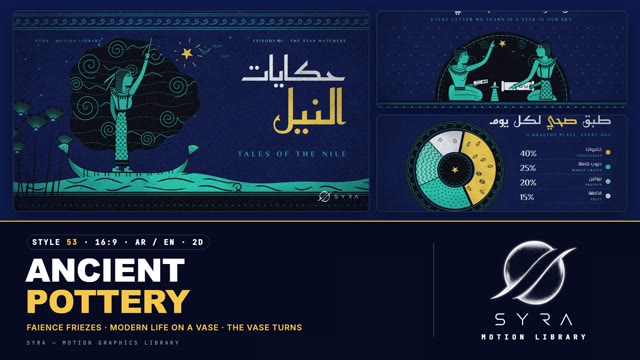

# 53 · Ancient Pottery

**SYRA Motion Library** · Style 53 · 16:9 · Arabic / English



<div dir="rtl">

> طريقة الاستخدام:
> انسخ البرومت ده كله وحطه لأي أداة AI أو لسكيل الـ animate، واملا الجزء الأخير ([VIDEO BRIEF]) بموضوع الفيديو.
> الستايل ده "الفخّار القديم" — 2D (SVG مرسوم من الصفر في كل فريم): الحكاية كأنها مرسومة على فازة مصرية من الفيانس واللازورد — شخصيات بروفايل بلونين وخطوط سوداء دقيقة، أشرطة زخارف (حلزونات، زجزاج، براعم لوتس)، نجوم سقف المقابر، وموج النيل. بيخلط التاريخ مع "الحياة العصرية على فازة قديمة": دكتورة، لاعب كورة، عامل توصيل، صياد، مبرمج، وأسرة.
> مناسب للتاريخ والحضارة، الحكايات، التعليم، والمحتوى اليومي العصري بلمسة مصرية أصيلة.
> المرجع الأساسي للشكل والحركة هو ملف "source/index.html". بيشتغل بالعربي وبالإنجليزي. ممنوع اللون البني وكل درجاته — ومفيش تيراكوتا خالص رغم إنه فخّار: الألوان فيانس تركواز ولازورد كحلي وأبيض بورسلين وكوبالت.

</div>

## Files in this folder

| File | What it is |
|---|---|
| [source/index.html](source/index.html) | The motion itself — opens and plays in a browser; the source of truth |
| [sample.mp4](sample.mp4) | Showcase reel of the style |
| The info card at the top of this file | Tags & hashtags: what the style expresses, what it suits, search words |

## Tags

<div dir="auto">

النوع: 2D (رسم SVG)  
في سطر: حكاية مرسومة على فازة مصرية من الفيانس واللازورد — شخصيات بروفايل بلونين وخطوط سوداء وأشرطة زخارف حلزونية، تاريخ وحياة عصرية في نفس الفريز.  
In one line: A story painted on an Egyptian faience-and-lapis vase — two-tone profile figures, black line work and spiral pattern bands, mixing history with modern everyday life.  
#عربي: #تاريخ #حضارة_مصرية #فراعنة #حكايات #قصص #تعليمي #فخار #زخارف #النيل #تراث #حياة_يومية #مصر #شرح #بيانات #ثقافة #أسرة #رياضة #صحة  
#English: #history #ancientegypt #pottery #storytelling #folklore #education #explainer #heritage #nile #pattern #flatillustration #egypt #culture #everydaylife #infographic #family #sport #health  
مناسب لـ: محتوى التاريخ والحضارة، الحكايات والقصص، الدروس التعليمية، المتاحف والتراث، الحياة اليومية بلمسة مصرية، محتوى ثقافي للمدارس، بيانات بسيطة بشكل فني  
Best for: history and heritage, storytelling, lessons for schools, museums and culture, everyday-life explainers with an Egyptian touch, simple data told artistically  
مش مناسب لـ: إعلانات تقنية لامعة، محتوى طبي دقيق محتاج تفاصيل تشريح، العلامات التجارية اللي محتاجة صور حقيقية  
Not for: glossy tech ads, detailed medical/anatomy content, brands that need real photos  
المزاج: أسطوري، دافي، حكائي، أصيل، هادي        Mood: mythic, storybook, authentic, warm-hearted, calm  
الإيقاع: متوسط        Pace: medium  

</div>

## Components

| # | Component |
|---|---|
| 01 | Title Tales Of The Nile |
| 02 | Data One City 24 Hours |
| 03 | Data Healthy Plate |
| 04 | Object Library In Your Pocket |
| 05 | Character Teacher And Girl |
| 06 | Team Makers Of Today |
| 07 | Story Night Programmer |
| 08 | Mentor Coach And Footballer |
| 09 | Three Steps Small Bakery |
| 10 | Big Number Nile 6650 |
| 11 | Timeline Clay To Code |
| 12 | Quote Ptahhotep Amphora |
| 13 | Before After Family Dinner |
| 14 | Map Egypt Nile Two Seas |
| 15 | Chapter Card Lower Third |
| 16 | End SYRA Lockup |
---

## ANCIENT POTTERY — MOTION GRAPHICS STYLE PROMPT (SYRA Motion Library · Style 53 · 16:9 · Arabic / English · 2D)

### Role

You are a senior motion designer producing motion graphics in the "Ancient Pottery" style of the SYRA Motion Library, on ANY topic, in Arabic OR English (or both). Match the reference exactly: the source of truth is "source/index.html" (all components, playable in a browser; click = pause, arrow keys = seek, #t=12.5 opens at a time).

### 1. Style identity

- One line: the story is painted on an Egyptian faience vase — flat two-tone profile figures with fine black line work, rhythmic pattern registers (running spirals, chevrons, lotus buds, dot bands), tomb-ceiling stars, Nile waves made of tapered strokes, black glaze masses with incised faience spirals, and an aged cool glaze grain over everything.
- Two sets: MAIN = lapis-navy ground with faience-turquoise figures (myth, night, story); CONTRAST = cool porcelain ground with cobalt figures and black lines (data, modern everyday life). Neighbouring scenes usually alternate.
- Content mix: history and myth (the star watcher, the scribe, Ptahhotep, pyramids) next to "modern life on an ancient vase" (doctor in hijab, footballer, delivery rider on a scooter, fisherman, programmer, coach, baker, family at dinner).
- Never: terracotta, orange, brown, sepia, beige, rosy skin; 3D shading; photos; gradients on figures.

### 2. Format & technical

- Canvas 1920×1080, 30 fps. One idea per scene, 4.6–4.8 s; scenes overlap 1.0 s for the signature transition.
- SVG + HTML + GSAP (HyperFrames): one paused timeline, deterministic (seeded randomness, no clocks), each scene's SVG is rebuilt from time every frame (pure function of t); DOM type only via fromTo.
- The glaze texture (mottle, fine grain, dark glaze pits, pale micro-speckles, vignette) is baked ONCE to PNG layers at load and laid over each scene — never live SVG noise filters (they were the main render cost).
- Build order: pattern registers unroll from the left → black masses / arches grow → figures slide or walk in → the gold accent pops → type wipes on. Full state by ~2.8 s, then a hold that keeps breathing.

### 3. Colour palette (use only these)

- Main: lapis #0E1A4A (deep #09123A, lifted #13235E) · faience #19B9B2 (light #5ED6CF, low #0F8F8A for far limbs).
- Contrast: porcelain #F2F4F8 (#DCE2EE second tone) · cobalt #2747C9 (low #1C349A).
- Line work and masses: black glaze #0A0A12. Eye whites porcelain. Elder hair: silver #C9D2E6.
- ONE precious accent: gold #F5C84B — once or twice per scene (a star, a ball, bread, one accent word).
- Glaze texture is cool (navy pits, pale cyan specks), never warm.

### 4. Typography (bilingual)

- Arabic display: Reem Kufi 400 (geometric Kufic, reads as inscribed); always word-spacing .18–.22em; heavier = bigger, never faux bold. Arabic reading lines and labels: El Messiri 500.
- English: El Messiri 600 caps, tracked wide (.2–.4 em) for subs and kickers; numbers El Messiri 700, Latin digits.
- One accent word per headline: gold on lapis, cobalt on porcelain. Kickers 20–22 px tracked caps (furniture); reading text ≥ 28 px. Never split Arabic into letters: whole words rise out of masks (headroom for dots and hamzas) or wipe in from the right with a 30 px drift.

### 5. Drawing language

- Figures: Egyptian profile (frontal almond eye with kohl, broad frontal shoulders), capsule limbs with a 3.2 px painted outline, open / fist / pinch hands; poses: stand, walk, kneel, cross-legged, seated, kick, ride. Wigs and modern hair: long, bob, short, crop, ponytail, hijab, cap, helmet, hard hat; glasses, moustache, earring. Modern clothes through the same kit: white coat + stethoscope, jersey + shorts, galabeya, tracksuit, hi-vis vest, trousers, apron.
- Skin is faience (on lapis) or cobalt (on porcelain) by design — two-tone pottery, no rosy skin. Figure scale ≥ .5.
- Text held by a mirrored figure is drawn in world space (never flipped).
- Patterns: running-spiral bands, chevrons, lotus-bud friezes, dot bands, cartouches with tie bars, tomb-ceiling star grids, black swirl clouds with incised spirals, wave fields of tapered strokes with curls, painted plates, amphorae.
- Depth only from layers (sky → black mass → figure → foreground papyrus → foot band), never from shading.
- Keep a calm or black base register under the corner logo.

### 6. Motion language + signature transition

- Smooth cut-out storybook motion: friezes unroll from the left with a rolled-scroll lip, cartouches pop with a soft back-ease, values and clocks count up, waves drift, spirals rotate slowly, boats bob and tilt ~1°, streamers flutter, flames flicker, stars twinkle; arms move on simple joint angles with a small anticipation (cast a net, kick, point, lift a tray); characters blink and look toward the gold accent. Camera: a slow push or pull on the art (1.03 → 1.0).
- Signature transition — THE VASE TURNS (1.0 s): every scene is one painted facet of the same vase. The vase rotates on its wheel: the outgoing frieze swings away to the right round the curve while the next comes round from the left (the Arabic reading direction), with a small anticipation and settle. The facets are shaded as one continuous cylinder (sides darken, a pale glaze highlight travels), a black running-spiral divider band rides the seam, and the vase's belly bulges slightly so no corner is ever empty. The corner logo switches white/black as the seam passes it. Echoes inside scenes: friezes and panels unroll, the amphora in the quote scene turns its pattern bands.

### 7. Branding

- SYRA logo only — plain white on lapis scenes, plain black on porcelain scenes; never tinted, never under a pattern.
- Corner logo: SYRA (mark + wordmark) bottom-right ~222×60 px, ~58 px right / 50 px bottom, plain fade; on a calm or black foot register.
- End: SYRA stacked logo alone, plain white, in the centre of a painted black plate whose running-spiral rim draws round; tagline «كل درس حكاية» / "Every lesson is a story".

### 8. Component library (in "pottery html.html"; ar = arabic example, en = english)

- **01** Star watcher in a papyrus boat «حكايات النيل» (AR)
- **02** Four-panel day frieze "One city, 24 hours" (EN)
- **03** Painted plate donut «طبق صحي لكل يوم» (AR)
- **04** Phone as the new scribe's tablet "A library in your pocket" (EN)
- **05** Scribe-teacher and girl under a night arch «كل حرف نتعلّمه نجمة في سمائنا» (AR)
- **06** Procession of four makers (programmer, engineer, farmer, potter) "The makers of today" (EN)
- **07** Night programmer, code curls into spirals «سطرًا بعد سطر نبني الغد» (AR)
- **08** Coach and young footballer "Every champion had a coach" (EN)
- **09** Three panels: idea / plan / open bakery «ثلاث خطوات لمشروعك» (AR)
- **10** Big number 6,650 km + felucca fisherman «طول نهر النيل» (AR)
- **11** Frieze timeline 3500 BC → today "From clay to code" (EN)
- **12** Ptahhotep on a turning amphora «لا أحد يولد حكيمًا» (AR)
- **13** Family dinner before → after "Screens off, stories on" (EN) 14 Egypt map on a plate panel «أرض النيل والبحرين» (AR)
- **15** Chapter 02 cartouche + lower third (pediatrician) (AR+EN)
- **16** SYRA end lockup on a painted plate (AR + EN)

### 9. Sound (if the video has sfx)

- Soft clay-pot taps and frame-drum hits on pops, a rolling wooden-wheel hush (pottery wheel) under the vase turn, ney and oud plucks, light riq, water and reed ambience in Nile scenes. Duck ~18–20 dB under VO.

### 10. Do / don't

- **DO** keep figures two-tone with black line work, frame scenes with pattern registers, use gold sparingly, mix history with modern everyday Egyptians, alternate lapis and porcelain sets, keep Arabic RTL in wipes and step order.
- **DON'T** use terracotta / orange / brown / beige / tan / sepia / ochre / cream anywhere, rosy skin, 3D shading, gradients on figures, live noise filters, text over busy pattern, tinted logos, generic cross-fades.

## [VIDEO BRIEF] — fill this in for each new video

```text
- Language: [ Arabic / English / both ]
- Topic / title: [ ... ]
- Voiceover file or script: [ path to WAV/MP3 or the text ]
- Length: [ e.g. 45 s ]
- Headlines and the accent word in each: [ ... ]
- Numbers / steps / content: [ ... ]
- Components to use (in order): [ e.g. 01, 05, 09, 16 ]
- Characters needed: [ ... ]
- Extra notes: [ ... ]
Output: 1920×1080, 30 fps MP4, same length as the voiceover, every visual timed to the word it illustrates,
SYRA corner logo, SYRA painted-plate ending.
```
