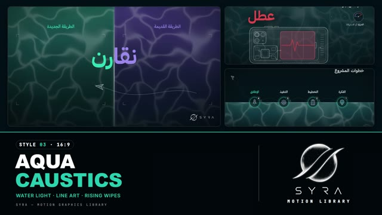

# 03 · Aqua Caustics

**SYRA Motion Library** · Style 03 · 16:9 · Arabic / English



<div dir="rtl">

> طريقة الاستخدام:
> انسخ البرومت ده كله وحطه لأي أداة AI أو لسكيل الـ animate، واملا الجزء الأخير ([VIDEO BRIEF]) بموضوع الفيديو.
> الستايل ده ينفع لأي محتوى (بيزنس، تقنية، استدامة، تعليم…). المرجع الأساسي للشكل والحركة هو ملف "source/index.html"،
>.

</div>

## Files in this folder

| File | What it is |
|---|---|
| [source/index.html](source/index.html) | The motion itself — opens and plays in a browser; the source of truth |
| [sample.mp4](sample.mp4) | Showcase reel of the style |
| The info card at the top of this file | Tags & hashtags: what the style expresses, what it suits, search words |

## Tags

<div dir="auto">

النوع: 2D رسم خطي (لاين آرت) على خلفية مية متحركة غامقة  
في سطر: سما ليل غامقة فوق سطح مية تركواز بانعكاسات ضوء بتتحرك، ورسومات بخط رفيع كريمي وكلمة عربي كبيرة طالعة من المية — هادي وعلمي وواضح.  
In one line: A calm, scientific night-water stage — glowing teal water with moving light caustics, thin cream line-art, and big Arabic key words rising from the surface.  
#عربي: #شرح #علمي #تعليمي #مقارنة #قبل_وبعد #تقنية #هندسة #طبي #صيانة #زراعة #استدامة #خطوات #رسم_خطي #هادي #وثائقي #فريق_عمل  
#English: #explainer #science #education #comparison #beforeafter #technology #engineering #medical #xray #cutaway #lineart #process #sustainability #calm #documentary #teal #water  
مناسب لـ: فيديو شرح علمي أو تقني خطوة بخطوة، مقارنة قديم/جديد أو قبل/بعد (بنفسجي ضد نعناعي)، شرح من جوه جهاز أو مبنى أو نبات (أشعة/قطاع)، أعطال وتحذيرات، توعية صحية أو زراعية هادية، تدريب موظفين وشرح نظام عمل  
Best for: step-by-step science/tech explainers, old-vs-new or before/after comparisons (violet vs mint), X-ray/cutaway views inside devices, buildings or plants, faults and warnings, calm health or farming awareness, staff training and process explainers  
مش مناسب لـ: إعلانات حماسية وعروض بيع، محتوى أطفال ملوّن وكرتوني، فيديو فخم احتفالي أو تراثي، أي حاجة محتاجة صور حقيقية أو ألوان مبهجة كتير  
Not for: hype ads and sales offers, colourful cartoon kids content, festive/luxury or heritage films, anything needing real photos or many bright colours  
المزاج: هادي، ذكي، واضح، علمي، وثائقي        Mood: calm, intelligent, clear, scientific, documentary  
الإيقاع: هادي        Pace: calm  

</div>

## Components

| # | Component |
|---|---|
| 01 | Title |
| 02 | Character |
| 03 | Key Word |
| 04 | Split Compare |
| 05 | Object |
| 06 | X-Ray |
| 07 | Dials |
| 08 | Sudden vs Gradual |
| 09 | Cards |
| 10 | Cross Section |
| 11 | Steps |
| 12 | Break Even |
| 13 | Team |
| 14 | Do Dont |
| 15 | Big Stat |
| 16 | Mixing |
| 17 | Key Sentence |
| 18 | End Logos |
---

## AQUA CAUSTICS — MOTION GRAPHICS STYLE PROMPT (SYRA Motion Library · Style 03 · 16:9)

### Role

You are a senior motion designer producing explainer motion graphics in the "Aqua Caustics" style of the SYRA Motion Library, on ANY topic. Match the reference exactly: the source of truth is "source/index.html" (all components, playable in a browser). The style is a drawing and motion language — never copy the reference's subject; draw the brief's own subject in this language.

### 1. Style identity

- One line: a calm, scientific, night-water stage — deep night sky above a glowing water surface, teal water below with soft moving light caustics — on which thin cream line-art illustrations, charts and big Arabic key words appear; two contrast colours (violet = before / old / from, mint = after / new / good) tell every comparison.
- Mood: clear, intelligent, calm, documentary-science. Explains ideas step by step.
- Never: flat cartoon colours, heavy outlines, busy textures, neon glow everywhere, hard cuts.

### 2. Format & technical

- Canvas 1920×1080, 30 fps. One idea per scene, 4.0–4.8 s each; scenes overlap 0.75 s for the transition.
- Built as HTML + GSAP (HyperFrames): one paused timeline, only fromTo / to / set, deterministic (seeded random), no CSS keyframes, no remote assets. Animate transforms, opacity, filter, stroke-dashoffset.
- The water texture is a seamless caustics tile (Worley-noise web, curved cells) in two layers that drift at different speeds and directions (screen blend, opacity .2 and .1).
- Keep the bottom-right corner empty for the corner logo.

### 3. Colour palette (use only these)

- Night sky ........ #031016 → #05161D
- Water ............ #1A4A50 (top) → #113740 → #081B21 (deep); surface line = cream with a mint-white glow
- Line art / text .. #EAF4F2 (cream), soft 55 %, faint 22 %; muted text #9FB3B5
- Violet ........... #9A8CF0, fill rgba(104,88,196,.62)  → before / old / the starting state
- Mint ............. #2ED6B0, fill rgba(46,214,176,.30)  → after / new / success / key highlight
- Red .............. #E5484D → warnings, faults, stress, "don't" only
- Split-screen waters: violet water #3A3570 → #121630, mint water #1C5752 → #08201F.

### 4. Typography

- Arabic: IBM Plex Sans Arabic — 700 for key words and titles, 600 for captions, 500 for labels.
- Sizes (1920×1080): key word 200 px · title 96–100 px · caption 56 px · sub-caption 40 px · kicker 30 px (muted) · labels 30 px · minimum 28 px.
- Latin digits for numbers and units (Inter 700).
- The running sentence lives TOP-RIGHT (kicker above, caption below), right-aligned — the style's signature.
- Key words: one huge word centred above the surface that rises out of the water; the important word of a caption is coloured mint (or violet / red by meaning).
- Arabic is RTL and revealed word by word (rise through a mask); never split into letters. Give words with tanween (ـاً) extra mask padding so the marks are not clipped.

### 5. Drawing language (how everything is drawn)

- Line art: cream strokes 1.5–2.5 px, round caps and joins, translucent fills only (cream 5–10 %, or the violet / mint fills); a few inner detail lines and dotted lines; glowing rings for eyes/lenses.
- Objects sit ON the water: half above, half below the surface; the submerged part is tinted.
- X-ray / cutaway: show the inside of things (devices, buildings, soil, machines) with internal parts and labelled leader lines.
- Charts: thin cream axes, violet vs mint lines, shaded gaps, travelling dots, value labels that count.
- Dials: round gauges with ticks and a mint needle that overshoots and settles.
- Cards: thin glass cards (1.5 px cream border at 28 %, faint gradient fill) with corner brackets for frames.
- Characters: minimal technical-illustration people — the same cream line, translucent fills, simple face (eye rings), no flat colours (see the character components once added).
- Ambient life: rising bubbles, floating line icons, a paper boat or paper plane, slow drift.

### 6. Motion language

- Tempo: calm and smooth. Entrances expo.out 0.9–1.4 s; draws power2.inOut 1.0–1.8 s.
- Line art draws on stroke by stroke; objects "surface" (rise 60–120 px from below with a blur that clears).
- Floating objects bob gently; bubbles rise and fade at the surface; the caustic light never stops moving.
- Camera: whole film pushes 1.00 → 1.025; each scene settles from 1.05–1.08 to 1.00.
- Signature transition (0.75 s): the water rises — a bright surface line with a mint glow sweeps from the bottom to the top and reveals the next scene beneath it, while the old one blurs slightly.

### 7. Branding

- SYRA logo only — plain white on dark scenes / black on light scenes, never tinted, no sheen or glow over it. Every Aqua scene is dark, so the logo is white.
- Corner logo: SYRA (mark + wordmark) BOTTOM-RIGHT, ~222 px wide, 58 px in, 50 px up, 95 % opacity, plain fade in; hidden during the ending.
- End: SYRA lockup alone — the stacked SYRA logo (~360 px) rises above the water out of a soft blur while ripple rings spread across the surface and bubbles rise, then settles with a gentle bob; the short Arabic line «نصنع المحتوى بوضوح» rises under it.

### 8. Component library (in "aqua html.html" — reuse their layouts on any topic)

- **01** Title over the water        two-line Arabic title, kicker, floating object on the surface, icons below.
- **02** Key word                    one huge word rising out of the water + coloured sub-caption.
- **03** Split comparison            violet half vs mint half, corner brackets, two-tone key word, object crossing.
- **04** Object on the surface       a line-art object half in the water lighting up + a dial under water.
- **05** X-ray / cutaway             inside of a device drawn stroke by stroke; one part turns red + red key word.
- **06** Dials                       three gauges with values counting.
- **07** Sudden vs gradual           step line (red flash) vs S-curve (mint) on a glass card.
- **08** Small multiples             five glass cards with icons and mini curves, dotted connectors, one highlighted.
- **09** Cross-section + meter       hatched section, growing subject, hand-held meter probe, callouts.
- **10** Steps on the surface        numbered nodes on the surface line, dotted arcs, bubbles, a plane takes off.
- **11** Two-line chart              falling violet vs rising mint, shaded gap, crossing point marked.
- **12** Do / don't cards            mint ✓ card vs red ✕ card with small illustrations.
- **13** Big stat                    huge number counting inside a progress ring, bubbles.
- **14** Mixing / merging            two sources pour into one container and blend; percentage counter.
- **15** Key sentence                two-line sentence + huge key word rising, paper boat on the surface.
- **16** End logos                   see Branding.
Characters  one person: a minimal line-art professional standing waist-deep, drawn line by line, blinks, lifts a tablet whose chart grows into a glass card; a group: four figures on the surface line with reflections, glass speech bubbles and a lightbulb lighting above them.

### 9. Layout rules

- Surface line usually between y 560 and 700; sky above for text, water below for objects and data.
- Arabic flows right-to-left: sequences, steps and lists run right to left.
- One main subject per scene, lots of dark space; nothing touches the frame edge except water and light.

### 10. Sound (if the video has sfx)

- Soft underwater ambience, gentle bubble pops, a low swell on each rising-water transition, light ticks on counters and dials, a soft chime on success, a low pulse on red warnings. Duck ~18–20 dB under VO.

### 11. Do / don't

- **DO** keep everything thin, calm and translucent; use violet → mint to show change; put the sentence top-right and the key word in the centre; draw the brief's own subject in this line language.
- **DON'T** copy the reference video's subject, use other colours, fill shapes with solid colour, add thick outlines or cartoon faces, or animate Arabic letter by letter.

## [VIDEO BRIEF] — fill this in for each new video

```text
- Topic / title: [ ... ]
- Voiceover file or script: [ path to WAV/MP3 or the text ]
- Length: [ e.g. 60 s ]
- Key ideas, numbers and comparisons (what is violet "before" vs mint "after"): [ ... ]
- Components to use (in order): [ e.g. 01, 03, 05, 10, 13, 16 ]
- Objects / people to draw in the line style: [ ... ]
- Extra notes: [ ... ]
Output: 1920×1080, 30 fps MP4, same length as the voiceover, every visual timed to the word it
illustrates, SYRA corner logo bottom-right, SYRA lockup ending.
```
