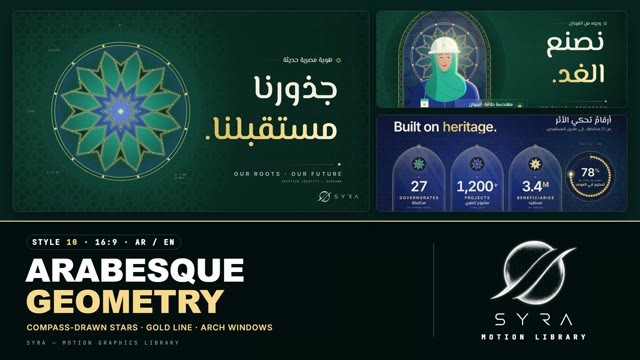

# 10 · Arabesque Geometry

**SYRA Motion Library** · Style 10 · 16:9 · Arabic / English



<div dir="rtl">

> طريقة الاستخدام:
> انسخ البرومت ده كله وحطه لأي أداة AI أو لسكيل الـ animate، واملا الجزء الأخير ([VIDEO BRIEF]) بموضوع الفيديو.
> الستايل ده "زخرفة هندسية إسلامية" بهوية مصرية حديثة — نجوم ونقوش بتترسم بالبرجل، خطوط دهبي على أخضر زمردي وكحلي، وشبابيك محاريب — مناسب للمشروعات القومية، التراث، المناسبات، والمحتوى الرسمي الفخم. بيشتغل بالعربي وبالإنجليزي.
> المرجع الأساسي للشكل والحركة هو ملف "source/index.html". ممنوع اللون البني — الدهبي لازم يفضل شمبانيا فاتح.

</div>

## Files in this folder

| File | What it is |
|---|---|
| [source/index.html](source/index.html) | The motion itself — opens and plays in a browser; the source of truth |
| [sample.mp4](sample.mp4) | Showcase reel of the style |
| The info card at the top of this file | Tags & hashtags: what the style expresses, what it suits, search words |

## Tags

<div dir="auto">

النوع: 2D زخارف هندسية إسلامية بتترسم بالبرجل + شخصيات فلات أنيقة — عربي وإنجليزي  
في سطر: نجوم ونقوش إسلامية بتترسم قدامك بالبرجل بخط دهبي شمبانيا على أخضر زمردي وكحلي، أرقام جوه شبابيك محاريب وفانوس منوّر — فخر وأصالة وفخامة بهوية مصرية حديثة.  
In one line: Islamic geometric star patterns drawn live with compass and ruler in champagne-gold line on emerald and midnight blue, data inside mihrab arches and a glowing fanous — proud, refined and luxurious.  
#عربي: #تراث #هوية_مصرية #زخرفة_إسلامية #أرابيسك #رمضان #مناسبات_دينية #مشروعات_قومية #حكومي #رسمي #فخم #إنجازات #حرف_يدوية #أعياد #أرقام #دهبي #أخضر_زمردي  
#English: #heritage #egyptianidentity #islamicgeometry #arabesque #ramadan #eid #religiousoccasions #nationalprojects #government #formal #luxury #achievements #crafts #culture #gold #emerald #ornament  
مناسب لـ: فيديوهات رمضان والأعياد والمناسبات الدينية، مشروعات قومية وإنجازات حكومية بأرقام، هوية وتراث وثقافة مصرية، حرف يدوية وحكايات صنايعية، مؤسسات رسمية وأوقاف وبنوك إسلامية، تهاني فخمة، خريطة مصر بالدهبي  
Best for: Ramadan, Eid and religious occasions, national projects and government achievements with numbers, Egyptian heritage, identity and culture, crafts and artisan stories, formal institutions, endowments and Islamic banking, premium greetings, gold maps of Egypt  
مش مناسب لـ: محتوى أطفال مرح، ديمو تطبيقات وتقنية عصرية سريعة، إعلانات حماسية أو شبابية، مواضيع طبية أو علمية بتفاصيل تقنية  
Not for: playful kids content, fast modern app/tech demos, hype or youth ads, technical medical or scientific explainers  
المزاج: فخور، راقي، فخم، أصيل، معاصر        Mood: proud, refined, luxurious, authentic, contemporary  
الإيقاع: هادي لمتوسط        Pace: calm to medium  

</div>

## Components

| # | Component |
|---|---|
| 01 | Title Rosette |
| 02 | Mihrab Data Panels |
| 03 | Tessellation Medallion |
| 04 | Rosette Progress Dial |
| 05 | Energy Engineer |
| 06 | Three Arches |
| 07 | Storyteller |
| 08 | Mentor |
| 09 | Map of Egypt |
| 10 | Star Bar Chart |
| 11 | Timeline |
| 12 | Three Steps |
| 13 | Before After |
| 14 | Lantern |
| 15 | Chapter Card |
| 16 | End Logos |
---

## ARABESQUE GEOMETRY — MOTION GRAPHICS STYLE PROMPT (SYRA Motion Library · Style 10 · 16:9 · Arabic / English)

### Role

You are a senior motion designer producing elegant, heritage-inspired motion graphics in the "Arabesque Geometry" style of the SYRA Motion Library, on ANY topic, in Arabic OR English (or both). Match the reference exactly: the source of truth is "source/index.html" (all components, playable in a browser).

### 1. Style identity

- One line: Islamic geometric star patterns (8/10/12/16-point rosettes, 4.8.8 and 3.12.12 tessellations, interlace bands) constructed live with compass and ruler — guide circles, pencil plan, gold ink, jewel-tone fills, a light sweep — framing modern ivory/gold typography, data inside mihrab arches, and dignified flat-illustrated people.
- Mood: proud, refined, luxurious, contemporary — "our roots, our future".
- Never: kitsch ornament overload, brownish gold, beige, random decoration without geometry.

### 2. Format & technical

- Canvas 1920×1080, 30 fps. One idea per scene, 4.2–4.8 s; scenes overlap 0.9 s for the star iris.
- HTML + GSAP (HyperFrames): one paused timeline, only fromTo / to / set, deterministic, no CSS keyframes.
- All patterns are generated mathematically (precise compass geometry) as SVG paths drawn with the dash trick.
- Something must be visible at the frame centre within 0.3 s (the iris opens from the centre).

### 3. Colour palette (use only these)

- Emerald stage ... #06231F → #0A3A33        - Midnight stage ... #0B1430 / #0E1A40
- Gold line ....... #E2B652 → #F6D98B gradient (bright champagne, never brownish)
- Jewel fills ..... turquoise #1FB5A8 · lapis #2E5BD8 · ivory #F3EEDF (low opacity in patterns)
- Text ............ ivory #F3EEDF, one gold accent word. The SYRA logo is never gold: plain white only.

### 4. Typography (bilingual)

- Arabic headlines: El Messiri 600/700 in ivory, ONE gold word. English headlines: Inter 600, gold accent word.
- Kickers: Inter caps with wide tracking (Arabic kickers: El Messiri / IBM Plex, no tracking) with a small star.
- Latin digits. Min 28 px. Never split Arabic into letters.

### 5. Drawing language

- Rosettes, tessellation fields, interlace bands, mihrab / arch windows with double gold borders and pearl beading, cartouches with pointed ends, segmented gold progress rings, 8-point star markers, a Fanous lantern.
- People: elegant flat illustration (hijab, hard hat, beard, glasses, galabeya), gold rim light, rosette halo behind.

### 6. Motion language

- construct(): guide circles sweep in → pencil plan → gold ink drawn element by element (with a compass arm) → jewel cells fill → outer ring → gold light sweep.
- Frames draw from the apex down both sides symmetrically; tessellations grow outward tile by tile from the centre.
- Numbers count with power2; text rises from masks; gold words get a sheen.
- Signature transition: an 8-point star iris opens from the frame centre with a gold rim; the old scene shrinks and dims behind it.

### 7. Branding

- SYRA logo only — plain white on dark scenes / black on light scenes, never tinted (never gold, no light sweep).
- Corner logo: SYRA (mark + wordmark) bottom-right ~222 px, plain white (every stage is dark).
- End: SYRA lockup alone (stacked logo, plain white) inside the geometric cartouche, unveiled like a compass circle opening; tagline «جذورٌ أصيلة، ومستقبلٌ نصنعه.» / "ROOTED IN HERITAGE · BUILDING TOMORROW".

### 8. Component library (in "arabesque html.html"; ar = arabic example, en = english)

- **01** Rosette title (AR)
- **02** Stats in mihrab arches (EN)
- **03** Tessellation + medallion (AR)
- **04** Rosette progress dial (EN)
- **05** Engineer in an arch (AR)
- **06** Three faces in three arches (EN)
- **07** Craftsman storyteller + quote (AR)
- **08** Mentor & student (EN)
- **09** Gold map of Egypt (AR)
- **10** Star-capped bar chart (AR)
- **11** Interlace timeline (EN)
- **12** Three steps in mihrabs (AR)
- **13** Fragments → form (EN)
- **14** Fanous lantern light (AR)
- **15** Chapter cartouche + lower third (AR+EN)
- **16** End: SYRA lockup (AR + EN)

### 9. Sound (if the video has sfx)

- Soft pencil/compass scratches during construction, delicate metallic chimes on gold sweeps, a deep warm string or oud pad, a gentle swell on the iris. Duck ~18–20 dB under VO.

### 10. Do / don't

- **DO** keep geometry precise, let construction tell the story, one gold word per headline, generous dark space.
- **DON'T** use brownish gold, beige, clutter, or random swirls that are not real geometric patterns.

## [VIDEO BRIEF] — fill this in for each new video

```text
- Language: [ Arabic / English / both ]
- Topic / title: [ ... ]
- Voiceover file or script: [ path to WAV/MP3 or the text ]
- Length: [ e.g. 60 s ]
- Headlines and the gold word in each: [ ... ]
- Numbers / places / milestones: [ ... ]
- Components to use (in order): [ e.g. 01, 02, 05, 09, 14, 16 ]
- People needed: [ ... ]
- Extra notes: [ ... ]
Output: 1920×1080, 30 fps MP4, same length as the voiceover, every visual timed to the word it illustrates,
SYRA corner logo, SYRA lockup ending.
```
