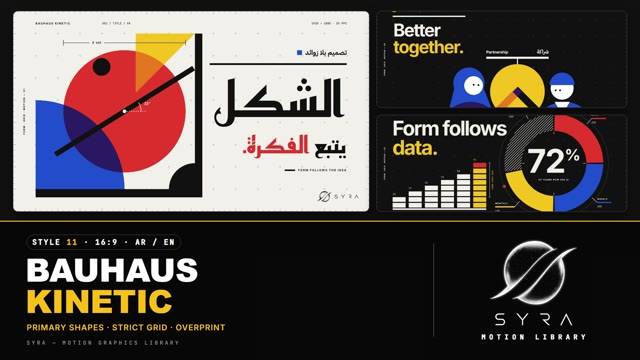

# 11 · Bauhaus Kinetic

**SYRA Motion Library** · Style 11 · 16:9 · Arabic / English



<div dir="rtl">

> طريقة الاستخدام:
> انسخ البرومت ده كله وحطه لأي أداة AI أو لسكيل الـ animate، واملا الجزء الأخير ([VIDEO BRIEF]) بموضوع الفيديو.
> الستايل ده "هندسي بسيط" على طريقة الباوهاوس — دواير ومربعات ومثلثات بألوان أساسية على شبكة صارمة — مناسب للشركات، التقارير، الهوية، والتعليم.
> المرجع الأساسي للشكل والحركة هو ملف "source/index.html". بيشتغل بالعربي وبالإنجليزي. ممنوع اللون البني.

</div>

## Files in this folder

| File | What it is |
|---|---|
| [source/index.html](source/index.html) | The motion itself — opens and plays in a browser; the source of truth |
| [sample.mp4](sample.mp4) | Showcase reel of the style |
| The info card at the top of this file | Tags & hashtags: what the style expresses, what it suits, search words |

## Tags

<div dir="auto">

النوع: 2D هندسي فلات (دواير ومربعات ومثلثات بألوان أساسية على شبكة صارمة) — عربي وإنجليزي  
في سطر: أشكال هندسية جريئة أحمر وأزرق وأصفر وأسود على شبكة دقيقة، بتتزحلق وتلف بزوايا مظبوطة، كلام كوفي هندسي ضخم وجنبه علامات قياس صغيرة — دقيق وذكي وواثق.  
In one line: Modern Bauhaus motion — bold red, blue, yellow and black primitives on a strict grid that snap and rotate by exact angles, huge geometric Kufi type beside tiny technical marks.  
#عربي: #هندسي #باوهاوس #أشكال_بسيطة #مينيمال #تصميم #هوية_بصرية #شركات #تقارير #بيانات #إنفوجرافيك #تعليم #عمارة #فن #جريء #ألوان_أساسية #ملصق  
#English: #bauhaus #geometric #constructivist #primaryshapes #minimal #design #branding #corporate #report #data #infographic #education #architecture #art #bold #primarycolours #poster  
مناسب لـ: تقارير وأرقام شركات بشكل عصري جريء، هوية بصرية وبراندنج، محتوى تصميم وعمارة وفنون، تعليم مفاهيم بشكل مبسّط، شراكات وفرق عمل، خريطة مصر مبسّطة، بوسترات كلام متحركة  
Best for: bold modern corporate reports and figures, brand identity, design/architecture/art content, simplified concept teaching, partnerships and teams, simplified map of Egypt, kinetic type posters  
مش مناسب لـ: محتوى عاطفي أو إنساني دافي، تراث وديني، أطفال صغيرين محتاجين كرتون طري، أي حاجة محتاجة صور حقيقية أو تدرجات وظلال ناعمة  
Not for: warm emotional/human stories, heritage or religious content, young kids needing soft cartoons, anything needing real photos, gradients or soft shadows  
المزاج: دقيق، واثق، ذكي، جريء، عصري        Mood: precise, confident, intelligent, bold, modern  
الإيقاع: متوسط لسريع (حركات سناب ميكانيكية)        Pace: medium to fast (snappy, mechanical)  

</div>

## Components

| # | Component |
|---|---|
| 01 | Title |
| 02 | Block Chart |
| 03 | KPI Modules |
| 04 | Timeline |
| 05 | Character |
| 06 | Team |
| 07 | Journey |
| 08 | Handshake |
| 09 | Steps |
| 10 | Big Number |
| 11 | Map |
| 12 | Order |
| 13 | Poster |
| 14 | Device |
| 15 | Chapter |
| 16 | End Logos |
---

## BAUHAUS KINETIC — MOTION GRAPHICS STYLE PROMPT (SYRA Motion Library · Style 11 · 16:9 · Arabic / English)

### Role

You are a senior motion designer producing motion graphics in the "Bauhaus Kinetic" style of the SYRA Motion Library, on ANY topic, in Arabic OR English (or both). Match the reference exactly: the source of truth is "source/index.html" (all components, playable in a browser).

### 1. Style identity

- One line: modern Bauhaus / constructivist motion — bold primary shapes (circles, half and quarter discs, triangles, squares, thick bars) composed on a strict 120 px grid, overprint colours where shapes overlap, huge type set against tiny technical microcopy (dimension lines, angle marks, mono labels, grid crosses, edge rulers).
- Mood: precise, confident, intelligent — "form follows the idea".
- Never: gradients, soft shadows, rounded corporate cards, brown/beige.

### 2. Format & technical

- Canvas 1920×1080, 30 fps. One idea per scene, 4.2–4.8 s; scenes overlap 0.8 s for the signature transition.
- HTML + GSAP (HyperFrames): one paused timeline, only fromTo / to / set, deterministic (seeded randomness), no CSS keyframes, no remote assets. Hold the full state for the last ~1 s of every scene before the transition.

### 3. Colour palette (use only these)

- Paper #F2F0EA (neutral) or black #111111 stages
- Signal red #E63B2E · cobalt #1F4FD1 · yellow #F4C21B · black #111 · white
- Overprints: red×blue #2B1C66 · red×yellow #EE7A1E (drawn as clipped shapes, never blend modes)

### 4. Typography (bilingual)

- Arabic display: Reem Kufi 700 (geometric Kufi), line-height ~1.4. Small Arabic labels: IBM Plex Sans Arabic.
- English: Inter 700 tight (−0.03em); uppercase mono kickers (JetBrains Mono). One accent-coloured word per headline.
- Latin digits in both languages. Min 28 px for reading text. Never split Arabic into letters.

### 5. Drawing language

- Everything is a primitive: shapes, bars, arcs, block-stacked bar charts, quarter-arc donuts, rule-and-tick timelines.
- Characters are built from primitives (circle head, flared hijab drape, half-disc body, bar arms, dot eyes, no mouth) — stylish, never childish.
- Frame marks: grid crosses, edge rulers, a top label row, a rotated side label, a frame code.

### 6. Motion language

- Shapes slide on the grid with SNAP (power4.inOut), grow from a corner, extend bars, rotate by EXACT angles (32°, 45°, 90°), step in whole grid cells; small mechanical overshoot (back.out 1.35).
- Numbers use stepped tickers / per-frame counters; text wipes or rises from masks.
- Characters move pose to pose with exact rotations; walks are stepped.
- Signature transition: shapeWipe — alternating IRIS (three concentric discs burst from a grid corner) and BARS (a wide colour bar + a narrow one + an ink bar slide across), colours rotating red/blue → yellow/red → blue/yellow.

### 7. Branding

- SYRA logo only — plain white on dark scenes / black on light scenes, never tinted.
- Corner logo: SYRA (mark + wordmark) bottom-right ~222 px — black on paper, white on black.
- End: SYRA lockup alone (stacked logo, plain black) rising in hard steps out of an ink rule above the primitive skyline, + the tagline «أشكال بسيطة، أفكار واضحة.» / "Simple shapes. Clear ideas.".

### 8. Component library (in "bauhaus html.html"; ar = arabic example, en = english)

- **01** Geometric title (AR)
- **02** Block chart + donut (EN)
- **03** KPI modules in shapes (AR)
- **04** Rule timeline (EN)
- **05** Character + diagram (AR)
- **06** Team lineup (EN)
- **07** Stepped walk journey (AR)
- **08** Handshake (EN)
- **09** Three steps (AR)
- **10** Big number poster (AR)
- **11** Geometric map of Egypt (AR)
- **12** Chaos → order (EN)
- **13** Kinetic type poster (EN)
- **14** Phone from primitives (AR)
- **15** Chapter card + lower third (AR+EN)
- **16** End: SYRA lockup (AR + EN)

### 9. Sound (if the video has sfx)

- Crisp mechanical clicks on grid steps, a dry thunk when shapes land, a short tonal sweep on wipes, minimal synth bed. Duck ~18–20 dB under VO.

### 10. Do / don't

- **DO** keep to the grid, use exact angles, one accent word, overprints where shapes overlap.
- **DON'T** use gradients, blur, soft shadows, brown/beige, or more than 5 colours.

## [VIDEO BRIEF] — fill this in for each new video

```text
- Language: [ Arabic / English / both ]
- Topic / title: [ ... ]
- Voiceover file or script: [ path to WAV/MP3 or the text ]
- Length: [ e.g. 45 s ]
- Headlines and the accent word in each: [ ... ]
- Numbers / steps / content: [ ... ]
- Components to use (in order): [ e.g. 01, 05, 09, 16 ]
- Characters needed: [ ... ]
- Extra notes: [ ... ]
Output: 1920×1080, 30 fps MP4, same length as the voiceover, every visual timed to the word it illustrates,
SYRA corner logo, SYRA lockup ending.
```
