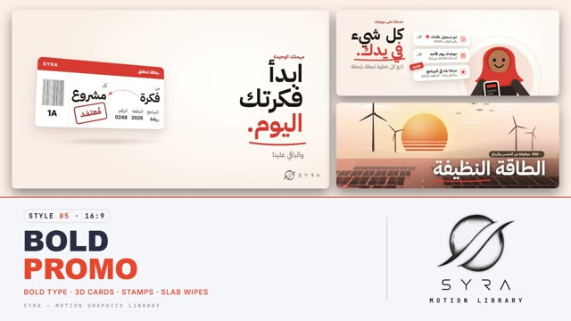

# 05 · Bold Promo

**SYRA Motion Library** · Style 05 · 16:9 · Arabic / English



<div dir="rtl">

> طريقة الاستخدام:
> انسخ البرومت ده كله وحطه لأي أداة AI أو لسكيل الـ animate، واملا الجزء الأخير ([VIDEO BRIEF]) بموضوع الفيديو.
> الستايل ده ينفع لأي محتوى (إعلان خدمة، برنامج، مشروع، تقرير إنجازات). المرجع الأساسي للشكل والحركة هو ملف "source/index.html".

</div>

## Files in this folder

| File | What it is |
|---|---|
| [source/index.html](source/index.html) | The motion itself — opens and plays in a browser; the source of truth |
| [sample.mp4](sample.mp4) | Showcase reel of the style |
| The info card at the top of this file | Tags & hashtags: what the style expresses, what it suits, search words |

## Tags

<div dir="auto">

النوع: 2D فلات (كروت UI بميلة 3D خفيفة + رسوم فيكتور وشخصيات فلات)  
في سطر: إعلان واثق وسريع — مشاهد كريمي فاتح بتتبادل مع خلفية أحمر كاملة، عناوين عربي ضخمة آخر كلمة فيها حمرا بخط تحتها، كروت بيضا بتلف وأختام بتخبط عليها.  
In one line: A confident, fast product-promo film — light cream scenes alternating with a full brand-red field, huge Arabic headlines with a red underlined last word, white UI cards that swing in and rubber stamps that slam.  
#عربي: #إعلان #بروموشن #إطلاق_خدمة #عروض #باقات #خدمات #تطبيق #شركات #ستارت_أب #تسويق #أحمر #عناوين_قوية #خريطة_مصر #إنجازات #حماسي #تفاؤل  
#English: #promo #advertising #servicelaunch #productlaunch #offer #pricing #plans #marketing #startup #business #app #red #boldtype #stamps #flatillustration #egyptmap #energetic  
مناسب لـ: إعلان إطلاق خدمة أو برنامج أو تطبيق، عروض وباقات وأسعار، فيديو تسويقي لشركة أو مبادرة، تقرير إنجازات بأرقام وخريطة انتشار، خطوات الاشتراك في تلات خطوات، آراء العملاء، قطاعات (طاقة، تعليم، مدن)  
Best for: service/program/app launch ads, offers, plans and pricing, marketing films for companies or initiatives, achievement reports with numbers and a coverage map, three-step sign-up flows, customer testimonials, sector spotlights (energy, education, cities)  
مش مناسب لـ: محتوى هادي أو حزين أو طبي حساس، فيديو فخم رسمي بإحساس سينمائي، شرح علمي عميق، أي حاجة محتاجة صور حقيقية أو ألوان أزرق/أخضر  
Not for: calm, sad or sensitive medical content, cinematic luxury/formal films, deep scientific explanations, anything needing real photos or blue/green colours  
المزاج: واثق، سريع، متفائل، موثوق، مباشر        Mood: confident, fast, optimistic, trustworthy, direct  
الإيقاع: سريع        Pace: fast  

</div>

## Components

| # | Component |
|---|---|
| 01 | Headline Card |
| 02 | Word Swap |
| 03 | Hero Checklist |
| 04 | Sector Energy |
| 05 | Sector Education |
| 06 | Triptych |
| 07 | Big Stat |
| 08 | Character Phone |
| 09 | Group Ratings |
| 10 | Before After |
| 11 | Three Steps |
| 12 | Offer Plans |
| 13 | Testimonial |
| 14 | Route Map |
| 15 | Dashboard |
| 16 | End Logos |
---

## BOLD PROMO — MOTION GRAPHICS STYLE PROMPT (SYRA Motion Library · Style 05 · 16:9)

### Role

You are a senior motion designer producing premium promo / service-launch motion graphics in the "Bold Promo" style of the SYRA Motion Library, on ANY topic. Match the reference exactly: the source of truth is "source/index.html" (all components, playable in a browser).

### 1. Style identity

- One line: a confident product-promo film — warm cream stages with a faint dot grid alternating with a full brand-red colour field, huge bold Arabic headlines whose last word is red (gold on the red field) with a hand-drawn underline, crisp white UI cards that swing in with a 3D tilt, rubber stamps that slam onto them, words that come out of a blur and swap, a small paper plane flying dotted paths, rich flat illustrations for the "big picture" moments, and a red diagonal slab wipe between scenes.
- Mood: clear, fast, optimistic, trustworthy — "you start, we handle the rest".
- Never: photos, blue/green palettes, glossy 3D, clutter, slow floaty fades.

### 2. Format & technical

- Canvas 1920×1080, 30 fps. One idea per scene, 3.8–4.8 s; scenes overlap 0.5 s for the transition.
- Built as HTML + GSAP (HyperFrames): one paused timeline, only fromTo / to / set, deterministic, no CSS keyframes, no remote assets.
- Each scene has a gentle camera push (scale 1.03 → 1). Full state by ~2.8 s, then hold.

### 3. Colour palette (use only these)

- Cream stage ... #FFF8F2 (glow #FFFFFF, edge #FBEFE6), faint warm dot grid every 44 px
- Brand red ..... #E5482E (field centre #F05A3F, edge #C3361F); red text on white #B8321C
- Gold .......... #F2B23A — accent on the red field only (highlight word, stars, pills)
- Ink ........... #1A1412 (headlines), soft text #6F625A, lines #EFE2D8
- Cards ......... #FFFFFF, radius 28, soft warm shadow
- Illustration tints: #F6C9BD #FBE3DA #FFE7B3 + the colours above. Skies cream→peach, land tan/terracotta.

### 4. Typography

- Headlines: IBM Plex Sans Arabic 700 — 170 / 150 / 120 / 84 px; small red kicker above (30 px); grey sub line under (44 px). Pattern: 2–3 words, last word highlighted + hand-drawn underline.
- Numbers: Inter 700–800, Latin digits, tabular. Labels: IBM Plex Sans Arabic 600, min 28 px.
- Arabic RTL; animate whole words, never split letters.

### 5. Drawing language

- UI cards: white, rounded, real-looking content (ticket, status card, plans, dashboard, notifications), red header strips, pills that flip from grey "in progress" to red "done ✓".
- Stamps: rounded-rect outline in red text colour, rotated -12°, slam in with a 2-frame shake.
- Paper plane: small, white on red / red on cream, always flying a dotted path that it draws.
- Illustrations: flat vector, layered with parallax, gradients and small details (sun, solar panels, turbines, campus, skyline); one strong red element each.
- Characters: friendly flat people — round heads, simple hair (hijab, short hair, beard), dot eyes, small smile, warm skin tones, clothes in red / ink / cream tints; simple poses with anticipation and settle.

### 6. Motion language

- Headline words rise from masks, staggered 0.1 s; the underline draws after the last word.
- Statement words come out of a blur (blur 14 → 0, y 50 → 0) and leave the same way when swapped; the highlight box grows from the right and the word turns red inside it.
- Cards swing in from a 3D tilt (rotateY 70° → 16°) and keep a small float; stamps slam last.
- Status cards cycle with quick blur swaps; progress dots fill; counters roll with expo.out.
- Signature transition: a red slab with a gold trailing edge sweeps right → left on a -14° diagonal; the scenes swap while it covers the frame and the new scene settles from scale 1.06.
- Ending: a red dot pops, sends a ring ripple, shrinks, and bursts open into the SYRA logo, which springs out of it.

### 7. Branding

- SYRA logo only — plain white on dark scenes / black on light scenes, never tinted (never red), no sheen or glow over it.
- Corner logo: SYRA (mark + wordmark) bottom-right, ~222 px: black on cream scenes, white on the red field, plain fade in.
- End: SYRA lockup alone (stacked logo, black, ~330 px, centred) + the tagline «أنت تبدأ. والباقي علينا.» and sector pills.

### 8. Component library (in "promo html.html" — reuse their layouts on any topic)

- **01** Headline + 3D card + stamp
- **02** Red field word swap + orbit
- **03** Hero object + status checklist
- **04** Sector illustration (energy)
- **05** Sector illustration (campus)
- **06** Triptych + counters
- **07** Big stat on red
- **08** Character with phone + notifications
- **09** Group of people + ratings
- **10** Before / after cards
- **11** Three steps + plane path
- **12** Plans / offer cards + stamp
- **13** Testimonial card
- **14** Map with pins + route
- **15** Dashboard card + line chart
- **16** End logos

### 9. Sound (if the video has sfx)

- Whoosh on each slab wipe, soft pops for cards, a dry "thunk" on stamps, light ticks on counters and checks, a small jet swish for the plane, a bright chime on the logo. Duck ~18–20 dB under VO.

### 10. Do / don't

- **DO** alternate cream and red scenes; keep one highlighted word per headline; make every card look real.
- **DON'T** use photos, blue or green, more than one stamp per scene, or text under 28 px.

## [VIDEO BRIEF] — fill this in for each new video

```text
- Topic / title: [ ... ]
- Voiceover file or script: [ path to WAV/MP3 or the text ]
- Length: [ e.g. 45 s ]
- Headlines and the highlighted word in each: [ ... ]
- Numbers / steps / cards content: [ ... ]
- Components to use (in order): [ e.g. 01, 03, 07, 11, 15, 16 ]
- Characters needed: [ ... ]
- Extra notes: [ ... ]
Output: 1920×1080, 30 fps MP4, same length as the voiceover, every visual timed to the word it
illustrates, SYRA corner logo, SYRA lockup ending.
```
