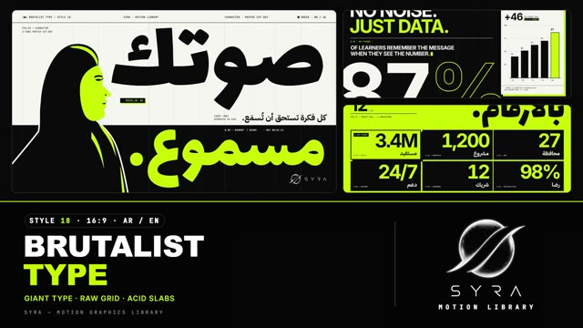

# 18 · Brutalist Type

**SYRA Motion Library** · Style 18 · 16:9 · Arabic / English



<div dir="rtl">

> طريقة الاستخدام:
> انسخ البرومت ده كله وحطه لأي أداة AI أو لسكيل الـ animate، واملا الجزء الأخير ([VIDEO BRIEF]) بموضوع الفيديو.
> الستايل ده "كلام تقيل" — الكلمة هي الصورة: كلمات عملاقة بتخبط وتقف مرة واحدة، جريد واضح، أبيض وأسود ولون أخضر فسفوري واحد — مناسب للحملات، البيانات، المانيفستو، الأخبار، والرسايل الجريئة.
> المرجع الأساسي للشكل والحركة هو ملف "source/index.html". بيشتغل بالعربي وبالإنجليزي. ممنوع اللون البني.

</div>

## Files in this folder

| File | What it is |
|---|---|
| [source/index.html](source/index.html) | The motion itself — opens and plays in a browser; the source of truth |
| [sample.mp4](sample.mp4) | Showcase reel of the style |
| The info card at the top of this file | Tags & hashtags: what the style expresses, what it suits, search words |

## Tags

<div dir="auto">

النوع: 2D (كاينتك تايبوجرافي — الكلمة هي الصورة)  
في سطر: كلمات عملاقة بتخبط وتقف مرة واحدة على جريد واضح، أسود وأبيض ولون أخضر فسفوري واحد، بلوكات حادة وبدون أي زينة — جريء ومباشر وواثق.  
In one line: Giant kinetic words slam in and stop dead on a visible grid — black, off-white and one acid-green accent, raw blocks and hard shadows, zero decoration; bold, direct, confident.  
#عربي: #تايبوجرافي #كلام_متحرك #حملات #مانيفستو #أخبار #بيانات #أرقام #جريء #مباشر #تحريري #أبيض_وأسود #فسفوري #رسالة_قوية #إعلان #سوشيال_ميديا #بوستر #شبابي  
#English: #typography #kinetictype #brutalist #editorial #campaign #manifesto #news #data #statistics #bold #direct #blackandwhite #acidgreen #swissdesign #poster #socialmedia #statement #grid  
مناسب لـ: حملات توعية ورسايل قوية، مانيفستو وقيم شركة، أخبار وتقارير سريعة، حائط أرقام وإحصائيات، بوستات سوشيال ميديا وريلز بالكلام، إطلاق براند جريء أو مبادرة شبابية، اقتباسات وتصريحات  
Best for: awareness campaigns and strong statements, manifestos and company values, fast news/reports, stat walls and statistics, text-led social posts and reels, bold brand or youth initiative launches, quotes and declarations  
مش مناسب لـ: قصص أطفال أو محتوى طفولي، حكايات عاطفية ناعمة، شرح منتج 3D أو مكان محتاج صور ومشاهد، مواضيع محتاجة شخصيات كتير بتتحرك  
Not for: kids' stories or childish content, soft emotional tales, 3D product or place explainers needing scenery, topics needing many animated characters  
المزاج: جريء، مباشر، واثق، حاد، صريح        Mood: bold, direct, confident, sharp, blunt  
الإيقاع: سريع وحماسي        Pace: fast  

</div>

## Components

| # | Component |
|---|---|
| 01 | Title |
| 02 | Data Spread |
| 03 | Manifesto |
| 04 | Counter |
| 05 | Voice Character |
| 06 | Team Lineup |
| 07 | Pull Quote |
| 08 | Crowd One In A Million |
| 09 | Steps |
| 10 | Before After |
| 11 | Timeline |
| 12 | Stat Wall |
| 13 | Headline Swap |
| 14 | Map North South |
| 15 | Chapter Lower Third |
| 16 | End Logos |
---

## BRUTALIST TYPE — MOTION GRAPHICS STYLE PROMPT (SYRA Motion Library · Style 18 · 16:9 · Arabic / English)

### Role

You are a senior motion designer producing motion graphics in the "Brutalist Type" style of the SYRA Motion Library, on ANY topic, in Arabic OR English (or both). Match the reference exactly: the source of truth is "source/index.html" (all components, playable in a browser).

### 1. Style identity

- One line: neo-brutalist / Swiss-editorial kinetic typography — TYPE IS THE IMAGE: gigantic words bleeding off the frame, tight leading, stacked and cropped lines, a visible 12-column grid with hairlines, mono metadata and index numbers, outline-only echoes, marquee strips, raw blocks with hard borders and hard offset shadows.
- Mood: bold, direct, confident — "no noise. just the message."
- Never: soft fades, blur, floating, bouncy springs, gradients, circle/triangle shape compositions.

### 2. Format & technical

- Canvas 1920×1080, 30 fps. One idea per scene, 4.2–4.8 s; scenes overlap 0.75 s for the signature transition.
- HTML + GSAP (HyperFrames): one paused timeline, only fromTo / to / set, deterministic (seeded randomness), no CSS keyframes, no remote assets, seek-safe counters. Hold the full state for the last ~1 s of every scene before the transition.

### 3. Colour palette (use only these)

- Paper #F4F4F0 (off-white) · ink #0A0A0A · acid #C6FF00 (the ONE accent) · red #FF3B1F (signal — one tiny thing per scene at most: a full stop, a square)
- Stages: paper, black, acid. Acid as text only on black; on paper put an acid block behind black type. No gradients.

### 4. Typography (bilingual)

- Arabic display: Lalezar (giant, line-height 1). Arabic sub lines / labels: IBM Plex Sans Arabic 700. English: Inter 700, −0.05 em, line-height .86 (giant = 300–600 px). Metadata: JetBrains Mono caps, always English (the "system" layer).
- One acid accent word per scene; outline-only duplicates (4 px stroke) as echoes. Arabic as big as the English.
- Latin digits in both languages. Min 28 px for reading text. Never split Arabic into letters.

### 5. Drawing language

- 12-column hairline grid + header band (4 mono labels, index with a signal square, 2 px rule); giant index numbers "01"; raw ink / acid / paper / red blocks, 3 px borders, 12 px hard shadows, mono chips, marquees, bar panels.
- People are 2-tone poster cut-outs: profile busts (hijab, man) — flat black silhouette, acid face plane, black features, acid rim highlights, paper cut-out outline; no skin tones, no smiles, framed by giant type.

### 6. Motion language

- Editorial punch: giant words slam in from off-frame and stop dead (the frame jolts on impact), outline echoes shoot out as a trail, blocks extend from an edge, clip crops slide, words hard-cut on the beat, labels tick on like a typewriter, marquees scroll, words re-lay-out on the grid, raw blocks lift as their hard shadow grows, counters roll.
- Signature transition: slabCut — three full-width slabs (ink / acid / ink) slam in from alternating sides, or the frame splits into 12 grid-column slabs that drop; the scenes swap on a hard cut under full cover, then the slabs leave.

### 7. Branding

- SYRA logo only — plain white on dark scenes / black on light scenes, never tinted (never acid, never red).
- Corner logo: SYRA (mark + wordmark) bottom-right ~222 px — white on black stages, black on paper / acid; keep its corner in stage colour.
- End: SYRA lockup alone (mark above wordmark, flat white) in one block-wiped grid cell, with the tagline around it «بلا ضوضاء. فقط الرسالة.» / "NO NOISE. JUST THE MESSAGE.".

### 8. Component library (in "brutal html.html"; ar = arabic example, en = english)

- **01** «قول الحقيقة.» title + echoes (AR)
- **02** NO NOISE. JUST DATA. spread (EN)
- **03** Four-rule manifesto (AR)
- **04** Counter to 1,000,000 (EN)
- **05** Poster character «صوتك مسموع» (AR)
- **06** Team lineup MAKE / THINK / BUILD / LEAD (EN)
- **07** Pull quote (AR)
- **08** ONE IN A MILLION. crowd (EN)
- **09** Three steps فكّر / ابنِ / أطلق (AR)
- **10** Before / after split (AR)
- **11** Timeline 2015 → 2026 (EN)
- **12** Stat wall «بالأرقام» (AR)
- **13** Headline swap THINK. BUILD. SHIP. (EN)
- **14** Map north to south (AR)
- **15** Chapter card + lower third (AR+EN)
- **16** End SYRA lockup + marquees (AR + EN)

### 9. Sound (if the video has sfx)

- Hard impacts on every slam, typewriter ticks, sharp cuts on the beat, a punchy minimal electronic beat. Duck ~18–20 dB under VO.

### 10. Do / don't

- **DO** let giant type dominate and bleed off an edge, stop dead on the beat, keep grid discipline, one acid accent.
- **DON'T** use brown/beige/tan/sand/wood/gold/olive tones, gradients, soft fades, blur, floating, or centred "slide" layouts.

## [VIDEO BRIEF] — fill this in for each new video

```text
- Language: [ Arabic / English / both ]
- Topic / title: [ ... ]
- Voiceover file or script: [ path to WAV/MP3 or the text ]
- Length: [ e.g. 45 s ]
- Headlines and the accent word in each: [ ... ]
- Numbers / steps / content: [ ... ]
- Components to use (in order): [ e.g. 01, 05, 09, 16 ]
- Characters needed: [ ... ]
- Extra notes: [ ... ]
Output: 1920×1080, 30 fps MP4, same length as the voiceover, every visual timed to the word it illustrates,
SYRA corner logo, SYRA logo ending.
```
