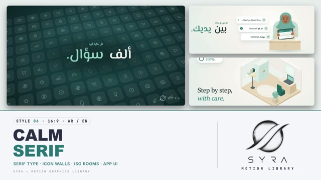

# 06 · Calm Serif

**SYRA Motion Library** · Style 06 · 16:9 · Arabic / English



<div dir="rtl">

> طريقة الاستخدام:
> انسخ البرومت ده كله وحطه لأي أداة AI أو لسكيل الـ animate، واملا الجزء الأخير ([VIDEO BRIEF]) بموضوع الفيديو.
> الستايل ده بيشتغل بالعربي وبالإنجليزي (الاتنين موجودين في الأمثلة). المرجع الأساسي للشكل والحركة هو ملف "source/index.html".
> ملحوظة الخطوط: العناوين العربي بخط El Messiri (موجود في _system\brand\fonts ومدمج جوه ملف الـ HTML)، والإنجليزي بخط Sitka Display الموجود في ويندوز — فالإنجليزي يبان صح على ويندوز.

</div>

## Files in this folder

| File | What it is |
|---|---|
| [source/index.html](source/index.html) | The motion itself — opens and plays in a browser; the source of truth |
| [sample.mp4](sample.mp4) | Showcase reel of the style |
| The info card at the top of this file | Tags & hashtags: what the style expresses, what it suits, search words |

## Tags

<div dir="auto">

النوع: 2D فلات ناعم + أيزومتريك (غرف ومباني مجسّمة خفيفة) + واجهات تطبيق — عربي وإنجليزي  
في سطر: فيلم منتج هادي وأنيق — خلفيات لؤلؤي فاتحة بلمسة نعناعي ومشهد تيل غامق، عناوين بخط سيريف راقي وكلمة واحدة تيل، كروت وشيبس بيضا وغرف أيزومتريك بتتملي بهدوء.  
In one line: A calm, elegant product film — soft pearl stages with a mint haze and one deep-teal stage, refined serif headlines with one teal accent word, white chips and cards, and isometric rooms that fill up gently.  
#عربي: #هادي #أنيق #تنظيم #تطبيق #خدمات #منصة_رقمية #عيادة #صحة #تعليم #موارد_بشرية #عربي_وإنجليزي #أيزومتريك #مريح #ثقة #خطوات #آراء_العملاء  
#English: #calm #elegant #serif #organised #app #services #digitalplatform #healthcare #clinic #education #hr #bilingual #isometric #reassuring #trust #steps #testimonial  
مناسب لـ: إعلان هادي لتطبيق أو منصة خدمات، خدمات صحية أو عيادة أو تأمين بإحساس مطمّن، تنظيم مهام ومواعيد ومستندات، تعليم وجامعات وسكن طلبة، فيديو بلغتين عربي وإنجليزي، شرح خطوات بهدوء، آراء عملاء وتقييمات  
Best for: calm app or service-platform promos, reassuring healthcare/clinic/insurance services, organising tasks, appointments and documents, education, campuses and housing, bilingual Arabic-English videos, gentle step-by-step explainers, customer testimonials  
مش مناسب لـ: الإعلانات الحماسية والعروض الصارخة، أطفال وكرتون مبهج، رياضة وجيمنج، أي حاجة محتاجة ألوان قوية (أحمر/بنفسجي) أو صور حقيقية  
Not for: loud hype ads and shouty sales, bright cartoon kids content, sports and gaming, anything needing strong colours (red/purple) or real photos  
المزاج: مطمّن، منظّم، رقيق، راقي، هادي        Mood: reassuring, organised, gentle, premium, calm  
الإيقاع: هادي        Pace: calm  

</div>

## Components

| # | Component |
|---|---|
| 01 | Icon Wall |
| 02 | Chips |
| 03 | Phone Tags |
| 04 | Smart Sort |
| 05 | Iso Room |
| 06 | Iso Block |
| 07 | Big Stat |
| 08 | Character Tablet |
| 09 | Team |
| 10 | Before After |
| 11 | Timeline |
| 12 | Chart |
| 13 | Quote |
| 14 | Checklist |
| 15 | Bilingual Title |
| 16 | End Logos |
---

## CALM SERIF — MOTION GRAPHICS STYLE PROMPT (SYRA Motion Library · Style 06 · 16:9 · Arabic / English)

### Role

You are a senior motion designer producing calm, premium app / service promo motion graphics in the "Calm Serif" style of the SYRA Motion Library, on ANY topic, in Arabic OR English (or both). Match the reference exactly: the source of truth is "source/index.html" (all components, playable in a browser).

### 1. Style identity

- One line: a calm, elegant product film — soft pearl stages with a mint haze and one deep-teal dark stage, refined SERIF headlines with one italic teal word, white rounded tiles / chips / cards with soft shadows, thin line icons, a phone mockup with app UI, dotted connectors with a travelling dot, soft isometric dioramas that fill up while a progress ring counts, words that melt out of a blur and swap, and a soft zoom-blur dissolve.
- Mood: reassuring, organised, gentle, premium — "everything in its place".
- Never: loud colours, bouncy cartoon motion, heavy sans headlines, purple, red, photos or 3D renders.

### 2. Format & technical

- Canvas 1920×1080, 30 fps. One idea per scene, 4.2–4.8 s; scenes overlap 0.6 s for the dissolve.
- Built as HTML + GSAP (HyperFrames): one paused timeline, only fromTo / to / set, deterministic, no CSS keyframes, no remote assets. Each scene has a gentle push (scale 1.02 → 1). Full state by ~2.8 s, then hold with a slow drift or float.

### 3. Colour palette (use only these)

- Pearl stage ... #F4F2ED (glow #FFFFFF, edge #E7EDEA)      - Deep teal stage ... #12343A (glow #22585E)
- Ink ........... #15292D, soft text #5E6F72, lines #E2E4DF  - Teal accent ....... #2A7A74 (small text #226660,
- Mint .......... #D9E9E4 / #BFDAD3                                                 on dark #8FD0C6)
- Sand / wood ... #EADFCB / #E3CFAE / #CDB48D                - Gold .............. #C9A24B (tiny sparkles only)
- Cards / chips / tiles: #FFFFFF, radius 30 (chips fully round), soft teal-tinted shadow.

### 4. Typography (bilingual)

- Arabic display: El Messiri 600 (elegant modern Arabic, _system\brand\fonts) — 150 / 112 / 80 / 56 px. RTL.
- English display: Sitka Display 500 — same sizes. LTR.
- Accent: ONE word per headline in teal (on dark: #8FD0C6) — italic in English, upright in Arabic (never a fake slant).
- Kicker: Inter 600 caps, tracking .14em (Arabic: IBM Plex Sans Arabic 600, no tracking), teal, 28–30 px.
- UI text inside cards / phones / chips: IBM Plex Sans Arabic / Inter 500–600, reading text ≥ 28 px.
- Numbers: Sitka (serif lining figures) for big stats and %; Latin digits in both languages.
- Never split Arabic into letters; animate whole words or whole lines.
- Bilingual pages: Arabic headline large, English line under it smaller, separated by a thin teal rule.

### 5. Drawing language

- Line icons: 24-grid, 1.5–1.7 px round strokes, teal on white tiles (pearl-mint on the dark stage).
- Icon walls: hundreds of faint tiles on a tilted 3D plane, growing out from the centre.
- Isometric dioramas: flat-shaded boxes (top light, sides two tones), soft floor shadow, pieces drop in.
- Phone / dashboard UI: white, airy, one teal progress element, tick circles, small avatars.
- Connectors: dotted curved lines that draw themselves, with a small teal dot travelling along them.
- Characters: soft flat people — round heads, simple hair (hijab, beard, short hair), dot eyes, small smile, warm skin tones, clothes in teal / mint / sand / ink; calm gestures.

### 6. Motion language

- Words melt in out of a blur (blur 12 → 0, y 24 → 0); headline lines rise from masks; swaps melt out upward.
- Tiles / chips settle with a small spring; cards fade up softly; nothing snaps.
- Progress rings and counters roll with power2; dioramas fill piece by piece in sync with the %.
- Signature transition: soft zoom-blur dissolve — the old scene drifts forward (scale 1.07) and melts (blur 14), the new one settles from scale 0.965 out of a blur.
- Ending: two thin teal circles draw, the SYRA logo settles inside them out of a blur, the circles open and dissolve, the bilingual tagline melts in.

### 7. Branding

- SYRA logo only — plain white on dark scenes / black on light scenes, never tinted (never teal), no sheen or glow over it.
- Corner logo: SYRA (mark + wordmark) bottom-right, ~222 px: black on pearl, white on the deep-teal stage, plain fade in.
- End: SYRA lockup alone (stacked logo, black, ~330 px, centred) + the tagline «خطوات هادئة، ونتائج واضحة.» / "Calm steps. Clear results."

### 8. Component library (in "calm html.html" — reuse their layouts on any topic; ar = arabic example, en = english)

- **01** Icon wall + word swap (AR)
- **02** Icons → chips (EN)
- **03** Phone + linked chips (AR)
- **04** Smart sort scan → grid (EN)
- **05** Iso room fills + ring (EN)
- **06** Iso campus block grows (AR)
- **07** Big stat on deep teal (EN+AR)
- **08** Character with tablet (AR)
- **09** Team + connected chips (EN)
- **10** Before / after tidy-up (AR)
- **11** Timeline (EN)
- **12** Chart card (AR)
- **13** Testimonial (EN)
- **14** Checklist + ring (AR)
- **15** Bilingual chapter title + lower third
- **16** End logos (AR + EN)

### 9. Sound (if the video has sfx)

- Soft airy whooshes on dissolves, gentle glassy taps for tiles and chips, light ticks for counters and checks, a warm pad under the iso build, a soft chime on the logo. Duck ~18–20 dB under VO.

### 10. Do / don't

- **DO** keep lots of air, one italic teal word per headline, one teal element per card, slow gentle holds.
- **DON'T** crowd frames, use more than one dark scene in a row, mix heavy sans headlines in, or go under 28 px.

## [VIDEO BRIEF] — fill this in for each new video

```text
- Language: [ Arabic / English / both ]
- Topic / title: [ ... ]
- Voiceover file or script: [ path to WAV/MP3 or the text ]
- Length: [ e.g. 45 s ]
- Headlines and the italic word in each: [ ... ]
- Numbers / steps / UI content: [ ... ]
- Components to use (in order): [ e.g. 01, 03, 05, 07, 14, 16 ]
- Characters needed: [ ... ]
- Extra notes: [ ... ]
Output: 1920×1080, 30 fps MP4, same length as the voiceover, every visual timed to the word it illustrates,
SYRA corner logo, SYRA lockup ending.
```
