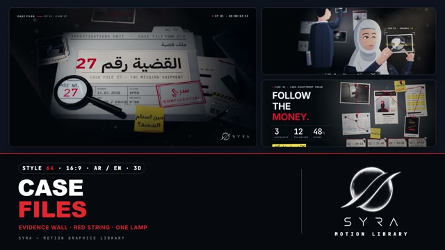

# 64 · Case Files

**SYRA Motion Library** · Style 64 · 16:9 · Arabic / English



<div dir="rtl">

> طريقة الاستخدام:
> انسخ البرومت ده كله وحطه لأي أداة AI أو لسكيل الـ animate، واملا الجزء الأخير ([VIDEO BRIEF]) بموضوع الفيديو.
> الستايل ده "ملفات القضية" — 3D حقيقي (WebGL / three.js): مكتب محقق تحت لمبة واحدة وحيطة أدلة عليها صور ومستندات متدبسة وخيط أحمر بيوصل بينها، متصوّر زي فيلم وثائقي (ضل ناعم، عمق ميدان، تراب في نور اللمبة، حبيبات فيلم). مناسب لفيديوهات التحريات في القضايا، التحقق من المعلومات (فاكت تشيك)، التوعية ضد النصب والاحتيال، والقصص الوثائقية الجادة.
> جاد ومشوّق لكن من غير أي عنف: ممنوع جثث أو دم أو سلاح أو أشخاص حقيقيين أو قضايا حقيقية — المشتبه بهم يظهروا كظلال (سيلويت) بس.
> المرجع الأساسي للشكل والحركة هو ملف "source/index.html". بيشتغل بالعربي وبالإنجليزي. ممنوع اللون البني والبيج (الفولدرات والورق رمادي مزرق وأبيض).

</div>

## Files in this folder

| File | What it is |
|---|---|
| [source/index.html](source/index.html) | The motion itself — opens and plays in a browser; the source of truth |
| [sample.mp4](sample.mp4) | Showcase reel of the style |
| The info card at the top of this file | Tags & hashtags: what the style expresses, what it suits, search words |

## Tags

<div dir="auto">

النوع: 3D (مكتب وحيطة أدلة حقيقيين بلمبة واحدة، three.js) + شخصيات مرسومة  
في سطر: فيلم تحريات وثائقي: مكتب محقق تحت لمبة واحدة، ملفات وصور كاميرات مراقبة متدبسة على حيطة أدلة وخيط أحمر بيوصلها، تراب في النور وحبيبات فيلم — جاد ومشوّق من غير أي عنف.  
In one line: A true-crime documentary in real 3D — a detective's desk under one lamp and an evidence wall of case files, CCTV prints and red string, with soft shadows, lens blur, dust in the beam and film grain; gripping but never gory.  
#عربي: #تحريات #قضايا #تحقيق #وثائقي #فاكت_تشيك #التحقق_من_المعلومات #توعية #نصب_واحتيال #احتيال_إلكتروني #أمن_رقمي #حيطة_الأدلة #خيط_أحمر #كاميرات_مراقبة #ملف_قضية #ثلاثي_الأبعاد #غموض #خريطة_مصر #بنوك  
#English: #truecrime #investigation #casefiles #documentary #factcheck #fraudawareness #scam #cybersecurity #evidenceboard #redstring #cctv #detective #mystery #3d #threejs #filmnoir #egyptmap #bilingual #banking  
مناسب لـ: فيديوهات التحريات والقضايا (المخترعة أو المبسّطة)، التحقق من الأخبار والشائعات، التوعية ضد النصب والاحتيال الإلكتروني والبنكي، الأمن الرقمي، القصص الوثائقية الجادة، مقدمات حلقات وسلاسل تحقيقات، شرح خطوات حماية  
Best for: investigation and case-story videos (invented or simplified), news and rumour fact-checks, fraud and banking-scam awareness, digital safety, serious documentary storytelling, episode intros for investigative series, protective step-by-step explainers  
مش مناسب لـ: محتوى أطفال مرح، إعلانات منتجات مبهجة وملونة، احتفالات ومناسبات، أي حاجة فيها عنف أو قضايا وأشخاص حقيقيين  
Not for: playful kids' content, bright cheerful product ads, celebrations and events, anything with violence or real cases and people  
المزاج: جاد، مشوّق، غامض، دقيق، موثوق        Mood: serious, gripping, mysterious, precise, trustworthy  
الإيقاع: متوسط (بنايات هادية + انتقالات سريعة)        Pace: medium (calm builds, fast whip transitions)  

</div>

## Components

| # | Component |
|---|---|
| 01 | Title Case Jacket |
| 02 | Evidence Wall Follow the Money |
| 03 | Report Highlighter Bars |
| 04 | Exhibit Phone Evidence Bag |
| 05 | Investigator CCTV Lens |
| 06 | Team ID Cards |
| 07 | Lineup Silhouettes |
| 08 | Mentor and Trainee |
| 09 | Three Steps Cards |
| 10 | Big Number 24 Hours |
| 11 | Timeline Five Moments |
| 12 | Fact Check Quote |
| 13 | Before After Enhance |
| 14 | Map Shipment Route |
| 15 | Chapter Card Lower Third |
| 16 | End SYRA Lockup |
---

## CASE FILES — MOTION GRAPHICS STYLE PROMPT (SYRA Motion Library · Style 64 · 16:9 · Arabic / English)

### Role

You are a senior motion designer producing motion graphics in the "Case Files" style of the SYRA Motion Library, on ANY investigation, fact-check or fraud-awareness topic, in Arabic OR English (or both). Match the reference exactly: the source of truth is "source/index.html" (all components, playable in a browser).

### 1. Style identity

- One line: a true-crime documentary shot on a detective's desk and an evidence wall — one warm-white lamp, real soft shadows, lens depth of field, dust floating in the beam and film grain; case jackets, typed reports, CCTV prints, sticky notes and red string, all real 3D lit by that one lamp.
- Mood: serious, gripping, precise, trustworthy — "every clue tells part of the story".
- Never: gore, bodies, blood, weapons, police violence, real people, real brands or real cases; no faces for suspects (silhouettes only); no manila, kraft, beige, brown, wood or sepia anywhere.

### 2. Format & technical

- Canvas 1920×1080, 30 fps. One idea per scene, 4.6–4.8 s; scenes overlap 1.0 s for the signature transition.
- Real-time 3D: three.js r160 in ONE shared WebGL renderer / canvas for the whole film; every scene owns its own THREE.Scene, camera and lamp; HTML/DOM over the canvas for razor-sharp type. One paused GSAP timeline (HyperFrames), fully deterministic (seeded randomness, every value a pure function of time), direct seek to any frame works.
- Post: lens DOF (depth gather, alpha-aware for painted characters), ACES, vignette, edge chroma, navy shadow lift, luminance-weighted grain. Paper and print art are canvas textures (Arabic shaped by the browser, never split).

### 3. Colour palette (use only these)

- Desk #0E141F · evidence-wall felt #1A2333 · folders cool grey-blue #C9D3E0, slate #8C9AB0 / #6F7E96 · paper #F2F4F7
- Ink #141B27, form ink #2B3850 · signal red #E0262E (string, pins, stamps, accent word, REC dot)
- Lemon #FFE24A (highlighter, sticky notes, scan lines, HUD values) · police-tape yellow #FFD60A ONLY on evidence seals
- Lamp light #FFF4E6 (neutral warm-white, never orange) · cool rim #8FA6CF
- People: rosy skin #F0B8A2 (shade #DC9D9E, never brown), navy-black hair #151B27, grey hair #C9D1DE, hijab #D9DFE9, navy / graphite / slate-blue clothes, white lab coat.

### 4. Typography (bilingual — each typeface has one job)

- Arabic narration and headlines: IBM Plex Sans Arabic 700 / 600 / 500 (printed-form voice).
- English documentary voice: Inter 700 caps, tight tracking (−0.025em) for headlines, wide tracking for labels.
- Typewriter (case numbers, timestamps, stats, HUD, reports): JetBrains Mono 500, per-glyph ink jitter.
- Rubber stamps only: Reem Kufi 400 («سري / CONFIDENTIAL», «حقيقة / TRUE», «مُغلقة / CASE CLOSED»).
- Investigators' handwriting on sticky notes and photos: Marhey, blue ballpoint #1D2B55 or red marker.
- One accent word per headline in signal red. Latin digits. Min 28 px reading text. Never split Arabic into letters (whole words ink-press in; masks keep 0.2 em headroom for dots and hamzas).

### 5. Drawing language (3d sets / materials / lighting)

- Sets: the dark desk with a felt blotter (case jacket, reports, polaroids, phone in an evidence bag, magnifier, pen, mug, desk lamp) and the navy felt evidence wall (pinned prints, profiles, statements, maps, timeline cards, red strings).
- Paper: curled / bowed / hanging sheets (roughness ~0.82), cool paper fill with fibres, worn edges, typed text, ragged redaction bars, highlighter swipes, distressed stamps, procedural fingerprints. Folders are extruded boards with tabs.
- Photos are real renders of tiny 3D sets (loading dock, ATM kiosk, container yard) graded documentary-cool; CCTV prints get scanlines, REC, timecode and corner brackets.
- Pins: lathe plastic heads + steel needles; strings: red tubes on sagging curves; both cast thin shadows.
- Light: ONE key (lamp spot, VSM soft shadows) + faint navy hemisphere + cool rim; an additive volumetric beam with dust; a soft light pool; everything else falls off into navy darkness.
- People: graphic-novel documentary illustration (flat cel-lit shapes painted with the scene's light, rosy shade, cool rim) as lit planes that cast real shadows: the investigator in a pearl-white hijab with a CCTV print and a LIVE lens, the detective (3/4 back) pinning evidence, a trainee (back view, notebook), ID-card portraits of the team (woman in hijab, woman with a low bun, young man, older man with glasses and lab coat). Suspects = solid silhouettes with number boards. Poses stay natural and simple (3/4 or back views).

### 6. Motion language (incl. camera)

- Camera: slow documentary push-ins (~5 %) with a lateral drift; focus pulls that land on the key word or face; trucking along a timeline string; 2-frame shakes on stamp slams.
- Builds: the lamp clicks on with a flicker; evidence slaps onto the wall with overshoot; pins pop and press in; strings draw on along their curve; words ink-press in whole; typewriter lines type one character per frame; redaction and highlighter swipe on; stamps slam (1.35 → 1 in 4 frames) and the ink spreads; numbers count up; HUD brackets snap in with a 1-frame overshoot; scan lines roll; REC timecode ticks; characters blink.
- Life in the hold: dust drifting in the beam, ±2 % lamp breath, grain re-seeded every frame; nothing freezes.
- Signature transition: "Follow the string" — the outgoing pin presses in, a red ring pulses and the red string draws out of it; the camera whip-pans along the string (streak blur, smeared dust, a red light pulse racing ahead); at the blur peak the sets swap and the camera lands square on the next pinned item, the string arriving into its pin. Chapter breaks use the stamp slam («سري / CONFIDENTIAL», «مُغلقة / CASE CLOSED»).

### 7. Branding

- SYRA logo only — plain white on these dark scenes (black only on a light scene), never tinted, never lit or shaded.
- Corner logo: SYRA (mark + wordmark) bottom-right, ~222×60 px, 58 px right / 50 px bottom, plain fade in; keep it off busy detail.
- End: the SYRA stacked logo alone, plain white, over the soft desk under the lamp, tagline «كلّ قضية تبدأ بسؤال.» / "EVERY CASE BEGINS WITH A QUESTION."; the lamp clicks off at the very end, the logo stays.

### 8. Component library (in "case html.html"; ar = arabic example, en = english)

- **01** Case-jacket title «القضية رقم 27» + typed sub + stamp (AR)
- **02** Evidence wall "FOLLOW THE MONEY." + 3 counters (EN)
- **03** Printed report, highlighter bar chart «مِن أين يبدأ الاحتيال؟» (AR)
- **04** EXHIBIT 04 phone in evidence bag + HUD "ONE FAKE LINK." (EN)
- **05** Investigator + live lens on a CCTV print «كلّ بصمةٍ تروي جزءًا من الحكاية.» (AR)
- **06** THE TEAM — four ID cards on string (EN)
- **07** Lineup of three silhouettes «ثلاثة مشتبهين… والحقيقة واحدة.» (AR)
- **08** Mentor & trainee at the wall "LEARN THE PATTERN." (EN)
- **09** Three awareness steps «توقّف · تحقّق · بلّغ» (AR)
- **10** Big number «24 ساعة» + wall-clock time-lapse (AR)
- **11** Timeline of five moments on one string "THREE DAYS, FIVE MOMENTS." (EN)
- **12** Fact-check quote card «البنك لا يطلب رمزك السرّي… أبدًا.» (AR)
- **13** Before / after CCTV enhance "FROM NOISE TO PROOF." (EN)
- **14** Route on a printed map of Egypt «تتبّع المسار» (AR)
- **15** Chapter folder «الفصل الثاني · أثر المال» + lower third (AR+EN)
- **16** End SYRA lockup (AR + EN)

### 9. Sound (if the video has sfx)

- Low documentary drone and soft pulse, lamp switch click, paper slaps, pin taps, string whoosh on the whip, rubber-stamp thud, typewriter ticks, faint CCTV hum. Duck ~18–20 dB under VO.

### 10. Do / don't

- **DO** keep one lamp and real shadows, cool paper, one red accent word, red string connecting the story, whole-word Arabic, silhouettes for suspects, invented cases labelled illustrative where numbers appear.
- **DON'T** use brown/beige/tan/kraft/manila/wood/sepia/cream, warm the lamp past #FFF4E6, show gore, weapons, faces of suspects, real people, brands or real cases, or freeze a hold.

## [VIDEO BRIEF] — fill this in for each new video

```text
- Language: [ Arabic / English / both ]
- Topic / title: [ ... ]
- Voiceover file or script: [ path to WAV/MP3 or the text ]
- Length: [ e.g. 45 s ]
- Headlines and the accent word in each: [ ... ]
- Case details (invented), numbers, steps, timeline: [ ... ]
- Components to use (in order): [ e.g. 01, 02, 09, 16 ]
- Characters needed: [ investigator / detective / team / silhouettes ... ]
- Extra notes: [ ... ]
Output: 1920×1080, 30 fps MP4, same length as the voiceover, every visual timed to the word it illustrates,
SYRA corner logo, SYRA end lockup.
```
