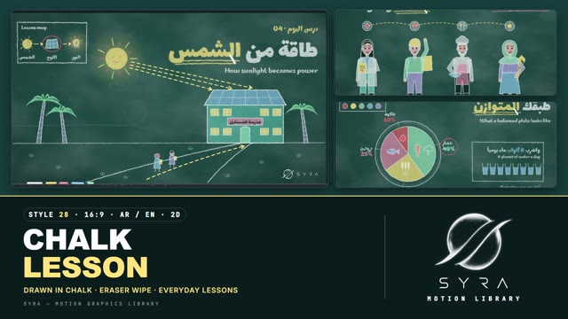

# 28 · Chalkboard Lesson

**SYRA Motion Library** · Style 28 · 16:9 · Arabic / English



<div dir="rtl">

> طريقة الاستخدام:
> انسخ البرومت ده كله وحطه لأي أداة AI أو لسكيل الـ animate، واملا الجزء الأخير ([VIDEO BRIEF]) بموضوع الفيديو.
> الستايل ده "درس على السبورة" — رسم 2D بالطباشير الملوّن على سبورة خضراء مزرقّة: كل خط بيترسم قدامك، والألوان بتتلوّن بخطوط طباشير مائلة، والكلام بيتكتب بخط اليد، وبين كل مشهد والتاني ممسحة سبورة حقيقية بتمسح الدرس القديم بحركة زجزاج وغبار طباشير، والدرس الجديد بيترسم وراها على طول.
> مناسب للدروس والشرح المبسّط في أي موضوع: الصحة، الأكل، الرياضة، الفلوس والادخار، السلامة، البيئة، الجغرافيا — مش بس العلوم والمدرسة.
> المرجع الأساسي للشكل والحركة هو ملف "source/index.html". بيشتغل بالعربي وبالإنجليزي. ممنوع اللون البني (ولا خشب ولا بيج) في أي حتة.

</div>

## Files in this folder

| File | What it is |
|---|---|
| [source/index.html](source/index.html) | The motion itself — opens and plays in a browser; the source of truth |
| [sample.mp4](sample.mp4) | Showcase reel of the style |
| The info card at the top of this file | Tags & hashtags: what the style expresses, what it suits, search words |

## Tags

<div dir="auto">

النوع: 2D — رسم طباشير على سبورة  
في سطر: درس بيترسم قدامك بالطباشير الملون على سبورة خضرا مزرقّة، بخط إيد وأسهم صفرا متقطعة وممسحة بتمسح بين المشاهد، إحساس مدرّس شاطر بيشرح بصبر وبساطة.  
In one line: A lesson drawn live in coloured chalk on a green-teal board, with handwriting, yellow dashed arrows and a real eraser wipe between scenes, like a patient good teacher explaining simply.  
#عربي: #سبورة #طباشير #درس #شرح_مبسط #تعليمي #تعليم_مدرسي #توعية #صحة #تغذية #ادخار #سلامة #بيئة #جغرافيا #خط_اليد #رسم_يدوي #خطوات #مدرس  
#English: #chalkboard #chalk #lesson #explainer #education #school #howitworks #handwriting #handdrawn #health #nutrition #savings #safety #environment #geography #teacher #awareness #edtech  
مناسب لـ: دروس وشرح مبسط لأي موضوع، فيديوهات مدارس ومنصات تعليم، توعية صحية وتغذية، الفلوس والادخار للأطفال والكبار، قواعد السلامة والمرور، البيئة والجغرافيا، شرح "إزاي الحاجة بتشتغل" بمعادلة ورسم  
Best for: simple lessons on any topic, school and e-learning videos, health and nutrition awareness, money and saving tips, safety and road rules, environment and geography, "how it works" diagrams with a formula  
مش مناسب لـ: إعلانات منتجات فخمة أو تقنية مستقبلية، شركات رسمية وتقارير مالية جادة، فيديو حماسي سريع، أي حاجة محتاجة 3D أو صور حقيقية  
Not for: luxury product ads or futuristic tech, formal corporate or financial reports, fast hype videos, anything needing 3D or real photos  
المزاج: دافي، واضح، صبور، مرح شوية، مدرسي        Mood: warm, clear, patient, a little playful, classroom  
الإيقاع: هادي لمتوسط (رسم بسرعة الطباشير)        Pace: calm to medium  

</div>

## Components

| # | Component |
|---|---|
| 01 | Title Energy From The Sun |
| 02 | Solar Panel Diagram |
| 03 | Balanced Plate Pie |
| 04 | Bicycle Explained |
| 05 | Teacher And Student Question |
| 06 | Everyday Heroes Team |
| 07 | Savings Jar Story |
| 08 | Coach And Player |
| 09 | Three Steps Safe Crossing |
| 10 | Big Number 10000 Steps |
| 11 | Timeline Seed To Market |
| 12 | Quote Sound Mind |
| 13 | Before After Cleaner Street |
| 14 | Map Of Egypt Nile |
| 15 | Chapter Card Lower Third |
| 16 | End SYRA Lockup |
---

## CHALKBOARD LESSON — MOTION GRAPHICS STYLE PROMPT (SYRA Motion Library · Style 28 · 16:9 · Arabic / English)

### Role

You are a senior motion designer producing explainer videos in the "Chalkboard Lesson" style of the SYRA Motion Library, on ANY topic, in Arabic OR English (or both). Match the reference exactly: the source of truth is "source/index.html" (all 16 components, playable in a browser).

### 1. Style identity

- One line: an illustrated lesson drawn live on a cool green-teal chalkboard — white chalk outlines, coloured chalk fills shaded in diagonal hatching, bold Arabic chalk lettering, the teacher's neat handwriting, yellow dashed arrows, an inset "lesson map" box, faint ghosts of earlier lessons — and between lessons a real board eraser wipes it clean.
- Mood: warm, clear, patient, a little playful — "a good teacher explains it on the board".
- Topics: everyday life in Egypt — health, food, sport, money, safety, environment, geography, work, family.
- Never: wooden frames or trays, brown/beige anything, photographic textures, glossy UI, fly-in slides.

### 2. Format & technical

- Canvas 1920×1080, 30 fps. One idea per scene, 4.6–4.8 s; scenes overlap 1.35 s for the eraser transition.
- Pure SVG chalk: turbulence grain mask + low-frequency displacement wobble + soft dust halo on every stroke; coloured fills = solid underlay (≈ 42 %, yellow 93 %, skin 66 %) + −38° hatch of the same colour under the grain.
- HTML + GSAP (HyperFrames): one paused timeline, a master proxy tween drives every frame; deterministic (seeded randomness, no Math.random / Date / rAF); direct seek to any time shows the right frame. The static board is one cached layer; keep ≤ ~40 filtered objects per scene. No remote assets.

### 3. Colour palette (use only these)

- Slate: radial #1D4A47 → #173F3D → #112F2E, fine tooth + cloudy old-eraser marks; graphite frame #1A2125 / #39444A; graphite tray #3A454B → #13181B with white, yellow, pink, sky and mint chalk sticks.
- Chalk white #F2F7F3 · board-dark lines #0C2524 · graphite hatch #0A1D1C (hair, shoes, soil).
- YELLOW #FFE680 = the accent (one headline word, big numbers, sunbeams, dashed paths).
- Pink #FF9BB8 (Arabic sub-line underlines, hijab, tags) · sky #8FD3FF · mint #9EF0C8 · teal #63D9CF · lilac #C9B8FF (trunks, trousers) · coral #FF8F80 · red chalk #FF6B6B (rings, rays, crosses) · skin #FFC8BE with pink blush.
- Eraser: graphite body #3B464C → #171C20, sky stripe, blue-grey felt #B9CCDA → #8FA8BC — never wood.

### 4. Typography (bilingual)

- Arabic headlines and bold labels: Lalezar (104–150 px), always with a yellow chalk underline under the accent word, drawn last with a chalk stick riding the line.
- Handwriting — all English and Arabic notes/labels: Marhey 500–700 (English headlines 80–84 px, labels 28–40 px).
- Kicker in yellow handwriting: «درس الصحة · 07». English-led scenes carry an Arabic line top-right with a pink underline; Arabic scenes carry an English handwritten sub line.
- Latin digits in both languages. Min 28 px reading text. Never split Arabic into letters (lettered in as whole lines).

### 5. Drawing language

- Simple, chunky children's-book chalk drawings: white outline + hatched colour fill, slightly wobbly, dusty edges.
- Layout: Arabic headline top-right, English headline top-left; inset box top-left (lesson map, tip, mini chart); illustration in the middle/left; labels with thin leaders, numbered yellow circles, red chalk rings for emphasis.
- People: front-facing chalk characters — women with and without hijab, men young and older (beard, moustache, grey hair), kids with puffs or curls; peach skin, board-dark eyes with white highlights, pink blush, coral smile; outfits in sky/mint/teal/lilac/pink/yellow; props: stethoscope, chef hat, delivery box, helmet, clipboard, wheat.
- Icons: sun with yellow/red rays, glowing bulb, solar panel, heart, drop, leaf, coin, tree, check, star, map pins.

### 6. Motion language (incl. camera + signature transition)

- Write-on, not fly-in: lines draw at chalk speed (ease-in-out), fills shade in ~0.12 s after their outline, Arabic lettering wipes in right → left and English left → right, underlines last with the chalk stick.
- Holds that breathe: yellow dashed paths flow along their direction, glows pulse, characters blink, wave, point or tap; small stories play (a coin drops into a jar, a ball rolls to a player, a felucca sails up the Nile).
- Camera: a slow push-in (≈ 3 %) on each lesson's hold, eased back to the full board under the next wipe.
- SIGNATURE TRANSITION — Eraser Wipe (1.35 s): a graphite eraser with a blue-grey felt sweeps the whole board in a tight zig-zag (about 3 strokes per second, ±370 px, tilting ±14° into each stroke) — right → left before an Arabic lesson, left → right before an English one. The old lesson survives only where the felt has not passed; behind it a faint blurred ghost stays, a streaky chalk haze smears along the felt's path and chalk dust falls from it (with a soft puff at the contact edge). The new lesson is DRAWN IN right behind the eraser — lines draw on, colour fills shade in, labels letter in. The ghost and haze fade over the next ~1.5 s. Every scene change uses it; no fades.

### 7. Branding

- SYRA logo only — plain white on the dark slate (plain black only on a light board), never tinted, no glow/sheen.
- Corner logo: SYRA (mark + wordmark) bottom-right, 222×60 px, 58 px from the right, 50 px from the bottom, plain fade in; keep that corner free of drawings.
- End: the stacked SYRA logo alone, dusted on inside a chalk ring behind a chalk stick, a ring of tiny lesson doodles (sun, heart, leaf, coin, drop, star), tagline «نتعلّم كل يوم.» / "Learning, every day.".

### 8. Component library (in "chalk html.html"; ar = arabic example, en = english)

- **01** Title — solar school, sun, palms, lesson map «طاقة من الشمس» (AR)
- **02** Diagram — how a solar panel works, numbered flow + formula + bar inset "How a solar panel works" (EN)
- **03** Data pie — the balanced plate 40/25/25/10 + 8 glasses of water «طبقك المتوازن» (AR)
- **04** Object — a bicycle explained with call-outs + CO₂ inset "Ride the clean way" (EN)
- **05** Character — teacher in hijab + student with an idea «العلم يبدأ بسؤال» (AR)
- **06** Team — doctor, delivery rider, chef, farmer with name tags "Everyday heroes" (EN)
- **07** Story — a girl drops coins into her savings jar + weekly bars «ادّخر بذكاء» (AR)
- **08** Mentor & learner — coach, player, tactics board "Practice makes progress" (EN)
- **09** Three steps — stop, look, cross «ثلاث خطوات لعبور آمن» (AR)
- **10** Big number — 10,000 counting up + footprints «خطوة كل يوم» (AR)
- **11** Timeline — plant, water, harvest, sell "From seed to market" (EN)
- **12** Quote — «العقل السليم في الجسم السليم» with brain + heart (AR)
- **13** Before / after — a cleaner street "A cleaner street" (EN)
- **14** Map — Egypt, the Nile, five cities «من الإسكندرية إلى أسوان» (AR)
- **15** Chapter card + lower third — «صحّتنا أولاً» / "Chapter 05 · Our health first" + name card (AR + EN)
- **16** End — SYRA lockup «نتعلّم كل يوم.» / "Learning, every day." (AR + EN)

### 9. Sound (if the video has sfx)

- Chalk scratches on every stroke (short, varied), a soft felt "whoosh-whoosh" rhythm on the eraser zig-zag with a faint dust hiss, light taps for numbers and rings; a gentle acoustic / pizzicato classroom bed. Duck ~18–20 dB under VO.

### 10. Do / don't

- **DO** draw everything on (never slide it in), keep the hatched chalk fills and dusty edges, one yellow accent word, an inset box and yellow dashed paths, the eraser wipe between EVERY two scenes, characters from everyday Egypt.
- **DON'T** use brown/beige/tan/wood/sepia/ochre/khaki/cream (not even for trunks, soil, bread or the eraser), clean vector lines without grain, crossfades, flying text, more than one accent colour per headline, or a logo other than SYRA.

## [VIDEO BRIEF] — fill this in for each new video

```text
- Language: [ Arabic / English / both ]
- Topic / title: [ ... ]
- Voiceover file or script: [ path to WAV/MP3 or the text ]
- Length: [ e.g. 45 s ]
- Headlines and the accent word in each: [ ... ]
- Numbers / steps / content: [ ... ]
- Components to use (in order): [ e.g. 01, 06, 09, 16 ]
- Characters needed: [ ... ]
- Extra notes: [ ... ]
Output: 1920×1080, 30 fps MP4, same length as the voiceover, every visual timed to the word it illustrates,
SYRA corner logo, eraser wipe between scenes, SYRA lockup ending.
```
