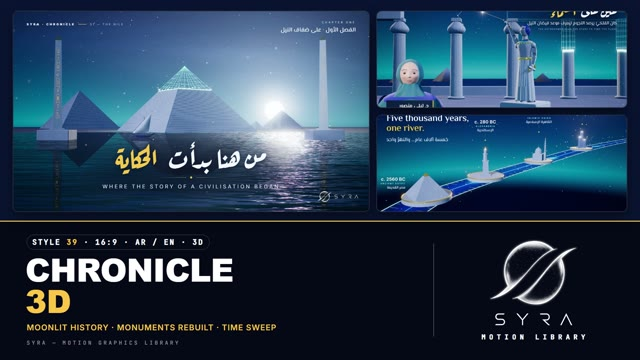

# 39 · Chronicle 3D

**SYRA Motion Library** · Style 39 · 16:9 · Arabic / English



<div dir="rtl">

> طريقة الاستخدام:
> انسخ البرومت ده كله وحطه لأي أداة AI أو لسكيل الـ animate، واملا الجزء الأخير ([VIDEO BRIEF]) بموضوع الفيديو.
> الستايل ده "كرونيكل" — 3D حقيقي (WebGL / three.js): التاريخ بيتحكي زي مقدمة فيلم وثائقي فاخر تحت ضوء القمر. المعالم بتتبني قدام عينك:
> تطلع خطوط بناء فيروزية مضيئة، وبعدين خط مسح بيطلع لفوق ويحوّلها لحجر جيري فاتح، وشرر خفيف بيطير من الحافة. بيمشي من مصر القديمة
> لحد مصر الحديثة (الأهرامات، الإسكندرية، القاهرة الإسلامية، قناة السويس، السد العالي، وسط البلد، المدن الجديدة) ومعاها ناس من حياتنا
> النهارده (مهندسة، دكتور، مبرمج، فلاح، صنايعي، أم/مرشدة، أطفال) — مناسب للأفلام الوثائقية، التاريخ والتراث، المناسبات الوطنية،
> وقصص المدن والإنجازات.
> المرجع الأساسي للشكل والحركة هو ملف "source/index.html". بيشتغل بالعربي وبالإنجليزي.
> ممنوع اللون البني والرملي والسيبيا — الليل لازوردي والإضاءة قمرية.

</div>

## Files in this folder

| File | What it is |
|---|---|
| [source/index.html](source/index.html) | The motion itself — opens and plays in a browser; the source of truth |
| [sample.mp4](sample.mp4) | Showcase reel of the style |
| The info card at the top of this file | Tags & hashtags: what the style expresses, what it suits, search words |

## Tags

<div dir="auto">

النوع: 3D (WebGL) — سينمائي ليلي تحت ضوء القمر  
في سطر: زي مقدمة فيلم وثائقي فخم بالليل: المعالم بتتبني قدامك بخطوط فيروزي مضيئة وبعدين تتحوّل لحجر أبيض قمري، ونيل لامع وكلمة دهبي واحدة — رهبة وفخر هادي.  
In one line: A premium moonlit documentary title sequence in real 3D — monuments are rebuilt from glowing turquoise lines into pale stone, with one gold accent word.  
#عربي: #تاريخ #وثائقي #تراث #مصر_القديمة #آثار #أهرامات #النيل #مناسبات_وطنية #إنجازات #مدن_جديدة #قناة_السويس #السد_العالي #القاهرة_الإسلامية #سينمائي #فخم #ليلي #مجسم_3D  
#English: #history #documentary #heritage #ancientegypt #pyramids #nile #monuments #nationalday #achievements #megaprojects #suezcanal #islamiccairo #cinematic #premium #night #moonlit #3d #timeline  
مناسب لـ: أفلام وثائقية وتاريخية، تراث وآثار وحضارة مصرية، مناسبات وطنية واحتفالات، قصص المدن والمشروعات القومية الكبيرة (قناة السويس، السد العالي، المدن الجديدة)، تايم لاين "من زمان للنهارده"، مقدمات وافتتاحيات فخمة، أرقام إنجازات كبيرة  
Best for: documentaries and history films, Egyptian heritage and monuments, national occasions, city and national-megaproject stories, then-to-now timelines, premium openers and title sequences, big achievement numbers  
مش مناسب لـ: محتوى أطفال أو كوميدي، إعلانات منتجات سريعة أو عروض، شرح "إزاي بيشتغل" نهاري بلافتات (ده 37 أيزومتريك 3D)، قصص عاطفية مركّزة على وشوش (الشخصيات 3D بسيطة وجامدة شوية)  
Not for: kids or comedic content, fast product ads and offers, bright labelled how-it-works explainers (use 37 Isometric 3D), emotional face-driven stories (the 3D people are simple and a bit stiff)  
المزاج: مهيب، فخم، هادي، فخور، سينمائي        Mood: awe-inspiring, premium, calm, proud, cinematic  
الإيقاع: هادي وبطيء        Pace: calm  

</div>

## Components

| # | Component |
|---|---|
| 01 | Title Pyramid Rising |
| 02 | Timeline Five Thousand Years |
| 03 | Nile Ring Chart |
| 04 | Alexandria Then and Now |
| 05 | Historian Star Reader |
| 06 | Team Building Tomorrow |
| 07 | Lantern Maker |
| 08 | Mentor and Learner |
| 09 | Three Steps Restoration |
| 10 | Big Number High Dam |
| 11 | Timeline Suez Canal |
| 12 | Quote Gift of the Nile |
| 13 | Before After Downtown |
| 14 | Map Nile Draws Egypt |
| 15 | Chapter New Cities |
| 16 | End SYRA |
---

## CHRONICLE 3D — MOTION GRAPHICS STYLE PROMPT (SYRA Motion Library · Style 39 · 16:9 · Arabic / English)

### Role

You are a senior motion designer producing motion graphics in the "Chronicle 3D" style of the SYRA Motion Library, on ANY topic, in Arabic OR English (or both). Match the reference exactly: the source of truth is "source/index.html" (all components, playable in a browser).

### 1. Style identity

- One line: a premium documentary title sequence at blue hour / under moonlight, in real 3D — monuments, cities and objects are REBUILT in front of the viewer: faience-turquoise construction lines draw on, a glowing scan edge climbs, and the wireframe turns into pale moonlit limestone while sparks lift off the edge.
- Range: ancient → modern Egypt (pyramids and obelisks, the Pharos and the Bibliotheca, Islamic Cairo, the Suez Canal, the High Dam, Downtown façades, new-city skylines) AND modern everyday people, always in the same moonlit world.
- Mood: awe, calm pride, "the story continues" — cinematic, never cartoonish.
- Never: sand, sepia, parchment, brown/beige/ochre deserts, orange "torch" light, comic bounces.

### 2. Format & technical

- Canvas 1920×1080, 30 fps. One idea per scene, 4.6–4.8 s; scenes overlap 1.0 s for the signature transition.
- Real-time 3D: three.js r160 in ONE shared WebGL renderer / canvas for the whole film, inside HTML + GSAP (HyperFrames): one paused timeline, DOM via fromTo / to / set only (transforms + opacity; no letter-spacing tweens), deterministic (seeded randomness), every 3D value a pure function of timeline time; geometry built once. Per scene: HDR render → 6-level bloom → optional god rays from the moon → ACES filmic, light chromatic aberration, vignette, grain.
- Full state by ~2.8 s, then hold with life (water glints, dust in the moon shafts, star twinkle, idle people, a slow dolly).

### 3. Colour palette (use only these)

- Night sky lapis #0A1430 → #1B2F6B with a turquoise horizon haze #1FB5B0; fog #13295A–#163668.
- Stone / marble #DCE4F0 with #AEBBD3 mottling; terraces #6F7FA6 / #7E8DB0; far plateau #2B3A66.
- Lapis #2747C9 (cloth, ribbon, map), faience turquoise #18C4C0 (construction lines, scan edge, the Nile glow, hot edge #9AFFF6).
- Gold #F5C84B ONLY for the accent word, timeline markers and rings, glyph inlays, pins and small brass details.
- Light: cool moon key #C2D4FF, warm-WHITE rim #FFF3E4 and a warm-white "story light" #FFF3EA on people (never orange).
- Water deep teal #021C26 / #0A4C57 with moon glints and mirror reflections. Skin: rosy tones #F1C1AF #E3AE9C #DDA694.

### 4. Typography (bilingual)

- Arabic display: Aref Ruqaa 700 (calligraphic chronicle titles). Arabic body, chapter lines, captions, lower thirds and the English display headline: El Messiri. English kickers, years, labels: Inter in wide-tracked caps (.26–.46 em).
- ONE gold accent word per headline; it ignites (blur clears, slight overshoot). Arabic words rise out of masks with headroom (never split into letters). Calm order: chapter line → headline → gold ornament rule → tracked English line.
- Era labels pinned to 3D points: year (Inter) / tracked EN caps (faience) / Arabic (El Messiri) / gold stem + diamond.
- Latin digits in both languages. Min 28 px for reading text (small tracked caps excepted).

### 5. Drawing language (3d modelling / materials / lighting)

- Materials: procedural limestone/marble (fbm mottling, bump, block courses, flutes) with a REVEAL clip — everything above the scan height is discarded and a turquoise-white band glows at the edge; additive construction-line wireframes with a build order (draw-on), hidden once the stone has passed them.
- World: moonlit sky dome with cirrus, stars and a haloed moon, the Nile/sea as a moonlit normal-field water with mirror reflections, dust motes that brighten in the moon shafts, god rays toward the moon.
- Builders: pyramids (course + meridian grids), obelisks with gold glyphs, papyrus columns, the Pharos, mosque + minaret, modern towers with lit windows, felucca, timeline ribbon with flowing pulses, ring charts of stone wedges, a stele, a dam, a map slab of Egypt with a growing glowing Nile, a container ship, a brass lantern.
- People (medium shots): soft sculpted faces with real eyeballs and sculpted upper/lower eyelids (blink), painted brows and lips; fabric hijab that hugs the face with a rolled hem and draped folds; hands with knuckles, nails and per-finger poses (present, point, grip, open); outfits: blazer, white coat + stethoscope, hi-vis vest, hoodie, galabeya + emma, shirt.

### 6. Motion language (incl. camera)

- Everything is built, never dropped: lines draw on in build order → scan edge climbs → stone → sparks; people can be built up by the same scan edge. Counters count up while their object rises.
- Camera: slow cinematic dolly / crane / small orbit (35–45 mm), sine ease, no cuts inside a scene; then it breathes.
- Life: water ripples and glints, dust, star twinkle, felucca bobbing, ribbon pulses, blinks, breathing, small gestures.
- Signature transition — TIME SWEEP (1.0 s): a slanted band of turquoise-white light crosses the frame left → right with sparks riding on it. Ahead of the band the outgoing era breaks down into glowing construction lines; behind it the next era is drawn as lines and solidifies; both cameras pan with the sweep and each scene's text is cut exactly at the band — one continuous move. Chapter variant: the camera flies down a lapis ribbon avenue into the chapter card.

### 7. Branding

- SYRA logo only — plain WHITE (every Chronicle scene is a night scene), never tinted, never lit, no glow over it.
- Corner logo: SYRA (mark + wordmark) bottom-right, ~222 px, plain fade in.
- End: the stacked SYRA logo alone, plain white, uncovered from the bottom up by the scan line over a moonlit river with pyramids drawing themselves on the horizon; tagline «نحكي الأمس.. ونبني الغد» / "Telling yesterday · Building tomorrow".

### 8. Component library (in "chronicle html.html"; ar = arabic example, en = english)

- **01** Title — the Great Pyramid rebuilt on the Nile «من هنا بدأت الحكاية» (AR)
- **02** Timeline hero — four eras rise along a ribbon "Five thousand years, one river." (EN)
- **03** Ring chart of stone wedges + KPI cards «النيل.. شريانُ الحياة» (AR)
- **04** Object moment — the Pharos lights its beam, the Bibliotheca draws on "Alexandria, then and now." (EN)
- **05** Historian in hijab presents the astronomer statue «عينٌ على السماء» (AR)
- **06** Team of four built up by the scan edge, Cairo Tower rising "The people building tomorrow." (EN)
- **07** Lantern maker of Al-Muizz street, the fanous is drawn then lights «حِرفةٌ تُورَّث» (AR)
- **08** Mentor & learner — hologram pyramid → tower on a tablet "Every expert was once a beginner." (EN)
- **09** Three steps — scan / restore / tell «ثلاث خطوات لإحياء الأثر» (AR)
- **10** Big number 3,830 m — the High Dam rises «طولُ السدّ العالي في أسوان» (AR)
- **11** Timeline — the Suez Canal 1859 · 1869 · 1956 · 2015, ship gliding "A canal that joined two seas." (EN)
- **12** Quote on a stele among papyrus «مصرُ هِبةُ النيل» — Herodotus (AR)
- **13** Before / after behind a moving restoration line "Restored, not replaced." (EN)
- **14** Map of Egypt — the Nile grows from Aswan to the delta, city pins «النيل يرسم مصر» (AR)
- **15** Chapter card «مدنٌ جديدة» / Chapter Five + lower third (urban planner) over a self-drawing city (AR + EN)
- **16** End — SYRA (white) uncovered by the scan line, tagline (AR + EN)

### 9. Sound (if the video has sfx)

- Low cinematic strings and a soft pad, oud or ney accents for history, a rising shimmer + airy whoosh on every Time Sweep, crystalline ticks as lines draw on, a deep soft boom when a monument completes. Duck ~18–20 dB under VO.

### 10. Do / don't

- **DO** build everything (lines → scan edge → stone), keep it moonlit, one gold word, people at medium shot with the warm-white story light, slow camera with purpose, labels pinned to 3D, the Time Sweep between every two scenes.
- **DON'T** use sand, sepia, brown, beige, tan, ochre, khaki, cream or orange light; cartoon bounces; doll-like faces or close-ups of hands; tinted or glowing logos; frozen holds; splitting Arabic into letters.

## [VIDEO BRIEF] — fill this in for each new video

```text
- Language: [ Arabic / English / both ]
- Topic / title: [ ... ]
- Voiceover file or script: [ path to WAV/MP3 or the text ]
- Length: [ e.g. 45 s ]
- Headlines and the accent word in each: [ ... ]
- Eras / places / numbers / steps: [ ... ]
- Components to use (in order): [ e.g. 01, 02, 05, 11, 16 ]
- Characters needed: [ ... ]
- Extra notes: [ ... ]
Output: 1920×1080, 30 fps MP4, same length as the voiceover, every visual timed to the word it illustrates,
SYRA corner logo (white), SYRA end lockup.
```
