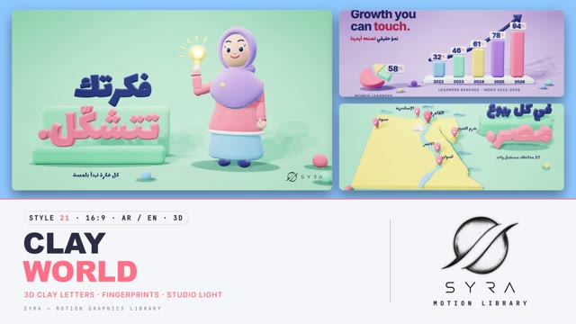

# 21 · Clay World

**SYRA Motion Library** · Style 21 · 16:9 · Arabic / English



<div dir="rtl">

> طريقة الاستخدام:
> انسخ البرومت ده كله وحطه لأي أداة AI أو لسكيل الـ animate، واملا الجزء الأخير ([VIDEO BRIEF]) بموضوع الفيديو.
> الستايل ده "عالم الصلصال" — 3D حقيقي (WebGL / three.js): حروف وشخصيات ومجسمات من صلصال ناعم عليه بصمات الإيد، بتقع وتتهرس وترجع تستقر على خلفية استوديو باستيل، والكاميرا بتتحرك بجد — مناسب للتعليم، الأطفال، القصص، والمبادرات المجتمعية.
> المرجع الأساسي للشكل والحركة هو ملف "source/index.html". بيشتغل بالعربي وبالإنجليزي. ممنوع اللون البني.

</div>

## Files in this folder

| File | What it is |
|---|---|
| [source/index.html](source/index.html) | The motion itself — opens and plays in a browser; the source of truth |
| [sample.mp4](sample.mp4) | Showcase reel of the style |
| The info card at the top of this file | Tags & hashtags: what the style expresses, what it suits, search words |

## Tags

<div dir="auto">

النوع: 3D حقيقي (WebGL / three.js — صلصال ستوب موشن)  
في سطر: حروف وشخصيات ومجسمات 3D من صلصال ناعم عليه بصمات الإيد، بتقع وتتهرس وتستقر على خلفية استوديو باستيل والكاميرا بتتحرك — دافي ولطيف ومعمول باليد.  
In one line: Real-3D plasticine letters, characters and objects with fingerprints, dropping, squashing and settling on a pastel studio sweep with a moving camera; warm-hearted, tactile, hand-made.  
#عربي: #صلصال #3D #ستوب_موشن #أطفال #تعليم #قصص_الأطفال #مبادرات_مجتمعية #لطيف #دافي #طفولي #باستيل #كرتون_3D #إنفوجرافيك #تعليم_مدرسي #تطبيقات_تعليمية #عيلة #حضانة  
#English: #clay #claymation #plasticine #3d #stopmotion #kids #education #kidsstory #community #cute #warm #playful #pastel #3dcartoon #infographic #school #edtech #handmade  
مناسب لـ: تعليم أطفال ومدارس وحضانات، قصص أطفال بشخصيات لطيفة، مبادرات مجتمعية وتوعية لطيفة للأسرة، تطبيقات ومنصات تعليمية، تقارير نتايج بأرقام بشكل ودود (بارات ودونات صلصال)، توجيه وإرشاد (مينتور وطالب)، إعلانات منتجات للأم والطفل  
Best for: kids/school/nursery education, children's stories with cute characters, community initiatives and gentle family awareness, learning apps and platforms, friendly results reports (clay bars and donuts), mentorship, mother-and-child product ads  
مش مناسب لـ: شركات رسمية جادة أو بنوك ومالية، تقنية هاي تك ومستقبلية، أخبار وموضوعات حزينة أو حساسة، فخامة ولمعان (استخدم Liquid Chrome)  
Not for: serious corporate, banking or finance, high-tech/futuristic topics, sad or sensitive news, glossy luxury (use Liquid Chrome instead)  
المزاج: دافي، لطيف، ملموس، مرح، ودود        Mood: warm-hearted, cute, tactile, playful, friendly  
الإيقاع: متوسط        Pace: medium  

</div>

## Components

| # | Component |
|---|---|
| 01 | Title Clay Letters |
| 02 | Data Bars Touch |
| 03 | Data Donut Arabic |
| 04 | Product Tablet Orbit |
| 05 | Idea Lightbulb |
| 06 | Team Steps |
| 07 | Seedling Story |
| 08 | Mentor Student |
| 09 | Three Steps |
| 10 | Big Number |
| 11 | Timeline Coil |
| 12 | Quote Slab |
| 13 | Before After |
| 14 | Map Egypt Nile |
| 15 | Chapter Lower Third |
| 16 | End Logo Plaques |
---

## CLAY WORLD — MOTION GRAPHICS STYLE PROMPT (SYRA Motion Library · Style 21 · 16:9 · Arabic / English)

### Role

You are a senior motion designer producing motion graphics in the "Clay World" style of the SYRA Motion Library, on ANY topic, in Arabic OR English (or both). Match the reference exactly: the source of truth is "source/index.html" (all components, playable in a browser).

### 1. Style identity

- One line: premium stop-motion plasticine on a seamless pastel studio sweep, rendered as real 3D — every object is fingerprinted, lumpy, velvety clay lit by one big soft key, with soft contact shadows, gentle depth of field, vignette and grain; headlines are 3D clay letters traced from the real font; things drop in, squash, overshoot and settle.
- Mood: warm-hearted, tactile, hand-made — "shaping the future, by hand".
- Never: plastic / CAD-perfect surfaces, glossy highlights, earth tones or any brown in shadows, skin, hair or soil.

### 2. Format & technical

- Canvas 1920×1080, 30 fps. One idea per scene, 4.6–4.8 s; scenes overlap 0.9 s for the signature transition.
- Real-time 3D: three.js r160 in ONE shared WebGL renderer / canvas for the whole film (no second context, no extra lights or render targets), inside HTML + GSAP (HyperFrames): one paused timeline, DOM only via fromTo / to / set, deterministic (seeded randomness), every 3D value a pure function of timeline time; build all geometry and clay text once, nothing per frame. No CSS keyframes, no remote assets. Keep ≲ 150k triangles per scene. Full state by ~2.8 s, then hold with life.

### 3. Colour palette (use only these)

- Coral clay #FF6F86 (deep #F2506A) · HTML accent text #D43C5B · butter #FFD45E · mint #5ED9B4 / #2FBF92 · sky #5FB4FF / #3D8BF0 · lilac #AE92F2 / #8E6FE8 · pink #FF9CB4 · cool white clay #F3F5FB
- Navy #1C2763 for type, contrast and soil; hair ink-navy #232B66; skin rosy peach #FFB49C (blush #FF7F95, mouth #C93E62).
- Sweeps (one per scene, neighbours differ): sky, lilac, mint, butter, pink, cloud (cool white).

### 4. Typography (bilingual)

- Arabic display: Lalezar as 3D clay letters (connected letter groups, RTL shaping intact). English / digits: Inter 800 — as clay digits or crisp HTML supers (−0.035em). Notes and Arabic captions: Marhey 600. One coral accent word per headline.
- Kicker pills with a dot (coral, mint, butter, sky, lilac, navy); tracked Inter 800 caps captions; supers can be pinned to 3D points. Accent word gets a clay "squish" pop.
- Latin digits in both languages. Min 28 px for reading text. Never split Arabic into letters.

### 5. Drawing language (3d modelling / materials / lighting)

- Modelling: lumpy blobs, lathed pots and bulbs, sausage coils and arrows (tubes that grow), rounded plinths and steps, rolled sheets, clay donuts and bars, the logo on a white clay plaque; seeded tilts so nothing is CAD-perfect.
- Materials: triplanar clay shader — roughness ≥ .5, sheen, fingerprint bump and mottle (shifted per object so neighbours don't repeat); glowing clay = emissive butter + a soft glow sprite.
- Lighting: shared studio rig — 3-light softbox key with contact-hardening shadows, rim, hemisphere, a spot pool on the backdrop, one accent point light for glows; navy-tinted contact shadows under everything; soft DOF, vignette, grain.
- People: rigged clay figures — woman in hijab, man (optional beard), child with puffs, girl in hijab; rosy-peach skin, ink-navy hair, blinking eyes, simple talking mouth.

### 6. Motion language (incl. camera)

- Tactile drops: objects fall with stretch, squash on impact, hop and wobble to rest; clay letters drop piece by piece in reading order; coils grow along their path; tags and icons pop with overshoot; nothing ever freezes in the hold.
- Characters on twos (stop-motion stepping at 12 fps) while the camera stays smooth: raise, wave, point, present, hold, cheer, plus breathing, weight shift and blinks.
- Camera: a real move with purpose (boom, dolly, push, gentle arc) through eased keys, then a slow breath in the hold.
- Signature transition: Clay Sheet Roll — a giant roll of clay sheet in the next sweep's colour rolls in from the left, unrolling a fingerprinted slab over the old set; fully covered, the scenes swap; the sheet re-rolls itself toward camera and out of the bottom while the cameras tilt up, revealing the new set from the top down.

### 7. Branding

- SYRA logo only — plain white on dark scenes / black on light scenes, never tinted, never lit or shaded (no clay relief, no sheen or glow over it): in 3D it is an unlit flat plane.
- Corner logo: SYRA (mark + wordmark) bottom-right, ~222 px — black on the pastel sweeps (white only on a navy-dominant stage), plain fade in.
- End: SYRA lockup alone — one white clay plaque drops onto a short lilac shelf with a squash, and the stacked SYRA logo (flat black, unlit) is stamped onto its face as it lands; clay confetti balls drop around it; tagline «نصنع الغد بأيدينا.» in clay letters / "Building tomorrow, by hand.".

### 8. Component library (in "clay html.html"; ar = arabic example, en = english)

- **01** Clay letters title «نشكّل المستقبل.» (AR)
- **02** Growth bars + pie "Growth you can touch." (EN)
- **03** Donut + KPI tags «نتائج ملموسة.» (AR)
- **04** Tablet + orbiting icons "Learn anywhere." (EN)
- **05** Hijab woman raises a glowing bulb «فكرتك تتشكّل.» (AR)
- **06** Team drops onto clay steps "Better together." (EN)
- **07** Girl waters a seedling «كل بذرة تكبر.» (AR)
- **08** Mentor shows a clay tablet "Learn by doing." (EN)
- **09** Three plinths + coil path «ثلاث خطوات للنجاح.» (AR)
- **10** Big number +2500 «متعلّم هذا العام» (AR)
- **11** Coil timeline "Shaped year by year." (EN)
- **12** Quote on a clay slab «كل إنجاز عظيم يبدأ بلمسة صغيرة.» (AR)
- **13** Rough lumps → finished clay "From rough to ready." (EN)
- **14** Clay map of Egypt + Nile coil «في كل ربوع مصر.» (AR)
- **15** Chapter 02 + clay lower third (AR+EN)
- **16** End SYRA plaque (AR + EN)

### 9. Sound (if the video has sfx)

- Soft clay thuds and squishes on landings, rolling-pin rumble on the sheet roll, playful plucks and marimba, a light acoustic bed. Duck ~18–20 dB under VO.

### 10. Do / don't

- **DO** keep it clay (fingerprints, lumps, seeded tilts), contact shadows under everything, squash on every landing, one coral word.
- **DON'T** use brown/beige/tan/terracotta/wood/sepia/ochre/cream (not even in shadows or skin), plastic shine, extra lights, or frozen holds.

## [VIDEO BRIEF] — fill this in for each new video

```text
- Language: [ Arabic / English / both ]
- Topic / title: [ ... ]
- Voiceover file or script: [ path to WAV/MP3 or the text ]
- Length: [ e.g. 45 s ]
- Headlines and the accent word in each: [ ... ]
- Numbers / steps / content: [ ... ]
- Components to use (in order): [ e.g. 01, 05, 09, 16 ]
- Characters needed: [ ... ]
- Extra notes: [ ... ]
Output: 1920×1080, 30 fps MP4, same length as the voiceover, every visual timed to the word it illustrates,
SYRA corner logo, SYRA plaque ending.
```
