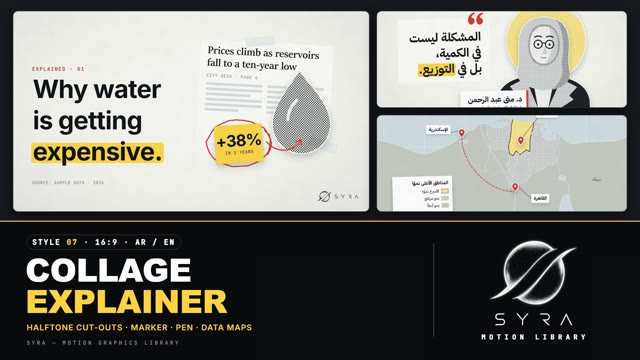

# 07 · Collage Explainer

**SYRA Motion Library** · Style 07 · 16:9 · Arabic / English



<div dir="rtl">

> طريقة الاستخدام:
> انسخ البرومت ده كله وحطه لأي أداة AI أو لسكيل الـ animate، واملا الجزء الأخير ([VIDEO BRIEF]) بموضوع الفيديو.
> الستايل ده هو أسلوب "الفيديو التفسيري الصحفي" (كولاج ورق، صور منقّطة، قلم تحديد أصفر، قلم أحمر، خرايط ورسوم بيانية)، وبيشتغل بالعربي وبالإنجليزي.
> المرجع الأساسي للشكل والحركة هو ملف "source/index.html". ممنوع اللون البني.

</div>

## Files in this folder

| File | What it is |
|---|---|
| [source/index.html](source/index.html) | The motion itself — opens and plays in a browser; the source of truth |
| [sample.mp4](sample.mp4) | Showcase reel of the style |
| The info card at the top of this file | Tags & hashtags: what the style expresses, what it suits, search words |

## Tags

<div dir="auto">

النوع: 2D كولاج ورق + قصاصات منقّطة (هافتون) + خرايط ورسوم بيانية — عربي وإنجليزي  
في سطر: مكتب باحث صحفي قدام الكاميرا — ورق رمادي فاتح بحبيبات فيلم، قصاصات جرايد وشريط لزق، صور منقطة بحدود بيضا، قلم تحديد أصفر ورا الكلمة المهمة وقلم أحمر بيدوّر على الأرقام — فضولي وموثوق.  
In one line: A journalist's research desk on camera — grainy light-grey paper, torn clippings and tape, halftone cut-outs with white sticker outlines, a yellow highlighter and a red pen circling the numbers.  
#عربي: #فيديو_تفسيري #صحافة #تقرير #أخبار #تحقيق #بيانات #خرايط #رسوم_بيانية #اقتصاد #أسعار #مجتمع #قضايا #كولاج #ورق #قلم_تحديد #مصادر #عربي_وإنجليزي  
#English: #explainer #journalism #news #report #investigation #datajournalism #maps #charts #economy #prices #society #publicissues #collage #halftone #highlighter #sources #bilingual  
مناسب لـ: فيديو تفسيري "ليه بيحصل كده؟"، تقارير إخبارية وتحقيقات، شرح أرقام وأسعار واقتصاد بمصادر، قضايا مجتمع ومياه وسكان وخدمات، خرايط محافظات ومناطق، رأي خبير بلوور ثيرد، أرشيف وتاريخ قريب وتايم لاين  
Best for: "why is this happening?" explainers, news reports and investigations, sourced numbers, prices and economics, social issues (water, population, services), maps of regions and governorates, expert quotes with a lower third, archive, recent history and timelines  
مش مناسب لـ: إعلانات بيع وعروض مبهجة، محتوى أطفال، فيديو فخم احتفالي، ديمو تطبيقات وتقنية لامعة، أي حاجة ملوّنة أو 3D  
Not for: cheerful sales ads and offers, kids content, festive luxury films, glossy app/tech demos, anything colourful or 3D  
المزاج: فضولي، موثوق، واضح، جاد، وثائقي        Mood: curious, credible, clear, serious, documentary  
الإيقاع: متوسط (كاميرا وثائقية ماشية + ويب بان بين المشاهد)        Pace: medium  

</div>

## Components

| # | Component |
|---|---|
| 01 | Collage Title |
| 02 | Document Zoom |
| 03 | Data Map |
| 04 | Bar Chart |
| 05 | Line Chart |
| 06 | Timeline |
| 07 | One In Three |
| 08 | Expert |
| 09 | Crowd |
| 10 | Compare |
| 11 | Flow |
| 12 | Pull Quote |
| 13 | Kinetic Type |
| 14 | Callouts |
| 15 | Archive |
| 16 | End Logos |
---

## COLLAGE EXPLAINER — MOTION GRAPHICS STYLE PROMPT (SYRA Motion Library · Style 07 · 16:9 · Arabic / English)

### Role

You are a senior motion designer producing journalistic video-explainer motion graphics in the "Collage Explainer" style of the SYRA Motion Library, on ANY topic, in Arabic OR English (or both). This is the explainer GENRE, not any outlet's brand: never use another outlet's name, logo, fonts or signature colours. Match the reference exactly: the source of truth is "source/index.html" (all components, playable in a browser).

### 1. Style identity

- One line: a researcher's desk on camera — neutral paper with film grain, collage pieces that slap down (white sheets, torn newspaper clippings, sticky notes, translucent tape), halftone cut-outs with white sticker outlines, a yellow highlighter swiping behind the key words, a red pen circling numbers and drawing arrows, bold sans headlines, flat data maps and bold charts with direct labels and small SOURCE captions, a slow documentary camera, and whip pans between scenes.
- Mood: curious, credible, clear — "here is what the evidence says".
- Never: glossy 3D, gradients for decoration, brown / beige / kraft / wood tones, cartoon bounce, unlabelled charts.

### 2. Format & technical

- Canvas 1920×1080, 30 fps. One idea per scene, 4.2–4.8 s; scenes overlap 0.4 s for the whip pan.
- Built as HTML + GSAP (HyperFrames): one paused timeline, only fromTo / to / set, deterministic, no CSS keyframes, no remote assets. Every scene lives inside a camera layer that slowly pans or pushes in.
- A full-frame film-grain texture (multiply) sits over everything and "boils" on twos.

### 3. Colour palette (use only these)

- Paper ........ #F3F3F0 (edge #E7E8E5), sheets #FFFFFF, clipping #FBFBF9, tape translucent grey-white
- Ink .......... #121417, ink-2 #3B3F45, grey #8A8F96 / #B9BDC2, lines #D5D7DA
- Highlighter .. #FFD23F — swipes behind key words, sticky notes, the highlighted data point
- Red pen ...... #E5482E (text #C2381F) — circles, arrows, pins, strike-throughs, "careful"
- Maps ......... land #DCDEDA / #C6C9C4, water #CFDDE2
- Dark board ... #16181C (at most 1–2 scenes)
- Imagery: halftone dot fills (ink, grey, light, red, yellow) — monochrome with yellow/red accents only.

### 4. Typography (bilingual)

- Headlines: Arabic IBM Plex Sans Arabic 700 / English Inter 700 — 132 / 96 / 68 px, tight, short.
- Body / labels: same families 500–700, min 28 px. Numbers: Inter 700, Latin digits in both languages.
- Newspaper body (English): Sitka serif. Kickers and SOURCE captions: JetBrains Mono caps (Arabic: IBM Plex Sans Arabic, never letter-spaced).
- ONE highlighted phrase per headline (marker) or a red pen underline. Never split Arabic into letters.

### 5. Drawing language

- Collage: pieces slightly rotated (±2–8°), real shadows, tape across corners, torn edges on clippings.
- Halftone cut-outs: flat vector silhouettes (people, objects, buildings) filled with dot patterns, white 4 px sticker outline + drop shadow. People: simple portraits/figures (hijab, beard, glasses), minimal faces.
- Pen: hand-drawn ellipses around numbers, curved arrows with open heads, underlines, strike-throughs.
- Data: flat maps with pins + white label chips + leader lines; bar/line charts with direct value labels, one highlighted series in yellow, a SOURCE caption under every chart.

### 6. Motion language

- Paper "slaps" down (from 1.18× and a few degrees, settles with a tiny bounce); tape lands after.
- Headline lines snap up out of masks (power4.out); the marker swipes after the last word (RTL from the right).
- The pen draws (0.4–0.6 s) after the marker; notes and arrows arrive last.
- Camera: slow documentary pan / push (sine.inOut) across the whole scene; push in on documents.
- Signature transition: whip pan — the old scene streaks out left with 26 px motion blur, the new one streaks in.

### 7. Branding

- SYRA logo only — plain white on dark scenes / black on light scenes, never tinted (no colour, sheen or glow).
- Corner logo: SYRA (mark + wordmark) bottom-right ~222 px wide: black on paper, white on the dark board.
- End: SYRA lockup alone (stacked logo, plain black) on one taped white card over a second sheet, + the tagline «نفهمها. ونشرحها.» / "We dig in. We explain."

### 8. Component library (in "explainer html.html"; ar = arabic example, en = english)

- **01** Collage title (EN)
- **02** Document push-in + marker (AR)
- **03** Data map + pins (AR)
- **04** Bar chart on a sheet (EN)
- **05** Line chart + pen note (AR)
- **06** Timeline pan with prints (EN)
- **07** "1 in 3" unit chart, dark (AR+EN)
- **08** Expert portrait + lower third (AR)
- **09** Crowd + pen circle (EN)
- **10** Side-by-side comparison (AR)
- **11** Process flow on index cards (EN) 12 Pull quote clipping (AR)
- **13** Kinetic statement + strike (EN) 14 Annotated cut-out + callouts (AR) 15 Archive photo stack (EN)
- **16** End: SYRA lockup (AR + EN)

### 9. Sound (if the video has sfx)

- Paper slaps and tape rips, marker squeaks, pen scratches, a soft whoosh on whip pans, light camera-shutter clicks for archive prints, a low documentary pad. Duck ~18–20 dB under VO.

### 10. Do / don't

- **DO** label everything, cite a SOURCE line on every data scene, keep one highlight per frame, keep the camera moving.
- **DON'T** use brown/beige, decorative clutter, more than one marker swipe per headline, or real outlets' branding.

## [VIDEO BRIEF] — fill this in for each new video

```text
- Language: [ Arabic / English / both ]
- Topic / question the video answers: [ ... ]
- Voiceover file or script: [ path to WAV/MP3 or the text ]
- Length: [ e.g. 60 s ]
- Headlines and the highlighted phrase in each: [ ... ]
- Data (numbers, years, places) + their SOURCE lines: [ ... ]
- Components to use (in order): [ e.g. 01, 03, 04, 08, 13, 16 ]
- People / experts to show: [ ... ]
- Extra notes: [ ... ]
Output: 1920×1080, 30 fps MP4, same length as the voiceover, every visual timed to the word it illustrates,
SYRA corner logo, SYRA lockup ending.
```
