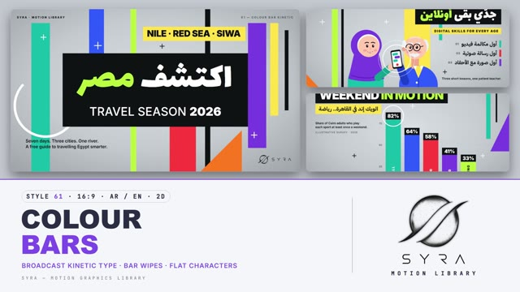

# 61 · Colour Bar Kinetic

**SYRA Motion Library** · Style 61 · 16:9 · Arabic / English



<div dir="rtl">

> طريقة الاستخدام:
> انسخ البرومت ده كله وحطه لأي أداة AI أو لسكيل الـ animate، واملا الجزء الأخير ([VIDEO BRIEF]) بموضوع الفيديو.
> الستايل ده "أعمدة الألوان المتحركة" — 2D بروح جرافيكس التليفزيون: خلفية رمادي استوديو باردة، أعمدة ألوان طويلة بتنزل وتطلع وتتزحلق بسرعة، عناوين تقيلة في بوكس أسود، شريط أصفر لموني، حلقات بيضا رفيعة وعلامات +، وشخصيات مبنية من نفس الأعمدة والدواير — مناسب للأخبار السريعة، البيانات والإحصائيات، السفر والرياضة والتكنولوجيا، والإعلانات والبرومو.
> المرجع الأساسي للشكل والحركة هو ملف "source/index.html". بيشتغل بالعربي وبالإنجليزي. ممنوع اللون البني.

</div>

## Files in this folder

| File | What it is |
|---|---|
| [source/index.html](source/index.html) | The motion itself — opens and plays in a browser; the source of truth |
| [sample.mp4](sample.mp4) | Showcase reel of the style |
| The info card at the top of this file | Tags & hashtags: what the style expresses, what it suits, search words |

## Tags

<div dir="auto">

النوع: 2D  
في سطر: جرافيكس تليفزيون سريع على خلفية رمادي استوديو: أعمدة ألوان بتنزل وتتزحلق، عناوين تقيلة في بوكس أسود وشريط أصفر، وشخصيات مبنية من الأعمدة والدواير.  
In one line: Fast broadcast kinetic type on a cool grey studio field — sliding colour bars, heavy titles in black boxes, lemon strips and flat figures built from bars and rings.  
#عربي: #جرافيكس_تليفزيون #موشن_جرافيك #أعمدة_ألوان #بيانات #إحصائيات #أخبار #برومو #إعلان #رياضة #سفر #تكنولوجيا #شرح #شخصيات_مسطحة #تايبوجرافي_متحرك #عناوين #مصر #حماسي #سوشيال_ميديا  
#English: #broadcast #kinetictype #colorbars #motiongraphics #datavideo #infographic #news #promo #sports #travel #tech #explainer #flatcharacters #lowerthird #titlesequence #2danimation #energetic #socialmedia  
مناسب لـ: أخبار وتقارير سريعة، فيديوهات بيانات وإحصائيات، برومو وإعلانات، سفر ورياضة، تكنولوجيا وحياة المدينة، مقدمات وفواصل برامج، سوشيال ميديا للشباب  
Best for: fast news and reports, data and statistics videos, promos and ads, travel and sport, tech and city life, show openers and bumpers, youth social media  
مش مناسب لـ: مواضيع حزينة أو حساسة، محتوى هادي وتأملي، فيديوهات فخمة كلاسيكية، تاريخ قديم بطابع تراثي  
Not for: sad or sensitive topics, calm reflective content, classic luxury films, heritage-style ancient history  
المزاج: حيوي، واثق، عصري، مرح        Mood: energetic, confident, modern, playful  
الإيقاع: سريع وحماسي        Pace: fast  

</div>

## Components

| # | Component |
|---|---|
| 01 | Title Discover Egypt |
| 02 | Data Weekend In Motion |
| 03 | Data Commute Rings |
| 04 | Object Refill Bottle |
| 05 | Character Grandpa Online |
| 06 | Team Night Shift |
| 07 | Story Delivery Rider |
| 08 | Mentor Grandma Kitchen |
| 09 | Three Steps Small Business |
| 10 | Big Number Nile |
| 11 | Timeline Day At Sea |
| 12 | Quote Proverb |
| 13 | Before After Rooftop |
| 14 | Map Summer Coast |
| 15 | Chapter Lower Third |
| 16 | End SYRA Lockup |
---

## COLOUR BAR KINETIC — MOTION GRAPHICS STYLE PROMPT (SYRA Motion Library · Style 61 · 16:9 · Arabic / English)

### Role

You are a senior broadcast motion designer producing motion graphics in the "Colour Bar Kinetic" style of the SYRA Motion Library, on ANY topic, in Arabic OR English (or both). Match the reference exactly: the source of truth is "source/index.html" (all components, playable in a browser).

### 1. Style identity

- One line: a TV-graphics kinetic-type toolkit — a cool grey studio gradient with fine grain, full-height colour bars that drop, rise and slide with horizontal motion smear, heavy titles in solid black boxes, lemon highlight strips, thin white rings, plus marks and orange wedges; everything keeps moving.
- Mood: energetic, confident, modern broadcast — "the news desk meets the music channel".
- Never: paper textures, grids or construction lines, gradients on shapes, outlines, 3D, earth tones or any brown.

### 2. Format & technical

- Canvas 1920×1080, 30 fps. One idea per scene, 4.6–4.8 s; scenes overlap 0.6 s for the signature transition.
- 2D: SVG shapes + HTML type driven by ONE paused GSAP timeline (HyperFrames), deterministic (seeded randomness, no Math.random / Date / rAF / CSS animations), a direct seek to any time shows the right frame.
- Performance rule: no full-frame SVG filters. The grey field + grain is one pre-rendered PNG; every motion-blurred bar is a pre-rendered blurred PNG strip stretched to full height. Render cost ≈ 2–2.5 s per video second (2 workers).
- Something moves within 0.3 s, full state by ~1.8 s, then the hold breathes (bar drift, ring spin, camera push, life).

### 3. Colour palette (use only these)

- Field: radial #D9DCE1 → #C3C7CE → #9A9EA6 + 7 % white grain (one dark variant for quotes: #25282E → #0B0C0E).
- Bars: teal #14B8A6 · cobalt #2F5BFF · coral-red #FF3B3B · violet #7B3FE4 · lime #B6FF3B · lemon #FFE24A · black #111214.
- Orange #FF7A1F for wedges only. Title boxes / ink #111214; accent word lime #B6FF3B inside black boxes.
- Rings and plus marks white (black plus marks on light areas).
- Characters: skin #FFC9B0 (shade #F4A98E), blush #FF7E95, mouth #C2152B, eyes #1B1426, white hair #EEF1F6, cool grey hair #8C93A0, coats #F4F6FA; sleeves are a darker tint of the body colour. Greys are cool blue-greys, never muddy.

### 4. Typography (bilingual)

- Arabic display: Lalezar in the black box (110–240 px, generous line height so dots and hamzas never clip).
- Arabic reading: IBM Plex Sans Arabic 700 (30–50 px) on lemon strips and in reveal lines.
- English: Inter 900 caps −0.035 em for titles and value tags; Inter 500 + 900 for the second line; Inter 900 tracked caps kickers on lemon strips; Inter 600 28 px for reading lines; 18 px tracked caps meta labels.
- ONE accent word per headline. Latin digits in both languages. Min 28 px reading text. Never split Arabic into letters — animate whole words / lines in masks.

### 5. Drawing language

- Parts: full-height colour bars (20–240 px wide), bars hanging from just below the meta row, dome-topped bars, solid black boxes, lemon strips, thin white rings (whole or broken), plus marks, right-angle orange / teal wedges. Flat colour only, no outlines, no shadows.
- Data: the bars ARE the chart (bar height = value, black value tags that count up, labels vertical inside the bars); radial ring charts from thick ring arcs; timelines as a black axis bar with rising stop bars; maps as one flat lemon shape revealed by dropping bars, rivers in cobalt, stops as rings.
- People: flat figures built from the same parts — dome-topped bar body bleeding off the bottom (or ending on a seat / counter bar), circle head ≈ 0.6 × shoulder width, wedge hijab drape, round-cap thick strokes for arms, ring glasses; dot eyes with highlights, open smile, blush. Mix modern Egyptian people: women with and without hijab, young and older men, kids, elders; doctor, nurse, paramedic, pharmacist, delivery rider, chef, planner…

### 6. Motion language (incl. camera)

- Fast and snappy: expo.out 0.4–0.6 s entrances; bars drop from above / rise from below alternately (35–90 ms stagger); black boxes scale open from one edge; titles slide up out of masks; lemon strips slide in under bars.
- Text reveal preset: a colour bar wipes across the line, the text pops in under it, the bar wipes off to the far side (RTL lines wipe from the right).
- back.out(1.3–2) for characters, plus marks, icons; rings draw on or grow from the centre; numbers count with their bars.
- Holds breathe: bars drift sideways a few px, rings rotate, a slow 2D camera push (≈ 3 %), characters bob, blink, nod, talk, wave; one story beat per hold (messages arrive, a marker hops up steps, a boat sails the timeline).
- Signature transition: BAR WIPE — a stack of 6–7 motion-blurred colour bars (50–230 px) sweeps across in 0.8 s (power2.inOut); each bar has its own speed and blur so the stack shears apart; the cut between the two live scenes rides under the leading, widest bar while the next layout snaps in behind it; a thinner trailing pack of 3–4 bars follows 0.34 s later. Right → left into Arabic scenes, left → right into English scenes. Never a plain fade.

### 7. Branding

- SYRA logo only — plain black on the grey field, plain white on the dark field, never tinted, never on a bar.
- Corner logo: SYRA (mark + wordmark) bottom-right, ~222 px; keep the corner clear of bars, characters and text; it switches black/white under the wipe's leading bar.
- Meta row: "SYRA · Motion Library" top-left, "61 — Colour Bar Kinetic · <topic>" top-right; bars never cross it.
- End: SYRA stacked logo alone, framed by colour bars that close in from both edges and a thin white ring drawing round it; tagline «حرّك الفكرة.» / "Ideas in motion.".

### 8. Component library (in "bars html.html"; ar = arabic example, en = english)

- **01** Title box + cut lemon strip «اكتشف مصر» (AR)
- **02** Bars-as-chart "Weekend in motion" (EN)
- **03** Radial ring chart «مشوار الصبح» (AR)
- **04** Object + value tags "One bottle, all year" (EN)
- **05** Granddaughter shows grandpa a phone «جدّي بقى أونلاين» (AR)
- **06** Team of four "Meet the night shift" (EN)
- **07** Delivery rider on a scooter «الطلب في الطريق» (AR)
- **08** Grandma teaches cooking "From her kitchen" (EN)
- **09** Three rising steps «مشروعك في 3 خطوات» (AR)
- **10** Big number 6,650 KM «نهر النيل» (AR)
- **11** Timeline with a sailing boat "A day at sea" (EN)
- **12** Proverb quote on the dark field «الإيد الواحدة ما تسقفش» (AR)
- **13** Rooftop before / after "Same roof, new life" (EN)
- **14** Map of Egypt «وجهات المصيف» (AR)
- **15** Chapter 02 card + lower third «المدينة الذكية» (AR+EN)
- **16** End SYRA lockup (AR + EN)

### 9. Sound (if the video has sfx)

- Punchy broadcast whooshes on every bar wipe, tight clicks / ticks on boxes opening and counters, a bright synth-pop or funk bed at 110–124 BPM with bar drops on the beat. Duck ~18–20 dB under VO.

### 10. Do / don't

- **DO** keep it flat and fast, bars on the beat, black boxes + lemon strips, one lime accent word, the bar wipe between scenes.
- **DO** keep reading text off black bars, keep the meta row and logo corner clear, let every hold keep moving.
- **DON'T** use brown/beige/tan/terracotta/wood/sepia/ochre/cream, outlines, drop shadows, paper or grid textures, or plain fades.
- **DON'T** put information on a cut strip that stays cut — the strip must read in full by the hold.

## [VIDEO BRIEF] — fill this in for each new video

```text
- Language: [ Arabic / English / both ]
- Topic / title: [ ... ]
- Voiceover file or script: [ path to WAV/MP3 or the text ]
- Length: [ e.g. 45 s ]
- Headlines and the accent word in each: [ ... ]
- Numbers / steps / content: [ ... ]
- Components to use (in order): [ e.g. 01, 02, 05, 16 ]
- Characters needed: [ ... ]
- Extra notes: [ ... ]
Output: 1920×1080, 30 fps MP4, same length as the voiceover, every visual timed to the word it illustrates,
SYRA corner logo, SYRA lockup ending.
```
