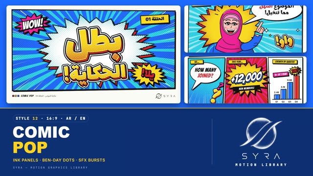

# 12 · Comic Pop

**SYRA Motion Library** · Style 12 · 16:9 · Arabic / English



<div dir="rtl">

> طريقة الاستخدام:
> انسخ البرومت ده كله وحطه لأي أداة AI أو لسكيل الـ animate، واملا الجزء الأخير ([VIDEO BRIEF]) بموضوع الفيديو.
> الستايل ده "قصص مصورة" — حبر أسود سميك، نقط بن-داي، لوحات، فقاعات كلام وانفجارات صوتية — مناسب للحكايات، الشرح المرح، السوشيال، والتعليم.
> المرجع الأساسي للشكل والحركة هو ملف "source/index.html". بيشتغل بالعربي وبالإنجليزي. ممنوع اللون البني.

</div>

## Files in this folder

| File | What it is |
|---|---|
| [source/index.html](source/index.html) | The motion itself — opens and plays in a browser; the source of truth |
| [sample.mp4](sample.mp4) | Showcase reel of the style |
| The info card at the top of this file | Tags & hashtags: what the style expresses, what it suits, search words |

## Tags

<div dir="auto">

النوع: 2D كوميكس فلات بحبر أسود تقيل + نقط بن-داي (بوب آرت) — عربي وإنجليزي  
في سطر: صفحات كوميكس بلوحات مايلة وحدود حبر سميكة، ألوان صريحة بنقط بوب آرت، فقاعات كلام وانفجارات صوت «واو!» «يلا!» "BOOM!" وشخصيات معبّرة — حماسي ومضحك ودافي.  
In one line: Modern comic-book pop art — tilted panels with thick ink outlines, bold flat colour with Ben-Day dots, speech balloons, action bursts and big SFX lettering, with expressive characters.  
#عربي: #كوميكس #قصص_مصورة #بوب_آرت #حكاية #قصة #حوار #مضحك #حماسي #شباب #سوشيال_ميديا #تعليم_مرح #رياضة #كرتون #فقاعات_كلام #إنفوجرافيك_مرح #حملة  
#English: #comic #comicbook #popart #storytelling #story #dialogue #funny #energetic #youth #socialmedia #edutainment #sports #cartoon #speechbubbles #bendaydots #sfx #campaign  
مناسب لـ: حكايات وقصص بشخصيات وحوار، شرح مرح لفكرة أو مشكلة وحلّها، محتوى سوشيال حماسي (رياضة، تحديات، مسابقات)، أرقام وإنجازات بأسلوب "بووم!"، تعليم للمراهقين والشباب، حملات توعية خفيفة، قبل/بعد وخطوات بشكل ستريب كوميكس  
Best for: character stories and dialogue, fun problem-and-solution explainers, high-energy social content (sports, challenges, contests), "BOOM!" numbers and milestones, teen and youth education, light awareness campaigns, before/after and steps as comic strips  
مش مناسب لـ: محتوى رسمي حكومي أو فخم، مواضيع حزينة أو طبية حساسة، تقارير صحفية جادة، أي حاجة محتاجة هدوء أو صور حقيقية  
Not for: formal government or luxury content, sad or sensitive medical topics, serious journalistic reports, anything needing calm or real photos  
المزاج: حماسي، مضحك، دافي، جريء، شقي        Mood: energetic, funny, warm, bold, cheeky  
الإيقاع: سريع وحماسي (ضربات impact وهزّة)        Pace: fast and punchy  

</div>

## Components

| # | Component |
|---|---|
| 01 | Title Hero |
| 02 | Three Panels |
| 03 | Chat Balloons |
| 04 | Big Number |
| 05 | Hero Point |
| 06 | Team Pose |
| 07 | Dialogue |
| 08 | Aha Moment |
| 09 | Before After |
| 10 | Three Steps |
| 11 | Map Everywhere |
| 12 | Bars |
| 13 | SFX Noise |
| 14 | Phone Zoom |
| 15 | Issue Cover |
| 16 | End Logos |
---

## COMIC POP — MOTION GRAPHICS STYLE PROMPT (SYRA Motion Library · Style 12 · 16:9 · Arabic / English)

### Role

You are a senior motion designer producing motion graphics in the "Comic Pop" style of the SYRA Motion Library, on ANY topic, in Arabic OR English (or both). Match the reference exactly: the source of truth is "source/index.html" (all components, playable in a browser).

### 1. Style identity

- One line: modern comic-book / pop-art storytelling — tilted panels with gutters, 8–10 px ink outlines, flat bold colour with graded Ben-Day halftone shading, speech balloons and caption boxes, action bursts with speed lines and big SFX lettering («يلا!», «واو!», "BOOM!").
- Mood: energetic, funny, warm — "every future starts with a story".
- Never: gradients, soft 3D, thin lines, brown/beige skin or backgrounds.

### 2. Format & technical

- Canvas 1920×1080, 30 fps. One idea per scene, 4.2–4.8 s; scenes overlap 0.6 s for the signature transition.
- HTML + GSAP (HyperFrames): one paused timeline, only fromTo / to / set, deterministic (seeded randomness), no CSS keyframes, no remote assets. Hold the full state for the last ~1 s of every scene before the transition.

### 3. Colour palette (use only these)

- Paper #FAFAF7 · ink #111
- Comic red #E8352B · electric blue #1E6BFF · sunshine yellow #FFD21E · cyan #22C3E6 · magenta #FF3E9A · white
- Skin: rosy peach #FFC9B9 shaded with red dots (never beige/brown)

### 4. Typography (bilingual)

- Arabic display / SFX: Lalezar (extruded comic lettering with ink outline + coloured 3D block). Arabic balloons: Marhey.
- English titles, SFX and captions: Bangers (uppercase). Small UI: Inter / IBM Plex Sans Arabic.
- Latin digits in both languages. Min 28 px for reading text. Never split Arabic into letters.

### 5. Drawing language

- Panels (hero, three-panel, two-panel, full bleed), bursts, rays, speed lines, Ben-Day vignettes, balloons with tails, caption boxes, SFX lettering, sparkles.
- Characters: bold-outlined comic people with expressive faces and dynamic poses (hijab, beard, glasses, curly hair).

### 6. Motion language

- Real comic timing: anticipation → smash-in with overshoot → impact frame (white flash + ink focus lines) → shake → hold with line boil; accents stepped on twos (12 fps).
- Balloons pop from their tail tip; SFX punch with rotation; numbers count on twos.
- Characters swap hand-drawn key poses with smears between them.
- Signature transition: panelWipe — a slanted ink seam with a halftone band races across; the new page lands with a jolt.

### 7. Branding

- SYRA logo only — plain white on dark scenes / black on light scenes, never tinted (no colour, sheen, glow or shading on it).
- Corner logo: SYRA (mark + wordmark) bottom-right ~222 px — black on paper / yellow / cyan, white on blue / red / magenta / ink.
- End: SYRA lockup alone (plain black, slammed into the white burst with an impact frame) + the tagline «المستقبل يبدأ بحكاية!» / "Every future starts with a story.".

### 8. Component library (in "comic html.html"; ar = arabic example, en = english)

- **01** Hero title burst (AR)
- **02** Three-panel stat (EN)
- **03** Balloon chat (AR)
- **04** 1,000,000 BOOM (EN)
- **05** Hero pointing (AR)
- **06** Team hero pose (EN)
- **07** Shot / reverse-shot dialogue (AR)
- **08** AHA! idea moment (EN)
- **09** Before / after panels (AR)
- **10** Three-step strip (EN)
- **11** Comic map of Egypt (AR)
- **12** Comic bar chart (AR)
- **13** ZAP! POW! BOOM! (EN)
- **14** Phone zoom panel (AR)
- **15** Comic cover + lower third (AR+EN)
- **16** End: SYRA lockup (AR + EN)

### 9. Sound (if the video has sfx)

- Cartoon whooshes, punchy hits on impact frames, pops for balloons, rumble on big numbers, playful upbeat bed. Duck ~18–20 dB under VO.

### 10. Do / don't

- **DO** use holds and impact frames, keep ink weight constant, one big hit per scene, readable balloons.
- **DON'T** fade things in softly, use thin lines, gradients, or brown/beige skin.

## [VIDEO BRIEF] — fill this in for each new video

```text
- Language: [ Arabic / English / both ]
- Topic / title: [ ... ]
- Voiceover file or script: [ path to WAV/MP3 or the text ]
- Length: [ e.g. 45 s ]
- Headlines and the accent word in each: [ ... ]
- Numbers / steps / content: [ ... ]
- Components to use (in order): [ e.g. 01, 05, 09, 16 ]
- Characters needed: [ ... ]
- Extra notes: [ ... ]
Output: 1920×1080, 30 fps MP4, same length as the voiceover, every visual timed to the word it illustrates,
SYRA corner logo, SYRA lockup ending.
```
