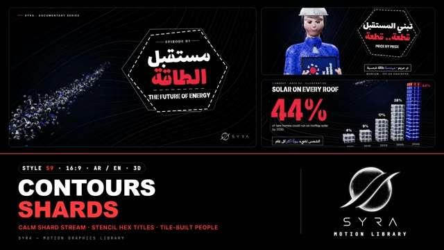

# 59 · Contours and Shards

**SYRA Motion Library** · Style 59 · 16:9 · Arabic / English



<div dir="rtl">

> طريقة الاستخدام:
> انسخ البرومت ده كله وحطه لأي أداة AI أو لسكيل الـ animate، واملا الجزء الأخير ([VIDEO BRIEF]) بموضوع الفيديو.
> الستايل ده "خطوط وشظايا" — 3D حقيقي (WebGL / three.js): خلفية سودا خالص عليها خطوط كنتور بيضا رفيعة، وشريط واحد هادي من مكعبات وشظايا معدن صغيرة (رمادي جرافيت وفضي ولمسة أزرق كوبالت) طالع من الضلمة بعمق ميدان حقيقي، والعناوين جوّه لوحة سداسية سودا بحدود بيضا متقطعة وحروف ستنسل. الشخصيات والأرقام والخرايط والأعمدة مبنية من بلاطات ومكعبات صغيرة بتتجمّع قطعة قطعة — شكل وثائقي سينمائي هادي ومريح للعين.
> مناسب للأفلام الوثائقية القصيرة، الطاقة والتكنولوجيا والمدن، الصحة والرياضة، المشروعات الصغيرة، تقارير البيانات، ومقدمات الحلقات. المرجع الأساسي للشكل والحركة هو ملف "source/index.html". بيشتغل بالعربي وبالإنجليزي. ممنوع اللون البني والبيج.

</div>

## Files in this folder

| File | What it is |
|---|---|
| [source/index.html](source/index.html) | The motion itself — opens and plays in a browser; the source of truth |
| [sample.mp4](sample.mp4) | Showcase reel of the style |
| The info card at the top of this file | Tags & hashtags: what the style expresses, what it suits, search words |

## Tags

<div dir="auto">

النوع: 3D (WebGL / three.js) — وثائقي سينمائي هادي على أسود  
في سطر: خلفية سودا بخطوط كنتور بيضا رفيعة وشريط هادي من مكعبات وشظايا معدن صغيرة، وعناوين ستنسل جوّه لوحة سداسية، وكل حاجة — ناس وأرقام وخرايط — بتتبني قطعة قطعة.  
In one line: A calm cinematic documentary look in real 3D — black field, thin white contour lines, one slow ribbon of small metal shards, stencil titles in a hexagon plate, and people, numbers and maps that crystallise from tiny tiles.  
#عربي: #وثائقي #طاقة #طاقة_شمسية #تكنولوجيا #مدن_ذكية #صحة #رياضة #مشروعات_صغيرة #بيانات #أرقام #إنفوجرافيك #مقدمة_حلقة #سينمائي #هادي #شظايا #مكعبات #خريطة_مصر #النيل #مجسم_3D  
#English: #documentary #energy #solar #technology #smartcities #health #sport #smallbusiness #data #infographic #numbers #episodeopener #cinematic #calm #shards #cubes #contourlines #stencil #egyptmap #3d  
مناسب لـ: أفلام وثائقية قصيرة ومقدمات حلقات، الطاقة والطاقة الشمسية والبيئة، التكنولوجيا والبرمجة والمدن الذكية، تقارير بيانات وأرقام هادية، الصحة والرياضة، المشروعات الصغيرة وريادة الأعمال، قصص ناس مصريين حقيقيين في شغلهم (مهندسة، دكتورة، صياد، شيف، مبرمج)  
Best for: short documentaries and episode openers, energy / solar / environment, tech, coding and smart cities, calm data reports and big numbers, health and sport, small business and entrepreneurship, portraits of everyday Egyptian professionals  
مش مناسب لـ: محتوى أطفال صغيرين أو كوميدي، إعلانات عروض سريعة وصاخبة بألوان كتير، خلفيات فاتحة أو نهارية، قصص عاطفية قريبة جدًا على الوش  
Not for: young kids or comedy, loud fast promo offers with many colours, light / daytime looks, very close emotional face-driven stories  
المزاج: هادي، دقيق، فخم، متفائل، سينمائي        Mood: calm, precise, premium, hopeful, cinematic  
الإيقاع: هادي        Pace: calm  

</div>

## Components

| # | Component |
|---|---|
| 01 | Title Future Of Energy |
| 02 | Data Solar Bars |
| 03 | Data Walk Ring |
| 04 | Object Shop App Phone |
| 05 | Character Engineer Mariam |
| 06 | Team City Heroes |
| 07 | Story Fisherman Catch |
| 08 | Mentor Learn To Code |
| 09 | Three Steps Small Business |
| 10 | Big Number Steps |
| 11 | Timeline Day On The Nile |
| 12 | Quote Proverb |
| 13 | Before After Rooftop |
| 14 | Map Egypt Nile |
| 15 | Chapter Lower Third |
| 16 | End SYRA Lockup |
---

## CONTOURS & SHARDS — MOTION GRAPHICS STYLE PROMPT (SYRA Motion Library · Style 59 · 16:9 · Arabic / English)

### Role

You are a senior motion designer producing motion graphics in the "Contours & Shards" style of the SYRA Motion Library, on ANY topic, in Arabic OR English (or both). Match the reference exactly: the source of truth is "source/index.html" (all components, playable in a browser).

### 1. Style identity

- One line: a calm cinematic documentary title look — a pure black field crossed by thin white contour / flow lines, ONE slow ribbon of small metal cubes and flat shards gliding out of the dark with real depth of field, titles set in a black hexagon "plate" (dashed white outline + two offset hexagon strokes) in home-made stencil type; people, numbers, bars and maps are built from tiny tiles that crystallise piece by piece.
- Mood: calm, precise, premium, hopeful — "building the future, piece by piece". Lots of black space; easy on the eye.
- Never: a noisy cloud or explosion of particles, glitter, rainbow colours, warm earth tones, any brown/beige/tan/cream.

### 2. Format & technical

- Canvas 1920×1080, 30 fps. One idea per scene, 4.6–4.8 s; scenes overlap 1.1 s for the signature transition.
- Real 3D: three.js r160 in ONE shared WebGL renderer / canvas for the whole film; every frame = 3D (instanced cubes, shadow-casting key light, PMREM studio reflections) → depth-aware DOF + ACES post → composited with a 2D contour field under it and a 2D type layer over it. HTML + GSAP (HyperFrames): one paused timeline, deterministic (seeded randomness, no clocks), every value a pure function of timeline time. Characters are pre-baked tile sets (never sampled at render).
- Full state by ~2.6 s, then hold with slow drift; nothing freezes.

### 3. Colour palette (use only these)

- Field pure black #000000 with a faint cobalt haze rgba(20,34,90,.5) behind the subject; contour lines white 15–17 %, every 5th line 30–34 %.
- Metal: graphite #2A2F3A / light graphite #454C5C · silver #DDE3EE · cobalt #2F5BFF (dark #1D3FC9).
- Accent coral-red #FF3B3B — ONE accent word per headline, one data highlight; in the shard stream at most 2 pieces.
- Arabic secondary accent (small lines, roles) #7D9BFF. Skin rosy peach #FBBDAF family; hair ink #1B1F27; grey #9AA1AE.
- Stream colour mix: ≈ 58 % graphite, 35 % silver, 7 % cobalt.

### 4. Typography (bilingual)

- Arabic display: Lalezar, turned into a stencil by cutting a bridge into every enclosed counter (whole words, shaping intact, never split into letters). English display + big numbers: Inter 900 condensed (scaleX .8) with stencil breaks in the stems of B D E F H K P R and bridges in O, A, R, 0, 4, %.
- Small Arabic lines: IBM Plex Sans Arabic 700 (accent word in #7D9BFF). English body Inter 500, tracked caps Inter 700–800 (≥ 22 px). Kicker = short coral dash + tracked caps. Latin digits in both languages. Min ~28 px reading text.
- Text reveals rise out of masks with headroom (dots and hamzas never clipped), Arabic line first, English after.

### 5. Drawing language (3d modelling / materials / lighting)

- Shards: one bevelled cube (smooth chamfer normals so every edge catches light); flat shards = the same cube scaled (1.5, .9, .22); needles (thin streaks) aligned to the flow, ≤ 7 % of the pieces. Narrow size band (2 : 1).
- The stream: a flattened ribbon (not a tube) along a curve that follows the contour lines, thin where it comes out of the fog, wider and softer near the lens, both ends fading; one slow shared wave; budget ≤ 1 700 cubes on a title, ≤ 550 on a data scene, ≤ 200 loose cubes near a character; ≥ 60 % of the frame stays clean black. Nothing over the plate or type (≥ 80 px from the plate, ≥ 60 px from text). 0–2 soft out-of-focus pieces, only on a frame edge.
- Materials: satin metal (metalness .72, roughness .42), low sparkle; studio reflections from soft strips; key light with a 2048 soft shadow, strong cool rim from behind, low hemisphere fill, fog to black for depth.
- Objects from cubes: bars on a contour-map floor, a dial ring of cube stacks, a tile-built phone, voxel icons on cube plinths, a stencil number turned into a cube relief, a cube house with cobalt solar panels, a cube map of Egypt with the Nile as a cobalt ribbon, cube quote marks.
- People: medium close-ups built from ~8–18k tiles (finest on the eyes and face, a calm "shard skin" on clothes) — friendly animated-film faces: big soft eyes in sockets with lids and catch-lights, soft arched brows, button nose, full cheeks, closed smile with lifted corners, real hands (grip / point). Cast: engineer in a hard hat, doctor in hijab and white coat, programmer with headphones, chef in a toque, fisherman with a cap and grey moustache holding a silver fish, mentor with glasses holding a tablet, teen girl in hijab.

### 6. Motion language (incl. camera)

- Calm by default: the stream drifts (0.016–0.1 per second along its curve), spins ≤ ±0.6 rad/s and breathes as a whole; the contour field drifts slowly; the plate scales 1.06 → 1 with a slight rotation settle while its dashed outline crawls.
- Builds: cubes land with a small overshoot (bars level by level, the dial sweeping round, the number built left → right by the stream, panels laid as a divider passes); data counts up with the build. Camera: slow push / micro-drift only.
- Signature transition: SHARD FRONT — a contour-shaped front sweeps the frame from the top-left corner to the bottom-right. Ahead of it the old picture breaks into small square shards that shrink away; inside a dark gap a calm streaked ribbon of metal shards glides down the contour (fast for a moment, then settling); behind it the next scene crystallises tile by tile (people and objects lock in as the front passes them). The contour lines never cut — they morph across the front. Elegant and quiet, never an explosion.

### 7. Branding

- SYRA logo only — plain white on this always-dark style, never tinted, never lit or shaded, no sheen.
- Corner logo: SYRA (mark + wordmark) bottom-right ~222×60 px, plain fade in; keep the corner on clean black (busts sink into darkness at the bottom).
- End: the SYRA stack logo alone inside the hexagon plate (rises out of a mask), with «نبني المستقبل.. قطعة قطعة» / "BUILDING TOMORROW, PIECE BY PIECE"; no corner logo on the end scene.

### 8. Component library (in "shards html.html"; ar = arabic example, en = english)

- **01** Title in the hexagon plate «مستقبل الطاقة» + EPISODE 01 (AR)
- **02** Cube bars on a contour floor "SOLAR ON EVERY ROOF" 44 % (EN)
- **03** Cube dial ring 68 % «نمشي أكثر.. ننام أحسن» (AR)
- **04** Tile-built phone + orbiting voxel icons "YOUR SHOP, ONE TAP AWAY" (EN)
- **05** Eng. Mariam with a solar tablet «تبني المستقبل.. قطعة قطعة» (AR)
- **06** Team: doctor, programmer, chef "ONE CITY, ONE TEAM" (EN)
- **07** Am Saad the fisherman and his catch «كل صباح.. رزق جديد» (AR)
- **08** Mentor & learner, code on a tablet "LEARN TO CODE, TOGETHER" (EN)
- **09** Three steps on cube plinths «ابدأ مشروعك» idea · plan · first customer (AR)
- **10** Big number 10,000 built from cubes «خطوة.. كل يوم» (AR)
- **11** Timeline "A DAY ON THE NILE" along a shard ribbon (EN)
- **12** Quote in the plate «من جدّ وجد» + cube quote marks (AR)
- **13** Before / after rooftop solar "SAME ROOF, SMALLER BILL" (EN)
- **14** Cube map of Egypt, the Nile as a cobalt ribbon «من النيل.. للبحر» (AR)
- **15** Chapter 02 «المدن الذكية» + lower third (AR + EN)
- **16** End: SYRA logo in the plate + tagline (AR + EN)

### 9. Sound (if the video has sfx)

- A low cinematic pad and soft pulse; airy metallic shimmers (very soft) under the stream; a short glassy "tick-tick" cascade on the Shard Front; light clicks as cubes land. Duck ~18–20 dB under VO.

### 10. Do / don't

- **DO** keep ONE calm ribbon per frame, lots of black, the hexagon plate + stencil type, one coral word, faces friendly and checked at 100 %, characters and objects that crystallise from tiles.
- **DON'T** use brown/beige/tan/terracotta/wood/sepia/ochre/cream, dense particle clouds or explosions, sparkle overload, shards over text, coral confetti, or any logo other than SYRA.

## [VIDEO BRIEF] — fill this in for each new video

```text
- Language: [ Arabic / English / both ]
- Topic / title: [ ... ]
- Voiceover file or script: [ path to WAV/MP3 or the text ]
- Length: [ e.g. 45 s ]
- Headlines and the accent word in each: [ ... ]
- Numbers / steps / content: [ ... ]
- Components to use (in order): [ e.g. 01, 05, 10, 16 ]
- Characters needed: [ ... ]
- Extra notes: [ ... ]
Output: 1920×1080, 30 fps MP4, same length as the voiceover, every visual timed to the word it illustrates,
SYRA corner logo, SYRA plate ending.
```
