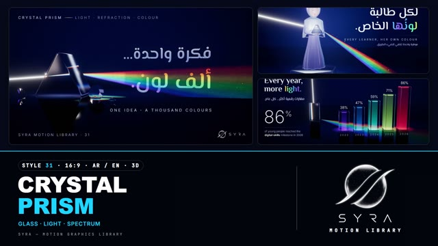

# 31 · Crystal Prism

**SYRA Motion Library** · Style 31 · 16:9 · Arabic / English



<div dir="rtl">

> طريقة الاستخدام:
> انسخ البرومت ده كله وحطه لأي أداة AI أو لسكيل الـ animate، واملا الجزء الأخير ([VIDEO BRIEF]) بموضوع الفيديو.
> الستايل ده "منشور الكريستال" — 3D حقيقي (WebGL / three.js): زجاج ومنشورات وأحجار مقطوعة وتماثيل كريستال صغيرة على أرضية سوداء لامعة زي المراية، وشعاع نور أبيض بيدخل الزجاج ويطلع قوس قزح، والنور هو اللي بيحرّك المشهد — مناسب للمحتوى الراقي والملهم: إطلاق منتجات، قصص نجاح، بيانات وأرقام، صحة ورياضة وأكل وتكنولوجيا وحياة المدينة.
> المرجع الأساسي للشكل والحركة هو ملف "source/index.html". بيشتغل بالعربي وبالإنجليزي. ممنوع اللون البني.

</div>

## Files in this folder

| File | What it is |
|---|---|
| [source/index.html](source/index.html) | The motion itself — opens and plays in a browser; the source of truth |
| [sample.mp4](sample.mp4) | Showcase reel of the style |
| The info card at the top of this file | Tags & hashtags: what the style expresses, what it suits, search words |

## Tags

<div dir="auto">

النوع: 3D حقيقي (WebGL) — زجاج ونور وقوس قزح  
في سطر: منشورات زجاج وأحجار مقطوعة وتماثيل كريستال صغيرة على أرضية سودا زي المراية، وشعاع نور أبيض بيدخل الزجاج ويطلع قوس قزح ينوّر الكلام، إحساس راقي وملهم وهادي زي محل مجوهرات.  
In one line: Glass prisms, cut gems and small crystal figurines on a black mirror floor, where a white beam enters the glass and fans out into a rainbow that lights the words, refined, inspiring and calm like a jeweller's studio.  
#عربي: #كريستال #زجاج #منشور #قوس_قزح #نور #فخم #راقي #ملهم #إطلاق_منتج #قصص_نجاح #ثري_دي #مجوهرات #جوايز #تكريم #بيانات #شباب_وتعليم #مواهب  
#English: #crystal #glass #prism #rainbow #spectrum #light #luxury #premium #elegant #inspiring #productlaunch #successstory #3d #gem #awards #data #talent #refraction  
مناسب لـ: إطلاق منتج راقي أو براند، قصص نجاح ومواهب وتكريم، حفلات جوايز وافتتاحات، أرقام نمو بشكل فخم، رسائل ملهمة (تنوع، تعليم، إبداع)، إعلانات مجوهرات وعطور وتجميل، تحول "من الخام للمعان" (تدريب وتطوير)  
Best for: premium product or brand launches, success, talent and recognition stories, award ceremonies and openings, elegant growth numbers, inspiring messages (diversity, learning, creativity), jewellery, perfume and beauty ads, "rough to radiant" training/development stories  
مش مناسب لـ: محتوى أطفال مرح أو كرتوني، شرح علمي تفصيلي بأجزاء وأسهم، فيديو حماسي سريع زي الرياضة والمسابقات، مواضيع شعبية بسيطة محتاجة دفء وناس كتير  
Not for: playful cartoon kids' content, detailed labelled science explainers, fast hype videos like sports or quizzes, folksy everyday topics needing warmth and crowds  
المزاج: منوّر، ثمين، متفائل، هادي، فخم        Mood: luminous, precious, hopeful, calm, premium  
الإيقاع: هادي (النور هو اللي بيتحرك، كاميرا بطيئة)        Pace: calm  

</div>

## Components

| # | Component |
|---|---|
| 01 | Title Prism Light |
| 02 | Data Glass Columns |
| 03 | Data Ring Arabic |
| 04 | Product Gem Icons |
| 05 | Character Hijab Prism |
| 06 | Team Figurines |
| 07 | Story Chef Bowl |
| 08 | Mentor Learner |
| 09 | Three Steps |
| 10 | Big Number |
| 11 | Timeline Rail |
| 12 | Quote Guillemets |
| 13 | Before After Gem |
| 14 | Map Egypt Nile |
| 15 | Chapter Lower Third |
| 16 | End Logo |
---

## CRYSTAL PRISM — MOTION GRAPHICS STYLE PROMPT (SYRA Motion Library · Style 31 · 16:9 · Arabic / English · 3D)

### Role

You are a senior motion designer producing motion graphics in the "Crystal Prism" style of the SYRA Motion Library, on ANY topic, in Arabic OR English (or both). Match the reference exactly: the source of truth is "source/index.html" (all components, playable in a browser).

### 1. Style identity

- One line: glass, light and spectrum in a night-navy studio — bevelled prisms, brilliant-cut gems and frosted-crystal figurines stand on a black mirror floor; a white beam enters the glass and leaves as a spectral fan that lights the objects and even the letters; real dispersion, bloom, glitter motes, a jeweller's calm.
- Mood: luminous, precious, hopeful — "one idea, a thousand colours".
- Never: flat cartoon colour, busy backgrounds, warm earth tones, brown/gold, fast cuts inside a scene.

### 2. Format & technical

- Canvas 1920×1080, 30 fps. One idea per scene, 4.6–4.9 s; scenes overlap 0.8 s for the signature transition.
- Real-time 3D: three.js r160 in ONE shared WebGL renderer / canvas for the whole film, inside HTML + GSAP (HyperFrames): one paused timeline, DOM only via fromTo / to / set, deterministic (seeded noise), every 3D value a pure function of timeline time; all geometry and text textures built once. Glass = physical transmission with three-tap RGB dispersion; light shapes (beams, fans, floor glows) are additive meshes the glass can refract; mirror floor via reflected clones; HDR bloom, slight chromatic aberration, vignette, fine grain, ACES filmic. Full state by ~2.6 s, then hold with life.

### 3. Colour palette (use only these)

- Studio night-navy #060A1A → #111C4A / #132157 centre glow; floor #070B1F (far #0A1233).
- Type: ink white #F4F7FF, frost #D6E0FB, secondary #C9D4F5 / #AFBCE6 / #9FB0DA.
- Spectrum (7 stops): #FF1F52 rose-red · #FF6624 · #FFE647 lemon (thin band only) · #47FF8F · #1FD6FF · #3866FF · #9942FF violet.
- Figurine gems: rose-quartz skin #FFE1E8 · aquamarine #CFE4FF · sapphire #B3C0FF · amethyst #D4C2FF · mint #C9FBE8 · ruby #FFC4D2 · topaz #C6F2FF · frost white #F4F7FF · indigo #9AA4F0 · hair #8590E6 · silver #EEF1FF.
- Never yellow as the body colour of a glass object (it turns olive on navy); never brown, beige, gold or ochre.

### 4. Typography (bilingual)

- Arabic display: El Messiri 600 (carved, glyphic terminals); Arabic lines El Messiri 500. English display: El Messiri Latin 600. Captions and numbers: Inter 200–300, uppercase, widely tracked (+0.3–0.4 em), hairline and luminous.
- ONE accent word per headline in a spectral fill that shimmers across the letters. Big hero type (titles, big numbers) can be a 3D text plane in the light fan, lit band by band by the spectrum.
- Latin digits in both languages. Reading text ≥ 28 px. Never split Arabic into letters; never letter-space Arabic.

### 5. Drawing language (3d modelling / materials / lighting)

- Objects: bevelled triangular prisms, brilliant-cut gems, glass columns with inner light cores, crystal ring-chart sectors, glass blocks and rails, a glass slab map of Egypt with the Nile as flowing light, crystal guillemets « ».
- Figurines (statuettes on hexagonal crystal plinths): frosted satin crystal with clearcoat sheen and soft inner glow; serene closed downcast eyes; sculpted hands with real fingers. Cast: young woman in hijab (soft throat roll, layered khimar over a folded abaya), man, grandfather with silver beard and glasses, athlete, chef (toque, apron), child. Figures barely move (breathing, a 1° head tilt); they can grow out of their plinths bottom-up with a ring of light.
- Light: white beam → prism → spectral fan (polar, dusty, decaying), floor caustics, point glints where the beam enters, glitter motes; studio PMREM with tall strip softboxes for crisp glass edges; violet / cyan rim lights on figurines.

### 6. Motion language (incl. camera)

- Light is the animator: a beam travels in and strikes the glass, the fan opens like a hand fan, the spectrum reaches the objects and the words, motes twinkle; columns and sectors rise expo-out while numbers count; gems turn slowly.
- Camera: calm, slow dolly / truck (1–2 %) with ease in-out; holds breathe. Type rises from masks, spectral shimmer slides.
- Signature transition: REFRACTION SLICE — a bright glass-blade edge, 20° from vertical, sweeps across the frame (~0.75 s); the old scene bends toward the blade with an RGB split, the new one refracts in behind it, rainbow-fringed, and relaxes; a short spectral fan flashes off the edge mid-frame; titles and captions are cut by the same edge.

### 7. Branding

- SYRA logo only — plain white on these dark scenes (black only on a light scene), never tinted, never lit, glowing or shaded.
- Corner logo: SYRA (mark + wordmark) bottom-right, ~222 px, plain fade in; keep that corner clear.
- End: SYRA stacked logo alone, plain white, floating in a halo of refracted light thrown by a prism; tagline «نرى الغدَ بكلّ ألوانه.» / "Every colour of tomorrow." (no corner logo on the end card).

### 8. Component library (in "crystal html.html"; ar = arabic example, en = english)

- **01** Prism title, headline lit by the spectrum «فكرة واحدة… ألف لون.» (AR)
- **02** Glass columns in spectral bands "Every year, more light." (EN)
- **03** Crystal ring chart + legend «نتحرّك أكثر.» (AR)
- **04** Brilliant gem + orbiting crystal icons "Cut to shine." (EN)
- **05** Hijab figurine holds a prism «لكلّ طالبة لونُها الخاص.» (AR)
- **06** Four figurines grow on plinths "Many facets, one team." (EN)
- **07** Crystal chef, glass bowl, spectral steam «طبقٌ واحد… ألف نكهة.» (AR)
- **08** Grandfather passes the light to a child "Light, passed on." (EN)
- **09** One beam through three crystal blocks «ثلاث خطوات نحو الضوء.» (AR)
- **10** Big number lit by the spectrum +35% (AR)
- **11** Glass-rail timeline, milestones light up "A path of light." (EN)
- **12** Quote with crystal guillemets «النورُ لا يَنقُص… حين نتقاسمه.» (AR)
- **13** Rough crystal → brilliant gem "From rough to radiant." (EN)
- **14** Glass map of Egypt, the Nile as light «نورٌ في كل مدينة.» (AR)
- **15** Chapter 02 card + glass lower third, runner figurine (AR+EN)
- **16** End: SYRA logo in a halo of refracted light (AR + EN)

### 9. Sound (if the video has sfx)

- Airy glass pads and soft piano or celesta; a crystalline "ting" when the beam strikes glass; shimmering chimes as the fan opens; a glassy "shing" + soft chime on every Refraction Slice. Duck ~18–20 dB under VO.

### 10. Do / don't

- **DO** let light do the moving, keep glass edges crisp, one spectral accent word, keep fans away from reading text, mirror floor.
- **DON'T** use brown/beige/gold/ochre/yellow glass, cartoon outlines, busy backdrops, fast cuts inside scenes, or a lit/tinted logo.

## [VIDEO BRIEF] — fill this in for each new video

```text
- Language: [ Arabic / English / both ]
- Topic / title: [ ... ]
- Voiceover file or script: [ path to WAV/MP3 or the text ]
- Length: [ e.g. 45 s ]
- Headlines and the accent word in each: [ ... ]
- Numbers / steps / content: [ ... ]
- Components to use (in order): [ e.g. 01, 05, 09, 16 ]
- Characters needed: [ ... ]
- Extra notes: [ ... ]
Output: 1920×1080, 30 fps MP4, same length as the voiceover, every visual timed to the word it illustrates,
SYRA corner logo, SYRA end card.
```
