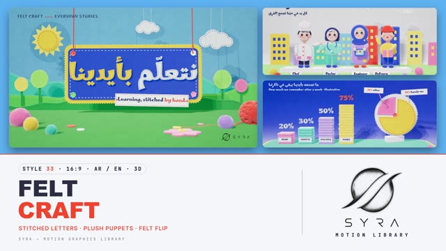

# 33 · Felt Craft

**SYRA Motion Library** · Style 33 · 16:9 · Arabic / English



<div dir="rtl">

> طريقة الاستخدام:
> انسخ البرومت ده كله وحطه لأي أداة AI أو لسكيل الـ animate، واملا الجزء الأخير ([VIDEO BRIEF]) بموضوع الفيديو.
> الستايل ده "حرفة اللباد" — 3D حقيقي (WebGL / three.js): عالم مصنوع من قماش اللباد، قطع مقصوصة بالمقص عليها غُرز يدوية، زراير، كور صوف، وخيوط، وعرائس قماش محشية بعيون زراير وابتسامة مخيطة. الحركة ستوب موشن (كل حاجة بتتحط بالإيد على 12 فريم)، والكاميرا بتتحرك بنعومة.
> مناسب للأطفال والتعليم والأسرة والصحة والمشروعات الصغيرة والحكايات اليومية والمبادرات المجتمعية.
> المرجع الأساسي للشكل والحركة هو ملف "source/index.html". بيشتغل بالعربي وبالإنجليزي (خط مرحي للاتنين). ممنوع اللون البني والبيج.

</div>

## Files in this folder

| File | What it is |
|---|---|
| [source/index.html](source/index.html) | The motion itself — opens and plays in a browser; the source of truth |
| [sample.mp4](sample.mp4) | Showcase reel of the style |
| The info card at the top of this file | Tags & hashtags: what the style expresses, what it suits, search words |

## Tags

<div dir="auto">

النوع: 3D حقيقي (WebGL) بشكل ستوب موشن من القماش  
في سطر: عالم معمول من قماش اللباد الملون بغُرز يدوية وزراير وكور صوف وخيوط، وعرائس قماش محشية بعيون زراير وابتسامة مخيطة، بحركة ستوب موشن، إحساس دافي وطفولي ومعمول باليد بحب.  
In one line: A world made of bright felt with hand stitches, buttons, pom-poms and yarn, and stuffed plush puppets with button eyes and stitched smiles, moving in stop-motion, warm, childlike and lovingly hand-made.  
#عربي: #لباد #قماش #شغل_يدوي #ستوب_موشن #عرايس #أطفال #قصص_الأطفال #أسرة #تعليم #صحة #مشاريع_صغيرة #حكايات #مبادرات_مجتمعية #دافي #طفولي #ملون #ثري_دي #حنين  
#English: #felt #fabric #handmade #craft #stopmotion #puppets #plush #kids #childrensstories #family #education #health #smallbusiness #community #cosy #cute #3d #storytelling  
مناسب لـ: محتوى وقصص أطفال وحضانات، تعليم مبسط للصغار، فيديوهات أسرة وعيلة (جدة وحفيد)، نصايح صحة يومية بشكل لطيف، مشاريع صغيرة وشغل يدوي وحِرف، مبادرات مجتمعية وبيئة (نظافة البحر، الزراعة)، حكايات يومية دافية  
Best for: kids' content and stories, preschool and early learning, family videos (grandma and grandchild), gentle daily health tips, small businesses, crafts and handmade products, community and environment initiatives (clean sea, farming), warm everyday tales  
مش مناسب لـ: تقنية وذكاء اصطناعي ومستقبل، شركات رسمية وتقارير مالية، أخبار جادة أو طب متخصص، فيديو سريع حماسي (الحركة ستوب موشن هادية)  
Not for: tech, AI and futuristic topics, formal corporate or financial reports, serious news or specialist medicine, fast hype videos (the stop-motion pace is gentle)  
المزاج: دافي، مرح، طفولي، حنين، معمول بحب        Mood: warm, playful, childlike, cosy, crafted with care  
الإيقاع: هادي لمتوسط (ستوب موشن على اتنين)        Pace: calm to medium  

</div>

## Components

| # | Component |
|---|---|
| 01 | Title Felt Board |
| 02 | Data Felt Stacks |
| 03 | Data Yarn Line Arabic |
| 04 | Product Plush Phone |
| 05 | Character Hijab Girl |
| 06 | Team Four Puppets |
| 07 | Story Farmer Sprout |
| 08 | Mentor Grandmother Knitting |
| 09 | Three Steps Washing Line |
| 10 | Big Number Nile |
| 11 | Timeline Day In Cairo |
| 12 | Quote Quilted Cushion |
| 13 | Before After Sea |
| 14 | Map Egypt Nile Thread |
| 15 | Chapter Lower Third |
| 16 | End Logo Banner |
---

## FELT CRAFT — MOTION GRAPHICS STYLE PROMPT (SYRA Motion Library · Style 33 · 16:9 · Arabic / English)

### Role

You are a senior motion designer producing motion graphics in the "Felt Craft" style of the SYRA Motion Library, on ANY topic, in Arabic OR English (or both). Match the reference exactly: the source of truth is "source/index.html" (all components, playable in a browser).

### 1. Style identity

- One line: a handmade stop-motion world built from bright felt and fabric, rendered as real 3D — thick cut-felt pieces with fuzzy fibre surfaces and a soft sheen rim, running stitches in contrasting thread, buttons, yarn, pom-poms, pinking-shear edges, woven fabric tags and stuffed plush puppets, in a small lit studio with soft shadows, light depth of field, vignette and grain.
- Mood: warm, playful, crafted with care — "learning, stitched by hand".
- Never: plastic or CAD-perfect surfaces, hard glossy light, earth tones, brown/beige/cream anywhere (not in skin, hair, wood, soil or shadows).

### 2. Format & technical

- Canvas 1920×1080, 30 fps. One idea per scene, 4.6–4.8 s; scenes overlap 1.0 s for the signature transition.
- Real-time 3D: three.js r160 in ONE shared WebGL renderer / canvas for the whole film, inside HTML + GSAP (HyperFrames): one paused timeline, DOM only via fromTo / to / set, deterministic (seeded randomness), every 3D value a pure function of timeline time; build all felt pieces, letters and puppets once, nothing per frame. No CSS keyframes, no remote assets.
- Shared studio rig: 3-light soft key (1024 shadow maps), cool rim, fill, hemisphere, PMREM softbox environment; 10 fur shells per pom-pom; cached materials. Full state by ~2.8 s, then hold with life.

### 3. Colour palette (use only these — bright felt)

- Tomato red #F0412F (thread #E8321F) · sunflower yellow #FFC70F / light #FFE04A · grass #3DB54A / deep #1E8F45 / leaf #7FD957 · teal #14B3A6 · cobalt #2450D8 / deep #1A35A8 · pink #FF79B0 / deep #F2589C · lilac #A98BF0 · cool white felt #F6F8FC · sky felt #5FB2F0 · ink thread #14204F / #1B2350.
- Skin: rosy peach felt #FFBFA6 (variants #FFAE93, #FFC8B2), blush #FF7FA6, nose #FFA58C. Hair ink-navy #1B2350.
- Sets (one per scene, neighbours differ): sky, cobalt, lilac, teal, yellow, pink, green, red, cool white.
- HTML accent word: red #E8321F on light sets, yellow #FFC70F on cobalt / red sets.

### 4. Typography (bilingual — one maker's hand)

- Marhey only: Arabic AND English. 700 for headlines and felt-cut letters, 600 for lines and notes, tracked caps kicker with a dashed red/yellow stitch line ("FELT CRAFT ----- TOPIC").
- Display headlines as 3D felt letters traced from the real font (Arabic shaping intact, connected letter groups), each piece a felt slab with its own inset running stitch in a contrasting thread; or crisp HTML Marhey supers.
- Reading text in HTML (≥ 28 px), on woven fabric tags with a sewn dashed border for labels and lower thirds.
- One accent word per headline. Latin digits in both languages. Never split Arabic into letters (animate whole words).

### 5. Drawing language (3d modelling / materials / lighting)

- Felt material: physical, roughness .93, sheen 1.0 (sheen colour = base lifted to white), triplanar fibre texture (bump + density mottle + roughness fuzz), hand-cut wobble on every outline, pinking-shear zigzag under-layers.
- Pieces: stitched boards hung on red yarn, felt hills as stage flats, lollipop trees, clouds and stars on threads, felt suns, bubbles, cushions, stacked felt sheets as bars, a felt pie, buttons (clearcoat plastic with crossed thread), pom-poms (fur shells), yarn (three twisted plies), woven fabric tags.
- Puppets: plush dolls (two felt pieces sewn and stuffed) — button eyes with white thread, stitched brows, red back-stitched smile, felt cheeks and nose; hijab (cape + piped rim + button pin) or felt hair (bob, short, curly, bun), moustache, glasses, chef toque, farmer hat, cap, stethoscope, coat / dress / galabeya / shirt + trousers. Cast in the kit: girl in pink hijab, chef, doctor without hijab, engineer in hijab, delivery rider, farmer with moustache, grandmother in headscarf with glasses, kid with curly hair, baker with moustache.
- Lighting: warm soft key, cool rim, contact-shadow decals under floor props, light DOF on the hero.

### 6. Motion language (incl. camera)

- Stop-motion on twos: every animated value steps at 12 fps (DOM text too); the camera glides at 30 fps.
- Felt pieces are placed by hand: they land from in front with a small spin and backOut; boards are lowered on yarn and bounce; flats rise like theatre layers; sheets stack one by one; yarn lines are laid point to point; stars rise on threads; puppets hop in, bob like hand-held dolls, wave, hold props, blink (stitched closed eyes) and talk (mouth piece swap).
- Camera: a real move with purpose (low push, crane back, track along a timeline) through eased keys, then a slow breath.
- Signature transition: FELT FLIP — a full-frame felt panel in the next scene's set colour (pinked edges, stitched border, two buttons) swings down from the top hinge with a trailing cloth bend and slaps flat over the old scene (the old shot leans in); fully covered, the scenes swap; then the same panel peels off from the bottom-right corner, a fabric curl travelling to the top-left, showing its deeper back side, while the new shot settles back.

### 7. Branding

- SYRA logo only — plain white on dark scenes / black on light scenes, never tinted, never lit or stitched; in 3D it is an unlit flat plane.
- Corner logo: SYRA (mark + wordmark) bottom-right, ~222×60 px — black on light sets, white on cobalt / red.
- End: SYRA stack logo alone (flat black, unlit) pressed onto a white felt banner with a pinked yellow edge, lowered on red yarn over a cobalt set; stars and a heart on threads, pom-poms drop; tagline «نصنع الغد بأيدينا» / "Stitched by hand, made to last.".

### 8. Component library (in "felt html.html"; ar = arabic example, en = english)

- **01** Felt board title «نتعلّم بأيدينا» + tag "Learning, stitched by hand." (AR)
- **02** Felt-sheet stacks + felt pie "Makers remember more." (EN)
- **03** Yarn line chart on a stitched board «نمشي أكثر» — steps per day (AR)
- **04** Plush felt phone on a turntable, orbiting icons "Your shop, in your pocket." (EN)
- **05** Girl in pink hijab with a book + bubble «أحلامنا تكبر» (AR)
- **06** Team of four puppets in a felt city "Every hand counts." (EN)
- **07** Farmer with moustache waters a sprout, tomatoes grow «من الأرض لبيتك» (AR)
- **08** Grandmother teaches a kid to knit "Some skills are passed on." (EN)
- **09** Three steps on a yarn washing line «ثلاث خطوات ليوم صحي» (AR)
- **10** Big felt number 6650 km — the Nile, waves + felucca (AR)
- **11** Yarn timeline "A day in Cairo." 06:00 → 21:00 (EN)
- **12** Quote on a quilted cushion «الإتقان غرزة بعد غرزة» (AR)
- **13** Before / after with a zip: litter → clean sea "Small hands, cleaner sea." (EN)
- **14** Felt map of Egypt, the Nile as one blue yarn «مصر على خيط واحد» (AR)
- **15** Chapter patch «الفصل الثاني» + woven lower third (baker) (AR + EN)
- **16** End: SYRA logo on a white felt banner (AR + EN)

### 9. Sound (if the video has sfx)

- Soft fabric pats and thumps on landings, a cloth "whump" + rustle on the Felt Flip, button clicks, a needle-and-thread zip on stitched reveals, ukulele / glockenspiel / light hand percussion bed. Duck ~18–20 dB under VO.

### 10. Do / don't

- **DO** keep it felt (fibre, sheen rim, wobbly cut edges, stitches on every piece), animate on twos, contact shadows, one accent word.
- **DON'T** use brown/beige/tan/terracotta/wood/sepia/ochre/khaki/cream, plastic shine on felt, CSS fades as transitions, or frozen holds.

## [VIDEO BRIEF] — fill this in for each new video

```text
- Language: [ Arabic / English / both ]
- Topic / title: [ ... ]
- Voiceover file or script: [ path to WAV/MP3 or the text ]
- Length: [ e.g. 45 s ]
- Headlines and the accent word in each: [ ... ]
- Numbers / steps / content: [ ... ]
- Components to use (in order): [ e.g. 01, 05, 09, 16 ]
- Characters needed: [ ... ]
- Extra notes: [ ... ]
Output: 1920×1080, 30 fps MP4, same length as the voiceover, every visual timed to the word it illustrates,
SYRA corner logo, SYRA felt-banner ending.
```
