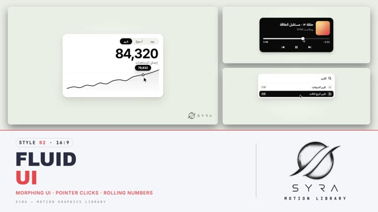

# 02 · Fluid UI

**SYRA Motion Library** · Style 02 · 16:9 · Arabic / English



<div dir="rtl">

> طريقة الاستخدام:
> انسخ البرومت ده كله وحطه لأي أداة AI أو لسكيل الـ animate، واملا الجزء الأخير ([VIDEO BRIEF]) بموضوع الفيديو.
> المرجع الأساسي للشكل والحركة هو ملف "source/index.html" في نفس الفولدر.

</div>

## Files in this folder

| File | What it is |
|---|---|
| [source/index.html](source/index.html) | The motion itself — opens and plays in a browser; the source of truth |
| [sample.mp4](sample.mp4) | Showcase reel of the style |
| The info card at the top of this file | Tags & hashtags: what the style expresses, what it suits, search words |

## Tags

<div dir="auto">

النوع: 2D واجهات تطبيقات (UI) مينيمال — شكل واحد بيتحوّل من مكوّن للتاني  
في سطر: كارت أبيض أو زرار أسود على خلفية أوف وايت فاتحة، بيتحوّل بنعومة من مكوّن لمكوّن وماوس بيضغط ويسحب وأرقام بتلف — نضيف وذكي زي ديمو أبل.  
In one line: Minimal app-UI micro-interactions — one white card or black pill keeps morphing between components, driven by a mouse pointer, on a soft off-white stage.  
#عربي: #تطبيقات #واجهة_مستخدم #تقنية #برمجيات #ستارت_أب #ديمو_منتج #ذكاء_اصطناعي #داشبورد #مينيمال #أبيض_وأسود #اشتراكات #شرح_تطبيق #موبايل #مواقع #تحليلات #بسيط  
#English: #ui #ux #appdemo #productdemo #saas #tech #startup #software #ai #chatbot #dashboard #analytics #minimal #microinteractions #blackandwhite #pricing #clean  
مناسب لـ: ديمو تطبيق أو موقع أو منصة، شرح فيتشر جديدة خطوة بخطوة، إعلان شركة سوفتوير/ستارت أب، مساعد ذكاء اصطناعي وشات بوت، داشبورد وأرقام مشاهدات ومبيعات، باقات اشتراك وأسعار، تعليم استخدام أداة رقمية  
Best for: app/website/platform demos, step-by-step feature walkthroughs, software and startup ads, AI assistant and chatbot features, dashboards and view/sales numbers, subscription plans and pricing, digital-tool tutorials  
مش مناسب لـ: قصص بشخصيات أو أطفال، مواضيع تاريخية أو تراثية، محتوى عاطفي أو إنساني محتاج صور ناس، الحماس والرياضة والألوان الكتير  
Not for: character stories or kids, history or heritage topics, emotional/human stories that need people, hype, sports or colourful content  
المزاج: نضيف، ذكي، عصري، واثق، هادي        Mood: clean, smart, modern, confident, calm  
الإيقاع: متوسط (ناعم ومتصل من غير قطع)        Pace: medium (smooth, continuous, no cuts)  

</div>

## Components

| # | Component |
|---|---|
| 01 | Button |
| 02 | Toggle |
| 03 | Segmented |
| 04 | Analytics |
| 05 | Bar Chart |
| 06 | Progress Ring |
| 07 | Media Player |
| 08 | Slider |
| 09 | Search |
| 10 | Notifications |
| 11 | AI Chat |
| 12 | Checklist |
| 13 | Stepper |
| 14 | Profile |
| 15 | Pricing |
| 16 | End Logos |
---

## FLUID UI — MOTION GRAPHICS STYLE PROMPT (SYRA Motion Library · Style 02 · 16:9)

### Role

You are a senior UI motion designer producing product-style micro-interaction motion graphics in the "Fluid UI" style of the SYRA Motion Library. Match the reference exactly: the source of truth is "source/index.html" (all 16 components, playable in a browser).

### 1. Style identity

- One line: minimal UI micro-interactions where ONE container keeps morphing from component to component (button → loader → check → card → player → search → toast …), driven by a mouse pointer, on a soft off-white stage — black pills, white cards with big soft shadows, content that swaps through a soft blur, numbers that roll.
- Mood: clean, smart, modern product/tech; calm confidence. Apple-keynote / SaaS-demo feel.
- Never: busy backgrounds, 3D, glow, neon, gradients everywhere, hard cuts between components.

### 2. Format & technical

- Canvas 1920×1080, 30 fps. One component per beat, 3.0–4.4 s each; between beats a 0.55 s morph.
- Built as HTML + GSAP (HyperFrames): one paused timeline, only fromTo / to / set, deterministic, no CSS keyframes, no remote assets. Animate transforms, width/height, border-radius, colour, opacity and blur — never left/top.
- Components are centred and large: pills 110–140 px tall, cards 800–1000 px wide.
- Bottom-right corner (x > 1680, y > 960) is reserved for the logo bug.

### 3. Colour palette (use only these)

- Stage ............... #EAEDE6, with a lighter centre glow #F3F5EF (radial)
- Ink (pills, text) .... #0A0A0A      · on-ink text #FFFFFF (muted 55 %)
- Card ................. #FFFFFF      · card borders/dividers #E6E7E3
- Muted text ........... #6E6E73      · tracks rgba(10,10,10,.08)
- The ONLY colour accent: gradient #FFD166 → #F4A261 → #E5484D (gold → amber → red, 135°), used for artwork tiles, one highlighted bar, progress rings, avatars, small "save 20%" chips.
- Shadows: pills 0 18px 36px rgba(0,0,0,.18) + 0 4px 10px rgba(0,0,0,.10); cards 0 40px 80px rgba(20,24,16,.10) + 0 10px 24px rgba(20,24,16,.07).
- No blue, purple or green. Success = black disc + white check.

### 4. Typography

- Arabic UI: IBM Plex Sans Arabic — 600 for buttons (46 px), 700 for card titles (44 px), 500 for body (34 px) and labels (28 px, muted).
- Numbers: Inter 700, tight tracking (-0.04em), tabular figures; hero numbers 112–120 px.
- Mono for shortcuts / tiny captions: JetBrains Mono.
- Minimum readable text 28 px. Arabic is RTL, never split into letters; typed text uses whole-string prefixes so letters stay joined. Numbers, times and prices in Latin digits.

### 5. Motion language

- The morph: the outgoing container (position, size, radius, colour) tweens straight into the incoming one in 0.55 s, power3.inOut. Content is never visible during the morph.
- Content swap: in = from blur(10px), opacity 0, y +8 → sharp, 0.45 s expo.out; out = to blur(10px), opacity 0, 0.22 s power2.in, in the last 0.24 s of every beat.
- Pointer: macOS-style black arrow with white outline. It enters from a rest point (lower-right of centre), travels with ease-in-out, hovers (target grows 3 %), clicks (pointer squashes to 0.82 and the target presses to 0.95, then springs back with back.out(1.5)), drags (fills and values follow it exactly), and returns to rest before the beat ends.
- Indicators (segmented control, stepper) stretch while moving and settle with a small spring.
- Numbers roll (count-up with expo.out, a 6 px blur pulse when they change); charts draw with power3.inOut and morph between data series; tooltips follow the pointer.
- Loaders: a 0.28 arc spinning; success: a white check drawing in 0.35 s + a tiny 1.06 pop.

### 6. Branding

- SYRA logo only — plain white on dark scenes / black on light scenes, never tinted, no sheen or glow over it. Fluid sits on the light background, so the logo is black.
- Corner logo: SYRA (mark + wordmark), BOTTOM-RIGHT, ~222 px wide, 58 px from the right, 50 px from the bottom, 95 % opacity, plain fade in; hidden during the end lockup.
- End lockup: SYRA lockup alone. The last container morphs into a wide white card, which re-shapes itself into a tall white tile; the stacked SYRA logo (black, ~340 px) settles out of a soft blur, a thin #E6E7E3 rule grows under it and a black pill with the mono caption "MOTION · STUDIO" pops up. The pointer fades out.
- Brand/product names stay in Latin (SYRA). Never redraw or recolour the logo.

### 7. Component library (16 in the reference — reuse their layouts)

- **01** Button → loader → check   «ابدأ الآن» pill pressed, collapses to a circle, spins, shows a check.
- **02** Toggle switches           white card, rows «الإشعارات» / «الوضع الليلي», knobs slide, track grey → black.
- **03** Segmented control         «يوم / أسبوع / شهر», black indicator stretches between options.
- **04** Analytics card            segmented control + rolling total + line chart; pointer scrubs with a value bubble; switching period rolls the number and morphs the line.
- **05** Bar chart card            «الإيرادات الشهرية», bars grow, one gradient bar, hover lifts + bubble.
- **06** Progress ring (dark card) gradient ring fills to a %, centre number counts, two stat rows.
- **07** Media player (dark card)  gradient artwork, title, play → pause, scrubber + times, drag.
- **08** Slider                    black pill, speaker icon, drag the level, waves react.
- **09** Search / command palette  pill expands to a list, typing filters rows, select → black toast.
- **10** Notifications             cards drop in and stack, pointer flicks the top one away.
- **11** AI chat                   user bubble (black, right), typing dots, answer revealed word by word.
- **12** Checklist                 «مهام اليوم», rows ticked one by one, progress bar + 1/4 → 4/4 counter.
- **13** Stepper                   black capsule travels through 4 steps, completed dots become checks.
- **14** Profile card              gradient avatar, name, role, stats; «متابعة» → «تتابعه ✓», count rolls.
- **15** Pricing toggle            «شهري / سنوي» flips prices, «وفّر 20%» chip pops on the featured plan.
- **16** End lockup                see Branding.

### 8. Layout rules

- One component on screen at a time, centred, lots of empty stage around it.
- Arabic UI is right-aligned / RTL (rows, lists, steps run right-to-left). Media scrubbers and volume sliders stay left-to-right like real controls.
- Over talking-head footage: show components in a side zone away from the face, same scale rules.

### 9. Sound (if the video has sfx)

- Soft, tactile UI sounds: muted clicks on presses, a short airy swish on each morph, tiny ticks on rolling numbers, a gentle chime on success. No cartoon pops, no digital beeps. Duck ~18–20 dB under VO.

### 10. Do / don't

- **DO** keep one continuous object, let the pointer cause every change, keep text crisp after each swap, hold each component long enough to read.
- **DON'T** cut between components, add backgrounds/illustrations, use more than one accent colour, animate text letter by letter in Arabic, or let anything overlap the corner logo.

## [VIDEO BRIEF] — fill this in for each new video

```text
- Topic / title: [ ... ]
- Voiceover file or script: [ path to WAV/MP3 or the text ]
- Length: [ e.g. 45 s ]
- Numbers / data to show: [ ... ]
- Components to use (in order): [ e.g. 01, 04, 07, 09, 12, 16 ]
- Talent footage? [ yes: path / no ]
- Extra notes: [ ... ]
Output: 1920×1080, 30 fps MP4, same length as the voiceover, every interaction timed to the word it
illustrates, SYRA corner logo, SYRA lockup at the end.
```
