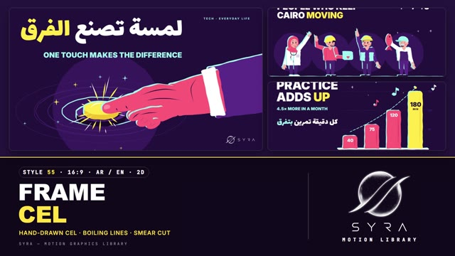

# 55 · Frame-by-Frame Cel

**SYRA Motion Library** · Style 55 · 16:9 · Arabic / English



<div dir="rtl">

> طريقة الاستخدام:
> انسخ البرومت ده كله وحطه لأي أداة AI أو لسكيل الـ animate، واملا الجزء الأخير ([VIDEO BRIEF]) بموضوع الفيديو.
> الستايل ده "رسوم فريم بفريم" — 2D كارتون مسطّح شكله مرسوم بالإيد فريم بفريم: أشكال بألوان صريحة عليها حافة سماوي مزحزحة لفوق وشمال، خطوط بتترعش (boil) كل فريمين، شرارات وخطوط طاقة، وتايبوجرافي ضخمة. كل حركة فيها تحضير ثم "سمير" (فريم مطّوط) ثم ارتداد — مناسب للإعلانات السريعة، السوشيال، شرح الأفكار، والقصص اللي فيها شخصيات.
> المرجع الأساسي للشكل والحركة هو ملف "source/index.html". بيشتغل بالعربي وبالإنجليزي. ممنوع اللون البني.

</div>

## Files in this folder

| File | What it is |
|---|---|
| [source/index.html](source/index.html) | The motion itself — opens and plays in a browser; the source of truth |
| [sample.mp4](sample.mp4) | Showcase reel of the style |
| The info card at the top of this file | Tags & hashtags: what the style expresses, what it suits, search words |

## Tags

<div dir="auto">

النوع: 2D (كارتون مسطّح مرسوم فريم بفريم)  
في سطر: كارتون مسطّح بألوان صريحة على بنفسجي غامق، حافة سماوي مزحزحة وخطوط بتترعش كل فريمين، شرارات وتايبوجرافي ضخمة — إحساس رسم إيد سريع ومبهج.  
In one line: Bold flat cel cartoon on deep purple with a misregistered cyan rim, lines boiling on twos, sparks and huge type — fast, joyful, hand-animated.  
#عربي: #كارتون #رسوم_متحركة #موشن_جرافيك #فريم_بفريم #2D #إعلان #سوشيال_ميديا #شرح #قصص #شخصيات #بيانات #رياضة #صحة #أكل #تكنولوجيا #مشروعات_صغيرة #أطفال #مصر  
#English: #cartoon #celanimation #framebyframe #2danimation #motiongraphics #handdrawn #boilinglines #smearframe #explainer #socialmedia #promo #characters #infographic #sport #health #food #tech #egypt  
مناسب لـ: إعلانات وبرومو سريعة، فيديوهات سوشيال قصيرة، شرح فكرة أو منتج، قصص بشخصيات، أرقام وبيانات بشكل مرح، محتوى أطفال وعائلة، رياضة وصحة وأكل ومشروعات صغيرة  
Best for: fast promos and ads, short social videos, product / idea explainers, character stories, playful data and numbers, kids & family content, sport, health, food, small business  
مش مناسب لـ: محتوى رسمي أو حكومي جاد، مواضيع حزينة أو حساسة، تقارير مالية رصينة، فيديو بصور حقيقية  
Not for: formal or institutional content, sad or sensitive topics, sober financial reports, photo-based video  
المزاج: مبهج، حماسي، واثق، مرح        Mood: joyful, energetic, confident, playful  
الإيقاع: سريع وحماسي        Pace: fast  

</div>

## Components

| # | Component |
|---|---|
| 01 | Title One Touch |
| 02 | Practice Adds Up Bars |
| 03 | Home Water Donut |
| 04 | Camera Capture The Moment |
| 05 | Chef And Woman High Five |
| 06 | City Team Of Four |
| 07 | Kids Fly A Kite |
| 08 | Coach And Young Footballer |
| 09 | Three Steps Clean Hands |
| 10 | Big Number 1200 Orders |
| 11 | Timeline A Day In Cairo |
| 12 | Quote Proverb |
| 13 | Before After Rooftop |
| 14 | Map Of Egypt Nile |
| 15 | Chapter Card Lower Third |
| 16 | End SYRA Lockup |
---

## FRAME-BY-FRAME CEL — MOTION GRAPHICS STYLE PROMPT (SYRA Motion Library · Style 55 · 16:9 · Arabic / English)

### Role

You are a senior 2D motion designer producing motion graphics in the "Frame-by-Frame Cel" style of the SYRA Motion Library, on ANY topic, in Arabic OR English (or both). Match the reference exactly: the source of truth is "source/index.html" (all components, playable in a browser).

### 1. Style identity

- One line: bold flat cel animation that looks hand-drawn frame by frame — flat colour shapes with a misregistered cyan rim offset to the top-left, thin tapered shading lines, energy lines, sparks and sparkles, huge clean type, everything boiling on twos, every action with anticipation, a one-drawing smear and follow-through.
- Mood: punchy, joyful, energetic, confident — "every frame counts".
- Never: smooth vector tweening without boil, gradients, soft shadows, realistic textures, brown/earth tones.

### 2. Format & technical

- Canvas 1920×1080, 30 fps, animated on twos (a new drawing every 2 frames = 15 drawings/s). One idea per scene, 4.4–4.8 s; scenes overlap 0.6 s for the signature transition.
- HTML + GSAP (HyperFrames): one paused timeline whose master proxy re-draws one SVG per drawing (under the type) and one over it; DOM type for headlines; fully deterministic (seeded jitter keyed on shape + drawing index), a pure function of time, so any seek is correct. No CSS keyframes, no remote assets.

### 3. Colour palette (use only these)

- Field deep purple #24103D · discs / counters #3A1A5E · guides / rays #4A2475 · sleeve purple #5B2B8C · ink #1A0B2E
- Coral #FF5A7A (low #D93E66, high #FF8DA2) · cyan rim #9EF3F0 (low #5FD3CF) · white #FFFFFF
- Lemon #FFE94A (low #F2C230, high #FFF6A8) = THE pop: one accent word, the hero bar, the button, a lemon field scene.
- Skin rosy peach #FFB4A6 (shadow #F2867F) · hair #2A1240 (highlight #5A2E8A) · grey hair #E6E2F0. Plants are cyan.
- Shading lines use the field purple or the shape's own low tone — never black, never brown.

### 4. Typography (bilingual)

- English: Inter 900 uppercase — headlines 92–128 px, sub-lines 40–56 px in cyan; labels Inter 800 24–30 px tracked; kickers Inter 700 20–22 px, tracked 0.26–0.3 em, cyan.
- Arabic: Lalezar — headlines 116–250 px, lines 54–84 px; right-aligned at the right margin; the accent word lemon.
- One accent word per headline. Latin digits in both languages (Inter 900). Min 28 px for reading text.
- Type punches in on contact (0.55 → 1 with overshoot) or pops up; a 1 px offset on twos keeps it in the boiling world. Never split Arabic into letters — whole words only.

### 5. Drawing language

- Every shape is a boiled point list smoothed into a curve; the cyan rim is a separately boiled copy offset (−9, −7) px so the edge "breathes". Boil ≈ 2.2 px on shapes, ~1 px on faces, < 1 px on highlights; no rim on eyes, mouth, blush.
- Inner detail: tapered shading lines (knuckles, tendons, folds), one highlight stroke, sparkles, spark bursts, dust puffs and impact ticks on landings, speed lines on fast moves, boiled steam squiggles.
- Hands: graphic coral hands for big close-ups, rosy hands for characters; close-ups get full crease detail (finger joints, palm lines, knuckle creases, nails).
- People: simple cel figures with egg faces, blush ovals, open or "happy-arc" eyes, laughing mouths — women with and without hijab, older men (grey moustache, glasses), kids, a doctor, an engineer, a delivery rider, a fisherman, a footballer, a grandmother; props like chef toques, caps, helmets, hard hats, stethoscopes.

### 6. Motion language (incl. camera)

- Anticipation → action → follow-through, all on twos: pull back, ONE smear drawing, hit, damped settle. Bars and objects pop with an overshoot; landings squash and puff dust; characters jump in on twos and land with a squash.
- Holds breathe: blinks, waves, steam, loops, ripples, twinkles — never a frozen frame.
- Camera: a slow eased push / drift on the hold; a punch-in with a short shake on every snap.
- Signature transition — THE SMEAR CUT (0.6 s): the outgoing scene pulls back for 4 drawings; then for ONE drawing its key shape is stretched into a long coral or lemon smear (rounded head, dry-brush fingers, cyan rim, speed lines) that reaches across the screen; on the next drawing it SNAPS into the key shape of the incoming scene (button, bar, ball, kite, logo…) with an impact burst, a camera punch and a shake; the speed lines shrink into it.

### 7. Branding

- SYRA logo only — plain white on the purple field, plain black on the lemon field; never tinted, never boiled, no rim or glow on it.
- Corner logo: SYRA (mark + wordmark) bottom-right, ~222 × 60 px, plain fade in; switches colour at the snap.
- End: the stacked SYRA logo alone, stamped onto a boiling purple cel disc with lemon rays and sparkles; tagline «نرسم بكرة، فريم بفريم» / "Drawing tomorrow, frame by frame."

### 8. Component library (in "cel html.html"; ar = arabic example, en = english)

- **01** Hand hits a lemon button «لمسة تصنع الفرق» (AR)
- **02** Bars + a hand dropping the hero bar "Practice adds up" (EN)
- **03** Donut from a water drop «الميّة رايحة فين؟» (AR)
- **04** Camera, flash and a print "Capture the moment" (EN)
- **05** Chef and young woman high-five «نجحنا سوا!» (AR)
- **06** Team of four Cairenes "People who keep Cairo moving" (EN)
- **07** Girl in hijab and her brother fly a kite «طيّارة ورق وحلم كبير» (AR)
- **08** Coach and young footballer "Train today, shine tomorrow" (EN)
- **09** Three steps with close-up hands «إيد نضيفة في 3 خطوات» (AR)
- **10** Big number 1,200 on lemon «طلب في الشهر من مطبخ البيت» (AR)
- **11** Timeline "A day in Cairo" (EN)
- **12** Quote «من جدّ وجد» (AR)
- **13** Before / after rooftop "Same roof, new life" (EN)
- **14** Map of Egypt + the Nile «من إسكندرية لأسوان» (AR)
- **15** Chapter 02 + lower third (AR + EN)
- **16** End SYRA lockup (AR + EN)

### 9. Sound (if the video has sfx)

- Snappy cartoon whooshes on every smear, a punchy "pop / smack" on each snap and landing, sparkle chimes, plucky marimba or ukulele with a light beat. Duck ~18–20 dB under VO.

### 10. Do / don't

- **DO** boil everything on twos, keep the cyan rim top-left, one lemon accent word, a smear before every big hit, squash on landings.
- **DON'T** use brown/beige/tan/terracotta/wood/sepia/ochre/cream, gradients, soft shadows, two-drawing smears, or frozen holds.

## [VIDEO BRIEF] — fill this in for each new video

```text
- Language: [ Arabic / English / both ]
- Topic / title: [ ... ]
- Voiceover file or script: [ path to WAV/MP3 or the text ]
- Length: [ e.g. 45 s ]
- Headlines and the accent word in each: [ ... ]
- Numbers / steps / content: [ ... ]
- Components to use (in order): [ e.g. 01, 05, 09, 16 ]
- Characters needed: [ ... ]
- Extra notes: [ ... ]
Output: 1920×1080, 30 fps MP4, same length as the voiceover, every visual timed to the word it illustrates,
SYRA corner logo, SYRA lockup ending.
```
