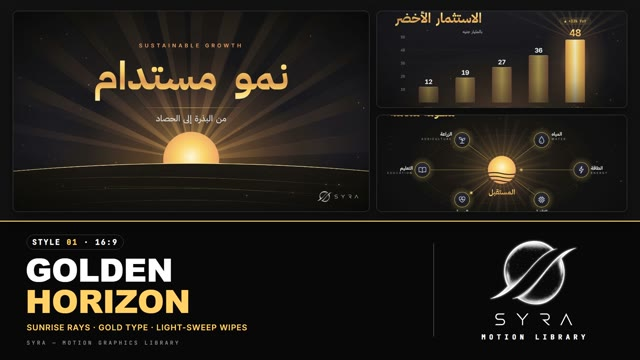

# 01 · Golden Horizon

**SYRA Motion Library** · Style 01 · 16:9 · Arabic / English



<div dir="rtl">

> طريقة الاستخدام:
> انسخ البرومت ده كله وحطه لأي أداة AI أو لسكيل الـ animate، واملا الجزء الأخير ([VIDEO BRIEF]) بموضوع الفيديو.
> المرجع الأساسي للشكل والحركة هو ملف "source/index.html" في نفس الفولدر.

</div>

## Files in this folder

| File | What it is |
|---|---|
| [source/index.html](source/index.html) | The motion itself — opens and plays in a browser; the source of truth |
| [sample.mp4](sample.mp4) | Showcase reel of the style |
| The info card at the top of this file | Tags & hashtags: what the style expresses, what it suits, search words |

## Tags

<div dir="auto">

النوع: 2D سينمائي (خلفية سودا + دهبي ميتاليك ولمعة ضوء)  
في سطر: شمس بتطلع ورا أفق مقوّس وأشعة دهبي على خلفية سودا، كتابة دهبي ميتاليك ولمعة نور بتعدّي — فخم وهادي ومتفائل.  
In one line: A cinematic black-and-metallic-gold broadcast look — a sun rises over a curved horizon, gold rays fan out and a light sweep carries each scene.  
#عربي: #فخم #رسمي #تقارير #تنمية_مستدامة #استثمار #اقتصاد #مؤسسات #إنجازات #أرقام #رسوم_بيانية #إنفوجرافيك #طاقة_نظيفة #زراعة #حكومي #افتتاح #تفاؤل #دهبي  
#English: #premium #corporate #annualreport #sustainability #investment #economy #institutional #achievements #datavisualization #infographic #cleanenergy #agriculture #government #launch #optimistic #gold #cinematic  
مناسب لـ: تقرير سنوي أو حصاد إنجازات، فيديو مؤسسي/حكومي رسمي، أرقام استثمار واقتصاد ونمو، تنمية مستدامة وطاقة وزراعة، افتتاح مشروع أو مؤتمر، لوور ثيرد فخم فوق متحدث، رؤية ومستقبل  
Best for: annual reports and achievement reels, formal corporate/government films, investment and growth figures, sustainability/energy/agriculture, project or conference openings, premium lower thirds over a speaker, vision statements  
مش مناسب لـ: الأطفال والمحتوى الكرتوني، الفيديوهات الحماسية السريعة والسوشيال الترند، شرح بشخصيات وقصص، أي حاجة محتاجة ألوان كتير (أزرق/بنفسجي/أخضر)  
Not for: kids or cartoon content, fast hype or trendy social clips, character-driven stories, anything that needs many colours (blue/purple/green)  
المزاج: فخم، هادي، متفائل، موثوق، سينمائي        Mood: premium, calm, optimistic, trustworthy, cinematic  
الإيقاع: هادي لمتوسط        Pace: calm to medium  

</div>

## Components

| # | Component |
|---|---|
| 01 | Title |
| 02 | Lower Third |
| 03 | Stat Gauge |
| 04 | Bar Chart |
| 05 | Line Chart |
| 06 | Donut Chart |
| 07 | Before After |
| 08 | Process Steps |
| 09 | Timeline |
| 10 | Ecosystem |
| 11 | KPI Cards |
| 12 | Quote |
| 13 | List |
| 14 | Icons |
| 15 | Chapter |
| 16 | End Logos |
---

## GOLDEN HORIZON — MOTION GRAPHICS STYLE PROMPT (SYRA Motion Library · Style 01 · 16:9)

### Role

You are a senior motion designer producing broadcast-grade Arabic/English motion graphics in the "Golden Horizon" style of the SYRA Motion Library. Match the reference exactly: the source of truth is "source/index.html" (all 16 scenes, playable in a browser).

### 1. Style identity

- One line: cinematic warm-obsidian and metallic-gold broadcast look — a sun rises over curved fields, volumetric rays fan out, gold type catches a moving sheen, and a band of light carries each beat into the next.
- Mood: premium, calm, optimistic, trustworthy. Sustainable development, growth, institutions, reports.
- Motif: a sunrise — sun disc, rays, curved horizon / field lines.
- Never: flat cartoon look, neon, glitch, hard cuts, bouncy cartoon motion, blue/purple/green colours.

### 2. Format & technical

- Canvas 1920×1080, 30 fps. Scenes of 4.0–4.8 s, consecutive scenes overlap 0.65 s for the transition.
- Built as HTML + GSAP (HyperFrames): one paused timeline, only fromTo / to / set, deterministic (seeded random only), no CSS keyframes, no remote assets. Every scene is self-contained.
- Safe margins 120 px left/right, 100 px top/bottom. Bottom-right corner (x > 1640, y > 940) is reserved for the logo bug — never place content there.

### 3. Colour palette (use only these)

- Background ............ #121212  (Obsidian)
- Background 2 .......... #1E1E24  (Warm Slate)
- Secondary / glow tint . #2B2D42  (Dark Graphite)
- Main accent ........... #FFD166  (Warm Gold)
- Second accent ......... #F4A261  (Amber)
- Text .................. #EDF2F4  (Cream White; secondary text at 82–86 % opacity, sub-labels at 55 %)
- Metallic gold gradient (for hero text, numbers, bars, medallions), top → bottom: #FFF2C8 0% → #FFD166 36% → #E39A4E 60% → #FFD166 80% → #FFEBB0 100%
- Sun / highlight gradient: #FFF6DA → #FFD166 → #F4A261.
- Scene backgrounds (pick one per scene): · "rise":   radial amber glow from the bottom centre (rgba(244,162,97,.22)) over #1E1E24 → #121212 · "corner": radial gold glow from the top-right (rgba(255,209,102,.16)) + graphite haze · "center": radial gold glow behind the centre (rgba(255,209,102,.14)) on #121212 Always add a soft vignette (edges to 55 % black).
- Exception: the SYRA logo is never gold — plain white on these dark scenes (black only on light ones).

### 4. Typography

- Arabic: IBM Plex Sans Arabic — 700 for titles, 500/600 for body and labels.
- Latin: Inter — 600 for kickers, 700 for big numbers. Mono labels / chips: JetBrains Mono 500.
- Sizes (1920×1080): Hero title 150–210 px · Section title (H2) 96–124 px · Big stat 200–250 px · Body 42–46 px · Labels 32–38 px · Minimum readable text 28 px.
- Kicker: English, uppercase, Inter 600, 28 px, letter-spacing .46–.5em, Amber #F4A261 — always above the Arabic title (e.g. "SUSTAINABLE GROWTH" over «نمو مستدام»).
- English sub-label under Arabic labels: Inter 500, 20–22 px, uppercase, letter-spacing .42em, 55 % cream.
- Hero words and numbers use the metallic gold gradient as text fill, with a light sheen that travels across them once after they land.
- Arabic is right-to-left, revealed WORD BY WORD only. Never split Arabic into letters, never letter-space it. Years in Arabic labels use Arabic-Indic digits (٢٠٢٦); big stats use Latin digits (+38%, 120K). On-screen English brand/tool names stay in English.

### 5. Visual language (recurring building blocks)

- Rays: fans of thin triangular light rays (gold → amber → transparent), screen-blended, slowly rotating 2–8°.
- Sun disc + halo: radial gradient sun with a large soft halo; rises from below a curved horizon.
- Horizon / field lines: 3–4 thin curved gold lines (1.2–3 px) that draw on from the centre outward.
- Gold rule: 2 px horizontal or vertical line, gold in the middle fading to transparent at both ends.
- Chip: pill with 1.5 px gold border at 45 %, gold fill at 8 %, JetBrains Mono gold text (e.g. "+24%").
- Card: dark glass with a gold edge — radius 22 px, 1.5 px gold border at 30 %, gold-tinted gradient fill at 2–10 %, deep soft shadow, thin top highlight.
- Nodes / medallions: dark disc with a 3 px gold ring and a cream centre dot, soft gold halo behind, a pulse ring expanding once on arrival.
- Line icons: single-weight gold strokes (4–6 px), round caps and joins, no fills, drawn on stroke by stroke, sitting in a soft circular halo.
- Particles: two depths of small warm-gold/cream dots drifting slowly upward (far: 1.5–3 px, near: 3.5–6 px with glow), always present, low opacity.
- Light sheen: a skewed soft white-gold band passing once across gold text and cards (never over the logo).

### 6. Motion language

- Tempo: cinematic and smooth, slow-to-moderate. Nothing snaps, nothing bounces except node pops.
- Entrances: expo.out, 0.9–1.4 s. Wipes and sheens: power2.inOut. Transitions: expo.in / expo.inOut. Node / medallion pops: back.out(2.2), 0.7 s.
- Word reveals: each word rises from 110 % below inside a mask with a fade, 0.9–1.2 s, 0.08–0.17 s stagger, right-to-left reading order.
- Lines and paths draw on (stroke dash), 1.2–1.8 s.
- Numbers count up with the same expo.out curve as the graphic they belong to (gauge, bar, ring).
- Camera: the whole film pushes in 1.00 → 1.03; every scene also settles from scale 1.06–1.10 → 1.00 over ~2 s. Particles move in parallax (near layer faster).
- Timing inside a scene: something visible within 0.4 s, full "hero" state by ~2.6–3.0 s, then hold. No exit animation inside the scene — the transition takes it out.
- Signature transition (between every two scenes, 0.65 s): a vertical bar of golden light sweeps across the frame from RIGHT to LEFT; its edge wipes the old scene out and the new one in, with a wide soft glow around the bar.
- Alternative transitions for special moments: sunrise iris (circle mask with a gold ring growing from a focal point) and horizon-open (a horizontal light line splits into two edges that open the frame).

### 7. Branding

- SYRA logo only — plain white on dark scenes / black on light scenes, never tinted, no gold, no sheen or glow over it.
- Corner logo (whole film except the end lockup): SYRA (mark + wordmark) BOTTOM-RIGHT ~222 px wide, 58 px from the right, 50 px from the bottom, 90 % opacity, plain fade in at 0.6 s; fades out just before the end lockup.
- End lockup (last ~3.5 s, also used as intro sting): the SYRA stacked logo alone, centred (~334 px), in plain white over a full gold ray burst and two horizon arcs, with a gold rule and a small spaced "MOTION · STUDIO" line under it. Rays open first, SYRA scales in, the rule grows, the line settles.
- Use the real SYRA logo files only. Never redraw, recolour or distort them.

### 8. Element library (16 scenes in the reference — reuse their layouts)

- **01** Title card — sun rises behind a curved horizon, rays fan out, kicker, giant gold Arabic title word by word, gold rule, one-line subtitle.
- **02** Lower third — over talent footage (bottom-LEFT): a gold bar grows up with a small sun accent, name in gold, gold rule, role in Arabic + English sub-label on a dark soft plate.
- **03** Stat gauge — half-circle track with ticks, gold arc + glowing tip fill to the value while a giant gold number counts up; Arabic caption + English sub-label.
- **04** Bar chart — 4–6 metallic gold bars grow from a baseline with stagger, values count up riding the bar tops, faint grid, year labels; the key bar gets full gold, halo, rays and a chip (e.g. "▲ +33% YoY").
- **05** Line / area chart (rising path) — a thick gold curve draws with two fainter parallel ribbons and a gradient area fill; milestone nodes pop with pulse rings, dashed drop lines and labels (year, name, chip).
- **06** Donut chart — ring segments (gold, amber, low-opacity cream, graphite) draw in order, tick ring and rays around, centre percentage counts up, legend rows fade up.
- **07** Before / after — two cards split by a glowing vertical gold rule: «قبل» on the right (muted cream), «بعد» on the left (gold); a round arrow badge in the centre; "after" values count up from "before".
- **08** Process steps — 3–5 circular gold nodes laid right-to-left, joined by a gold path that draws with a spark at its head; each node pops when reached, its line icon draws on, numbered badge + labels.
- **09** Timeline — horizontal gold axis with ticks draws right-to-left (earliest year on the right), milestones alternate above/below, current year gets a halo and a «الآن» chip, gentle camera drift.
- **10** Ecosystem / hub — a central sun-node with rays, 4–6 satellite nodes with line icons on a dashed rotating orbit, gold links draw outward, light particles travel along the links.
- **11** KPI cards — 3–4 glass-gold cards rise in right-to-left: line icon, big gold number counting up, Arabic label, sparkline or progress bar; a sheen crosses each card.
- **12** Quote — two-line Arabic quote word by word, oversized gold « » marks, one key word highlighted by a gold marker bar growing right-to-left behind it, gold rule and attribution.
- **13** Bullet list — title block on the right, 3–5 rows sliding in from the right, each with a metallic numbered medallion (١ ٢ ٣ ٤) popping in, divider lines, a vertical gold rule drawing through them.
- **14** Icon set — grid of line icons (sun over field, sprout, water drop, solar panel, wheat, rising chart) drawn stroke by stroke inside halos, Arabic label + English sub-label under each.
- **15** Chapter divider — a huge "02" in gold outline that fills with metallic gold from the bottom, chapter kicker, Arabic chapter name and title, 5-segment progress bar lighting right-to-left, "02 / 05" chip.
- **16** End lockup — see Branding.

### 9. Layout rules

- Arabic content is right-aligned and flows right-to-left (titles top-right or centred, sequences from right to left). Centred layouts for single statements, stats and lockups.
- One idea per scene, short text: titles ≤ 4 words, captions ≤ 8 words.
- Generous negative space; nothing touches the frame edge except rays, horizon and particles.
- When placed over a talking head: keep graphics on the side away from the face or in the lower third; never cover the face.

### 10. Sound (if the video has sfx)

- Soft sub-bass swell on the sunrise and the end lockup, airy shimmer on each light sweep, gentle mechanical clicks on counters and node pops. No stock whooshes, cartoon pops or digital beeps.
- Duck all SFX about 18–20 dB under the voiceover.

### 11. Do / don't

- **DO** keep everything warm, golden, soft and premium; time graphics to the spoken words; let each scene reach a clean hero frame and hold it; keep the corner logo clean.
- **DON'T** use other colours, outlines on text, drop-shadow stacks, glitch/neon/comic effects, hard cuts, elastic bounces on text, letter-by-letter Arabic, or more than one big idea per scene.

## [VIDEO BRIEF] — fill this in for each new video

```text
- Topic / title: [ ... ]
- Voiceover file or script: [ path to WAV/MP3 or the text ]
- Length: [ e.g. 60 s ]
- Key numbers / facts to show: [ ... ]
- Scenes to use from the element library (in order): [ e.g. 01, 03, 04, 08, 12, 16 ]
- Talent footage? [ yes: path / no ]
- Extra notes: [ ... ]
Output: 1920×1080, 30 fps MP4, same length as the voiceover, every graphic timed to the word it
illustrates, SYRA corner logo, SYRA end lockup.
```
