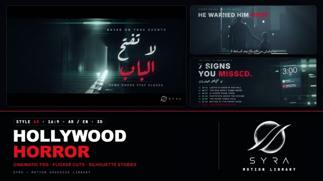

# 63 · Hollywood Horror

**SYRA Motion Library** · Style 63 · 16:9 · Arabic / English



<div dir="rtl">

> طريقة الاستخدام:
> انسخ البرومت ده كله وحطه لأي أداة AI أو لسكيل الـ animate، واملا الجزء الأخير ([VIDEO BRIEF]) بموضوع الفيديو.
> الستايل ده "رعب هوليودي" — 3D حقيقي (WebGL / three.js) بلغة تريلر أفلام الرعب والإثارة: ممرات مضلمة، باب موارب ونور بارد طالع منه، ضباب وأشعة نور حقيقية، شخصيات سيلويت، وتايتلات متآكلة بتظهر بجليتش. الرعب من الجو بس — مفيش دم ولا عنف ولا أسلحة ولا رموز دينية.
> مناسب لتريلرات القصص والمسلسلات القصيرة، الإعلان عن حلقة أو فيلم، قصص الغموض والجريمة الخفيفة، حملات التوعية الجادة (السلامة، الأمان، الكهربا)، ومقدمات البودكاست والحكايات.
> المرجع الأساسي للشكل والحركة هو ملف "source/index.html". بيشتغل بالعربي وبالإنجليزي. ممنوع اللون البني والسيبيا — الألوان باردة (أزرق مسوّد وتركواز) ولون أحمر واحد بس للكلمة المميزة.

</div>

## Files in this folder

| File | What it is |
|---|---|
| [source/index.html](source/index.html) | The motion itself — opens and plays in a browser; the source of truth |
| [sample.mp4](sample.mp4) | Showcase reel of the style |
| The info card at the top of this file | Tags & hashtags: what the style expresses, what it suits, search words |

## Tags

<div dir="auto">

النوع: 3D  
في سطر: تريلر رعب وإثارة سينمائي: ممرات وأماكن مصرية مضلمة، نور بارد واحد، ضباب وأشعة نور حقيقية، شخصيات سيلويت، وتايتلات متآكلة بتظهر بجليتش — الرعب من الجو بس.  
In one line: A cinematic horror/thriller trailer in real 3D — dark everyday Egyptian places, one cold motivated light, fog with shadowed god rays, rim-lit silhouettes and distressed glitching titles; scary by atmosphere only.  
#عربي: #رعب #إثارة #تريلر #غموض #سينمائي #قصص #حكايات #مسلسل_قصير #بودكاست #جريمة #توعية #السلامة #ليل #ضباب #3D #موشن_جرافيك #مصر #تشويق  
#English: #horror #thriller #trailer #mystery #cinematic #storytelling #suspense #filmgrain #volumetriclight #fog #nightscene #3danimation #motiongraphics #glitchtitles #darkmood #truecrime #podcastintro #egypt  
مناسب لـ: تريلرات قصص ومسلسلات قصيرة، إعلان حلقة أو فيلم، قصص غموض وجريمة خفيفة، مقدمات بودكاست وحكايات، حملات توعية جادة (السلامة، الكهربا، الأمان)، فواصل هالوين ومحتوى تشويقي للسوشيال  
Best for: story and short-series trailers, episode or film announcements, mystery and light true-crime stories, podcast and storytelling intros, serious awareness campaigns (safety, electricity, security), Halloween bumpers and suspense social content  
مش مناسب لـ: محتوى أطفال صغيرين، إعلانات فرحة ومبهجة، مواضيع طبية أو مأساوية حقيقية حساسة، تعليم بسيط هادي  
Not for: young children's content, happy upbeat ads, sensitive real medical or tragic topics, calm simple teaching  
المزاج: تشويق، رهبة، غموض، سينمائي        Mood: suspenseful, eerie, mysterious, cinematic  
الإيقاع: متوسط (هدوء مخيف وقطعات وميض سريعة)        Pace: medium (slow creeping holds, fast flicker cuts)  

</div>

## Components

| # | Component |
|---|---|
| 01 | Title The Door |
| 02 | Data Seven Signs |
| 03 | Data Line Cold |
| 04 | Object Tape 07 |
| 05 | Story School Hall |
| 06 | Team Four Strangers |
| 07 | Story Delivery Stairs |
| 08 | Mentor The Warning |
| 09 | Three Rules |
| 10 | Big Number Countdown |
| 11 | Timeline Corniche |
| 12 | Quote Swinging Bulb |
| 13 | Before After |
| 14 | Map Last Signal |
| 15 | Chapter Lower Third |
| 16 | End Logo |
---

## HOLLYWOOD HORROR — MOTION GRAPHICS STYLE PROMPT (SYRA Motion Library · Style 63 · 16:9 · Arabic / English)

### Role

You are a senior motion designer producing motion graphics in the "Hollywood Horror" style of the SYRA Motion Library, on ANY topic, in Arabic OR English (or both). Match the reference exactly: the source of truth is "source/index.html" (all components, playable in a browser).

### 1. Style identity

- One line: a cinematic horror/thriller trailer in real 3D — dark Egyptian everyday places (a school corridor, a stairwell, a guard booth, the Nile corniche, a living room at 3 AM) lit by ONE motivated cold light, cut by real shadowed god rays through fog and dust, graded like film (grain, gate weave, chromatic aberration, scratches, oval vignette, 2.39:1 bars), with distressed titles that glitch-slice in.
- Mood: suspense, dread, curiosity — "something is waiting at the end of the hall".
- The scare comes from atmosphere only: darkness, a flicker, a door, a silhouette. Never gore, blood, weapons, monsters, religious symbols or real people. Figures are believable rim-lit silhouettes, never awkward close-ups of faces.

### 2. Format & technical

- Canvas 1920×1080, 30 fps, with 138 px letterbox bars (2.39:1 picture). One idea per scene, 4.6–4.8 s; scenes overlap 0.8 s for the signature transition.
- three.js r160 in ONE shared WebGL renderer / canvas: scene -> view depth -> ray-marched volumetric fog that samples the spot lights' shadow maps -> bloom + anamorphic streak -> one film pass (ACES, cold grade, title layer, grain, damage). Inside HTML + GSAP (HyperFrames): one paused timeline, deterministic (seeded noise only), every value a pure function of time. Type is drawn in the film pass (canvas 2-D, whole strings) so grain and glitch hit it like the picture.

### 3. Colour palette (use only these)

- Blue-black base #05070D -> #0F1A2A (blacks lifted to blue-black, never grey).
- Cold teal light #4FE3D2, highlight #9FF7EE, door/room light #BFF8F2.
- Signal red #E0101E — ONE accent word per headline (and the last item of a list / the one practical red light).
- Bone type #E8ECF2.
- Set paint: plaster #46525D–#4F5C66, oil-paint dado #123139–#14323B, doors #203A44 / #2B4049, slate floors #0D1117 / #28303A.
- Grade: saturation .72, blue in the shadows, cool highlights, red preserved. No warm light anywhere.

### 4. Typography (bilingual)

- Arabic display: Aref Ruqaa 700 — distressed (eroded wear mask, smudge), with a soft teal or red glow; whole words only, extra leading (its joins stack vertically), never letter-spacing on Arabic.
- Arabic reading text, subtitles and location slates: IBM Plex Sans Arabic 500/600 (film-subtitle look, soft dark plate).
- English: Inter 500 in wide-tracked caps for credits ("BASED ON TRUE EVENTS", tracking slowly widens); Inter 800 tracked caps for headlines ("7 SIGNS / YOU MISSED.").
- Data, clocks, coordinates: JetBrains Mono 500. Latin digits. Min 28 px reading text.

### 5. Drawing language (3d modelling / materials / lighting)

- Sets: procedural painted plaster with drips, peeling and cracks; wet tiled / terrazzo floors whose roughness maps catch light streaks; panel doors with steel levers; fluorescent fixtures; bare cold bulbs on cords; metal desks and chairs; papers on the floor; CRT monitors, phones, VHS tapes, electricity meters, streetlamps.
- Light: one motivated source per shot (door gap, flickering tube, flashlight, phone, CRT, bulb, headlights, moonlight through mullions) + a weak cold kicker/rim. Every light that matters is a shadowed spot, so the fog shows real god rays cut by doors, window bars and bodies. Dust motes live only inside the beams.
- People: CAST.figure silhouettes with real proportions — woman in hijab (khimar + long coat), young woman, man, child, elder in a flat cap, delivery rider (helmet + delivery box); dark fabric with sheen, rim-lit, faces kept in shadow.

### 6. Motion language (incl. camera)

- Camera: slow creeping dolly-in or truck on every shot, tiny handheld drift, −1°…+2° Dutch tilt; orbit + rack focus on objects.
- Lights never sit still: tubes stutter on seeded patterns, flashlights tremble, bulbs swing, phones buzz, timers click off.
- Type: credits fade up while tracking widens; headlines glitch-slice in (2–3 frames of torn bands + RGB split); the red accent word drops out for 2 frames once; data rows reveal one by one; labels can be pinned to 3-D points.
- Story beats: something changes during a flicker (the child is gone, the peephole goes dark, a far window lights up).
- Signature transition: LIGHT-FLICKER CUT — the outgoing scene's lights stutter (8 f), BLACK with only grain and film damage (4 f), a 2-frame overexposed FLASH of the next scene with glitch, BLACK again (5 f), then the next scene's lights strike on (with two drop-outs) while the fog starts at double density and settles, so the image condenses out of the haze.

### 7. Branding

- SYRA logo only — plain white (every scene is dark), never tinted, never graded, no glow; DOM opacity only.
- Corner logo: SYRA (mark + wordmark) bottom-right, ~222 px, on the bottom letterbox bar, plain fade in.
- End: back in the corridor, the door swings shut and slams; only the light under the door remains; the stacked SYRA logo flickers on in the dark; tagline «كل قصة… ليها باب» (باب in red) / "EVERY STORY HAS A DOOR.".

### 8. Component library (in "horror html.html"; ar = arabic example, en = english)

- **01** Title in a corridor, door ajar «لا تفتح الباب» (AR)
- **02** Data list + phone at 3:00 "7 SIGNS YOU MISSED." (EN)
- **03** Line chart on a CRT «الحرارة نزلت فجأة» 21° → 4° (AR)
- **04** Object moment, VHS "TAPE 07 / FOUND FOOTAGE" (EN)
- **05** Woman in hijab + flashlight, child under the exit sign «مين هناك…؟» (AR)
- **06** Cast reveal, 4 silhouettes in headlights "FOUR STRANGERS. ONE NIGHT." (EN)
- **07** Delivery rider in a stairwell, timer light «الأوردر ده… محدش طلبه» (AR)
- **08** Grandfather & grandson at the window "HE WARNED HIM ONCE." (EN)
- **09** Three rules, three doors «قواعد الليلة» (AR)
- **10** Big number countdown 10 → 00 «ثواني قبل ما النور يقطع» (AR)
- **11** Timeline on the Nile corniche, 4 lamps (EN)
- **12** Quote under a swinging bulb «في أبواب… الأحسن تفضل مقفولة» (AR)
- **13** Before / after split, 2:59 vs 3:00 (EN)
- **14** Map of Egypt, last signal Cairo «آخر إشارة» (AR)
- **15** Chapter card «البدروم» + lower third (AR+EN)
- **16** End: the door closes, SYRA logo (AR + EN)

### 9. Sound (if the video has sfx)

- Low drones and sub booms on the black frames, fluorescent buzz and relay clicks on the flickers, a door creak and slam, reversed swells into each title, sparse piano or string harmonics; silence is part of the score. Duck ~18–20 dB under VO.

### 10. Do / don't

- **DO** keep one motivated cold light, real shadowed god rays, fog, grain and letterbox; one red word; silhouettes; flicker cuts.
- **DON'T** use gore, blood, weapons, religious symbols, jump-scare faces, warm/brown/sepia/beige grading, bright flat lighting, or soft cross-fades between scenes.

## [VIDEO BRIEF] — fill this in for each new video

```text
- Language: [ Arabic / English / both ]
- Topic / title: [ ... ]
- Voiceover file or script: [ path to WAV/MP3 or the text ]
- Length: [ e.g. 45 s ]
- Headlines and the accent word in each: [ ... ]
- Numbers / steps / content: [ ... ]
- Components to use (in order): [ e.g. 01, 05, 09, 16 ]
- Characters needed: [ ... ]
- Extra notes: [ ... ]
Output: 1920×1080, 30 fps MP4, same length as the voiceover, every visual timed to the word it illustrates,
SYRA corner logo, SYRA door ending.
```
