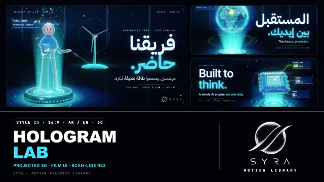

# 25 · Hologram Lab

**SYRA Motion Library** · Style 25 · 16:9 · Arabic / English



<div dir="rtl">

> طريقة الاستخدام:
> انسخ البرومت ده كله وحطه لأي أداة AI أو لسكيل الـ animate، واملا الجزء الأخير ([VIDEO BRIEF]) بموضوع الفيديو.
> الستايل ده "معمل الهولوجرام" — 3D حقيقي (WebGL / three.js): هولوجرامات من نور سماوي طالعة من جهاز عرض على أرضية غامقة لامعة، بخطوط سكان وحلقات وكروت بيانات وأشخاص من نور، وبين المشاهد الهولوجرام بيتمسح وينزل في الجهاز ويطلع اللي بعده — مناسب للذكاء الاصطناعي، التقنية، البيانات، والطاقة.
> المرجع الأساسي للشكل والحركة هو ملف "source/index.html". بيشتغل بالعربي وبالإنجليزي. ممنوع اللون البني.

</div>

## Files in this folder

| File | What it is |
|---|---|
| [source/index.html](source/index.html) | The motion itself — opens and plays in a browser; the source of truth |
| [sample.mp4](sample.mp4) | Showcase reel of the style |
| The info card at the top of this file | Tags & hashtags: what the style expresses, what it suits, search words |

## Tags

<div dir="auto">

النوع: 3D حقيقي (WebGL) — هولوجرامات نور على أرضية غامقة  
في سطر: هولوجرامات من نور سماوي طالعة من جهاز عرض على أرضية سودا لامعة، بخطوط سكان وكروت بيانات وأشخاص من نور، إحساس أفلام الخيال العلمي والذكاء الاصطناعي.  
In one line: Cyan light holograms rising from a projector disc on a dark glossy floor, with scanlines, FUI data cards and people made of light, a sci-fi AI-lab feel.  
#عربي: #هولوجرام #ذكاء_اصطناعي #تقنية #مستقبل #بيانات #طاقة_متجددة #مدن_ذكية #خيال_علمي #ثري_دي #نيون #شركات_تقنية #تحول_رقمي #إنفوجرافيك #تقرير_سنوي #ابتكار #شبكات #ستارت_اب  
#English: #hologram #ai #technology #futuristic #scifi #fui #data #3d #neon #cyan #smartcity #renewableenergy #digitaltransformation #innovation #annualreport #startup #techlaunch #darkmode  
مناسب لـ: شرح منتجات الذكاء الاصطناعي والتقنية، تقارير سنوية وأرقام نمو، إطلاق شركة تقنية أو ستارت اب، مشاريع طاقة ومدن ذكية، تقديم فريق هندسي، مؤتمرات وفعاليات تقنية، شبكات واتصالات على مستوى مصر  
Best for: AI and tech product explainers, annual reports and growth numbers, tech/startup launches, energy and smart-city projects, engineering team intros, tech conferences and events, nationwide network/connectivity stories  
مش مناسب لـ: محتوى أطفال بسيط أو طفولي، مواضيع دافية وإنسانية زي الأكل والعيلة، تاريخ وتراث، أي حاجة محتاجة ألوان كتير أو جو نهار فاتح  
Not for: simple kids' content, warm human topics like food and family, history and heritage, anything needing a colourful palette or a bright daylight look  
المزاج: ذكي، مستقبلي، واثق، فخم تقنياً        Mood: intelligent, futuristic, confident, high-tech premium  
الإيقاع: متوسط (ظهور سريع بالسكان ثم ثبات يتنفس)        Pace: medium  

</div>

## Components

| # | Component |
|---|---|
| 01 | Title Earth Projection |
| 02 | Data Hero Radial Chart |
| 03 | Growth Helix |
| 04 | Neural Chip |
| 05 | Character Nour Turbine |
| 06 | Team Of Four |
| 07 | Story Seed To Idea |
| 08 | Mentor And Student |
| 09 | Three Steps Path |
| 10 | Big Number 250K |
| 11 | Timeline Rail |
| 12 | Quote Voice |
| 13 | Before After City |
| 14 | Egypt Map Nile |
| 15 | Chapter Card Lower Third |
| 16 | End Logos |
---

## HOLOGRAM LAB — MOTION GRAPHICS STYLE PROMPT (SYRA Motion Library · Style 25 · 16:9 · Arabic / English)

### Role

You are a senior motion designer producing motion graphics in the "Hologram Lab" style of the SYRA Motion Library, on ANY topic, in Arabic OR English (or both). Match the reference exactly: the source of truth is "source/index.html" (all components, playable in a browser).

### 1. Style identity

- One line: a film-UI hologram lab in real 3D — a dark glossy floor with true reflections, a bevelled gunmetal projector disc throwing a volumetric cyan cone, and holograms of fresnel and scanline light with a wire lattice, FUI rings, billboard data cards and drifting dust; bloom and a blue anamorphic streak make the light glow.
- Mood: intelligent, futuristic, confident — "building the future, together".
- Never: plastic-looking solids, overlapping additive blobs that blow out white, warm or earth-toned light.

### 2. Format & technical

- Canvas 1920×1080, 30 fps. One idea per scene, 4.6–5.0 s; scenes overlap 1.0 s for the signature transition.
- Real-time 3D: three.js r160 in ONE shared WebGL renderer / canvas for the whole film, inside HTML + GSAP (HyperFrames): one paused timeline, DOM via fromTo / to / set or the engine's time-based type fx, deterministic (seeded randomness), every 3D value a pure function of timeline time; all materials built once. No CSS keyframes, no remote assets, no extra lights. Points ≤ ~20k per scene. Full state by ~2.6 s, then hold and breathe.

### 3. Colour palette (use only these)

- Background #02050C (every stage is the dark lab) · gunmetal #0D1730 / #1A2A4C
- Holo cyan #3FE0FF (primary) · ice #E8F8FF / #EEF9FF (rims, headlines) · electric blue #2E6BFF · azure #1FA2FF (depth, hijab)
- ONE highlight per frame: signal lime #B8FF3C (Egypt, a KPI, a badge)
- Hologram skin rosy peach #FFC6D0 with rose lips #FF7FA6 (characters only)

### 4. Typography (bilingual)

- Arabic: IBM Plex Sans Arabic 700 headlines / 400 lines. English and big numbers: Inter 600. Main words in ice; the ONE accent word is scanline-filled cyan hologram light with glow room. Arabic right at 120 px, English left at 120 px.
- FUI layer: JetBrains Mono 500 kickers ("Hologram Lab / 25 · Topic", "Live · Proj-NN"), readouts with a lime value, mono tags with a dash, glowing hairline rules, canvas data cards with corner brackets.
- Type arrives on the scan beat: 2 frames of chromatic split, then an expo rise; accent word scan-reveals bottom → top.
- Latin digits in both languages. Min 28 px for reading text. Never split Arabic into letters.

### 5. Drawing language (3d modelling / materials / lighting)

- Modelling: dot-matrix Earth and Egypt maps with arcs from Cairo, radial bar charts, donut rings, growth helix of year rings, a neural chip from wire lattice, wind turbine, seed-to-idea plant, light paths and rails, volumetric layered numerals and logos, wire city blocks, extra projector discs that rise out of the floor.
- Materials: additive hologram shader — fresnel rim, soft form light, world scanlines, a travelling band, 24 Hz flicker, optional slice glitch; a depth prepass on every solid part for clean silhouettes; line, point and decal materials.
- Lighting & post: cool key light #DCECFF with soft shadow, cyan rim spot on the projector, weak hemisphere, studio env; planar floor reflection, HDR bloom + anamorphic blue streak, chromatic offset, ACES, vignette, fine grain.
- People: holograms of light — Eng. Nour in hijab and an open lab coat with a lime badge, a man in shirt (glasses / beard), a young person in a hoodie; they rez wire → fill → rim and present, point, explain, wave and cheer.

### 6. Motion language (incl. camera)

- Rez, never fade: objects build wire → fill → rim out of the beam, spring with anticipation and small overshoot, staggered 0.08–0.2 s; rings unfurl, arcs and paths draw on, cards flicker in, numbers count up; holds breathe (spin, pulses, scans).
- Camera: always moving — eased push-in, orbit or crane with lens shift (hologram opposite the type), slow drift in the hold.
- Signature transition: scan & re-rez — the old hologram de-rezzes down into the disc (ice edge at the cut, glitch spike, scanline strands drifting up) while the camera swings to the next set-up, the lens dips and flares, and the next hologram re-rezzes up from the disc: wire first, then fill, then rim.

### 7. Branding

- SYRA logo only — plain white on dark scenes / black on light scenes, never tinted: never hologram-cyan, no fresnel, scanlines, bloom or glow on the logo itself. Every stage is the dark lab, so white.
- Corner logo: SYRA (mark + wordmark) bottom-right ~222 px, plain white throughout.
- End: SYRA lockup alone (mark above wordmark, plain white) resolving above the lab disc's beam with FUI rings around it, tagline «نبني المستقبل، سوا.» / "Building the future, together.".

### 8. Component library (in "holo html.html"; ar = arabic example, en = english)

- **01** Dot-matrix Earth title «المستقبل بين إيديك.» (AR)
- **02** Radial bar chart + donut + KPI cards "Data in 3D." (EN)
- **03** Growth helix 2.6M «كل سنة بنكبر أكتر.» (AR)
- **04** Neural chip from wire lattice "Built to think." (EN)
- **05** Eng. Nour presents a wind turbine «فريقنا حاضر.» (AR)
- **06** Four holograms on their own discs "Meet the team." (EN)
- **07** Ziad grows an idea from a seed «الفكرة بتكبر.» (AR)
- **08** Mentor & student, the idea lights up "Learn by doing." (EN)
- **09** Three discs + light path «من الفكرة للإطلاق.» (AR)
- **10** Volumetric 250K in a halo «ربع مليون حلم بيتحقق.» (AR)
- **11** Holo rail 2018 → 2026 "Built year by year." (EN)
- **12** Speaking hologram + quote card «إحنا بنبنيها.» (AR)
- **13** Grey blocks → smart district "Same street, smarter city." (EN)
- **14** Dot-matrix Egypt + Nile «مصر كلها متوصّلة.» (AR)
- **15** Chapter 02 from the beam + lower third (AR+EN)
- **16** End SYRA lockup over the disc (AR + EN)

### 9. Sound (if the video has sfx)

- Projector hum and power-up swells, digital glitch ticks on the scan, soft data blips as cards flicker in, a deep pulsing synth bed. Duck ~18–20 dB under VO.

### 10. Do / don't

- **DO** rez everything from the disc, keep fill low and let rims + bloom glow, keep the camera moving, one hologram word, one lime highlight.
- **DON'T** use brown/beige/tan/sand/wood/gold-brown/olive/sepia or earth tones, plain fades on 3D, white blown-out overlaps, or full-screen glow layers.

## [VIDEO BRIEF] — fill this in for each new video

```text
- Language: [ Arabic / English / both ]
- Topic / title: [ ... ]
- Voiceover file or script: [ path to WAV/MP3 or the text ]
- Length: [ e.g. 45 s ]
- Headlines and the accent word in each: [ ... ]
- Numbers / steps / content: [ ... ]
- Components to use (in order): [ e.g. 01, 05, 09, 16 ]
- Characters needed: [ ... ]
- Extra notes: [ ... ]
Output: 1920×1080, 30 fps MP4, same length as the voiceover, every visual timed to the word it illustrates,
SYRA corner logo, SYRA logo ending.
```
