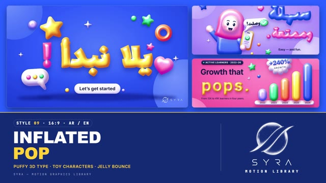

# 09 · Inflated Pop

**SYRA Motion Library** · Style 09 · 16:9 · Arabic / English



<div dir="rtl">

> طريقة الاستخدام:
> انسخ البرومت ده كله وحطه لأي أداة AI أو لسكيل الـ animate، واملا الجزء الأخير ([VIDEO BRIEF]) بموضوع الفيديو.
> الستايل ده "منفوخ" — حروف وأشكال وشخصيات زي البلالين ولعب الفينيل بألوان مبهجة — مناسب للشباب، التعليم، السوشيال، والحملات المرحة. بيشتغل بالعربي وبالإنجليزي.
> المرجع الأساسي للشكل والحركة هو ملف "source/index.html". ممنوع اللون البني.
> ملحوظة مهمة: الحروف العربي المنفوخة لازم تفضل مقروءة — النقط ما تلزقش في بعض (استخدم نفخ أخف للكلمات الكتير النقط).

</div>

## Files in this folder

| File | What it is |
|---|---|
| [source/index.html](source/index.html) | The motion itself — opens and plays in a browser; the source of truth |
| [sample.mp4](sample.mp4) | Showcase reel of the style |
| The info card at the top of this file | Tags & hashtags: what the style expresses, what it suits, search words |

## Tags

<div dir="auto">

النوع: 3D منفوخ (شكل بلالين ولعب فينيل لامعة) على خلفيات ألوان سادة مبهجة — عربي وإنجليزي  
في سطر: حروف وأشكال وشخصيات منفوخة زي البلالين واللعب، لامعة وطرية، على خلفيات أزرق وبمبي وأصفر ونعناعي، بتنطّ وتتهزّ زي الجيلي — فرحان ومرح وحيوي.  
In one line: Puffy 3D balloon-like type, objects and toy characters on bold saturated colour fields, moving with squash-and-stretch and jelly bounces — joyful, friendly and energetic.  
#عربي: #مرح #مبهج #شباب #أطفال #تعليم_ممتع #ألعاب #جيمنج #سوشيال_ميديا #حملة #تحفيز #3D #منفوخ #ألوان_زاهية #كرتون #تطبيق_تعليمي #احتفال  
#English: #playful #fun #colourful #youth #kids #edutainment #gamification #gaming #socialmedia #campaign #3d #inflated #puffy #balloon #toycharacters #cheerful #celebration  
مناسب لـ: محتوى تعليمي ممتع للأطفال والشباب، تطبيقات تعليم وألعاب (مستويات ونقط وجوايز)، حملات سوشيال ميديا مرحة، إعلانات خفيفة لبراند شبابي، احتفال بأرقام وإنجازات (مليون متابع)، دعوة للانضمام لفريق أو مجتمع، خطوات بسيطة بأسلوب مرح  
Best for: fun learning content for kids and youth, edtech and gamified apps (levels, coins, trophies), playful social campaigns, light ads for youth brands, milestone celebrations (a million followers), join-the-community calls, simple steps told playfully  
مش مناسب لـ: المواضيع الجادة أو الحزينة أو الطبية الحساسة، تقارير رسمية وحكومية وفخمة، أخبار وتحقيقات، شرح علمي دقيق بتفاصيل كتير  
Not for: serious, sad or sensitive medical topics, formal government or luxury reports, news and investigations, detailed scientific explanations  
المزاج: فرحان، ودود، حيوي، طفولي، مرح        Mood: joyful, friendly, energetic, childlike, playful  
الإيقاع: سريع وحماسي (نطّ وجيلي في كل حركة)        Pace: fast and bouncy  

</div>

## Components

| # | Component |
|---|---|
| 01 | Title |
| 02 | Bars |
| 03 | Chat |
| 04 | Counter |
| 05 | Character |
| 06 | Squad |
| 07 | High Five |
| 08 | Gamer |
| 09 | Checklist |
| 10 | Phone |
| 11 | Three Steps |
| 12 | Donut |
| 13 | Word Swap |
| 14 | Before After |
| 15 | Chapter Card |
| 16 | End Logos |
---

## INFLATED POP — MOTION GRAPHICS STYLE PROMPT (SYRA Motion Library · Style 09 · 16:9 · Arabic / English)

### Role

You are a senior motion designer producing playful, high-energy motion graphics in the "Inflated Pop" style of the SYRA Motion Library, on ANY topic, in Arabic OR English (or both). Match the reference exactly: the source of truth is "source/index.html" (all components, playable in a browser).

### 1. Style identity

- One line: puffy 3D type, objects and toy characters that look like balloons / soft vinyl toys, on bold saturated colour fields, moving with real squash & stretch and jelly bounces.
- Mood: joyful, friendly, energetic — "easy and fun".
- Never: brown/beige/olive, muddy grey shading, thin line art, flat corporate cards, unreadable Arabic.

### 2. Format & technical

- Canvas 1920×1080, 30 fps. One idea per scene, 4.2–4.8 s; scenes overlap 0.6 s for the blob wipe.
- HTML + GSAP (HyperFrames): one paused timeline, only fromTo / to / set, deterministic, no CSS keyframes.
- The inflated look = one shared SVG lighting filter (blurred alpha as a height map, light from top-left, gloss highlight, darker rim, shadows tinted towards a deeper version of the object's own colour) + a stage-tinted drop shadow + a soft contact shadow on the floor. ≤ ~25 puffed elements per scene; filled shapes only.
- Neighbouring scenes always use different stage colours.

### 3. Colour palette (use only these)

- Stages ...... electric blue #2F5BFF · bubblegum #FF6FB5 · sunny #FFD43B · mint #3DDC97 · lilac #B69CFF · tangerine #FF8A3D
- Objects ..... the same 6 colours + white; text navy #141A4A (white on blue / pink)
- Character skin: soft pink gradient (never beige). Shadows: deeper saturated tint of the object, never grey-brown.

### 4. Typography (bilingual)

- Arabic display: Lalezar, inflated (use a thinner stroke on dot-heavy words so dots stay separate).
- English display: Inter 700, inflated. Flat lines: IBM Plex Sans Arabic 700 / Inter 700 in navy or white.
- One inflated accent word/phrase per headline next to flat text. Latin digits. Min 28 px.

### 5. Drawing language

- Puffy stars, hearts, balls, rings, sparkles, speech bubbles, check badges, pills, capsule bars, donuts, phones, trophies, coins, ribbons, cloud badges — glossy highlight on top-left, contact shadow below.
- Characters: toy-like — big round puffy head, simple dot eyes + smile + blush, puffy hijab / cap / headphones / glasses, chunky body and limbs, each part a separate puffy piece.

### 6. Motion language

- inflate: from 0 with an elastic overshoot (X leads Y); drop: fall → squash on landing → one rebound.
- wobble / squish / jelly settle on every landing; floatBob for holds; typing dots hop; hearts beat.
- Characters jump, wave, high-five, nod with anticipation, squash and follow-through.
- Signature transition: small accent balls pop at a point, then a giant puffy blob in the next scene's colour inflates from it and covers the frame; the new scene lands with a jelly settle.

### 7. Branding

- SYRA logo only — plain white on dark scenes / black on light scenes, never tinted, puffed or squashed.
- Corner logo: SYRA (mark + wordmark) bottom-right ~222 px (white on blue / pink, black on the others).
- End: SYRA lockup alone — a big puffy white cushion drops and squashes on the floor, the flat black stacked SYRA logo pops onto it, + «مستقبلك يبدأ اليوم!» / "Your future starts today."

### 8. Component library (in "inflated html.html"; ar = arabic example, en = english)

- **01** Inflated title + props (AR)
- **02** Puffy bar chart + badge (EN)
- **03** Puffy chat bubbles (AR)
- **04** Million counter + confetti (EN) 05 Toy girl + phone (AR)
- **06** Squad of 4 toys (EN)
- **07** High-five (AR)
- **08** Gamer level-up (EN)
- **09** Puffy checklist + trophy (AR)
- **10** Puffy phone notifications (EN) 11 Three steps + hopping ball (AR) 12 Puffy donut chart (AR)
- **13** Inflated word swap (EN)
- **14** Before / after: deflated → star (AR)
- **15** Chapter card + lower third (AR+EN)
- **16** End: SYRA lockup (AR + EN)

### 9. Sound (if the video has sfx)

- Balloon squeaks and rubbery boings on landings, pops for wipes, bubbly UI blips, coin chimes, a bouncy upbeat bed. Duck ~18–20 dB under VO.

### 10. Do / don't

- **DO** alternate stage colours, keep every landing squashy, keep Arabic dots readable, keep it cheerful.
- **DON'T** use brown/beige, grey muddy shadows, thin outlines, or the same colour for neighbouring scenes.

## [VIDEO BRIEF] — fill this in for each new video

```text
- Language: [ Arabic / English / both ]
- Topic / title: [ ... ]
- Voiceover file or script: [ path to WAV/MP3 or the text ]
- Length: [ e.g. 30 s ]
- Headlines and the inflated word in each: [ ... ]
- Numbers / steps / content: [ ... ]
- Components to use (in order): [ e.g. 01, 05, 09, 04, 16 ]
- Characters needed: [ ... ]
- Extra notes: [ ... ]
Output: 1920×1080, 30 fps MP4, same length as the voiceover, every visual timed to the word it illustrates,
SYRA corner logo, SYRA lockup ending.
```
