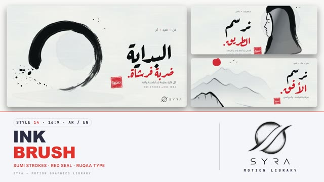

# 14 · Ink Brush

**SYRA Motion Library** · Style 14 · 16:9 · Arabic / English



<div dir="rtl">

> طريقة الاستخدام:
> انسخ البرومت ده كله وحطه لأي أداة AI أو لسكيل الـ animate، واملا الجزء الأخير ([VIDEO BRIEF]) بموضوع الفيديو.
> الستايل ده "حبر وفرشاة" — ضربات فرشاة سوداء، دواير حبر، رذاذ وغسلات على ورق أبيض، وختم أحمر — مناسب للفن، الثقافة، المحتوى الراقي، والقصص الهادئة.
> المرجع الأساسي للشكل والحركة هو ملف "source/index.html". بيشتغل بالعربي وبالإنجليزي. ممنوع اللون البني.

</div>

## Files in this folder

| File | What it is |
|---|---|
| [source/index.html](source/index.html) | The motion itself — opens and plays in a browser; the source of truth |
| [sample.mp4](sample.mp4) | Showcase reel of the style |
| The info card at the top of this file | Tags & hashtags: what the style expresses, what it suits, search words |

## Tags

<div dir="auto">

النوع: 2D (رسم بالحبر والفرشاة على ورق أبيض)  
في سطر: ضربات فرشاة حبر أسود ودواير إنسو ورذاذ وغسلات رمادي على ورق أبيض بارد، مع لون أحمر واحد وختم «سيرا» — هادي وراقي وفني.  
In one line: Bold black sumi-ink brush strokes, ensō circles, splatter and grey washes on cool white paper with one vermilion red accent and a red seal; calm, masterful, artistic.  
#عربي: #حبر #فرشاة #خط_عربي #رقعة #فن #ثقافة #هادي #راقي #مينيمال #أبيض_وأسود #اقتباس #حكمة #تأمل #قصة #إلهام #تراث #كتب  
#English: #ink #brush #sumi #calligraphy #ruqaa #art #culture #calm #minimal #elegant #blackandwhite #quote #wisdom #mindful #storytelling #inspiration #heritage #zen  
مناسب لـ: محتوى ثقافي وفني، خط عربي وأدب وشعر، اقتباسات وحكم ورسائل ملهمة، قصص هادية عن قيم (معلم وتلميذ، جيل لجيل)، معارض ومتاحف ومهرجانات فنية، براندات راقية مينيمال، مقدمات وثائقية  
Best for: culture and art content, Arabic calligraphy/literature/poetry, quotes and inspirational messages, calm value stories (mentor and student, generations), exhibitions/museums/art festivals, minimal premium brands, documentary intros  
مش مناسب لـ: محتوى حماسي سريع أو رياضة أو ألعاب، داشبورد بيانات كتير وأرقام معقدة، أطفال صغيرين محتاجين ألوان مبهجة، تقنية مستقبلية أو منتجات هاي تك  
Not for: fast hype, sports or gaming, dense dashboards and complex data, young kids needing bright colour, futuristic tech or high-tech products  
المزاج: هادي، راقي، فني، متمكّن، تأملي        Mood: calm, refined, artistic, masterful, contemplative  
الإيقاع: هادي        Pace: calm  

</div>

## Components

| # | Component |
|---|---|
| 01 | Title Enso |
| 02 | Strokes Chart |
| 03 | Calligraphy Ibdaa |
| 04 | Ink Drop |
| 05 | Portrait Painted |
| 06 | Calligrapher Line |
| 07 | Mentor Student |
| 08 | Walker Path |
| 09 | Steps Enso |
| 10 | Sumi Landscape |
| 11 | Map Egypt |
| 12 | Quote Brush |
| 13 | Before After |
| 14 | Bamboo Growth |
| 15 | Chapter Card |
| 16 | End Logos |
---

## INK BRUSH — MOTION GRAPHICS STYLE PROMPT (SYRA Motion Library · Style 14 · 16:9 · Arabic / English)

### Role

You are a senior motion designer producing motion graphics in the "Ink Brush" style of the SYRA Motion Library, on ANY topic, in Arabic OR English (or both). Match the reference exactly: the source of truth is "source/index.html" (all components, playable in a browser).

### 1. Style identity

- One line: East-meets-Arab ink painting — bold expressive sumi-ink brush strokes (ensō circles, sweeping strokes, dry-brush "flying white"), ink wash gradients and splatter on clean cool white paper, ONE vermilion red accent (a word, a dot, a sun) and a square red seal stamp «سيرا».
- Mood: calm, masterful, artistic — "one stroke, one idea".
- Never: cream/beige/sepia paper, many colours, digital-looking hard vectors.

### 2. Format & technical

- Canvas 1920×1080, 30 fps. One idea per scene, 4.2–4.8 s; scenes overlap 1.0 s for the signature transition.
- HTML + GSAP (HyperFrames): one paused timeline, only fromTo / to / set, deterministic (seeded randomness), no CSS keyframes, no remote assets. Hold the full state for the last ~1 s of every scene before the transition.

### 3. Colour palette (use only these)

- Paper #F7F7F5 (cool white) with a subtle fibre texture
- Ink black, cool greys for washes
- Vermilion seal red #E0322B — one red word + one seal per scene

### 4. Typography (bilingual)

- Arabic display: Aref Ruqaa 700 (Ruq'a calligraphy) written in as if inked. Small Arabic: IBM Plex Sans Arabic.
- English: Inter (small caps kickers with wide tracking + headline), one red word.
- Latin digits in both languages. Min 28 px for reading text. Never split Arabic into letters.

### 5. Drawing language

- Brush strokes with wet core, bristle clumps and dry tails; ensō; splatter; washes that bloom; brush-stroke bars; sumi-e landscapes (layered grey mountains, red sun, birds), bamboo.
- People are painted in a few confident strokes and washes (profiles, minimal faces).

### 6. Motion language

- paint(): the brush TRAVELS along its path with pressure and speed changes; washes bloom from the brush contact; splatter lands on beats; inkType: words soak into the paper; the seal presses with a tiny shake and red bleed.
- Calm pacing; holds with gentle drift.
- Signature transition: inkWipe — nine giant black brush strokes flood the frame right → left with a red line through them, the scenes swap under full cover, then the ink recedes.

### 7. Branding

- SYRA logo only — plain white on dark scenes / black on light scenes, never tinted (no red, wash or texture on it).
- Corner logo: SYRA (mark + wordmark) bottom-right ~222 px — plain black on the white paper.
- End: SYRA lockup alone (plain black, bleeding into the paper inside a brushed ensō, with the red «سيرا» seal) + the tagline «نرسم المستقبل، معًا.» / "Painting the future, together.".

### 8. Component library (in "ink html.html"; ar = arabic example, en = english)

- **01** Ensō title (AR)
- **02** Brush-stroke chart (EN)
- **03** Calligraphy «إبداع» (AR)
- **04** Ink drop → one idea (EN)
- **05** Painted portrait (AR)
- **06** Calligrapher's line (EN)
- **07** Mentor & student (AR)
- **08** Walker on a painted road (EN)
- **09** Three ensō steps (AR)
- **10** Sumi-e landscape (AR)
- **11** Ink map of Egypt (EN)
- **12** Ruq'a quote (AR)
- **13** Less, but better (EN)
- **14** Bamboo growth (AR)
- **15** Chapter card + lower third (AR+EN)
- **16** End: SYRA lockup in an ensō (AR + EN)

### 9. Sound (if the video has sfx)

- Brush swishes on paper, soft wet drops, a wooden seal thud, a shakuhachi/oud-style airy bed. Duck ~18–20 dB under VO.

### 10. Do / don't

- **DO** let the brush travel, keep lots of white space, one red accent, one seal.
- **DON'T** use beige/sepia paper, many colours, or text faded in without ink.

## [VIDEO BRIEF] — fill this in for each new video

```text
- Language: [ Arabic / English / both ]
- Topic / title: [ ... ]
- Voiceover file or script: [ path to WAV/MP3 or the text ]
- Length: [ e.g. 45 s ]
- Headlines and the accent word in each: [ ... ]
- Numbers / steps / content: [ ... ]
- Components to use (in order): [ e.g. 01, 05, 09, 16 ]
- Characters needed: [ ... ]
- Extra notes: [ ... ]
Output: 1920×1080, 30 fps MP4, same length as the voiceover, every visual timed to the word it illustrates,
SYRA corner logo, SYRA lockup ending.
```
