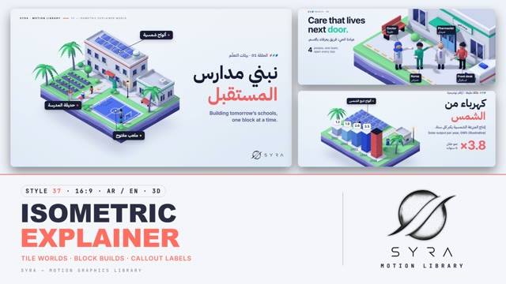

# 37 · Isometric Explainer

**SYRA Motion Library** · Style 37 · 16:9 · Arabic / English



<div dir="rtl">

> طريقة الاستخدام:
> انسخ البرومت ده كله وحطه لأي أداة AI أو لسكيل الـ animate، واملا الجزء الأخير ([VIDEO BRIEF]) بموضوع الفيديو.
> الستايل ده "عالم الأيزومتريك الشارح" — 3D حقيقي (WebGL / three.js) بكاميرا أيزومترية ثابتة الزاوية: كل مشهد قطعة أرض صغيرة طايرة
> في فراغ فاتح، طبقات أرض ملوّنة من تحت، ومباني وناس وشجر بيتبنوا قطعة قطعة، وعليها لافتات شرح بخطوط رفيعة — مناسب للشرح والإنفوجرافيك،
> المشروعات والمدن، الصحة والطاقة والنقل، المبادرات المجتمعية، وأي فكرة محتاجة "خريطة" توضّحها خطوة بخطوة.
> المرجع الأساسي للشكل والحركة هو ملف "source/index.html". بيشتغل بالعربي وبالإنجليزي. ممنوع اللون البني.

</div>

## Files in this folder

| File | What it is |
|---|---|
| [source/index.html](source/index.html) | The motion itself — opens and plays in a browser; the source of truth |
| [sample.mp4](sample.mp4) | Showcase reel of the style |
| The info card at the top of this file | Tags & hashtags: what the style expresses, what it suits, search words |

## Tags

<div dir="auto">

النوع: 3D (WebGL) — ديوراما أيزومتريك بزاوية ثابتة  
في سطر: كل مشهد قطعة أرض 3D صغيرة طايرة في فراغ فاتح، مباني وناس وشجر بيتبنوا قطعة قطعة وعليها لافتات شرح كحلي — هادي ومنظّم وواضح.  
In one line: Calm, map-like 3D explainer — one floating isometric tile per scene, built block by block and labelled with navy callout pills.  
#عربي: #شرح #إنفوجرافيك #أيزومتريك #مجسم_3D #مشروعات #مدن #طاقة_شمسية #زراعة_ذكية #صحة #نقل_ومواصلات #مصانع #مبادرات_مجتمعية #خريطة_مصر #بيانات #خطوات #تعليمي #شركات #هادي  
#English: #isometric #3d #explainer #infographic #diorama #howitworks #smartcity #urbanplanning #solarenergy #smartfarming #healthcare #logistics #factory #transport #community #egyptmap #data #corporate  
مناسب لـ: شرح "إزاي الحاجة بتشتغل" خطوة بخطوة، عرض مشروعات ومدن ومبادرات، تقارير طاقة وزراعة ونقل وموانئ، تعريف بخدمة صحية أو عيادة، إنفوجرافيك أرقام بأعمدة 3D، خرايط مصر ومواقع مشروعات، فيديوهات شركات وجهات حكومية  
Best for: step-by-step "how it works" explainers, project/city/initiative showcases, energy-farming-transport-port reports, local health-service intros, 3D bar-chart infographics, Egypt maps with project pins, corporate and public-sector videos  
مش مناسب لـ: قصص عاطفية مركّزة على وش شخص، تاريخ وآثار بإحساس سينمائي ليلي (ده 39 كرونيكل 3D مش 37)، إعلانات حماسية سريعة أو رياضة نارية، أي حاجة محتاجة صور حقيقية  
Not for: emotional face-driven drama, cinematic night-time history (that is 39 Chronicle 3D, not 37), fast hype ads or high-energy sport promos, anything needing real photos  
المزاج: هادي، منظّم، متفائل، واضح، نضيف        Mood: calm, organised, optimistic, clear, clean  
الإيقاع: هادي إلى متوسط        Pace: calm to medium  

</div>

## Components

| # | Component |
|---|---|
| 01 | Title School Campus |
| 02 | Data Smart Farm |
| 03 | Data Solar Bars Arabic |
| 04 | Product Factory Line |
| 05 | Character Outdoor Lesson |
| 06 | Team Clinic Close |
| 07 | Story Bakery Delivery |
| 08 | Mentor Fisherman Close |
| 09 | Three Steps Port |
| 10 | Big Number Stadium |
| 11 | Timeline Metro Line |
| 12 | Quote Night Market |
| 13 | Before After Green Block |
| 14 | Map Egypt Nile |
| 15 | Chapter Lower Third |
| 16 | End SYRA Lockup |
---

## ISOMETRIC EXPLAINER WORLD — MOTION GRAPHICS STYLE PROMPT (SYRA Motion Library · Style 37 · 16:9 · Arabic / English)

### Role

You are a senior motion designer producing motion graphics in the "Isometric Explainer World" style of the SYRA Motion Library, on ANY topic, in Arabic OR English (or both). Match the reference exactly: the source of truth is "source/index.html" (all components, playable in a browser).

### 1. Style identity

- One line: calm, map-like explainer worlds — one true-isometric diorama tile floating on a cool light void, cut away to show wavy cool strata, topped with clean flat-shaded buildings, small readable people, palms, dashed paths, glowing accents, and dark callout pills on thin leader lines that explain what we see.
- Mood: clear, optimistic, organised — "here is how it works, block by block".
- Never: perspective distortion or a rotating camera, gritty textures, photo elements, earth tones, brown soil or wood.

### 2. Format & technical

- Canvas 1920×1080, 30 fps. One idea per scene, ~4.8 s; scenes overlap 1.0 s for the signature transition.
- Real-time 3D: three.js r160 in ONE shared WebGL renderer for the whole film; orthographic camera at azimuth 45° and elevation 35.264° (true isometric) — pans and zooms only, never rotates. Flat Lambert materials with soft bevel highlights, 4 soft shadow keys + cool hemisphere light, screen-space AO tinted indigo, light grain, no tone mapping.
- HTML + GSAP (HyperFrames): one paused timeline; everything is a pure function of time (seeded randomness only), so any frame can be sought directly. Build all geometry once. Full state by ~2 s, then a living hold.

### 3. Colour palette (use only these)

- Void gradient #EEF3FA → #DCE7F6 with a soft bloom behind the tile. Ink #141B34 / #222B55, slate #46508A.
- Accents: coral #FF6F61 (headline accent), teal #14B8A6, cobalt #2F5BEA, yellow #FFC93C, sky #7CC4FF, lilac #B7A8F5.
- Architecture white #F7F9FD / #E9EEF7, roofs #D5DCEA, paving #E6EBF5, glass #22306A→#3E56A6 with glare bands.
- Nature: grass #86D99A, leaves #3FBE7A / #2A9E68 / #7EDB8F, field soil cool violet #6F72BE, palm trunks #8A91C4, water #4C8DF0 / #6FB3FF with foam ripples, beach = cool pale #E4E8F6 (never sand-beige).
- Strata #E7F0FF / #A9C4F2 / #8C8FE0 / #4E54A6 with pebbles; contact shadows and AO indigo #27306A / #3A3F8F.
- People: rosy skin #F2B9A3 / #E9A792 / #F6C7B3 / #E3978A, hair navy-black #1D2140, grey hair #C3CADF.
- Night variant: void #2B3566 → #121835, moonlit cool key, lit windows and lantern halos #FFD66B.

### 4. Typography (bilingual)

- Arabic: IBM Plex Sans Arabic 600/700 — headlines 92–124 px, callout pills 30 px, tags 28 px.
- English / digits: Inter 500–700 — headlines 80–86 px (−0.035 em), stats 64 px, big numbers up to 210 px, kickers tracked caps with three skewed colour swatches.
- One accent word per headline (coral, or teal / cobalt). Arabic + English on every screen (headline in one language, a one-line translation or sub in the other). Latin digits. Min 28 px. Never split Arabic into letters — whole lines rise out of masks with headroom for dots and hamzas.

### 5. Drawing language (3d modelling / materials / lighting)

- Every scene = one (or two) floating tiles: grass or paving lid on a slab with wavy strata bands and pebbles, a soft void shadow far below.
- Clean rounded boxes with analytic bevels: buildings with parapets, coloured trim, framed glass windows, doors with canopies, striped awnings, solar panels, tanks, cranes, containers, stands, rails, vehicles, scooters, boats.
- Organic shapes: palms with serrated fronds (smooth shadow proxies), round bushes and trees, crop rows, flowers.
- Paths and data: yellow dashed lines, chevrons, dashed zone outlines, pulsing ground rings, block bar charts that extrude floor by floor, pins on a map, glowing beacons (tinted halos, never additive).
- People: simple rounded figures with readable faces in close shots (dot eyes with glints, brows, nose, blush, smile), modern Egyptians: women with and without hijab, men young and older (beards, grey hair, galabeya), kids; doctors, engineers, bakers, fishermen, riders, shop owners, athletes. They walk, wave, point, work, sit and blink.
- Callouts: navy pill + thin leader + white ring pinned to a 3D point (Arabic pill with a coloured dot, English pill with a coral number badge and an Arabic sub-line); white speech bubbles.

### 6. Motion language (incl. camera)

- Block-by-block builds: paving draws on, buildings extrude floor by floor with a small squash, props drop (0.6 units, backOut, 60–80 ms stagger), plants grow with overshoot, people pop in last; then rings pop, leaders draw, pills scale out.
- Camera: slow ortho push and pan in every hold; establishing → close push when faces matter; glides along long tiles (timelines, step-by-step processes, maps). The iso angle never changes.
- Life in every hold: walkers, waves, blinks, swaying fronds, water ripples, flowing pipes, pulsing sensors, crowd waves.
- SIGNATURE TRANSITION — "Tile Swap": callouts retract into their rings, people and props sink into the ground in reverse order, the whole slab drops away with gravity and fades; the next tile assembles from the bottom up — strata bands slide up one by one, the grass lid lands with a squash, then the new world builds block by block.
- Alternative for two places in one world — "Glide": the camera glides across a continuous iso world from one tile to the next (angle locked, a slight breathing zoom-out mid-move).

### 7. Branding

- SYRA logo only — plain black on light scenes, plain white on dark scenes, never tinted, never shaded or glowing.
- Corner logo: SYRA (mark + wordmark) bottom-right, ~222×60 px, 58 px from the right and 50 px from the bottom.
- End: the SYRA stacked lockup alone on a back-lit white billboard standing on a small tile (flat, unlit artwork), people looking up at it, tagline «نبني العالم، قطعة قطعة.» / "Building the world, block by block.".

### 8. Component library (in "isometric html.html"; ar = arabic-led, en = english-led)

- **01** Title — school campus tile «نبني مدارس المستقبل» (AR)
- **02** Data hero — smart farm, numbered callouts + 2 stats "A smart farm saves every drop." (EN)
- **03** Data — solar farm + block bar chart «كهرباء من الشمس» ×3.8 (AR)
- **04** Product — factory line + e-scooter on a turntable "Built here, ready to ride." (EN)
- **05** Character — outdoor science lesson «نتعلّم من الطبيعة» (AR)
- **06** Team — neighbourhood clinic team of 4, close shot "Care that lives next door." (EN)
- **07** Story — bakery → delivery rider «من الفرن للبيت» (AR, glide in)
- **08** Mentor & learner — fisherman teaches his granddaughter "Every skill has a teacher." (EN)
- **09** Three steps — the port: unload → check → deliver «رحلة الشحنة في 3 خطوات» (AR, camera glide)
- **10** Big number — stadium 75,000+ «مشجّع في ليلة واحدة» (AR)
- **11** Timeline — a metro line 2026 → 2029 "A metro line, year by year." (EN, camera glide)
- **12** Quote — night market street «كلّ مشروعٍ كبير بدأ بحلمٍ صغير.» (AR, dark)
- **13** Before / after — the same block, grey → green "From grey to green." (EN)
- **14** Map — Egypt tile with the Nile, Delta, seas and city pins «في كل ربوع مصر» (AR)
- **15** Chapter card 02 + lower third, market street (AR + EN)
- **16** End — SYRA lockup billboard (AR + EN)

### 9. Sound (if the video has sfx)

- Soft plastic "tock" clicks on block landings, light glassy pops for callouts, a low whoosh + soft thud on each tile drop, airy chimes for pins, a gentle upbeat electronic / marimba bed. Duck ~18–20 dB under VO.

### 10. Do / don't

- **DO** keep the true-iso angle locked, build everything block by block, label with pills + leaders, keep a living hold, vary places (clinic, market, stadium, port, factory, solar farm, bakery, metro, farm, seaside) and people.
- **DON'T** rotate the camera, use perspective, brown / beige / tan / cream / sand / wood / terracotta (not even in soil, bread, trunks or shadows), additive glows on the light void, clutter pills over faces, or split Arabic letters.

## [VIDEO BRIEF] — fill this in for each new video

```text
- Language: [ Arabic / English / both ]
- Topic / title: [ ... ]
- Voiceover file or script: [ path to WAV/MP3 or the text ]
- Length: [ e.g. 45 s ]
- Headlines and the accent word in each: [ ... ]
- Numbers / steps / content: [ ... ]
- Places / tiles to build: [ e.g. clinic, port, metro station ]
- Components to use (in order): [ e.g. 01, 03, 09, 16 ]
- Characters needed: [ ... ]
- Extra notes: [ ... ]
Output: 1920×1080, 30 fps MP4, same length as the voiceover, every visual timed to the word it illustrates,
SYRA corner logo, SYRA billboard ending.
```
