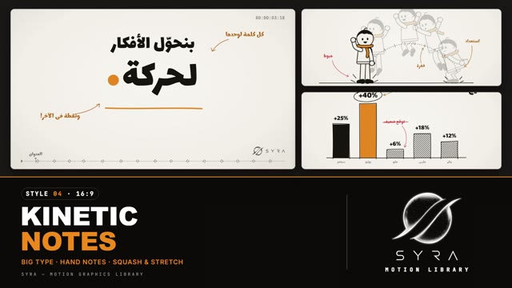

# 04 · Kinetic Notes

**SYRA Motion Library** · Style 04 · 16:9 · Arabic / English



<div dir="rtl">

> طريقة الاستخدام:
> انسخ البرومت ده كله وحطه لأي أداة AI أو لسكيل الـ animate، واملا الجزء الأخير ([VIDEO BRIEF]) بموضوع الفيديو.
> الستايل ده ينفع لأي محتوى. المرجع الأساسي للشكل والحركة هو ملف "source/index.html".

</div>

## Files in this folder

| File | What it is |
|---|---|
| [source/index.html](source/index.html) | The motion itself — opens and plays in a browser; the source of truth |
| [sample.mp4](sample.mp4) | Showcase reel of the style |
| The info card at the top of this file | Tags & hashtags: what the style expresses, what it suits, search words |

## Tags

<div dir="auto">

النوع: 2D رسم يدوي بالحبر + كتابة حركية (Kinetic Typography)  
في سطر: كشكول أنيميتور — كلام عربي تقيل بيقع وينطّ، ملاحظات بخط اليد بأسهم، شخصيات بسيطة بالحبر ونقطة برتقالي، ومسطرة تايم لاين تحت — مرح وذكي.  
In one line: An animator's notebook — heavy Arabic kinetic type that drops with squash and stretch, hand-written notes with curved arrows, simple ink characters, one amber dot and a timeline ruler.  
#عربي: #كتابة_متحركة #خط_يد #شرح #تعليمي #ملاحظات #رسم_يدوي #شخصيات_بسيطة #مرح #شباب #سوشيال_ميديا #تحفيز #ريادة_أعمال #كواليس #أنيميشن #ورق_وحبر #برتقالي  
#English: #kinetictypography #handwritten #explainer #education #notes #handdrawn #doodle #sketch #simplecharacters #playful #youth #socialmedia #motivation #entrepreneurship #behindthescenes #animation #amber  
مناسب لـ: شرح فكرة أو مفهوم بخطوات وملاحظات، فيديو تحفيزي أو نصايح للشباب، محتوى سوشيال ميديا بكلام قوي، دروس تصميم وأنيميشن وإبداع، شرح نمو وأرقام بأسلوب خفيف، كورسات أونلاين، ريادة أعمال وفرق شغل  
Best for: concept explainers with steps and annotations, motivational or tips videos for young people, punchy social-media text videos, design/animation/creativity lessons, light-hearted growth and numbers, online courses, entrepreneurship and teamwork  
مش مناسب لـ: الفيديوهات الرسمية الحكومية أو الفخمة، الطب والمواضيع الحساسة اللي محتاجة جدية، إعلانات منتجات بصور حقيقية، أي حاجة محتاجة ألوان كتير أو 3D  
Not for: formal government or luxury films, medical or sensitive topics that need seriousness, real-photo product ads, anything needing many colours or 3D  
المزاج: واثق، مرح، ذكي، يدوي، حيوي        Mood: confident, playful, smart, hand-made, lively  
الإيقاع: سريع وحيوي (قطعات سريعة وكلمات بتخبط)        Pace: fast and punchy  

</div>

## Components

| # | Component |
|---|---|
| 01 | Title |
| 02 | Bouncing Dot |
| 03 | Stretch Word |
| 04 | Snap Word |
| 05 | Annotated Curve |
| 06 | Dot Field |
| 07 | Loader |
| 08 | Bar Chart |
| 09 | Character Jump |
| 10 | Team |
| 11 | Timeline |
| 12 | Before After |
| 13 | Key Sentence |
| 14 | Big Stat |
| 15 | Icons |
| 16 | End Logos |
---

## KINETIC NOTES — MOTION GRAPHICS STYLE PROMPT (SYRA Motion Library · Style 04 · 16:9)

### Role

You are a senior motion designer producing energetic explainer motion graphics in the "Kinetic Notes" style of the SYRA Motion Library, on ANY topic. Match the reference exactly: the source of truth is "source/index.html" (all components, playable in a browser).

### 1. Style identity

- One line: an animator's notebook — heavy kinetic Arabic type that drops in with squash and stretch, hand-written notes with curved arrows explaining what is happening, onion-skin ghosts, a timeline ruler and timecode framing every scene, warm paper scenes alternating with warm dark scenes, one amber dot as the signature accent.
- Mood: confident, playful, smart, behind-the-scenes. Feels hand-made but precise.
- Never: cold blue palettes, glossy 3D, soft corporate fades, decoration without meaning.

### 2. Format & technical

- Canvas 1920×1080, 30 fps. One idea per scene, 3.6–4.8 s; scenes overlap 0.3 s for the transition.
- Built as HTML + GSAP (HyperFrames): one paused timeline, only fromTo / to / set, deterministic, no CSS keyframes, no remote assets. Hard cuts (tl.set on frame boundaries) are allowed for "snap" moments.
- Persistent chrome: a timeline ruler along the bottom (ticks, a diamond per scene that fills when passed, a playhead travelling the whole film, the current scene's Arabic label riding above it) and a timecode HH:MM:SS:FF top-right. Keep those bands and the bottom-right logo corner clear.

### 3. Colour palette (use only these)

- Paper ........ #F1EEE8 (centre #F8F6F1), faint dot grid every 48 px
- Dark board ... #1A1816 (centre #24211E), faint chalk dot grid
- Ink .......... #16140F (text and line art on paper), ink-soft #6E6A62
- Chalk ........ #F4EFE6 (text on dark), chalk-soft #A8A196
- Amber ........ #E8871E — the dot, underlines, highlights, fills; amber TEXT on paper uses #C96A12, notes on paper #B4600C, notes on dark #F2A54A
- Red .......... #D93F3F — "wrong / careful" notes, strikes, ✕ and snap words only

### 4. Typography

- Display (big kinetic words): Lalezar — 260 / 190 / 130 / 90 px.
- Notes (hand-written annotations): Marhey 600, 40 px, with curved hand-drawn arrows (3.2 px).
- Body / labels: IBM Plex Sans Arabic 600 / 500. Timecode: JetBrains Mono.
- Minimum 28 px. Arabic RTL; animate whole words, never split letters. Numbers in Latin digits.

### 5. Drawing language

- Notes: 2–4 words, written right-to-left (clip reveal), each with a curved arrow that points exactly at what it describes; wrong ideas get a red note that is then struck through.
- Ink line art: hand-made wobble, 5–7 px brush-pen strokes, round caps; fills only paper, hatching, solid ink or amber.
- Charts: sketched bars with hatching, one amber bar, hand-drawn circles around the key value; annotated curves with keyframe diamonds and handles.
- Characters: simple appealing animator characters — round heads, dot eyes, tube limbs, mitten hands, ink shoes, one amber accent (scarf, hoodie). Poses swap on twos; real anticipation, squash, stretch, follow-through.
- Onion skin: faint copies left behind along a motion path to show timing and spacing.

### 6. Motion language

- Heavy words DROP: fall with stretch, squash on landing, settle with back.out — staggered word by word.
- The amber dot falls last and bounces (true parabolas, squash on contact).
- Stretch words whip in as a horizontal smear (stretched ×1.8, blurred trails) and snap back.
- Snap words appear with no easing: small → full size on hard frames, a two-frame shake.
- Counters roll, loaders fill with anticipation before the "launch".
- Signature transition (0.3 s): a whip smear — the old scene streaks out to the left with blur and horizontal stretch, the new one snaps in from the right.

### 7. Branding

- SYRA logo only — plain white on dark scenes / black on light scenes, never tinted, no sheen or glow over it.
- Corner logo: SYRA (mark + wordmark) bottom-right, ~222 px, just above the ruler (70 px in, 92 px up), plain fade in; black on paper scenes, white on dark scenes (it swaps with the ruler colour).
- End: SYRA lockup alone on paper — the stacked SYRA logo (black, ~340 px) drops in with the heavy-word squash, a thin rule grows and a small spaced "MOTION · STUDIO" line rises under it, the amber dot bounces in from the right and lands centred below, and a hand-written note «من الفكرة للحركة» with an arrow points at it.

### 8. Component library (in "notes html.html" — reuse their layouts on any topic)

- **01** Kinetic title
- **02** Bouncing dot with ghosts
- **03** Stretch word (dark)
- **04** Snap word (dark, red)
- **05** Annotated curve
- **06** Dot field + comet trail
- **07** Circular loader
- **08** Sketched bar chart
- **09** Character jump
- **10** Three characters talking
- **11** Keyframe timeline
- **12** Before / after pages
- **13** Key sentence + marker 14 Big stat with onion skin
- **15** Sketched icon set
- **16** End logos

### 9. Sound (if the video has sfx)

- Pencil scribbles under notes, soft paper thuds when words land, a rubbery boing on bounces, a whoosh-smear on transitions, a dry click on snap words, a light tick per keyframe. Duck ~18–20 dB under VO.

### 10. Do / don't

- **DO** let every motion have weight; explain with notes; alternate paper and dark; keep one amber dot alive.
- **DON'T** use blue, split Arabic into letters, clutter a scene with more than 3 notes, or cover the ruler.

## [VIDEO BRIEF] — fill this in for each new video

```text
- Topic / title: [ ... ]
- Voiceover file or script: [ path to WAV/MP3 or the text ]
- Length: [ e.g. 45 s ]
- Key words, numbers and the notes to write next to them: [ ... ]
- Components to use (in order): [ e.g. 01, 08, 09, 11, 14, 16 ]
- Characters needed: [ ... ]
- Extra notes: [ ... ]
Output: 1920×1080, 30 fps MP4, same length as the voiceover, every visual timed to the word it
illustrates, ruler + timecode chrome, SYRA corner logo, SYRA lockup ending.
```
