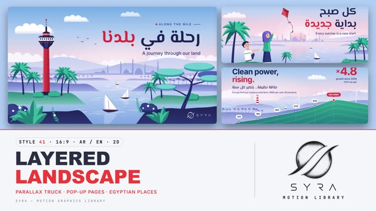

# 41 · Layered Landscape

**SYRA Motion Library** · Style 41 · 16:9 · Arabic / English



<div dir="rtl">

> طريقة الاستخدام:
> انسخ البرومت ده كله وحطه لأي أداة AI أو لسكيل الـ animate، واملا الجزء الأخير ([VIDEO BRIEF]) بموضوع الفيديو.
> الستايل ده "طبقات المنظر الطبيعي" — 2D فلات زي بوسترات السفر: منظر مصري معمول من طبقات سيلويت فوق بعض بتبهت مع البعد (سما باستيل، تلال بنفسجي-أزرق، ضفاف خضرا، مقدمة نيفي)، والكاميرا بتتحرك جنب (parallax) فكل طبقة بتمشي بسرعتها. مناسب للسياحة والبيئة والمدن والقصص الإنسانية والتقارير الخفيفة اللي محتاجة إحساس "رحلة في بلدنا".
> الانتقال المميز: الكاميرا بتعدّي جنب جذع نخلة أو شجرة قريبة جدًا من العدسة والمكان الجديد بيظهر وراها، ولتغيير الفصول: صفحة كتاب "بوب أب" — الطبقات بتقع وطبقات المكان الجديد بتقوم من تحت.
> المرجع الأساسي للشكل والحركة هو ملف "source/index.html". بيشتغل بالعربي وبالإنجليزي. ممنوع اللون البني (ولا رملي ولا بيج ولا خشبي) — حتى سيوة خضرا والصخور بنفسجي.

</div>

## Files in this folder

| File | What it is |
|---|---|
| [source/index.html](source/index.html) | The motion itself — opens and plays in a browser; the source of truth |
| [sample.mp4](sample.mp4) | Showcase reel of the style |
| The info card at the top of this file | Tags & hashtags: what the style expresses, what it suits, search words |

## Tags

<div dir="auto">

النوع: 2D — فلات فيكتور زي بوسترات السفر، طبقات بارالاكس  
في سطر: منظر مصري زي بوستر سفر معمول من طبقات تلال ونخل وميّه بتبهت مع البعد، سما باستيل وكاميرا ماشية جنب، ولمسة أحمر واحدة — هادي ودافي وفيه إحساس رحلة في بلدنا.  
In one line: A flat-vector travel poster of modern Egypt — stacked hazy landscape layers, pastel sky, slow sideways parallax and one bold red accent.  
#عربي: #سياحة #سفر #طبيعة #بيئة #مدن_مصر #النيل #الإسكندرية #أسوان #البحر_الأحمر #سيوة #الدلتا #زراعة #طاقة_نظيفة #قصص_إنسانية #تقارير_خفيفة #هادي #بوستر_سفر  
#English: #travel #tourism #landscape #nature #environment #egypt #nile #alexandria #aswan #redsea #siwa #delta #farming #cleanenergy #humanstories #parallax #flatvector #calm  
مناسب لـ: سياحة وترويج أماكن في مصر، بيئة وطاقة نظيفة واستدامة، قصص المدن والمحافظات، قصص إنسانية هادية (فلاح، صياد، ريّس فلوكة)، تقارير خفيفة بأرقام مدموجة في المنظر (موانئ، زراعة، رياح)، رسايل صباحية وأمثال، فيديوهات "رحلة" بين أماكن  
Best for: tourism and Egyptian destination promos, environment and clean energy, city and governorate stories, gentle human stories (farmer, fisherman, felucca captain), light reports with data built into the landscape, morning messages and proverbs, journey-between-places videos  
مش مناسب لـ: محتوى داخلي (مكاتب، مستشفيات من جوه، فصول)، شرح تقني معقّد أو بيانات كتير، إعلانات حماسية سريعة، تاريخ فرعوني فخم (فيه ستايلات أنسب)  
Not for: indoor settings (offices, hospital interiors, classrooms), complex technical or data-heavy explainers, fast hype ads, grand pharaonic history  
المزاج: هادي، دافي، متفائل، حالم، مريح        Mood: calm, warm, optimistic, dreamy, soothing  
الإيقاع: هادي        Pace: calm  

</div>

## Components

| # | Component |
|---|---|
| 01 | Title Journey Nile |
| 02 | Data Wind Hill Chart |
| 03 | Data Port Container Stacks |
| 04 | Object Reef Buoy |
| 05 | Character Kite Sunrise |
| 06 | Team Stadium |
| 07 | Story Delta Farmer |
| 08 | Mentor Aswan Felucca |
| 09 | Three Steps Harbour |
| 10 | Big Number Siwa Palms |
| 11 | Timeline Cairo Metro |
| 12 | Quote Red Sea Dusk |
| 13 | Before After Rooftops |
| 14 | Map Egypt Route |
| 15 | Chapter Lower Third Corniche |
| 16 | End SYRA Lockup |
---

## LAYERED LANDSCAPE — MOTION GRAPHICS STYLE PROMPT (SYRA Motion Library · Style 41 · 16:9 · Arabic / English)

### Role

You are a senior motion designer producing motion graphics in the "Layered Landscape" style of the SYRA Motion Library, on ANY topic, in Arabic OR English (or both). Match the reference exactly: the source of truth is "source/index.html" (all components, playable in a browser; arrow keys seek).

### 1. Style identity

- One line: a flat-vector travel poster of modern Egypt, built from stacked silhouette layers that fade into haze with distance — pastel sky, scalloped flat clouds, blue-violet hills, green banks, a navy foreground with teal leaf fans and white flowers — and ONE bold red accent (a landmark, a kite, a data point, the accent word).
- Mood: calm, warm, optimistic — "a journey through our land". Places are real and varied: the Nile at Cairo, Alexandria's corniche and harbour, Aswan, the Red Sea, a green Siwa, Delta fields, Port Said, a wind farm, a stadium, the metro.
- Never: sand / desert colours, outlines, gradients that look glossy, photo textures, more than one red idea per frame.

### 2. Format & technical

- Canvas 1920×1080, 30 fps. One idea per scene, 4.6–4.8 s; scenes overlap 1.1 s for the signature transition.
- SVG layers inside HTML + GSAP (HyperFrames): one paused timeline, a master proxy drives the camera, every value is a pure function of time (seeded randomness, no Math.random / Date / CSS animation) so any frame can be sought directly.
- Every layer is 420 px wider than the frame on each side so camera moves never reveal an edge; water bands share ONE gradient so seams vanish; the bottom-right always ends in the navy foreground (corner logo).

### 3. Colour palette (use only these)

- Sky #72ABE7 → #B2CEF2 → #F3DBE8 → #E7DAF4 (sunrise pinks #FBDCE8 / #F4A9BF; dusk #202A68 → #4F52AE → #A983C6 → #EEB3CB).
- Far hills (haze ramp) #C9D1F2 #AEBBEC #93A4E3 · banks #8394DB #6475C9 with a 30 % white rim · green banks / fields #23867F → #7EC0BF, data hill #2FA48F → #1D6C7B · palms #33B99E / #167A7A / #0F5C66, trunks #232B6C.
- Foreground navy #1E2556 → #2C3679, shrubs #33418F / #262F6E, leaf fans #36B49E / #1C7C7A, white flowers.
- Water #EADFF5 → #D3DBF6 → #AAC6F0 → #7DA6E5 with white glints; reef blues #2E9CCB → #253F8E.
- ONE accent red #E5323B (light #F2646A, shade #B4232D). Type navy #1B2350 / #24337A / #2B3A80; white on dusk scenes.
- Skin rosy peach #F7C4AC (+ #EBB39E, #F9D3C0), blush #F49AA6; hair ink-navy #1B2350, elders' hair lilac-grey #C3C8E4.

### 4. Typography (bilingual)

- Arabic: El Messiri 700 — display 130–190 px, lines 50–64 px, labels 30–44 px (its round domes echo minarets and hills).
- English: Inter — headlines 700 at 96–100 px (−0.025 em), subs 500 at 40–44 px, captions 500 at 28 px, numbers 700 at 150–210 px in red; kicker = tracked caps Inter 600 26 px (.24 em) between a red diamond and a short navy rule.
- AR titles flush right with an EN sub; data scenes EN-led with an AR line; Latin digits; one red accent word per headline; Arabic always as whole words (word-by-word builds at most), never split into letters. Min 28 px for reading text.

### 5. Drawing language

- Ridges are smooth seeded curves filled with a vertical haze gradient (crest colour → mist at the base) — the haze between layers IS the depth. Craggy mountains (Red Sea, Sinai) use the same layers with jagged crests.
- Assets: date palms (two-tone serrated fronds, ringed navy trunks) and far palm rows, umbrella trees with flat pads, round bushes, leaf fans, sprigs, flowers, flat clouds; feluccas, fishing boats, a container ship, gantry cranes, container stacks; Cairo Tower, minarets and domes, Qaitbay, Stanley bridge, lighthouse, Suez Canal building, Nubian painted houses, granite boulders (blue-violet), dovecotes, Shali (lilac haze), salt lake, spring pool, stadium bowl, metro viaduct + train, apartment blocks, solar panels, rooftop planters, reef corals, fish, a smart buoy, a pop-up paper map of Egypt.
- People: flat rigs with elbow (and knee) joints and a small pose rig — wave, point, hold a phone, cheer, clap, walk, sit, talk, blink, breathe. Oval eyes with catch-lights, blush, a small smile; hijab as a soft wrap with a framing ring; 2-tone cloth. Vary them: women with and without hijab, young and older men, kids, elders; doctor, engineer, chef, farmer, fisherman, athletes, delivery rider, programmer, painter, fish seller, felucca captain.

### 6. Motion language (incl. camera)

- The camera always trucks slowly sideways: each layer moves at its depth speed (sky 0, far −3…−8 px/s, banks −13…−34, foreground −56), so parallax is alive in every hold.
- Life loops: clouds drift, boats glide and bob, rotors spin, the kite pulls and its tail waves, birds drift, the sun rises, water glints shimmer, smoke rises, fish swim.
- Builds: kicker → headline → sub, each rising 20–36 px with a soft fade and a small back.out overshoot, 120–160 ms stagger; data grows out of the landscape (the hill crest follows the data, containers drop and squash onto their stacks, palms pop up with the counter), pins and pills pop with overshoot, counters ease out.
- Signature transition — PARALLAX TRUCK: the camera trucks right; every layer of the old place slides left at its depth speed, the new place's layers arrive from the right in the same depth order and settle; a palm trunk or umbrella tree very close to the lens sweeps across the frame and the cut hides behind it.
- Section-change variant — POP-UP BOOK: the old layers drop out front to back (small lift, fall and fold), the new sky fades in and the new layers rise from the bottom far → near with a 60–80 ms stagger and a soft overshoot.

### 7. Branding

- SYRA logo only — plain white on the navy foreground corner, plain black on a light corner; never tinted, never red.
- Corner logo: SYRA (mark + wordmark) bottom-right, ~222×60 px, 58 px from the right, 50 px from the bottom, plain fade in; the bottom-right corner of every scene is navy foreground.
- End: the last page of the pop-up book — a calm Nile at sunset rises layer by layer and the SYRA stack logo (plain black on the light sky) settles above the horizon with «رحلتنا مستمرة» / "The journey continues."; no corner logo.

### 8. Component library (in "layered html.html"; ar = arabic lead, en = english lead)

- **01** Title on the Nile at Cairo, Cairo Tower «رحلة في بلدنا» (AR)
- **02** Area-chart hill, wind farm "Clean power, rising." (EN)
- **03** Container-stack bar chart, Port Said «الميناء بيكبر» (AR)
- **04** Smart buoy, Red Sea reef split view "Listening to the reef." (EN)
- **05** Kids + red kite at sunrise «كل صبح بداية جديدة» (AR)
- **06** Team of four at a youth stadium "Stronger together." (EN)
- **07** Delta farmer + phone, water runs, crops sprout «الميّه بحساب» (AR)
- **08** Felucca captain teaches a student, Aswan "Learn from the river." (EN)
- **09** Three stations: catch / sell / cook, Alexandria «من البحر للسفرة» (AR)
- **10** Big number 300,000 palms, green Siwa (AR)
- **11** Metro viaduct timeline 07:00 → 07:50 "Right on time." (EN)
- **12** Proverb at dusk, Red Sea «الصبر مفتاح الفرج» (AR)
- **13** Before / after rooftops with a sweeping divider "Rooftops, reimagined." (EN)
- **14** Pop-up paper map of Egypt «رحلتنا في مصر» (AR)
- **15** Chapter 02 «الساحل» + lower third (painter on the corniche) (AR + EN)
- **16** End SYRA lockup (AR + EN)

### 9. Sound (if the video has sfx)

- Soft wind and water beds, a gentle whoosh on each truck (a leafy swish as the palm passes), paper pops and folds on the pop-up pages, light plucks on pins / pills, a warm oud or acoustic guitar motif. Duck ~18–20 dB under VO.

### 10. Do / don't

- **DO** build every place from haze layers, keep the camera trucking, keep one red idea, end the corner in navy, vary people and places, keep text in calm sky areas clear of landmarks and characters.
- **DON'T** use brown / beige / sand / tan / ochre / khaki / cream / wood / sepia / terracotta (no desert — use green oases and blue-violet rock), outlines, photo textures, fades instead of the truck / pop-up transitions, letter-split Arabic.

## [VIDEO BRIEF] — fill this in for each new video

```text
- Language: [ Arabic / English / both ]
- Topic / title: [ ... ]
- Voiceover file or script: [ path to WAV/MP3 or the text ]
- Length: [ e.g. 45 s ]
- Places to show (Egyptian, varied): [ ... ]
- Headlines and the accent word in each: [ ... ]
- Numbers / steps / content: [ ... ]
- Components to use (in order): [ e.g. 01, 05, 09, 16 ]
- Characters needed: [ ... ]
- Extra notes: [ ... ]
Output: 1920×1080, 30 fps MP4, same length as the voiceover, every visual timed to the word it illustrates,
SYRA corner logo, SYRA pop-up ending.
```
