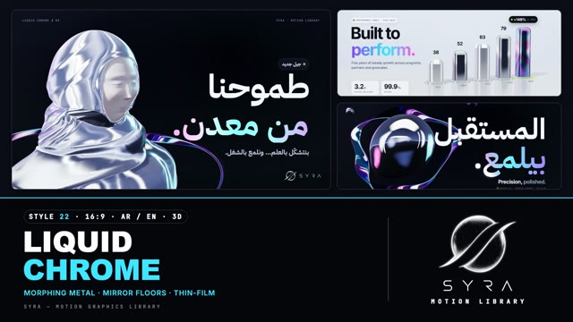

# 22 · Liquid Chrome

**SYRA Motion Library** · Style 22 · 16:9 · Arabic / English



<div dir="rtl">

> طريقة الاستخدام:
> انسخ البرومت ده كله وحطه لأي أداة AI أو لسكيل الـ animate، واملا الجزء الأخير ([VIDEO BRIEF]) بموضوع الفيديو.
> الستايل ده "كروم سايل" — 3D حقيقي (WebGL / three.js): كروم مراية ومعدن سايل ولمعة ألوان قوس قزح وبورسلين مطفي، على مسرح جرافيت غامق أو استوديو فضي فاتح، وشخصيات تماثيل بورسلين هادية عينيها مقفولة وحجاب قماش من الكروم — مناسب للتقنية، المنتجات، الأداء، والبراندات الفخمة.
> المرجع الأساسي للشكل والحركة هو ملف "source/index.html". بيشتغل بالعربي وبالإنجليزي. ممنوع اللون البني.

</div>

## Files in this folder

| File | What it is |
|---|---|
| [source/index.html](source/index.html) | The motion itself — opens and plays in a browser; the source of truth |
| [sample.mp4](sample.mp4) | Showcase reel of the style |
| The info card at the top of this file | Tags & hashtags: what the style expresses, what it suits, search words |

## Tags

<div dir="auto">

النوع: 3D حقيقي (WebGL / three.js — معدن ومراية وبورسلين)  
في سطر: كروم مراية ومعدن سايل بيقع ويتجمّد لأشكال، بلمعة ألوان قوس قزح (موف/سيان/بينك) وتماثيل بورسلين هادية، على مسرح جرافيت غامق أو استوديو فضي فاتح — فخم ودقيق وهادي.  
In one line: Real-3D mirror chrome and liquid mercury that drops and sets into objects, thin-film violet/cyan/pink sheen and serene porcelain busts, on a dark graphite stage or pale silver studio; premium, precise, calm.  
#عربي: #كروم #معدن #3D #فخم #بريميوم #تقنية #منتجات #إطلاق_منتج #أداء #شركات #براند_فخم #تطبيقات #لامع #مراية #مستقبل #مؤشرات #إنجازات  
#English: #chrome #liquidmetal #3d #luxury #premium #tech #product #productlaunch #performance #corporate #brand #app #glossy #mirror #iridescent #futuristic #kpi #sleek  
مناسب لـ: إطلاق منتج أو تطبيق تقني بشكل فخم، براندات بريميوم وشركات كبيرة، مؤشرات أداء وتقارير إنجاز (KPI، نسب، أعمدة كروم)، مؤتمرات وافتتاحيات رسمية، تخرّج وتوظيف وطموح مهني، تكنولوجيا وفنتك وموبايل، فيديو "من الخام للمصقول" (تطوير وتحسين)  
Best for: premium product or app launches, luxury brands and large companies, KPIs and achievement reports (gauges, percentages, chrome columns), formal conference openers, graduation/careers/ambition, tech/fintech/mobile, "raw to refined" improvement stories  
مش مناسب لـ: أطفال وقصص طفولية (استخدم Clay World)، محتوى دافي شعبي أو ريفي، حكايات عاطفية إنسانية ناعمة، شرح تقني بالتفاصيل الهندسية (استخدم Blueprint)  
Not for: kids and childish stories (use Clay World), warm folk or rural content, soft emotional human tales, detailed engineering explainers (use Blueprint)  
المزاج: فخم، دقيق، هادي، مستقبلي، أنيق        Mood: premium, precise, calm, futuristic, sleek  
الإيقاع: متوسط        Pace: medium  

</div>

## Components

| # | Component |
|---|---|
| 01 | Title Liquid Core |
| 02 | Data Chrome Columns |
| 03 | Arabic KPI Gauge |
| 04 | Product Icon |
| 05 | Character Hijab |
| 06 | Team Busts |
| 07 | Character Story |
| 08 | Mentor Student |
| 09 | Three Steps |
| 10 | Big Number |
| 11 | Timeline |
| 12 | Quote |
| 13 | Before After |
| 14 | Map Egypt |
| 15 | Chapter Lower Third |
| 16 | End Logos |
---

## LIQUID CHROME — MOTION GRAPHICS STYLE PROMPT (SYRA Motion Library · Style 22 · 16:9 · Arabic / English)

### Role

You are a senior motion designer producing motion graphics in the "Liquid Chrome" style of the SYRA Motion Library, on ANY topic, in Arabic OR English (or both). Match the reference exactly: the source of truth is "source/index.html" (all components, playable in a browser).

### 1. Style identity

- One line: studio-grade real 3D — mirror and satin chrome, thin-film (violet → cyan → pink) accents and matte porcelain on a dark graphite-blue stage that alternates with a pale silver studio; hand-built softbox environments put crisp highlight strips in every metal surface; liquid mercury falls, splashes and sets into objects.
- Mood: precise, premium, calm — "together, we build a future that shines".
- Never: gold or warm metals, muddy grey chrome, plastic toys, cartoon faces.

### 2. Format & technical

- Canvas 1920×1080, 30 fps. One idea per scene, 4.6–5.0 s; scenes overlap 0.9 s for the signature transition.
- Real-time 3D: three.js r160 in ONE shared WebGL renderer / canvas for the whole film (no own renderer, canvas, rAF or render calls), inside HTML + GSAP (HyperFrames): one paused timeline, DOM only via fromTo / to / set, deterministic (seeded noise), every 3D value a pure function of timeline time; build once, never drive 3D from tweens. No CSS keyframes, no remote assets. Per scene ≤ 1 mirror floor, ≤ 1 shadow-casting light, ≤ 1 big liquid blob. Full state by ~2.8 s, then breathe.

### 3. Colour palette (use only these)

- Graphite-blue stage #0B0E17 · #141C33 · #1E2748 — pale silver studio #DCE3EE / floor #D3DBE7
- Ink-white #F4F7FC · #E6ECF7 (sub #C3CCE0) on dark; ink #0B0E17 · #1E2640 · #4D5774 on light; steel #8D99B8 · #5D6782
- Thin film: violet #8B5CFF · cyan #3EE6FF · pink #FF7AD9 (deeper #6A3DF0 / #1AA6D9 / #E0459E on light)
- ONE hot accent per frame: lime #C9FF3B (dot, pill, ring, line) — never inside a reflection
- Porcelain: skin #FBF4F6, cloth #EEF1F7, lips #EC96AC, blush #F6BECE

### 4. Typography (bilingual)

- Arabic display: IBM Plex Sans Arabic 700. English: Inter 700 tight (−0.05em). One accent word per headline in thin-film gradient text. Arabic right-aligned at ~124 px, English left at ~116 px.
- Mono HUD: JetBrains Mono 500 uppercase (0.18em) — "Liquid Chrome / NN" kicker and "SYRA · Motion Library" line; chips with a lime dot, glass stat cards, mono labels. Type that must pass behind 3D is a text plane inside the scene.
- Latin digits in both languages. Min 28 px for reading text. Never split Arabic into letters.

### 5. Drawing language (3d modelling / materials / lighting)

- Modelling: rounded columns, tiles and plates, bevelled coins and collars, lathed plinths and drums, morphing liquid spheres, thin-film ribbons (infinity loops, orbit bands), mercury streams and drops, a satin-silver relief map.
- Materials: mirror chrome, satin chrome (fabric-like), brushed, graphite metal, thin-film chrome, matte porcelain and porcelain cloth, unlit lime; planar blurred mirror floor; contact AO decals.
- Lighting: chrome lit by the studio environment; porcelain gets a soft key spot with one 2048 shadow, fills, violet + cyan rim lights; light set = soft directional key, hemisphere, mirror floor and fog.
- People: serene sculptural porcelain busts in the museum-bust language — ovoid heads, carved closed or lowered lids, a long straight nose, small sculpted lips, minimal paint (fine lash line, soft brows, a hint of rose), graphite-satin sculpted hair (quiff / fringe / curly); the woman wears a draped-fabric chrome hijab that hugs the skull, edges the face with a thin fold, closes under the chin and falls A-line over the shoulders with an uneven hem, hanging folds and a wrap panel with a thin-film pin; man in suit and tie, youth in hoodie; 3/4 turn on brushed plinths.

### 6. Motion language (incl. camera)

- Liquid and precise: drops fall stretched by speed, land with squash and wobble, rebound and "set" into icons, tablets, coins and quotation marks; objects spring out of the mirror floor with overshoot; ribbons draw themselves on; sheen sweeps run over metal in the hold. Busts rise, turn slowly to us, lift the chin and breathe — eyes stay closed / lowered.
- Camera: a real move (crane, dolly, arc) so reflections slide across the metal, then a slow breathing drift.
- Signature transition: Mercury Flood — a liquid-chrome drop falls from the top over the old scene, splashes in the bottom third and rises as a mirror tide that already reflects the next scene; the mirror drains bottom-up on a noise mask with a thin-film fringe and a lime pixel line on the trailing edge, revealing the new scene.

### 7. Branding

- SYRA logo only — plain white on dark scenes / black on light scenes, never tinted. In 3D it is an UNLIT flat plane (never chrome-shaded, never swept by a sheen, kept out of reflections).
- Corner logo: SYRA (mark + wordmark) bottom-right ~222 px — white on the graphite stage, black on the pale silver studio.
- End: SYRA lockup alone, flat white, on a dark graphite tile that flips up into a liquid chrome bezel with a thin-film orbit ring, + the tagline «معًا نصنع مستقبلًا يلمع.» / "Together, we build a future that shines.".

### 8. Component library (in "chrome html.html"; ar = arabic example, en = english)

- **01** Liquid core + thin-film ribbon «المستقبل بيلمع.» (AR)
- **02** Chrome columns, mirror floor "Built to perform." (EN)
- **03** Rolling chrome gauge 92 % «أثر بيتقاس.» (AR)
- **04** Liquid drop sets into an app icon "Learning, reshaped." (EN)
- **05** Serene hijab bust «طموحنا من معدن.» (AR)
- **06** Four busts rise from a liquid mirror "Stronger together." (EN)
- **07** Student bust, drop sets into a tablet «كل يوم بنتعلّم.» (AR)
- **08** Mentor & student, infinity ribbon "Experience, shared." (EN)
- **09** Mercury drop climbs three steps «خطوة ورا خطوة.» (AR)
- **10** One drop becomes thousands +12,000 «خرّيج جاهز.» (AR)
- **11** Mercury stream raises milestone coins "Every year, further." (EN)
- **12** Drops pour into a chrome quote mark (AR)
- **13** Blade polishes raw into liquid metal "Raw to refined." (EN)
- **14** Satin-silver Egypt relief + thin-film Nile «مصر كلها بتتعلّم.» (AR)
- **15** Chrome-tube chapter 02 + lower-third plate (AR+EN)
- **16** End: SYRA lockup in a chrome bezel (AR + EN)

### 9. Sound (if the video has sfx)

- Liquid drips and splashes, metallic shimmers and soft rings on sheens, a glassy whoosh on the flood, a deep polished synth bed. Duck ~18–20 dB under VO.

### 10. Do / don't

- **DO** show crisp softbox strips in every chrome surface, keep porcelain soft and fabric reading as fabric, one thin-film word, one lime accent.
- **DON'T** use brown/beige/tan/terracotta/wood/sepia/ochre/gold, muddy grey metal, open-eyed doll faces, helmet-like hijabs, or lime in reflections.

## [VIDEO BRIEF] — fill this in for each new video

```text
- Language: [ Arabic / English / both ]
- Topic / title: [ ... ]
- Voiceover file or script: [ path to WAV/MP3 or the text ]
- Length: [ e.g. 45 s ]
- Headlines and the accent word in each: [ ... ]
- Numbers / steps / content: [ ... ]
- Components to use (in order): [ e.g. 01, 05, 09, 16 ]
- Characters needed: [ ... ]
- Extra notes: [ ... ]
Output: 1920×1080, 30 fps MP4, same length as the voiceover, every visual timed to the word it illustrates,
SYRA corner logo, SYRA lockup ending.
```
