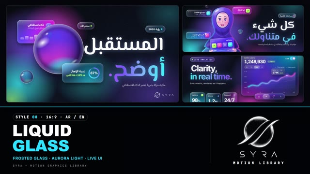

# 08 · Liquid Glass

**SYRA Motion Library** · Style 08 · 16:9 · Arabic / English



<div dir="rtl">

> طريقة الاستخدام:
> انسخ البرومت ده كله وحطه لأي أداة AI أو لسكيل الـ animate، واملا الجزء الأخير ([VIDEO BRIEF]) بموضوع الفيديو.
> الستايل ده "زجاج سائل" فوق خلفية ليلية بألوان الشفق — مناسب للتقنية، المنصات، الذكاء الاصطناعي، وأي إطلاق خدمة رقمية. بيشتغل بالعربي وبالإنجليزي.
> المرجع الأساسي للشكل والحركة هو ملف "source/index.html". ممنوع اللون البني.

</div>

## Files in this folder

| File | What it is |
|---|---|
| [source/index.html](source/index.html) | The motion itself — opens and plays in a browser; the source of truth |
| [sample.mp4](sample.mp4) | Showcase reel of the style |
| The info card at the top of this file | Tags & hashtags: what the style expresses, what it suits, search words |

## Tags

<div dir="auto">

النوع: 2.5D زجاج مصنفر شفاف + واجهات تطبيق + شخصيات لامعة — عربي وإنجليزي  
في سطر: ألواح وكور زجاج مصنفر بتكسر الضوء، طايرة فوق سما ليل بأضواء شفق (سماوي، بنفسجي، فوشيا)، كتابة بيضا بكلمة جريدينت وشارتات منوّرة — مستقبلي وفخم وواثق.  
In one line: Frosted, refracting glass panels, pills and orbs floating over a night sky of drifting aurora light (cyan, violet, magenta), with white type, one gradient word and glowing charts.  
#عربي: #تقنية #ذكاء_اصطناعي #مستقبل #منصة_رقمية #تطبيق #تحول_رقمي #داشبورد #زجاج #شفق #ليلي #فخم #إطلاق_منتج #اجتماعات_أونلاين #عربي_وإنجليزي #رؤية_2030 #ستارت_أب  
#English: #tech #ai #futuristic #digitalplatform #app #digitaltransformation #dashboard #glassmorphism #liquidglass #aurora #darkmode #premium #productlaunch #saas #videocall #bilingual #startup  
مناسب لـ: إطلاق منصة أو تطبيق أو خدمة رقمية، ذكاء اصطناعي وتحول رقمي، داشبورد وتحليلات لايف، فيديو رؤية ومستقبل لشركة تقنية، مساحات عمل رقمية واجتماعات أونلاين، تغطية وانتشار على خريطة مصر، فيديو بلغتين  
Best for: digital platform/app/service launches, AI and digital transformation, live dashboards and analytics, vision/future films for tech companies, digital workspaces and video calls, coverage maps of Egypt, bilingual videos  
مش مناسب لـ: محتوى تراثي أو تاريخي أو ديني، زراعة وحرف يدوية وحياة بسيطة، أطفال صغيرين، فيديو صحفي جاد أو هادي بخلفية فاتحة  
Not for: heritage, history or religious content, farming, crafts and simple everyday life, young kids, serious journalistic or calm light-background films  
المزاج: مستقبلي، واثق، فخم، هادي، لامع        Mood: futuristic, confident, premium, calm, glossy  
الإيقاع: متوسط        Pace: medium  

</div>

## Components

| # | Component |
|---|---|
| 01 | Title |
| 02 | Dashboard |
| 03 | KPI Tiles |
| 04 | Orb Reveal |
| 05 | Big Stat |
| 06 | Character |
| 07 | Team |
| 08 | Quote |
| 09 | Video Call |
| 10 | Phone App |
| 11 | Timeline |
| 12 | Map |
| 13 | Steps |
| 14 | Before After |
| 15 | Chapter |
| 16 | End Logos |
---

## LIQUID GLASS — MOTION GRAPHICS STYLE PROMPT (SYRA Motion Library · Style 08 · 16:9 · Arabic / English)

### Role

You are a senior motion designer producing premium tech / product motion graphics in the "Liquid Glass" style of the SYRA Motion Library, on ANY topic, in Arabic OR English (or both). Match the reference exactly: the source of truth is "source/index.html" (all components, playable in a browser).

### 1. Style identity

- One line: frosted, refracting glass panels, pills and orbs floating over a deep night sky of slowly drifting aurora light (cyan, violet, magenta, a touch of lime), with crisp white type, one gradient accent word, glowing charts and glossy stylised characters with rim light.
- Mood: futuristic, calm-confident, premium — "the future, in clear view".
- Never: flat opaque cards, brown/beige, busy clutter, more than ~6 glass objects in one frame.

### 2. Format & technical

- Canvas 1920×1080, 30 fps. One idea per scene, 4.2–4.8 s; scenes overlap 0.8 s for the glass-pane wipe.
- HTML + GSAP (HyperFrames): one paused timeline, only fromTo / to / set, deterministic, no CSS keyframes.
- Glass = backdrop blur + saturation, 1.5 px gradient rim, inner highlight, chromatic (cyan/magenta) inner edges and a magnified copy of the background at the edges (refraction). Never fade/blur a wrapper that contains glass.
- A fine animated film grain and a soft vignette sit over everything.

### 3. Colour palette (use only these)

- Night base ... #05070D → #0B1020
- Aurora ....... cyan #2EE6FF · violet #7B5CFF · magenta #FF4FD8 · lime #B8FF5C (small accents: up-arrows, checks)
- Text ......... white with a faint glow; secondary rgba(255,255,255,.7)
- Accent word .. gradient cyan → violet (Arabic runs right-to-left)
- Characters ... stylised rosy skin, clothes in violet / indigo / blue, cyan rim light left, magenta rim light right.

### 4. Typography (bilingual)

- Arabic headlines: El Messiri 700. English headlines: Inter 700, tracking −0.05em.
- UI text: IBM Plex Sans Arabic / Inter 500–700, min 28 px. Kickers: small mono caps inside glass pills.
- ONE gradient accent word per headline. Latin digits. Never split Arabic into letters.

### 5. Drawing language

- Glass cards, pills, tiles, tab bars, toggles, phone mockups; glowing line charts with a travelling dot + tooltip; progress rings with a glowing head; glass orbs with inverted refraction and a moving specular highlight.
- Characters: flat-but-glossy busts and half-figures (hijab, beard, glasses), soft gradient shading, rim lights.

### 6. Motion language

- glassIn: panels rise out of a blur while a rim-light sweep crosses them; orbs swell in; chips pop.
- Numbers count with power2; charts draw left→right with the dot riding the tip; rings fill with a glowing head.
- Aurora blobs drift slowly the whole time; held states float gently (yPercent bob).
- Signature transition: a tall frosted glass pane (cyan/magenta edges) sweeps right → left; the new scene is revealed behind its leading edge, both scenes seen blurred through the pane.

### 7. Branding

- SYRA logo only — plain white on dark scenes / black on light scenes, never tinted (no colour, rim-light sweep or glow over the logo itself).
- Corner logo: SYRA (mark + wordmark) bottom-right ~222 px, plain white (every scene is dark).
- End: SYRA lockup alone (stacked logo, plain white) on one glass tile, resolving like a lens pulling focus, + the tagline «المستقبل، أوضح.» / "The future, in clear view."

### 8. Component library (in "glass html.html"; ar = arabic example, en = english)

- **01** Title + orb + cards (AR)
- **02** Glass dashboard + live chart (EN)
- **03** KPI tiles 2×2 (AR)
- **04** Orb reveal + orbiting pills (EN)
- **05** Big stat in a glowing ring (AR+EN)
- **06** Character with glass tablet (AR)
- **07** Team around a glass hub (EN) 08 Testimonial (EN)
- **09** Video call + live captions (AR)
- **10** Glass phone app (EN)
- **11** Glowing timeline (AR)
- **12** Map of Egypt, glass pins (AR)
- **13** Three glass steps (EN)
- **14** Before / after glass toggle (AR)
- **15** Chapter card + lower third (AR+EN)
- **16** End: SYRA lockup (AR + EN)

### 9. Sound (if the video has sfx)

- Airy glassy whooshes on wipes, soft crystal taps for chips, gentle UI ticks for counters, a shimmering pad. Duck ~18–20 dB under VO.

### 10. Do / don't

- **DO** keep ≤ 6 glass objects per frame, one accent word, dark night base, slow aurora drift.
- **DON'T** use flat white backgrounds, brown/beige, heavy drop shadows, or glass inside faded wrappers.

## [VIDEO BRIEF] — fill this in for each new video

```text
- Language: [ Arabic / English / both ]
- Topic / title: [ ... ]
- Voiceover file or script: [ path to WAV/MP3 or the text ]
- Length: [ e.g. 45 s ]
- Headlines and the accent word in each: [ ... ]
- Numbers / UI content: [ ... ]
- Components to use (in order): [ e.g. 01, 02, 06, 10, 16 ]
- Characters needed: [ ... ]
- Extra notes: [ ... ]
Output: 1920×1080, 30 fps MP4, same length as the voiceover, every visual timed to the word it illustrates,
SYRA corner logo, SYRA lockup ending.
```
