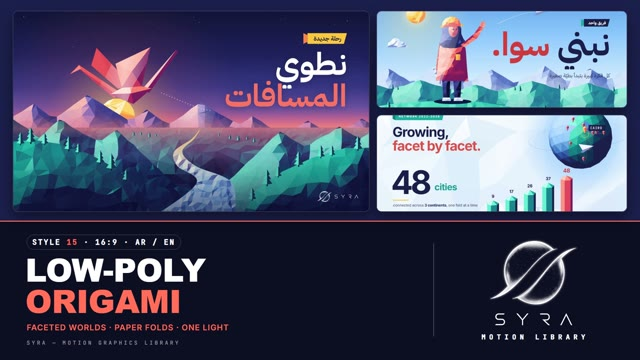

# 15 · Low-Poly Origami

**SYRA Motion Library** · Style 15 · 16:9 · Arabic / English



<div dir="rtl">

> طريقة الاستخدام:
> انسخ البرومت ده كله وحطه لأي أداة AI أو لسكيل الـ animate، واملا الجزء الأخير ([VIDEO BRIEF]) بموضوع الفيديو.
> الستايل ده "طيّ ومثلثات" — عوالم ومجسمات وشخصيات من مثلثات صغيرة كل واحد بياخد نوره، مع ورق بيتطوي زي الأوريجامي — مناسب للتقنية، السفر، التعليم، والمشروعات.
> المرجع الأساسي للشكل والحركة هو ملف "source/index.html". بيشتغل بالعربي وبالإنجليزي. ممنوع اللون البني.

</div>

## Files in this folder

| File | What it is |
|---|---|
| [source/index.html](source/index.html) | The motion itself — opens and plays in a browser; the source of truth |
| [sample.mp4](sample.mp4) | Showcase reel of the style |
| The info card at the top of this file | Tags & hashtags: what the style expresses, what it suits, search words |

## Tags

<div dir="auto">

النوع: 2D بإحساس 3D (فيكتور مسطّح من مثلثات مضلّعة + ورق بيتطوي)  
في سطر: عوالم وشخصيات ومجسمات مبنية من مثلثات صغيرة كل واحد واخد نوره من اتجاه واحد، وورق بيتطوي زي الأوريجامي — متفائل وذكي ومتقن.  
In one line: Crisp faceted low-poly worlds, people and objects lit from one light, plus paper that folds like origami; optimistic, smart and crafted.  
#عربي: #لو_بولي #أوريجامي #مثلثات #ورق #متفائل #تقنية #مدن_ذكية #سفر #تعليم #مشروعات #إنجاز #نمو #خريطة_مصر #إنفوجرافيك #شركات #ريادة_أعمال #بناء  
#English: #lowpoly #origami #faceted #polygon #papercraft #optimistic #tech #smartcity #travel #education #projects #growth #infographic #corporate #startup #achievement #geometric #egyptmap  
مناسب لـ: مشروعات قومية وبنية تحتية ومدن ذكية، سفر وسياحة وجغرافيا، تقارير نمو وإنجازات بأرقام، شركات ناشئة وريادة أعمال، تعليم ومبادرات شباب، فرق عمل وأهداف (قمة، كاس، علم)، توسّع وانتشار على خريطة  
Best for: national projects, infrastructure and smart cities, travel/tourism/geography, growth and achievement reports, startups and entrepreneurship, youth education initiatives, teamwork and goals (summit, trophy, flag), expansion on a map  
مش مناسب لـ: محتوى عاطفي ناعم أو قصص أطفال دافية، صور حقيقية ووثائقي واقعي، فخامة لامعة (معادن وزجاج)، موضوعات طبية دقيقة محتاجة تشريح واقعي  
Not for: soft emotional or warm kids' stories, real-photo documentary realism, glossy luxury (metal/glass), precise medical anatomy  
المزاج: متفائل، ذكي، متقن، حديث، ملهم        Mood: optimistic, smart, crafted, modern, inspiring  
الإيقاع: متوسط        Pace: medium  

</div>

## Components

| # | Component |
|---|---|
| 01 | Title Valley Crane |
| 02 | Globe Prism Bars |
| 03 | Gem KPI Tags |
| 04 | Paper Plane Fold |
| 05 | Engineer Paper Plane |
| 06 | Team Pedestals |
| 07 | Climber Summit Flag |
| 08 | Share The Spark |
| 09 | Map Egypt Nile |
| 10 | Trophy First Place |
| 11 | Timeline Valley |
| 12 | Steps Sheet To Crane |
| 13 | Before After Crane |
| 14 | Smart City Night |
| 15 | Chapter Lower Third |
| 16 | End Logos |
---

## LOW-POLY ORIGAMI — MOTION GRAPHICS STYLE PROMPT (SYRA Motion Library · Style 15 · 16:9 · Arabic / English)

### Role

You are a senior motion designer producing motion graphics in the "Low-Poly Origami" style of the SYRA Motion Library, on ANY topic, in Arabic OR English (or both). Match the reference exactly: the source of truth is "source/index.html" (all components, playable in a browser).

### 1. Style identity

- One line: crisp faceted low-poly / folded-paper worlds — triangulated landscapes, rivers, cities, globes, gems, trophies, origami cranes and planes, and faceted people, every facet shaded from ONE upper-left light; feels like premium 3D, drawn as flat-shaded vector.
- Mood: optimistic, smart, crafted — "building the future, fold by fold".
- Never: earth tones, brown/beige terrain, gradients without facets.

### 2. Format & technical

- Canvas 1920×1080, 30 fps. One idea per scene, 4.2–4.8 s; scenes overlap 0.9 s for the signature transition.
- HTML + GSAP (HyperFrames): one paused timeline, only fromTo / to / set, deterministic (seeded randomness), no CSS keyframes, no remote assets. Hold the full state for the last ~1 s of every scene before the transition.

### 3. Colour palette (use only these)

- Indigo #1B1F4B · teal #12A3A0 · aqua #5EE6D3 · coral #FF6B5B (deeper #D9463E on light stages) · sunflower #FFC53D · sky #8EC9FF · white
- Stages: dawn, night, day, paper. Terrain only in teal/indigo/aqua ramps.

### 4. Typography (bilingual)

- Arabic display: IBM Plex Sans Arabic 700. English: Inter 700. One coral accent word per headline.
- Kickers on folded-paper tags.
- Latin digits in both languages. Min 28 px for reading text. Never split Arabic into letters.

### 5. Drawing language

- Delaunay-triangulated terrain, prisms/bar charts, icosphere globes with pins, gems, trophies, origami cranes / planes / arrows, folded tags and tri-fold banners; low-poly people (hijab, hard hat, beard) with coral-pink stylised skin.

### 6. Motion language

- assemble(): facets flip / rise / drop into place with purposeful staggers; fold(): origami panels rotate around real creases showing the paper's darker back; shimmer light sweeps; crane flaps; objects re-lit as they turn.
- Characters assemble facet by facet, then clean key poses (throw, wave, climb, hand-off).
- Signature transition: facetWipe — ~110 big lit paper triangles flip in and cover the frame, the scenes swap, then they flip away and fall.

### 7. Branding

- SYRA logo only — plain white on dark scenes / black on light scenes, never tinted (no facet shading, sheen or colour on it).
- Corner logo: SYRA (mark + wordmark) bottom-right ~222 px — white on dark stages, black on light stages.
- End: SYRA lockup alone (plain black, folding down onto a faceted paper card that unfolds around its crease) + the tagline «نبني المستقبل، طيّة بطيّة.» / "Building the future, fold by fold.".

### 8. Component library (in "lowpoly html.html"; ar = arabic example, en = english)

- **01** Valley + crane title (AR)
- **02** Globe + prism bars (EN)
- **03** Gem + KPI tags (AR)
- **04** Paper folds into a plane (EN)
- **05** Engineer throws a plane (AR)
- **06** Team on pedestals (EN)
- **07** Summit flag (AR)
- **08** Share the spark (EN)
- **09** Faceted map of Egypt (AR)
- **10** Trophy + confetti (AR)
- **11** Valley timeline (EN)
- **12** Sheet → kite → crane (AR)
- **13** Crumpled → crane (EN)
- **14** Smart city at night (AR)
- **15** Tri-fold chapter + lower third (AR+EN)
- **16** End: SYRA lockup on a paper card (AR + EN)

### 9. Sound (if the video has sfx)

- Paper folds and crisp creases, soft chimes on shimmers, wing flaps, a light airy electronic bed. Duck ~18–20 dB under VO.

### 10. Do / don't

- **DO** light every facet from one direction, fold around real edges, keep terrain cool-toned, one coral word.
- **DON'T** use earth/brown tones, smooth gradients without facets, or too many triangles (keep < 5000 per scene).

## [VIDEO BRIEF] — fill this in for each new video

```text
- Language: [ Arabic / English / both ]
- Topic / title: [ ... ]
- Voiceover file or script: [ path to WAV/MP3 or the text ]
- Length: [ e.g. 45 s ]
- Headlines and the accent word in each: [ ... ]
- Numbers / steps / content: [ ... ]
- Components to use (in order): [ e.g. 01, 05, 09, 16 ]
- Characters needed: [ ... ]
- Extra notes: [ ... ]
Output: 1920×1080, 30 fps MP4, same length as the voiceover, every visual timed to the word it illustrates,
SYRA corner logo, SYRA lockup ending.
```
