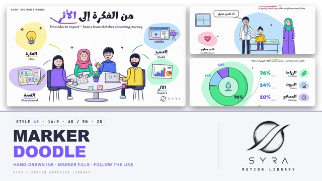

# 48 · Marker Doodle

**SYRA Motion Library** · Style 48 · 16:9 · Arabic / English



<div dir="rtl">

> طريقة الاستخدام:
> انسخ البرومت ده كله وحطه لأي أداة AI أو لسكيل الـ animate، واملا الجزء الأخير ([VIDEO BRIEF]) بموضوع الفيديو.
> الستايل ده "شخبطة الماركر" — رسم توضيحي 2D كأنه بقلم ماركر على ورق أبيض: خطوط حبر متموّجة بتترسم قدامك، ألوان ماركر باستيل بتتملي بعد الخط وبتطلع شوية برّه الحدود، تظليل بخطوط رفيعة، وفقاعات ألوان متوصّلة ببعض بخطوط ملوّنة. الكاميرا بتمشي على الخط الملوّن لحد الفكرة اللي بعدها — مناسب للشرح، التعليم، الصحة، المبادرات المجتمعية، المشروعات الصغيرة، وأي قصة فيها ناس من حياتنا اليومية.
> المرجع الأساسي للشكل والحركة هو ملف "source/index.html". بيشتغل بالعربي وبالإنجليزي. ممنوع اللون البني (ولا بيج ولا خشب).

</div>

## Files in this folder

| File | What it is |
|---|---|
| [source/index.html](source/index.html) | The motion itself — opens and plays in a browser; the source of truth |
| [sample.mp4](sample.mp4) | Showcase reel of the style |
| The info card at the top of this file | Tags & hashtags: what the style expresses, what it suits, search words |

## Tags

<div dir="auto">

النوع: 2D — رسم يدوي بالماركر على ورق أبيض  
في سطر: رسم توضيحي كأنه بقلم ماركر على ورق أبيض نضيف: خطوط حبر متموّجة بتترسم قدامك، ألوان باستيل طالعة شوية برّه الخط، وفقاعات ألوان متوصّلة بخطوط — دافي وواضح وإنساني وهادي.  
In one line: A friendly hand-drawn explainer on clean white paper — wobbly marker ink that draws on, pastel fills that miss their lines, and colour blobs joined by connector lines.  
#عربي: #رسم_يدوي #دودل #ماركر #شرح #تعليمي #صحة #عيادة #مبادرات_مجتمعية #مشاريع_صغيرة #بيانات_بسيطة #خطوات #مدرسة #عيلة #ورق_أبيض #باستيل #هادي #إنساني  
#English: #handdrawn #doodle #marker #whiteboard #explainer #education #health #clinic #community #smallbusiness #simpledata #steps #school #family #whitepaper #pastel #calm #friendly  
مناسب لـ: شرح وتعليم مدرسي وكورسات، توعية صحية هادية (كشف دوري، أكل صحي، حركة)، مبادرات مجتمعية وتنمية، مشاريع صغيرة ورحلة "من الفكرة للأثر"، بيانات بسيطة مرسومة باليد (أعمدة، دونات، رقم في دايرة)، خطوات وشرح منتج، قصص عيلة وناس من حياتنا اليومية، اقتباسات وحِكم بوش قريب  
Best for: school lessons and courses, calm health awareness (check-ups, healthy food, movement), community initiatives and development, small business "idea to impact" journeys, hand-drawn simple data, steps and product explainers, family and everyday-people stories, close-up quotes  
مش مناسب لـ: إعلانات حماسية صاخبة أو رياضة نارية (ده 52 ماركر سكريبل على خلفيات صريحة)، محتوى فخم أو سينمائي، تاريخ وآثار، تقني معقّد محتاج دقة هندسية أو 3D، صور حقيقية  
Not for: loud hype ads or high-energy sport (use 52 Marker Scribble on loud fields), luxury or cinematic films, history and heritage, precise technical/3D explainers, real photos  
المزاج: دافي، هادي، واضح، إنساني، متفائل        Mood: warm, calm, clear, human, optimistic  
الإيقاع: هادي إلى متوسط (كل حاجة بتترسم قدامك)        Pace: calm to medium (everything draws on)  

</div>

## Components

| # | Component |
|---|---|
| 01 | Title Team Sketch |
| 02 | Data Practice Progress |
| 03 | Nile Water Donut |
| 04 | Refill Bottle Product |
| 05 | Teacher Mind Map |
| 06 | Sport Team Of Four |
| 07 | Clinic Check Up |
| 08 | Workshop Mentor Apprentice |
| 09 | Kitchen Three Steps |
| 10 | Big Number Movement |
| 11 | Market Timeline |
| 12 | Quote Elder Farmer |
| 13 | Before After Family |
| 14 | Map Along The Nile |
| 15 | Chapter Market Lower Third |
| 16 | End SYRA Lockup |
---

## MARKER DOODLE — MOTION GRAPHICS STYLE PROMPT (SYRA Motion Library · Style 48 · 16:9 · Arabic / English · 2D)

### Role

You are a senior motion designer producing motion graphics in the "Marker Doodle" style of the SYRA Motion Library, on ANY topic, in Arabic OR English (or both). Match the reference exactly: the source of truth is "source/index.html" (all components, playable and seekable in a browser).

### 1. Style identity

- One line: a friendly hand-drawn explainer on clean white paper — wobbly dark marker outlines with thick-thin pressure, flat pastel marker fills that slightly miss their lines, light ink hatching for shadows, and topic vignettes sitting on soft colour blobs joined to the main scene by coloured connector lines.
- Mood: warm, clear, human, optimistic — "we sketch the idea, then build the impact".
- Never: vector-perfect strokes, gradients, glossy 3D, photo textures, drop shadows, or any brown / beige / wood tone.

### 2. Format & technical

- Canvas 1920×1080, 30 fps. One idea per scene, 4.6–4.8 s; scenes overlap 1.1 s for the signature transition.
- Pure SVG + JS inside HTML + GSAP (HyperFrames): one paused timeline driving one master proxy tween; every stroke, fill, camera and transition is a pure function of timeline time (seeded randomness, no Math.random / Date / rAF), so any seek shows the right frame. Ink lines are variable-width polygons rebuilt only while they draw (finished strokes cost nothing). No remote assets, no CSS keyframes.
- Build order per scene: content starts as the scene takes over (~0.9 s), full drawing by ~2.6 s, hold until the exit.

### 3. Colour palette (use only these)

- Paper #FFFFFF with a fine cool grain · ink #1F2233 (all outlines, hatching, headlines) · secondary text #3A3F5C.
- Blobs: lilac #D9CCFF · mint #BDF2DC · sky #BFE3FF · pink #FFD0DE · lemon #FFF1A8.
- Lines / accents: violet #7B5CFF · green #14B87A (text #0F9E68) · blue #2F8CFF · rose #FF4F86 · sun #FFC21F (underlines only, never text).
- Clothes and props: teal #1FC2B0 · coral #FF6B6B · cobalt #4D7CFF · grape #9A7BFF · leaf #3FD48B · bubble #FF86B0 · yellow #FFD84A · orange #FF9A3D · denim #3D4C99 · navy #2A2F55.
- People: skin rosy peach #FFD7C9 (#FDCBB9 / #F9BCB0) with pink hatching #F4A9A8, blush #FF8FAB; hair deep navy #1E2340; elders cool grey #C9CBE0. Tables grey-lilac #F1EEFA / #DCD6EE, steel #C3BFD8, chairs indigo #4B5085.
- Shading = the same hue darker AND more saturated (lemon turns golden, never khaki).

### 4. Typography (bilingual)

- Marhey (variable 500–700) for EVERYTHING — Arabic and English headlines, labels, digits, kickers — so every word looks written by the same marker hand as the drawings.
- Headline 88–104 px / 700 with ONE accent word in a line colour, underlined by a marker stroke (a pen often rests at its end). Subs 31 px / 500 in #3A3F5C. Labels 28–60 px. Kicker "SYRA · TOPIC" 22 px tracked caps.
- Text writes on with a marker wipe (right-to-left for Arabic) with headroom for dots and hamzas. Never split Arabic into letters. Latin digits in both languages. Min 28 px for reading text.

### 5. Drawing language

- Marker ink: every outline is a filled polygon sampled along the path with ±1 px hand wobble, ±30 % pressure, tapered start and end, closed shapes overshoot their start by ~7 px. A global felt-tip roughness filter in screen space.
- Fills: a second, re-jittered pass offset 3–4 px to one side (colour spills past one edge, a white sliver on the other), flat colour with faint darker diagonal pass bands and a pooled-ink edge.
- Hatching: parallel 1.8 px ink lines on the shadow side (light from top-left): right flanks, under chins (pink), table bands, bar shadows, floor contact ellipses.
- People: big ink eyes with highlights or happy arcs, small hook noses, smiles / grins / talk mouths, blush; women with and without hijab (outer wrap, white under-cap, chest drape), men young and older (beard, moustache, grey hair, kufi), kids. Pose library: down, hip, wave, raise, cheer, point, point-up, hold, offer, chin, thumbs-up, write, rest, reach; standing, walking, running and sitting legs; lab coat + stethoscope, chef hat + apron, sport jerseys, whistle.
- Close-up faces: almond eyes with navy iris and two highlights, heavy upper lid, nostril, lip line, jaw hatching, elder lines — the ink keeps a real marker width at any size.
- Props: round meeting table, desks, whiteboard, exam bed, kitchen counter + pot, workbench + pegboard, market stall with striped awning and produce crates, dinner table, window; 40+ topic icons (heart, pulse, pot, carrot, ball, trophy, medal, wrench, gear, scooter, phone, shop, fish, felucca, pyramid, drop, bottle, house, pin, sun, leaf ...).
- Data: hand-drawn axes with arrowheads, bars with hatched sides and a rose highlight bar, trend line with dots, donut sectors, scribbled marker circles around a big number, sticky notes, dashed arrows.

### 6. Motion language (incl. camera)

- Write-on, never fly-in: outlines draw on in illustrator order (face → body → arms → props), one pen per object, with ease-out marker speed; fills sweep in behind a slanted wipe ~45 % into each object's ink (right-to-left in Arabic scenes); blobs pop with a soft back-ease; labels wipe in; underlines are drawn last by a visible marker pen that rests.
- Only the pens move once things are drawn; the hold is a slow 3–4 % camera push toward the focus — calm and hand-made.
- Small life: talk ticks, sparkles, steam, speech bubbles that draw on before their text writes in.
- Signature transition — FOLLOW THE LINE: a connector in the next scene's colour draws out of the current scene with a pen at its tip; a vignette blob pops at its end and the next scene's icon draws inside; the camera travels ALONG the curve and zooms ~2.7× into the vignette while its pastel floods the frame; under full cover the next scene takes over zoomed inside its own blob of the same pastel, pulls back as the blob shrinks to its place, and new outlines draw on.

### 7. Branding

- SYRA logo only — plain black on this white paper style (white only if a scene were dark), never tinted, never roughened by the marker filter.
- Corner logo: SYRA (mark + wordmark) bottom-right ~222×60 px, 58 px from the right, 50 px from the bottom; keep floor lines, labels and connectors out of that corner.
- End: the stacked SYRA logo alone on a lilac blob, revealed by a marker wipe, circled by a loose violet marker ring with sparkles; tagline «نرسم الفكرة… ونصنع الأثر» / "We sketch the idea — and build the impact"; no corner logo.

### 8. Component library (in "doodle html.html"; ar = arabic-led, en = english-led)

- **01** Title + team at a round table with four vignettes «من الفكرة إلى الأثر» (AR)
- **02** Hand-drawn bar chart + circled +86% "Practice turns into progress" (EN)
- **03** Donut chart + legend «أين تذهب مياه النيل؟» (AR)
- **04** Product with callouts — refill bottle "Refill, don't rebuy" (EN)
- **05** Teacher in hijab draws a mind map, students «نرسم الفكرة معًا» (AR)
- **06** Team of four (coach in hijab, players, kid) "Stronger together" (EN)
- **07** Clinic check-up: doctor, girl, mother «اطمئن على صحتك» (AR)
- **08** Workshop mentor + apprentice at a workbench "Learn by doing" (EN)
- **09** Three steps in the kitchen with a cook «ثلاث خطوات لطبق صحي» (AR)
- **10** Big number 30 + runner «الحركة دوا» (AR)
- **11** Timeline of a small business "From stall to store" (EN)
- **12** Quote + elder farmer close-up face «الأرض بتدّي اللي بيدّيها» (AR)
- **13** Before (uncoloured sketch) / After (full colour) family dinner "Phones down, family up" (EN)
- **14** Hand-drawn map of Egypt, the Nile drawn by a pen, city pins «رحلة على النيل» (AR)
- **15** Chapter card + market stall + lower third «الفصل الثالث · السوق» / "Chapter 03 · The market" (AR+EN)
- **16** End SYRA lockup (AR + EN)

### 9. Sound (if the video has sfx)

- Felt-tip marker squeaks on strokes, soft paper swishes on fills, a pop on blobs, a whoosh along the connector and a soft "fwump" as the pastel floods; light ukulele / pizzicato / marimba bed. Duck ~18–20 dB under VO.

### 10. Do / don't

- **DO** draw everything on (never slide in), let fills miss the line, hatch shadows, one accent word per headline, connect ideas with coloured lines and blobs, show modern Egyptian people from everyday life.
- **DON'T** use brown/beige/tan/terracotta/wood/sepia/ochre/khaki/cream, clean vector strokes, gradients, glossy shading, fly-ins or generic fades, light-coloured text on pastel, or split Arabic into letters.

## [VIDEO BRIEF] — fill this in for each new video

```text
- Language: [ Arabic / English / both ]
- Topic / title: [ ... ]
- Voiceover file or script: [ path to WAV/MP3 or the text ]
- Length: [ e.g. 45 s ]
- Headlines and the accent word in each: [ ... ]
- Numbers / steps / content: [ ... ]
- Components to use (in order): [ e.g. 01, 07, 09, 16 ]
- Characters needed (age, hijab or not, job, pose): [ ... ]
- Extra notes: [ ... ]
Output: 1920×1080, 30 fps MP4, same length as the voiceover, every visual timed to the word it illustrates,
SYRA corner logo, SYRA lockup ending.
```
