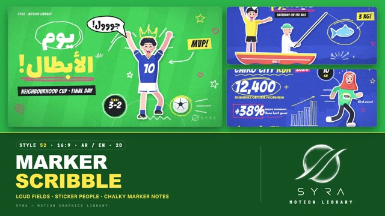

# 52 · Marker Scribble

**SYRA Motion Library** · Style 52 · 16:9 · Arabic / English



<div dir="rtl">

> طريقة الاستخدام:
> انسخ البرومت ده كله وحطه لأي أداة AI أو لسكيل الـ animate، واملا الجزء الأخير ([VIDEO BRIEF]) بموضوع الفيديو.
> الستايل ده "شخبطة الماركر" — 2D: خلفيات ألوانها صريحة (أخضر، كوبالت، أحمر، أسود) عليها شخصيات فلات مقصوصة بحرف أبيض زي الستيكر، وحواليها شخبطة ماركر طباشيري أبيض وأسود وليموني وبمبي بتترسم قدامك: دواير حوالين الكلام والأرقام، أسهم، نجوم، قلوب، تيجان، فقاعات كلام وبادجات — مناسب للرياضة، الشباب، الإعلانات المرحة، الأخبار الخفيفة، الإحصائيات اللي عايزة طاقة، والمحتوى اليومي.
> المرجع الأساسي للشكل والحركة هو ملف "source/index.html". بيشتغل بالعربي وبالإنجليزي. ممنوع اللون البني.

</div>

## Files in this folder

| File | What it is |
|---|---|
| [source/index.html](source/index.html) | The motion itself — opens and plays in a browser; the source of truth |
| [sample.mp4](sample.mp4) | Showcase reel of the style |
| The info card at the top of this file | Tags & hashtags: what the style expresses, what it suits, search words |

## Tags

<div dir="auto">

النوع: 2D — شخصيات فلات ستيكر + شخبطة ماركر طباشيري  
في سطر: خلفيات ألوانها صريحة (أخضر، كوبالت، أحمر، أسود) عليها شخصيات فلات بحرف أبيض زي الستيكر، وحواليها شخبطة ماركر طباشيري أبيض وليموني وبمبي: دواير حوالين الأرقام، أسهم، نجوم، تيجان — صاخب ومبهج و"بص هنا!".  
In one line: Loud flat fields with white-bordered cut-out sticker people, annotated by chalky hand-drawn marker scribbles — circles, arrows, stars, crowns — like a sports poster or creator notes.  
#عربي: #رياضة #كورة #شباب #إعلان_مرح #أخبار_خفيفة #إحصائيات #سوشيال_ميديا #تحدي #فوز #ستيكر #شخبطة #ماركر #ألوان_صريحة #حماسي #مبهج #يومي #شارع  
#English: #sport #football #youth #funad #lightnews #stats #socialmedia #challenge #win #stickerpeople #scribble #marker #chalky #boldcolours #energetic #joyful #everyday #streetstyle  
مناسب لـ: رياضة وكورة وماراثونات ومسابقات، محتوى شبابي وسوشيال وريلز، إعلانات مرحة وعروض، أخبار خفيفة وإحصائيات محتاجة طاقة (رقم في دايرة، نسبة، أعمدة مشخبطة)، توصيل وتطبيقات، فرق وفوز ولحظات احتفال، خطوات مشروع صغير، يوم في القاهرة وحياة المدينة  
Best for: sport, football, runs and competitions, youth social content and reels, fun ads and offers, light news and high-energy stats (circled numbers, percentages, scribbled bars), delivery and apps, teams, wins and celebrations, small-business steps, Cairo day-in-the-life  
مش مناسب لـ: شرح هادي أو تعليمي على ورق أبيض (ده 48 ماركر دودل)، محتوى رسمي أو طبي جاد أو حزين، فيديوهات فخمة، تاريخ وتراث، صور حقيقية (لو عايز صور ستيكر حقيقية ده 46)  
Not for: calm educational explainers on white paper (use 48 Marker Doodle), formal, serious medical or sad topics, luxury films, history and heritage, real photos (for real-photo stickers use 46)  
المزاج: صاخب، مبهج، حماسي، شبابي، شارعي        Mood: loud, joyful, energetic, youthful, street-level  
الإيقاع: سريع وحماسي        Pace: fast  

</div>

## Components

| # | Component |
|---|---|
| 01 | Title Champions Day |
| 02 | Data Cairo City Run |
| 03 | Data Healthy Plate |
| 04 | Object Delivery On The Way |
| 05 | Character Robotics Win |
| 06 | Team All Hands In |
| 07 | Story Fishing With Grandpa |
| 08 | Mentor Learn By Doing |
| 09 | Three Steps Small Business |
| 10 | Big Number New Trees |
| 11 | Timeline A Day In Cairo |
| 12 | Quote Grandma Baker |
| 13 | Before After Rooftop Garden |
| 14 | Map Summer Across Egypt |
| 15 | Chapter Lower Third |
| 16 | End SYRA Lockup |
---

## MARKER SCRIBBLE — MOTION GRAPHICS STYLE PROMPT (SYRA Motion Library · Style 52 · 16:9 · Arabic / English)

### Role

You are a senior motion designer producing motion graphics in the "Marker Scribble" style of the SYRA Motion Library, on ANY topic, in Arabic OR English (or both). Match the reference exactly: the source of truth is "source/index.html" (all components, playable in a browser).

### 1. Style identity

- One line: an energetic marker-overlay pack — a big flat cut-out subject (illustrated people and props with a 9 px white sticker border and a soft field-tinted drop shadow) on a loud solid field, annotated by dry, chalky, hand-drawn marker scribbles that write on around it: circled words and numbers, arrows, stars, hearts, crowns, bursts, swooshes, underlines, speech bubbles, hand-lettered tags and badges.
- Mood: loud, joyful, street-level, "look at this!" — like a sports poster or a creator's marker notes over footage.
- Never: clean vector strokes (every scribble has a rough chalky edge), gradients on the field, realistic rendering, earth tones or any brown in skin, hair, props or backgrounds.

### 2. Format & technical

- Canvas 1920×1080, 30 fps. One idea per scene, 4.6–4.8 s; scenes overlap 0.95 s for the signature transition.
- 2D SVG inside HTML + GSAP (HyperFrames): one paused timeline, every frame a pure function of time, seeded randomness, no CSS keyframes, no remote assets. One SVG per scene with a camera group; the marker filter (fractal-noise displacement + a streaky dry-brush mask) sits on a few large layers only (scribbles / text / stickers), never per element. Full state by ~2 s, then hold with life.

### 3. Colour palette (use only these)

- Fields (one per scene, neighbours always differ): grass green #2BB34A · cobalt #2747C9 · hot red #E8322B · black #111216 — each with a faint tone-on-tone context (mowing bands, skyline, tiles, rays, river) and a vignette in a deep tint of the field (#0B4A1C / #0C1A5C / #5A0E0B / black), plus fine white grain.
- Scribbles: white #FFFFFF · black #111216 · lemon #FFE94A (the accent) · pink #FF4F86.
- People: skin #FFD2BF / shade #F2A99B (alt peach #F9BCA6), blush #FF8FA6, ink hair #1B1F33 (highlight #3B4687), grey hair #C9D0DE. Clothes: cobalt #2747C9, mint #3DD6A0, coral #FF6A55 (never on the red field), white, navy #1B1F33, lemon, pink, sky #7FD0FF, lilac #A98BFF.

### 4. Typography (bilingual)

- Arabic shouts and headlines: Lalezar (heavy, hand-cut poster feel). Hand-lettered labels, bubbles, notes (AR + EN): Marhey 700. English shouts, numbers, tags, badges, kickers: Bangers. Latin digits in both languages.
- One accent word per headline in lemon. Headlines get a marker loop, wave or double underline. Tags are rough black or lemon quads that pop, then their text wipes in. Rotations stay within ±3°.
- Arabic is wiped on as whole words right-to-left (never split into letters), masks with headroom for dots and hamzas. Min 28 px for reading text.

### 5. Drawing language

- Marker strokes: round-cap paths through hand-jittered points (Catmull-Rom), 6–14 px, chalky edge + dry-brush gaps. Fills and text: displacement only, so they stay solid and readable with hand-cut edges.
- Shape library: loop (1.1–1.3 turns with overshoot), arrow, star, heart, crown, burst, zig-zag, wave, double underline, rough box, bubble with tail, spiral, hatch fill (scribble bars / pie portions), plus, tick, cross, sparkle, drops, sun and a set of mini marker icons (bulb, box, shop, bus, bowl, boat, home, pyramid, fish, lighthouse, leaf, pin…).
- People: flat vector cut-outs, two tones per material with the shadow side to the lower right, thick round-cap limbs, simple faces (open or happy eyes, cheer mouth with teeth and tongue, blush). Cast: women with and without hijab, men young and older (beard, moustache), kids (bigger heads), grey-haired elders, in front view, side profile, seated, kneeling, walking and riding; trades: doctor, engineer, chef, farmer, fisherman, athlete, delivery rider, coder, artist, shop owner, baker.

### 6. Motion language (incl. camera)

- Nothing slides in: things are drawn, popped or erased. Scribbles write on in 0.1–0.4 s with an ease-out tip, 40–120 ms apart in reading order (title → sub → circles → arrows → labels → stars); tags, badges and bubbles pop with back-ease (overshoot ~2.2), then their text wipes in (RTL for Arabic). Counters count up inside their loop.
- Subjects slap in like stickers (scale up from ~55 % with overshoot) and then move on twos (15 fps): hops, bobs, waves, blinks, talking mouths, boats rocking, wheels spinning; scribbles stay on ones. The marker line boils at 10 fps and stars / hearts jiggle on twos, so the hold always breathes. Camera: a slow 3–4.5 % push per scene.
- Signature transition — SCRIBBLE FILL WIPE (0.95 s): seven huge zig-zag marker bands in the NEXT field colour scribble-fill the frame on a diagonal (35 ms apart, alternating direction, a lighter chalky zig line riding on each), with one white and one lemon cursive loop-line, while the old camera pushes in and tilts; hold two frames fully covered; then the loop-lines leave and the bands un-write in reverse order (tails retracting along the scribble), uncovering the new scene as its camera settles from 1.07× and its subject lands and its scribbles begin.

### 7. Branding

- SYRA logo only — plain white on dark fields / plain black on light ones, never tinted, never scribbled over.
- Corner logo: SYRA (mark + wordmark) bottom-right, ~222×60 px, ~58 px from the right and ~50 px from the bottom; white on all four fields of this style; keep x ≥ 1620, y ≥ 950 clear of scribbles.
- End: the stacked SYRA logo alone slaps in at the centre on the black field, circled by a lemon marker loop with a white burst, stars, hearts and a spiral; tagline «نرسم الحكاية سوا.» / "Let's draw the story together."

### 8. Component library (in "scribble html.html"; ar = arabic example, en = english)

- **01** Title «يوم الأبطال!» — neighbourhood football boy, crown, MVP tag, score badge (AR, green)
- **02** Data hero "CAIRO CITY RUN" — 12,400 counter, +38 %, hatch bar chart, runner in sport hijab (EN, cobalt)
- **03** Healthy plate «نص الطبق خضار!» — scribble-hatched pie on a plate, chef pointing (AR, red)
- **04** Object "ON THE WAY!" — order-tracking phone + delivery rider on a scooter in profile, 20 MIN badge (EN, black)
- **05** Character «لحظة الفوز!» — robotics girl in hijab + teammate, robot scores (AR, red)
- **06** Team "ALL HANDS IN!" — doctor, engineer, coder, farmer with labels and arrows (EN, green)
- **07** Story «صيد اليوم!» — grandpa seated in profile with the rod, grandson cheers, fish jumps, 3 KG tag (AR, cobalt)
- **08** Mentor "LEARN BY DOING" — grey-haired artist and a kid painting at the easel (EN, black)
- **09** Three steps «3 خطوات لمشروعك» — idea → test → open, shop owner (AR, green)
- **10** Big number «+1,200 شجرة» — counter in a loop, girl kneeling to water her sapling (AR, red)
- **11** Timeline "A DAY IN CAIRO" — five stops with marker icons, walker in profile (EN, cobalt)
- **12** Quote «العيش الحلو محتاج صبر.» — grandma baker seated with her bread tray (AR, black)
- **13** Before / after "ROOFTOP GARDEN" — dull roof → garden revealed by a mini scribble wipe, gardener in hijab (EN, green)
- **14** Map «لفّ مصر!» — marker map of Egypt, Nile, four pinned cities with icons, traveller (AR, cobalt)
- **15** Chapter 02 «حياة المدينة» + lower third «مريم عادل» / "MARIAM ADEL · SOFTWARE ENGINEER", talking speaker (AR+EN, red)
- **16** End — SYRA stack logo + «نرسم الحكاية سوا.» / "Let's draw the story together." (AR+EN, black)

### 9. Sound (if the video has sfx)

- Dry marker squeaks and scratches on every write-on, paper "slap" pops on stickers and tags, a fast marker scrawl whoosh on the scribble wipe, claps / crowd cheers for wins, an upbeat drum-and-bass or baladi-percussion bed. Duck ~18–20 dB under VO.

### 10. Do / don't

- **DO** keep fields loud and flat, give every person a white sticker edge, circle the key number, one lemon accent word, route arrows to clothes and props (never across faces), let the hold breathe (bob, blink, boil, jiggle).
- **DON'T** use brown/beige/tan/terracotta/wood/sepia/ochre/khaki/cream, clean vector lines, slides or fades, coral on the red field, rotated text beyond ±3°, split Arabic letters, or any logo other than SYRA.

## [VIDEO BRIEF] — fill this in for each new video

```text
- Language: [ Arabic / English / both ]
- Topic / title: [ ... ]
- Voiceover file or script: [ path to WAV/MP3 or the text ]
- Length: [ e.g. 45 s ]
- Headlines and the accent word in each: [ ... ]
- Numbers / steps / content: [ ... ]
- Components to use (in order): [ e.g. 01, 05, 09, 16 ]
- Characters needed: [ ... ]
- Extra notes: [ ... ]
Output: 1920×1080, 30 fps MP4, same length as the voiceover, every visual timed to the word it illustrates,
SYRA corner logo, SYRA stack-logo ending.
```
