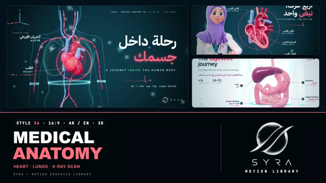

# 36 · Medical Anatomy 3D

**SYRA Motion Library** · Style 36 · 16:9 · Arabic / English



<div dir="rtl">

> طريقة الاستخدام:
> انسخ البرومت ده كله وحطه لأي أداة AI أو لسكيل الـ animate، واملا الجزء الأخير ([VIDEO BRIEF]) بموضوع الفيديو.
> الستايل ده "تشريح طبي 3D" — 3D حقيقي (WebGL / three.js): أعضاء جسم الإنسان (القلب، الرئتين، الجهاز الهضمي، المخ والأعصاب، الكلى، العظام، الدم) معمولة بالكود بشكل واقعي وناعم من غير أي منظر مقزز، جوه جسم زجاجي شفاف، مع تسميات بالعربي والإنجليزي ورسم قلب ودكتورة ومرضى من كل الأعمار — مناسب لشرح أعضاء الجسم، التوعية الصحية، المحتوى الطبي والتعليمي.
> فيه طقمين: ليلي (أزرق بترولي غامق) ونهاري (أبيض ثلجي طبي). الانتقال المميز بين المشاهد هو "إعادة المسح بالأشعة": خط مسح بيعدّي من فوق لتحت، العضو القديم يتحول لأشعة شفافة ويظهر الجديد.
> المرجع الأساسي للشكل والحركة هو ملف "source/index.html". بيشتغل بالعربي وبالإنجليزي. ممنوع اللون البني.

</div>

## Files in this folder

| File | What it is |
|---|---|
| [source/index.html](source/index.html) | The motion itself — opens and plays in a browser; the source of truth |
| [sample.mp4](sample.mp4) | Showcase reel of the style |
| The info card at the top of this file | Tags & hashtags: what the style expresses, what it suits, search words |

## Tags

<div dir="auto">

النوع: 3D حقيقي (WebGL) — أعضاء جسم الإنسان  
في سطر: أعضاء جسم الإنسان 3D شكلها واقعي وناعم ونضيف من غير أي منظر مقزز، جوه جسم زجاجي شفاف، بتسميات عربي وإنجليزي ورسم قلب ودكتورة ومرضى من كل الأعمار، بطقم ليلي بترولي غامق وطقم نهاري أبيض طبي، إحساس هادي ودقيق وفخم زي متحف طبي.  
In one line: Realistic but clean 3D human organs (never gory) inside a frosted glass body, with Arabic/English leader labels, ECG traces, a doctor and patients of every age, in a dark teal set and a clinical white set, calm, precise and premium like a medical museum.  
#عربي: #طبي #تشريح #جسم_الإنسان #أعضاء #صحة #توعية_صحية #القلب #الرئة #الجهاز_الهضمي #عظام #مستشفى #دكتور #تعليم_طبي #أشعة #ثري_دي #شرح_طبي #مرضى #عيادات  
#English: #medical #anatomy #humanbody #organs #health #healthawareness #heart #lungs #digestion #skeleton #hospital #doctor #medicaleducation #xray #3d #medicalanimation #patients #clinic  
مناسب لـ: شرح أعضاء الجسم ووظايفها (قلب، رئة، هضم، مخ وأعصاب، كلى، عظام، دم)، توعية صحية هادية وجادة، مستشفيات وعيادات وشركات أدوية وتأمين صحي، تعليم طبي وتمريض وكليات علوم، شرح أمراض ووقاية (شرايين، تنفس)، شبكات رعاية صحية على مستوى مصر، فيديوهات دكتور بيشرح لمريض  
Best for: explaining body organs and how they work (heart, lungs, digestion, brain and nerves, kidneys, bones, blood), calm serious health awareness, hospitals, clinics, pharma and health insurance, medical, nursing and science education, disease and prevention explainers (arteries, breathing), nationwide healthcare networks, doctor-explains-to-patient videos  
مش مناسب لـ: أي موضوع مش طبي أو مالوش علاقة بالجسم، محتوى أطفال مرح وكرتوني، فيديو حماسي أو ترفيهي سريع؛ ولو عايز شرح "إيه اللي جوّه" مبسط 2D لأي حاجة (موتور، أرض) استخدم Science Cutaway  
Not for: any non-medical topic, playful cartoon kids' content, fast hype or entertainment videos; for simple 2D "what's inside" explainers of anything (engine, Earth) use Science Cutaway  
المزاج: هادي، دقيق، مطمّن، فخم، علمي        Mood: calm, precise, caring, premium, scientific  
الإيقاع: هادي لمتوسط (كاميرا بتتحرك ببطء، قلب بينبض)        Pace: calm to medium  

</div>

## Components

| # | Component |
|---|---|
| 01 | Title Heart Journey |
| 02 | Digestive Journey Data |
| 03 | Habits Test Tubes |
| 04 | Lungs Breathing |
| 05 | Doctor Heart Cutaway |
| 06 | Patients Every Age |
| 07 | Athlete Xray Heart |
| 08 | Doctor Child Kidneys |
| 09 | Oxygen Three Steps |
| 10 | Big Number 206 Bones |
| 11 | Heart Timeline 24h |
| 12 | Quote Brain Nerves |
| 13 | Artery Before After |
| 14 | Egypt Clinic Map |
| 15 | Chapter Lower Third |
| 16 | End SYRA Lockup |
---

## MEDICAL ANATOMY 3D — MOTION GRAPHICS STYLE PROMPT (SYRA Motion Library · Style 36 · 16:9 · Arabic / English)

### Role

You are a senior medical-animation designer producing motion graphics in the "Medical Anatomy 3D" style of the SYRA Motion Library, on ANY health / body / medical-education topic, in Arabic OR English (or both). Match the reference exactly: the source of truth is "source/index.html" (all components, playable in a browser).

### 1. Style identity

- One line: premium medical-studio 3D — believable but stylised organs (never gory) in wet, softly translucent tissue, floating inside a frosted glass body, with x-ray bones, flowing blood / air / nerve-impulse particles, pulse rings, clean leader-line labels in Arabic + English, an orientation widget and an ECG trace.
- Two sets: a deep blue-teal DARK set (hero look, glowing glass, bloom) and a bright clinical ICE set (white -> ice blue, opaque organs, pale glass). Friendly rounded 3D people: a doctor in a lilac hijab and white coat, and patients of every age (elder in a galabiya, mother-to-be, child, athlete).
- Mood: calm, precise, caring, premium — a hospital museum, not a horror show.
- Never: blood splatter, gore, raw anatomy photos, brown / beige / tan organs, cartoon outlines, flat clip-art.

### 2. Format & technical

- Canvas 1920×1080, 30 fps. One idea per scene, 4.6–4.8 s; scenes overlap 0.8 s for the signature transition.
- Real-time 3D: three.js r160 in ONE shared WebGL renderer / canvas for the whole film, inside HTML + GSAP (HyperFrames): one paused timeline, deterministic (seeded randomness), every 3D value a pure function of time. Organs are SDF-sculpted (smooth unions of ellipsoids and tubes -> surface-nets meshes), built once and cached / baked.
- Post: 5-level bloom -> ACES -> exact-hex background gradient -> vignette + fine grain. No CSS keyframes, no remote assets.

### 3. Colour palette (use only these)

- Dark set: radial #0C3A4E / #0E4057 -> #04121C; glass rim #9FEFFF on #2FB8E0 (additive); text #F4FBFD / #BFEFFA.
- Light set: radial #FFFFFF -> #C9DFEA; glass rim #3F86A6 on #B9DCEA; text ink #0B2533, Arabic lines plum #7A2E64.
- Organs: heart #DC3C50 / atria #E5587A, arteries #E3263E, veins #4AA8FF, cut faces #FF8C97; stomach #E5627C, intestines #F27C8C / #DB5C78, LIVER PLUM #7C1A52, kidneys plum-raspberry #A82E62, lungs #F2899F (glass mint #5EF2C6), brain pink-lilac #F2A4BA, bones x-ray ice #9FEFFF, plaque lilac-grey #B8ACD8.
- Accents: coral #FF6F7E (dark) / #F0455A (light) for the ONE accent word; mint #5EF2C6; ice #BFEFFA.
- People: rosy skins #F6B9A0 #F2AE96 #EBA08F #F8C2AC #E8998B, hijab lilac #8E84DE, coat cool white #EDF3F7, scrubs teal #1C93AA, hair ink #191B30 or white #DCE3EC.

### 4. Typography (bilingual)

- Arabic: IBM Plex Sans Arabic — 700 headlines (90–150 px), 600 labels, 500 lines. English: Inter — 600 headlines (−0.03em), 500 UPPERCASE subs with wide +0.30em tracking. Data: JetBrains Mono 500 (+0.26em) for kickers, vitals ("HR 72 BPM"), measures and orientation letters.
- One accent word per headline (coral, soft glow on dark). Leader-line labels: anchor dot + ring, line draws on, then the card (Arabic on top + English caps, or English + Arabic on the light set, numbered badges).
- Latin digits in both languages. Min 28 px for reading text (mono captions 19–22 px). Never split Arabic into letters; animate whole words / masks.

### 5. Drawing language (3d modelling / materials / lighting)

- Modelling: SDF sculpting — smooth unions / subtractions of ellipsoids and variable-radius tubes; heart with coronaries and a four-chamber cutaway (valves, chordae); digestive tract with haustra and maze-packed small intestine; lungs with lobes, fissures and a branching bronchial tree with alveoli; brain with gyri + spinal cord and nerves; kidneys with renal vessels, ureters and bladder; x-ray skeleton; red blood cells; a cut-open artery.
- Materials: wet organ shader — physical clear-coat, wrap lighting + per-channel scatter (fake SSS), back translucency, micro-bump, fresnel rim glow pulsed by the heartbeat; frosted glass shell (fresnel rim, contour bands, scan line).
- Lighting: soft key with one shadow, cool fill, cyan rim lights, hemisphere, one coloured point light for organ glow; studio environment reflections; bloom on dark.
- People: rounded SDF faces with big glossy eyes that look at camera, lids that blink, simple talking mouth; a real arm rig (shoulder > elbow > wrist > hand) for presenting, pointing, explaining, waving, hand on belly, fist pump.

### 6. Motion language (incl. camera)

- The camera always moves: slow push-ins, gentle arcs and trucks (35–50 mm feel), then breathes in the hold.
- Organs develop under a scanner (clip / scan plane top -> bottom), grow in with overshoot, vessels grow out of the heart, labels draw on (line then card, 0.1–0.25 s stagger), numbers count up, ECG sweeps with a leading dot.
- Life in every hold: heart beats at 72 bpm (lub-dub scale + rim pulse + pulse rings), lungs breathe, peristalsis waves, blood / air / impulse particles flow at constant speed, characters idle, blink and talk.
- Signature transition — X-RAY RE-SCAN: a horizontal scan line (bright edge + trailing perspective grid + sparkles) sweeps top -> bottom in ~21 frames. In a band around it every organ and character of both scenes turns into a fresnel glass ghost: the old scene x-rays out just before the line, the new one develops from ghost to wet tissue just after it, with a short develop flash; text is clipped at the line; dark <-> light set swaps happen inside the same sweep.

### 7. Branding

- SYRA logo only — plain white on the dark set / plain black on the light set, never tinted, never lit, never glowing.
- Corner logo: SYRA (mark + wordmark) bottom-right ~222×60 px; it switches colour exactly as the scan line passes it.
- End: the SYRA stacked logo alone as the hero, developed top -> bottom by the scanner ring, an ECG line beneath it, and the tagline «اعرف جسمك، عِش أفضل» / "Know your body · live better". No corner logo on the end card.

### 8. Component library (in "anatomy html.html"; ar = arabic example, en = english)

- **01** Title: heart in a glass body, vessels + ECG «رحلة داخل جسمك» (AR)
- **02** Data hero: the digestive journey, 5 numbered organs + stats "The digestive journey" (EN)
- **03** Test-tube chart: healthy habits (water, sleep, walking, 5 a day) «عاداتك تصنع صحتك» (AR)
- **04** Object moment: breathing lungs, airway cutaway, alveoli "Every breath counts." (EN)
- **05** Doctor presents the four-chamber heart «أربع غرف، نبضٌ واحد» (AR)
- **06** Team: four patients of every age with name tags "Care for every age." (EN)
- **07** Story: x-ray scan of an athlete's chest, heart rate 72 -> 128 «قلبك يتمرّن معك» (AR)
- **08** Mentor & learner: doctor shows a child the kidneys "Why we drink water." (EN)
- **09** Three steps: lungs -> heart -> cells «رحلة الأكسجين في 3 خطوات» (AR)
- **10** Big number: 206 bones, x-ray skeleton «206 عظمة في جسمك» (AR)
- **11** Timeline: 24 hours of your heart rate "24 hours of your heart" (EN)
- **12** Quote: brain + nerves «العقل السليم في الجسم السليم» (AR)
- **13** Before / after: a narrowed artery scanned clear "Clear arteries, easy flow." (EN)
- **14** Map of Egypt: clinic network, the Nile, 27 governorates «رعاية صحية أقرب لكل بيت» (AR)
- **15** Chapter card 02 + lower third (doctor, lungs hologram) (AR + EN)
- **16** End: SYRA lockup under the scanner (AR + EN)

### 9. Sound (if the video has sfx)

- Soft heartbeat thumps on the beat, a gentle rising scanner sweep on each transition, airy breaths for the lungs, light glassy ticks for labels and counters, a calm ambient pad. Duck ~18–20 dB under VO.

### 10. Do / don't

- **DO** keep organs believable but clean, wet and softly lit; label everything in AR + EN; one accent word; keep the camera moving; mark illustrative numbers as illustrative; keep the logo corner clear.
- **DON'T** use gore, brown / beige / tan / ochre / cream (the liver and kidneys are plum), cartoon outlines, plain fades, frozen holds, tinted or glowing logos, or Arabic split into letters.

## [VIDEO BRIEF] — fill this in for each new video

```text
- Language: [ Arabic / English / both ]
- Topic / title: [ ... ]
- Voiceover file or script: [ path to WAV/MP3 or the text ]
- Length: [ e.g. 45 s ]
- Organs / body systems to show: [ heart, lungs, digestion, brain, kidneys, bones, blood ... ]
- Headlines and the accent word in each: [ ... ]
- Numbers / steps / labels: [ ... ]
- Components to use (in order): [ e.g. 01, 05, 09, 16 ]
- Characters needed: [ doctor / elder / mother-to-be / child / athlete ]
- Set per scene: [ dark / light ]
- Extra notes: [ ... ]
Output: 1920×1080, 30 fps MP4, same length as the voiceover, every visual timed to the word it illustrates,
SYRA corner logo, SYRA lockup ending.
```
