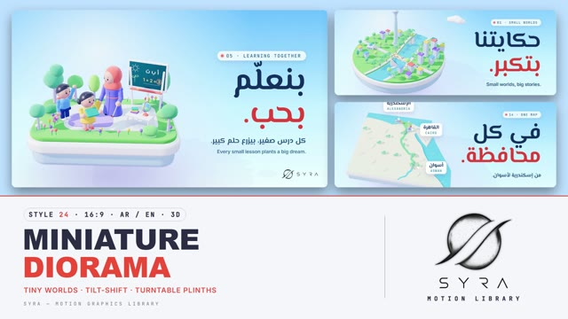

# 24 · Miniature Diorama

**SYRA Motion Library** · Style 24 · 16:9 · Arabic / English



<div dir="rtl">

> طريقة الاستخدام:
> انسخ البرومت ده كله وحطه لأي أداة AI أو لسكيل الـ animate، واملا الجزء الأخير ([VIDEO BRIEF]) بموضوع الفيديو.
> الستايل ده "عالم مُصغّر" — 3D حقيقي (WebGL / three.js): عوالم صغيرة على قواعد عايمة، بيوت بيضا وشجر من اللباد وعرايس فينيل، بنور شمس الغروب وظلال لافندر طويلة وتيلت-شيفت كأنه تصوير ماكيت حقيقي، والقاعدة بتلف زي الترابيزة الدوّارة بين المشاهد — مناسب للمدن، المجتمع، التعليم، والقصص.
> المرجع الأساسي للشكل والحركة هو ملف "source/index.html". بيشتغل بالعربي وبالإنجليزي. ممنوع اللون البني.

</div>

## Files in this folder

| File | What it is |
|---|---|
| [source/index.html](source/index.html) | The motion itself — opens and plays in a browser; the source of truth |
| [sample.mp4](sample.mp4) | Showcase reel of the style |
| The info card at the top of this file | Tags & hashtags: what the style expresses, what it suits, search words |

## Tags

<div dir="auto">

النوع: 3D حقيقي (WebGL / three.js — ماكيت مصغّر بتيلت-شيفت)  
في سطر: عوالم صغيرة على قواعد بيضا عايمة — مدن بالنيل وبرج القاهرة، بيوت بيضا بأسقف ملونة، شجر لباد وعرايس فينيل — بنور شمس هادي وظلال لافندر وتيلت-شيفت كأنه تصوير ماكيت حقيقي — ساحر ومتفائل وقريب من الناس.  
In one line: Tiny worlds on floating white plinths — Nile cities with the Cairo Tower, white houses with coloured roofs, felt trees and vinyl figurines — in soft sun with lavender shadows and tilt-shift like real miniature photography; charming, hopeful, human-scale.  
#عربي: #ماكيت #ديوراما #عالم_مصغر #3D #تيلت_شيفت #مدن #مجتمع #تعليم #قصص #تنمية #مبادرات #متفائل #ساحر #لطيف #مدارس #زراعة #إنفوجرافيك  
#English: #diorama #miniature #tiltshift #3d #tinyworld #city #community #education #storytelling #development #initiative #hopeful #charming #cute #school #urban #infographic #isometric  
مناسب لـ: تطوير مدن وأحياء ومشروعات عمرانية، مبادرات مجتمعية وتنمية محلية، تعليم وفصول ومدارس، قصص ملهمة عن ناس عادية (أجيال، زراعة، حلم صغير بيكبر)، تقارير أثر بأرقام بشكل دافي، النيل والمحافظات وخريطة مصر، مراحل تحوّل "من رمادي لأخضر"  
Best for: city/neighbourhood and urban development, community initiatives and local development, education/classrooms/schools, inspiring everyday-people stories (generations, planting, small dreams growing), warm impact reports with numbers, the Nile/governorates/Egypt map, "grey to green" transformation  
مش مناسب لـ: ألعاب وإعلانات حماسية سريعة، تقنية فخمة لامعة (استخدم Liquid Chrome)، شرح هندسي أو تقني دقيق، أخبار جادة أو موضوعات حزينة  
Not for: gaming or fast hype ads, glossy high-tech luxury (use Liquid Chrome), precise engineering/technical explainers, serious news or sad topics  
المزاج: ساحر، متفائل، دافي، هادي، قريب من الناس        Mood: charming, hopeful, warm, calm, human-scale  
الإيقاع: هادي        Pace: calm  

</div>

## Components

| # | Component |
|---|---|
| 01 | Title Nile City |
| 02 | Growth Step By Step |
| 03 | Arabic Data Plinths |
| 04 | Idea Monument |
| 05 | Garden Classroom |
| 06 | Team Builds |
| 07 | Planting Together |
| 08 | Mentor And Student |
| 09 | Three Steps |
| 10 | Big Number |
| 11 | Timeline Path |
| 12 | Quote At Dusk |
| 13 | Before After |
| 14 | Map Of Egypt |
| 15 | Chapter Lower Third |
| 16 | End Logos |
---

## MINIATURE DIORAMA — MOTION GRAPHICS STYLE PROMPT (SYRA Motion Library · Style 24 · 16:9 · Arabic / English)

### Role

You are a senior motion designer producing motion graphics in the "Miniature Diorama" style of the SYRA Motion Library, on ANY topic, in Arabic OR English (or both). Match the reference exactly: the source of truth is "source/index.html" (all components, playable in a browser).

### 1. Style identity

- One line: a small stylised world on a floating plinth, in real 3D — white ceramic tops on pale-blue bases, felt grass, lavender trunks, white buildings with coloured roofs and vinyl figurines, lit by a cool golden-hour sun with long lavender shadows; a tilt-shift blur on the top and bottom of the frame makes it read as real miniature photography.
- Mood: charming, hopeful, human-scale — "small worlds, big futures".
- Never: brown wood, earth-toned soil, warm-brown shadows, flat cartoon figures.

### 2. Format & technical

- Canvas 1920×1080, 30 fps. One idea per scene, 4.6–5.0 s; scenes overlap 1.2 s for the signature transition.
- Real-time 3D: three.js r160 in ONE shared WebGL renderer / canvas for the whole film, inside HTML + GSAP (HyperFrames): one paused timeline, DOM only via fromTo / to / set, deterministic (seeded randomness), every 3D value a pure function of timeline time; static parts baked after build. No CSS keyframes, no remote assets. ~150k triangles and ~200–300 draw calls per scene. Everything in by ~2.3 s, then a breathing hold.

### 3. Colour palette (use only these)

- Ink navy #14305e (sub #24507e, mono #1c5f8f) · coral #ff6f61 (type accent #e2423a) · sun-yellow #ffc93c · violet #8b6cf0 · teal #18b3a8 · sky blue #4aa8ff · indigo #5b6cf0 · water #0ea4c2 (dome #22c3cf) · white
- Grass #5cc759, trees #5cc96b · #3fb68b · #8bdc5e · #2fa86f, trunks lavender #c7c2f0 — plinth top white, base #b8dbf6
- Skin #f6bba4 (cheeks #ff8fa3), hair #1d2142 (elder #e9ebf7); shade / AO lavender #3b2e8f / #4a3aa8 at low opacity
- Skies: day #74bdf0 → #c6ebf9 → #eaf7f7, soft (paler), dusk (lavender → pink), night (navy with stars).

### 4. Typography (bilingual)

- Arabic display + subs: El Messiri 700 (~186–196 px headlines, 46 px subs). English: Inter 600 (−0.035em, ~108 px headlines, 40 / 30 px subs). One coral accent word per headline that drops and squashes like a figurine landing.
- Kickers: JetBrains Mono 500 pills with a dot ("02 · GROWTH IN NUMBERS"); number cards on a stem with a dot, pinned to 3D. Type is crisp HTML, never blurred by the tilt-shift. Arabic block right at 130 px, English left at 130 px.
- Latin digits in both languages. Min 28 px for reading text. Never split Arabic into letters.

### 5. Drawing language (3d modelling / materials / lighting)

- Modelling: round, square and stacked-tier plinths, an Egypt-outline slab; bevelled props — round / tall trees, palms, bushes, flowers, white buildings with coloured roofs, school with flag, crane, bus, car, felucca, Cairo Tower, mosque, boards, globe table, workbench robot, signs on posts, tiny far crowds; every hard edge bevelled.
- Materials: MeshPhysical — glazed ceramic (clearcoat), felt with sheen, glassy water, car paint, vinyl skin with a pink sheen.
- Lighting: one sun from the same direction in every scene (2048 soft shadow), lavender hemisphere, cool rim from behind, soft front fill, shared studio environment; lavender contact-shadow decals; HDR post with tilt-shift, ACES and a lift in saturation.
- People: vinyl figurines — woman in hijab and abaya, man (beard / glasses), elder with glasses, moustache, vest and cane, boy, girl with pigtails, girl in hijab; faces always within ±60° of the lens.

### 6. Motion language (incl. camera)

- Build order on every plinth: trees and bushes pop (back-out with a twist), buildings and towers grow up from their bases, signs flip up, people drop in and squash, then cars and boats move, then the type lands. Overshoot that reads, never bouncy.
- Figurines blend between poses (wave, point, raise, hold, carry, cheer, think, present, clap) with walk and breathing.
- Camera: slow orbit and push-in like a macro lens, focus band on the hero; the world turns slowly and floats in the hold.
- Signature transition: plinth turntable — the camera pulls back and up, the old plinth swings along an arc toward screen-left, spins about 40°, sinks and drops away while the blur widens; the new plinth rises from below along the same arc from screen-right, overshoots slightly and settles as the blur sharpens and the sky cross-fades.

### 7. Branding

- SYRA logo only — plain white on dark scenes / black on light scenes, never tinted, never lit or shaded by the 3D lights (show it on an unlit plane or as a flat overlay).
- Corner logo: SYRA (mark + wordmark) bottom-right ~222 px — black on the light skies (white only on a night scene).
- End: SYRA lockup alone on one white ceramic sign (flat black artwork) on a wide plinth with figurines either side, tagline «عوالم صغيرة، أحلام كبيرة.» / "Small worlds, big futures.".

### 8. Component library (in "diorama html.html"; ar = arabic example, en = english)

- **01** Nile city plinth title «حكايتنا بتكبر.» (AR)
- **02** Three tier plinths + number cards "Growing, step by step." (EN)
- **03** Round plinths rise like bars «أرقامنا بتعلى.» (AR)
- **04** Giant lightbulb monument switches on "Small ideas shine bright." (EN)
- **05** Garden classroom «بنعلّم بحب.» (AR)
- **06** Team finishes a block house "Built together." (EN)
- **07** Elder + girl plant a sapling «بنزرع سوا.» (AR)
- **08** Mentor & student, the robot wakes up "Learn by building." (EN)
- **09** Three plinths in a row «تلات خطوات.» (AR)
- **10** Big number 250K + a crowd «بحلم واحد.» (AR)
- **11** Plinths along a curved path "Every year, further." (EN)
- **12** Quote at dusk, a girl flies a kite «كل حلم كبير، بيبدأ صغير.» (AR)
- **13** Bare grey-blue plinth → green city "From grey to green." (EN)
- **14** Egypt plinth, the Nile draws itself «في كل محافظة.» (AR)
- **15** Chapter 02 + lower third over a wide landscape (AR+EN)
- **16** End SYRA sign on one plinth (AR + EN)

### 9. Sound (if the video has sfx)

- Tiny ceramic taps and pops on builds, soft felt thumps as figurines land, a gentle turntable whirr, a warm music-box / acoustic bed. Duck ~18–20 dB under VO.

### 10. Do / don't

- **DO** keep the sun direction fixed, shadows long and lavender, tilt-shift on the hero plinth, build trees → buildings → people → type, one coral word.
- **DON'T** use brown/beige/tan/terracotta/wood/sepia/ochre (trunks are lavender, tables white), blurred type, faces turned away, or exit animations.

## [VIDEO BRIEF] — fill this in for each new video

```text
- Language: [ Arabic / English / both ]
- Topic / title: [ ... ]
- Voiceover file or script: [ path to WAV/MP3 or the text ]
- Length: [ e.g. 45 s ]
- Headlines and the accent word in each: [ ... ]
- Numbers / steps / content: [ ... ]
- Components to use (in order): [ e.g. 01, 05, 09, 16 ]
- Characters needed: [ ... ]
- Extra notes: [ ... ]
Output: 1920×1080, 30 fps MP4, same length as the voiceover, every visual timed to the word it illustrates,
SYRA corner logo, SYRA logo ending.
```
