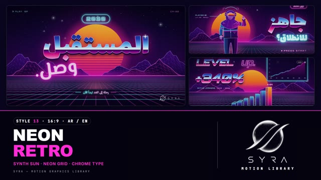

# 13 · Neon Retro

**SYRA Motion Library** · Style 13 · 16:9 · Arabic / English



<div dir="rtl">

> طريقة الاستخدام:
> انسخ البرومت ده كله وحطه لأي أداة AI أو لسكيل الـ animate، واملا الجزء الأخير ([VIDEO BRIEF]) بموضوع الفيديو.
> الستايل ده "نيون التمانينات" — شمس مقلّمة، أرضية نيون، جبال سلكية، وحروف كروم — مناسب للتقنية، الشباب، الألعاب، الإطلاقات والإعلانات الجريئة.
> المرجع الأساسي للشكل والحركة هو ملف "source/index.html". بيشتغل بالعربي وبالإنجليزي. ممنوع اللون البني.

</div>

## Files in this folder

| File | What it is |
|---|---|
| [source/index.html](source/index.html) | The motion itself — opens and plays in a browser; the source of truth |
| [sample.mp4](sample.mp4) | Showcase reel of the style |
| The info card at the top of this file | Tags & hashtags: what the style expresses, what it suits, search words |

## Tags

<div dir="auto">

النوع: 2D (رسوم نيون + حروف كروم، على أرضية شبكة بمنظور)  
في سطر: ليل بنفسجي وشمس مقلّمة برتقالي→بينك وشبكة نيون جارية وجبال سلكية وعناوين كروم — روح التمانينات والألعاب، حماسي وجريء.  
In one line: 80s synthwave night — striped orange-to-pink sun, rushing neon grid floor, wireframe mountains and chrome headlines; bold, nostalgic-futuristic, high energy.  
#عربي: #نيون #ريترو #التمانينات #ألعاب #جيمنج #شباب #تقنية #إطلاق_منتج #إعلان #بروموشن #حماسي #موسيقى #رياضة_إلكترونية #عد_تنازلي #إنفوجرافيك #ستايل_ألعاب #مستقبل  
#English: #neon #retro #synthwave #80s #retrowave #gaming #esports #youth #tech #productlaunch #promo #ad #music #countdown #chrome #arcade #vhs #futuristic  
مناسب لـ: إطلاق منتج أو تطبيق، إعلانات جريئة للشباب، ألعاب وبطولات إيسبورتس، حفلات ومهرجانات وموسيقى، عد تنازلي لحدث، أرقام نمو "ليفل أب"، مسابقات وهاكاثونات  
Best for: product or app launches, bold youth ads, gaming and esports, concerts/festivals/music, event countdowns, "level up" growth numbers, competitions and hackathons  
مش مناسب لـ: طب ومستشفيات وتوعية صحية جادة، أخبار حزينة أو أزمات، شركات رسمية محافظة أو بنوك تقليدية، قصص أطفال صغيرين هادية  
Not for: serious medical or health awareness, sad news or crises, conservative corporate/banking, calm stories for young children  
المزاج: جريء، حماسي، نوستالجي مستقبلي، شبابي، صاخب        Mood: bold, energetic, nostalgic-futuristic, youthful, loud  
الإيقاع: سريع وحماسي        Pace: fast  

</div>

## Components

| # | Component |
|---|---|
| 01 | Title |
| 02 | Data HUD |
| 03 | Scoreboard |
| 04 | Countdown |
| 05 | Player |
| 06 | Crew |
| 07 | DJ |
| 08 | Racer |
| 09 | Map |
| 10 | Speed |
| 11 | Timeline |
| 12 | Steps |
| 13 | Before After |
| 14 | Arcade |
| 15 | Chapter Card |
| 16 | End Logos |
---

## NEON RETRO — MOTION GRAPHICS STYLE PROMPT (SYRA Motion Library · Style 13 · 16:9 · Arabic / English)

### Role

You are a senior motion designer producing motion graphics in the "Neon Retro" style of the SYRA Motion Library, on ANY topic, in Arabic OR English (or both). Match the reference exactly: the source of truth is "source/index.html" (all components, playable in a browser).

### 1. Style identity

- One line: 80s retro-futurism — deep violet night, a striped orange→pink sun, a perspective neon grid floor rushing toward camera, wireframe mountains, stars, hard neon tubes, chrome lettering with a hard horizon line inside the letters, scanlines and a VHS feel.
- Mood: bold, nostalgic-futuristic, high energy — "the future starts now".
- Never: soft glass/aurora blur, flat corporate colour, brown.

### 2. Format & technical

- Canvas 1920×1080, 30 fps. One idea per scene, 4.2–4.8 s; scenes overlap 0.7 s for the signature transition.
- HTML + GSAP (HyperFrames): one paused timeline, only fromTo / to / set, deterministic (seeded randomness), no CSS keyframes, no remote assets. Hold the full state for the last ~1 s of every scene before the transition.

### 3. Colour palette (use only these)

- Night #0A0620 → purple #2A0B4A
- Sun orange #FF7A1A → hot pink #FF2E88 (never brown)
- Neon cyan #22E5FF · magenta #FF2BD6 · violet, chrome silver-blue → pink

### 4. Typography (bilingual)

- English: Orbitron (titles, HUD, numbers), chrome or neon outline.
- Arabic: Lalezar for chrome (and any word containing «لا»), El Messiri 700 for neon tube text.
- Latin digits in both languages. Min 28 px for reading text. Never split Arabic into letters.

### 5. Drawing language

- Neon frames, capsules, HUD rings, wireframe bars on the grid, neon line charts, lasers, light pillars, gates, arcade cabinets; neon line-art characters with gradient fill and cyan/magenta rim light.

### 6. Motion language

- Neon flicker-on (stepped), chrome highlight sweeps, grid rush on beats, lasers drawing, glitch jitter, scan-ins.
- Characters: confident key poses with snap, visor reflection sweeps, rim-light flicker.
- Signature transition: vhsWipe — a VHS tracking tear rolls up, the new scene tears in through stepped horizontal slices with RGB fringes, a neon flash at the midpoint.

### 7. Branding

- SYRA logo only — plain white on dark scenes / black on light scenes, never tinted: no neon glow, colour or sheen on the logo itself (only the frames and type around it glow).
- Corner logo: SYRA (mark + wordmark) bottom-right ~222 px — plain white (every Neon scene is night).
- End: SYRA lockup alone (plain white, powering up inside a neon tube frame over the sunset) + the tagline «المستقبل يبدأ الآن.» / "THE FUTURE STARTS NOW".

### 8. Component library (in "neon html.html"; ar = arabic example, en = english)

- **01** Sun + chrome title (AR)
- **02** Neon HUD data (EN)
- **03** Hall-of-fame scoreboard (AR)
- **04** Launch countdown (EN)
- **05** Player character (AR)
- **06** The crew (EN)
- **07** DJ on the beat (AR)
- **08** Hover-bike racer (EN)
- **09** Neon map of Egypt (AR)
- **10** Speed gauge (AR)
- **11** Fast-forward gate tunnel (EN) 12 Three arcade levels (AR)
- **13** Switch on: before / after city (EN)
- **14** Arcade game (AR)
- **15** Stage card + lower third (AR+EN)
- **16** End: SYRA lockup (AR + EN)

### 9. Sound (if the video has sfx)

- Analog synth stabs, arcade blips, VHS tracking noise on wipes, laser zaps, a driving synthwave bed. Duck ~18–20 dB under VO.

### 10. Do / don't

- **DO** keep glows hard and cheap, chrome for headlines, one neon accent word, grid always moving.
- **DON'T** use soft blur glass, brown/beige, or too many glow filters.

## [VIDEO BRIEF] — fill this in for each new video

```text
- Language: [ Arabic / English / both ]
- Topic / title: [ ... ]
- Voiceover file or script: [ path to WAV/MP3 or the text ]
- Length: [ e.g. 45 s ]
- Headlines and the accent word in each: [ ... ]
- Numbers / steps / content: [ ... ]
- Components to use (in order): [ e.g. 01, 05, 09, 16 ]
- Characters needed: [ ... ]
- Extra notes: [ ... ]
Output: 1920×1080, 30 fps MP4, same length as the voiceover, every visual timed to the word it illustrates,
SYRA corner logo, SYRA lockup ending.
```
