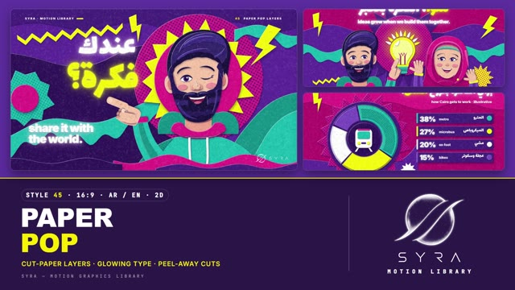

# 45 · Paper Pop Layers

**SYRA Motion Library** · Style 45 · 16:9 · Arabic / English



<div dir="rtl">

> طريقة الاستخدام:
> انسخ البرومت ده كله وحطه لأي أداة AI أو لسكيل الـ animate، واملا الجزء الأخير ([VIDEO BRIEF]) بموضوع الفيديو.
> الستايل ده "طبقات الورق الملوّن" — 2D (SVG): كل صورة معمولة من طبقات ورق مقصوص فوق بعض (موجات، شرايط زجزاج، برق، ورق منقّط، نجوم انفجار)، وكل ورقة ليها ظل ناعم على اللي تحتها، والعناوين بتنوّر فوق الورق زي اليافطة. شخصيات ورق ودودة: شعر بموجات ناعمة، إيدين حقيقية، رجالة وستات بحجاب ومن غير حجاب، أطفال وكبار، دكتورة وشيف ولاعب كورة.
> مناسب للمحتوى الشبابي والحماسي، البدايات والإعلانات، الصحة والرياضة والأكل، المشاريع الصغيرة، حياة المدينة، والعناوين اللي محتاجة طاقة "ثَمبنيل".
> المرجع الأساسي للشكل والحركة هو ملف "source/index.html". بيشتغل بالعربي وبالإنجليزي. ممنوع اللون البني وكل درجاته (بيج، تان، أوكر، كاكي، كريمي).

</div>

## Files in this folder

| File | What it is |
|---|---|
| [source/index.html](source/index.html) | The motion itself — opens and plays in a browser; the source of truth |
| [sample.mp4](sample.mp4) | Showcase reel of the style |
| The info card at the top of this file | Tags & hashtags: what the style expresses, what it suits, search words |

## Tags

<div dir="auto">

النوع: 2D — ورق مقصوص بطبقات وضلال (Cut-paper relief)  
في سطر: كل صورة طبقات ورق ملوّن مقصوص (موجات، برق، زجزاج، ورق منقّط، نجوم انفجار) بضل ناعم، وعناوين منوّرة زي يافطة نيون — حماسي وشقي وطاقة ثامبنيل.  
In one line: A loud, cheeky cut-paper relief — stacked coloured paper sheets with soft shadows, lightning bolts and halftone bursts, under glowing neon-sign type.  
#عربي: #ورق_مقصوص #طبقات_ورق #شبابي #حماسي #إعلان #بدايات #صحة #رياضة #أكل_صحي #مشاريع_صغيرة #حياة_المدينة #تحفيز #سوشيال_ميديا #نيون #بنفسجي #ألوان_صارخة #شخصيات  
#English: #cutpaper #paperlayers #papercraft #youth #energetic #promo #launch #health #sport #healthyfood #smallbusiness #citylife #motivation #socialmedia #neontype #halftone #playful #characters  
مناسب لـ: محتوى شبابي وحماسي للسوشيال، إعلانات وإطلاق أفكار ومشاريع ("عندك فكرة؟")، توعية صحة ورياضة وأكل صحي، مشاريع صغيرة وبيع أونلاين، حياة المدينة والمواصلات، أرقام وإحصائيات بشكل مرح (أعمدة، دونات، رقم ضخم)، أمثال شعبية بشكل شقي، تعريف بفريق  
Best for: energetic youth social content, idea/project launches and promos, health-sport-healthy-food awareness, small business and online shops, city life and commuting, playful stats (bars, donut, big number), cheeky proverbs, team intros  
مش مناسب لـ: محتوى رسمي أو حكومي أو طبي جاد، فيديوهات فخمة هادية، تاريخ بإحساس وثائقي، لو عايز ورق ممزّق يدوي هادي (ده 50 مش 45 — هنا ورق مقصوص نضيف وألوان صارخة ونيون)، لو عايز فيكتور ناعم من غير ملمس (ده 42)  
Not for: formal, governmental or serious medical content, calm luxury films, documentary history; for calm hand-torn paper use 50 (this is clean-cut, loud and neon), for smooth textureless vector use 42  
المزاج: حماسي، شقي، مبهج، جريء، ودود        Mood: energetic, cheeky, cheerful, bold, friendly  
الإيقاع: سريع وحماسي        Pace: fast  

</div>

## Components

| # | Component |
|---|---|
| 01 | Title Got An Idea |
| 02 | Data Robotics Bars |
| 03 | Data Cairo Commute Donut |
| 04 | Product Kitchen Shop Phone |
| 05 | Character Idea Grows Together |
| 06 | Team Four Talents |
| 07 | Story Teta Rooftop Garden |
| 08 | Mentor Coach And Kid |
| 09 | Three Steps Healthy Plate |
| 10 | Big Number 10000 Steps |
| 11 | Timeline Fisherman Day |
| 12 | Quote One Hand Cant Clap |
| 13 | Before After Nile Clean |
| 14 | Map Egypt Nile Trip |
| 15 | Chapter Lower Third |
| 16 | End SYRA Lockup |
---

## PAPER POP LAYERS — MOTION GRAPHICS STYLE PROMPT (SYRA Motion Library · Style 45 · 16:9 · Arabic / English)

### Role

You are a senior motion designer producing motion graphics in the "Paper Pop Layers" style of the SYRA Motion Library, on ANY topic, in Arabic OR English (or both). Match the reference exactly: the source of truth is "source/index.html" (all components, playable in a browser; click = pause, arrow keys = seek, #t=12 opens at 12 s).

### 1. Style identity

- One line: a loud, cheeky cut-paper relief — every picture is a stack of coloured paper sheets (waves, zig-zag strips, lightning bolts, halftone-dot paper, starbursts), each sheet casting a soft violet shadow on the one below, with glowing neon-sign type floating over the art.
- Mood: energetic, friendly, optimistic, "thumbnail energy" — bold but never messy.
- Depth comes only from stacking: every sheet is parallel to the camera; nothing bulges (not inflated), nothing folds (not origami). Front sheets overlap the characters so people sit INSIDE the paper stack.
- Never: brown / kraft / cardboard paper, realistic photos, flat vector without shadows, grunge, spiky hair.

### 2. Format & technical

- Canvas 1920×1080, 30 fps. One idea per scene, 4.6–4.8 s; scenes overlap 1.1 s for the signature transition.
- SVG + HTML + GSAP (HyperFrames): one paused timeline, deterministic (seeded randomness, no clocks), every frame a pure function of time. Each group of sheets is its own composited layer (rasterised once); motion = layer transforms.
- Every sheet = an SVG path + a depth level 1–5: soft drop shadow (blur 2→20 px, offset 3→28 px, 34–42 %, violet #1B0740 — deep teal #062E3A on teal scenes), a tight contact shadow, a 1.8 px lit white cut edge top-left and a faint dark edge bottom-right. One paper-fibre grain image over the whole frame at 15 %.
- Build order per scene: background stack already lying there → mid sheets and props pop / drop in back to front with a small back-out (paper being set down) → characters drop in → front sheets drop in over them → type flickers on. Full state by ~2.4 s, then a breathing hold.

### 3. Colour palette (use only these)

- Violet #5B2A9E (deep #46207F, deeper #2F145C, light #7A4BC4, lavender #A986EA) — the base.
- Magenta #E0218A (deep #B8166F, light #F45BAA, pink #FFB0D6) · Teal #16B8B0 (deep #0F8E89, light #5FD9D1, mint #B8F3EC) · Electric yellow #F5F50A (side #E3DE00) · White paper #FFFFFF / #F6F4FF with a cool lilac shade #DED7F5 · Sky #5EC8FF.
- Halftone papers: dots of one palette colour on another (yellow on magenta, magenta on violet, teal on deep teal…).
- Skin = rosy peach paper #F8C4A6 / #FDD9C3 / shade #EFA48D / #E2897D (+ a slightly deeper and a lighter rosy variant), blush #F28C98. Hair navy-violet #1A1240 #271B5A #34266F (highlight #4A36A0); elders lavender-silver #8F89C2 #B3ADDD.
- Shadows are always violet / deep teal / wine-violet tints — never grey-brown.

### 4. Typography (bilingual)

- Arabic headlines and lines: Lalezar (fat, rounded, poster-loud). English: Inter Black 900, lowercase, tight −3.5 % tracking; labels, kickers and name tags Inter 800 (tracked caps for kickers).
- Glow = stacked text-shadows (6 / 22 / 60 px) in white, yellow, magenta or teal + a 6 px violet drop for lift. One accent word per headline in yellow glow. Latin digits in both languages. Min 28 px reading text.
- Never split Arabic into letters: whole words / lines slap or flicker on. Lalezar has no "…" glyph — don't use it.
- Kickers top-left "SYRA · MOTION LIBRARY" + a short coloured paper strip; top-right "45 PAPER POP LAYERS".

### 5. Drawing language (paper, props, characters)

- Backgrounds: 3–5 wavy paper bands, a big halftone starburst or disc behind the hero, lightning bolts, zig-zag strips, small white / yellow stars; a dark front wave band at the bottom that also carries the corner logo.
- Data in paper: bars that slide up out of a slot (3 sheets each: side, face, halftone foot) with counting labels, donut slices that pop from the centre, stacked paper digits (deep-violet / yellow / white copies), timeline strips with round badge nodes, paper maps (Egypt as one sheet, the Nile as a sky-blue paper ribbon, pins that drop in).
- Props: paper phone with app cards, order cards, shopping bag, light bulb with rays, watering can, plants that grow leaf by leaf, football, cooking pot with steam, felucca, fish, lotus, rooftop skyline with lit windows.
- People (busts, head ≈ 1/2.5 of the bust): carved face planes, big catch-lit violet eyes that blink, rosy cheeks, open smiles; hair = SOFT LAYERED WAVES (stacked rounded-lobe sheets with crescent highlights — never spikes); beards = soft scalloped rows (or halftone stubble); hijab = layered drape + face wrap + coloured under-band + pin; REAL HANDS on everyone who gestures (paper sleeve + cuff + hand: wave, point, thumbs-up, hold). Cast: young man with beard, girl in hijab, doctor without hijab (long wavy hair, white coat, stethoscope), older woman in hijab with glasses, chef with moustache and toque, footballer, kid with curly puffs, architect.

### 6. Motion language (incl. camera) + signature transition

- Paper physics: sheets drop into place with a small back-out, pop from their centre, slide out of slots, grow from their base; props bob, bursts turn slowly, bolts hover; characters blink, nod, wave, wink; numbers count.
- Glowing type switches on like a sign (two quick flickers, small scale settle); Arabic words slap down like stickers.
- Camera: a slow multiplane push (1.0 → 1.035 and a small drift) — deeper sheets move less (real parallax); type stays.
- Signature transition — PEEL-AWAY (1.1 s): the outgoing scene's type and sheets peel off one by one, FRONT TO BACK — each lifts from its hinge corner toward the camera (perspective tilt, growing shadow), curls with a skew + rotation and flies off-frame, accelerating, ~2 frames apart, all in one direction per cut (up-left, up-right, left, right). Its base sheet peels last, revealing the next scene's stack already lying underneath; the new front sheets, characters and type then drop in. No cross-fades, no white flashes.

### 7. Branding

- SYRA logo only — plain white on these saturated scenes (plain black only on a light/white-paper scene), never tinted, never glowing, never made of paper.
- Corner logo: SYRA (mark + wordmark) bottom-right ~222×60 px, ~58 px right / 50 px bottom, plain fade, on a calm front sheet; it never peels.
- End: SYRA stacked logo alone, plain white, slapped onto the centre of concentric turning paper rings (deep violet, magenta halftone, teal, violet), bolts and zig-zags around; tagline «أفكارك تستاهل تتشاف» / "ideas deserve to be seen.".

### 8. Component library (in "paperpop html.html"; ar = arabic example, en = english)

- **01** Title: man with soft wave hair winks + points «عندك فكرة؟» (AR)
- **02** Bars from slots + waving robot "3× our robotics club" (EN)
- **03** Paper donut + legend strips «إزاي القاهرة بتروح الشغل؟» (AR)
- **04** Paper phone shop app + order cards "your shop, open 24/7." (EN)
- **05** Man + girl in hijab (with hands) + light bulb «سوا، الفكرة بتكبر» (AR)
- **06** Team of four busts: doctor, chef, footballer, coder "one street, many talents." (EN)
- **07** Teta waters her rooftop garden, plants grow «تيتا زرعت السطح» (AR)
- **08** Coach passes the ball to a kid "every champion had a coach." (EN)
- **09** Three step cards (shop, chop, cook) «3 خطوات لطبق صحي» (AR)
- **10** Stacked paper digits 10,000 + footprints «صحتك في خطوتك» (AR)
- **11** Timeline with badges + sailing felucca "a fisherman's day." (EN)
- **12** Proverb + two paper hands clap «الإيد الواحدة ما تسقفش» (AR)
- **13** Split before / after, torn divider "the Nile, cleaned up." (EN)
- **14** Paper map of Egypt, Nile ribbon, pins, felucca «رحلة على النيل» (AR)
- **15** Chapter 02 card stack + lower third (AR + EN)
- **16** SYRA end lockup on paper rings (AR + EN)

### 9. Sound (if the video has sfx)

- Crisp paper sounds: soft "flap" for each sheet set down, quick "slap" for sticker words, a neon "bzzt-tink" when type flickers on, rubbery pops for bursts, a paper rip-and-whoosh rising through each peel-away, playful plucks and claps over an upbeat pop / electro-chaabi groove. Duck ~18–20 dB under VO.

### 10. Do / don't

- **DO** build everything from shadowed paper sheets, keep front sheets over the characters, one accent word, soft wavy hair, real hands, calm sheet under the logo, Arabic RTL order in staggers, varied modern Egyptian people and topics.
- **DON'T** use brown/beige/tan/terracotta/wood/sepia/ochre/khaki/cream (no kraft paper), spiky hair, floating hands without arms, text over busy halftone, clip-wipes on glowing type, tinted or paper logos, generic cross-fades.

## [VIDEO BRIEF] — fill this in for each new video

```text
- Language: [ Arabic / English / both ]
- Topic / title: [ ... ]
- Voiceover file or script: [ path to WAV/MP3 or the text ]
- Length: [ e.g. 45 s ]
- Headlines and the accent word in each: [ ... ]
- Numbers / steps / content: [ ... ]
- Components to use (in order): [ e.g. 01, 05, 09, 16 ]
- Characters needed: [ ... ]
- Extra notes: [ ... ]
Output: 1920×1080, 30 fps MP4, same length as the voiceover, every visual timed to the word it illustrates,
SYRA corner logo, peel-away transitions, SYRA paper-rings ending.
```
