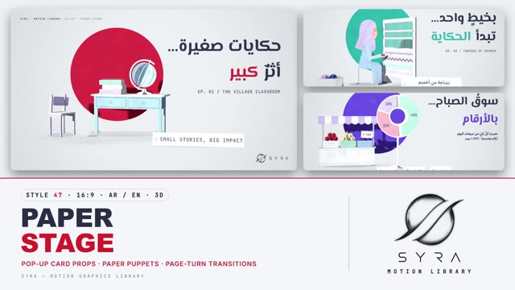

# 47 · Paper Stage

**SYRA Motion Library** · Style 47 · 16:9 · Arabic / English



<div dir="rtl">

> طريقة الاستخدام:
> انسخ البرومت ده كله وحطه لأي أداة AI أو لسكيل الـ animate، واملا الجزء الأخير ([VIDEO BRIEF]) بموضوع الفيديو.
> الستايل ده "مسرح الورق" — 3D حقيقي (WebGL / three.js): مسرح ورق صغير معمول باليد، على كل مشهد مجسمات من كرتون مقصوص واقفة على أرضية ورق، وراها دايرة لون واحدة، وتحتها تظليل رصاص، وتيكيت أبيض مكتوب بالآلة الكاتبة، والعنوان حروف ورق مقصوصة طالعة من الحيطة — ومعاه شخصيات عرايس ورق (نسّاجة، صيّاد، شيف، لاعب كورة، جدّة، دكتورة، طفل). مناسب للأفلام الوثائقية القصيرة، الحكايات الإنسانية، المبادرات المجتمعية، الصحة، الرياضة، الشغل والحِرف.
> المرجع الأساسي للشكل والحركة هو ملف "source/index.html". بيشتغل بالعربي وبالإنجليزي. ممنوع اللون البني والبيج والكرافت.

</div>

## Files in this folder

| File | What it is |
|---|---|
| [source/index.html](source/index.html) | The motion itself — opens and plays in a browser; the source of truth |
| [sample.mp4](sample.mp4) | Showcase reel of the style |
| The info card at the top of this file | Tags & hashtags: what the style expresses, what it suits, search words |

## Tags

<div dir="auto">

النوع: 3D (كرتون وورق مقصوص حقيقي، three.js)  
في سطر: مسرح ورق صغير معمول باليد: مجسمات كرتون مقصوص بتطلع زي كتب البوب-أب قدام دايرة لون واحدة، وتظليل رصاص، وتيكيت بالآلة الكاتبة — هادي وإنساني.  
In one line: A hand-made pop-up paper theatre in real 3D — cut-card props and paper puppets fold up in front of one bold colour disc, with pencil hatching and typewriter tags; calm, warm and documentary.  
#عربي: #مسرح_ورق #ورق_مقصوص #بوب_أب #كتاب_منبثق #ثلاثي_الأبعاد #حكايات_إنسانية #وثائقي #شخصيات_ورق #عرايس_ورق #تظليل_رصاص #آلة_كاتبة #مبادرات_مجتمعية #حرف_يدوية #صحة #رياضة #مطبخ #خريطة_مصر #النيل #رسوم_بيانية  
#English: #paperstage #papercraft #cutpaper #popupbook #3d #threejs #storytelling #documentary #paperpuppets #pencilhatching #typewriter #community #crafts #health #sport #infographic #egyptmap #nile #bilingual  
مناسب لـ: أفلام وثائقية قصيرة وحكايات ناس حقيقيين، مبادرات مجتمعية وتنمية، الحرف والمشروعات الصغيرة، الصحة والتوعية للأسرة والأطفال، الرياضة والشباب، تقارير سنوية بأرقام بسيطة، فصول ومقدمات سلاسل حلقات  
Best for: short documentaries and human stories, community and development initiatives, crafts and small business, family and kids health awareness, sport and youth, simple annual-report numbers, episode intros and chapter cards  
مش مناسب لـ: إعلانات تقنية سريعة ولامعة، محتوى رسمي حكومي جاف، داتا كتير ومعقدة في مشهد واحد، أي حاجة محتاجة صور حقيقية  
Not for: fast glossy tech ads, dry formal government content, dense complex dashboards in one scene, anything that needs real photos  
المزاج: دافي، إنساني، هادي، معمول باليد، وثائقي        Mood: warm, human, calm, hand-made, documentary  
الإيقاع: هادي        Pace: calm  

</div>

## Components

| # | Component |
|---|---|
| 01 | Title Village Classroom |
| 02 | Data Bars Growing |
| 03 | Data Donut Market Stall |
| 04 | Bike Workshop Wheel |
| 05 | Weaver at the Loom |
| 06 | Football Team Pitch |
| 07 | Fisherman Boat Dawn |
| 08 | Doctor and Kid Clinic |
| 09 | Chef Three Steps |
| 10 | Big Number Steps |
| 11 | Bakery Day Timeline |
| 12 | Grandmother Quote |
| 13 | Nile Bank Before After |
| 14 | Map of Egypt Nile |
| 15 | Chapter Card Lower Third |
| 16 | End SYRA Lockup |
---

## PAPER STAGE — MOTION GRAPHICS STYLE PROMPT (SYRA Motion Library · Style 47 · 16:9 · Arabic / English)

### Role

You are a senior motion designer producing motion graphics in the "Paper Stage" style of the SYRA Motion Library, on ANY topic, in Arabic OR English (or both). Match the reference exactly: the source of truth is "source/index.html" (all components, playable in a browser).

### 1. Style identity

- One line: a small hand-made pop-up paper theatre in real 3D — each scene is one stage on a cool paper sweep, with 1–4 cut-card props (extruded card with fibre faces and baked pencil hatching) standing on the floor, ONE big flat colour disc on the wall behind them, a pencil-hatched floor patch, a white typewriter tent tag, and a headline of cut-card letters that peel off the wall and cast real letter-shaped shadows.
- Mood: calm, documentary, warm-hearted — "small stories, big impact".
- Never: glossy plastic, CAD-perfect edges, kraft / brown paper, sepia ageing, busy backgrounds, more than one disc.

### 2. Format & technical

- Canvas 1920×1080, 30 fps. One idea per scene, 4.8–5.8 s; scenes overlap 1.2 s for the signature transition.
- Real-time 3D: three.js r160 with ONE shared renderer / canvas and ONE scene (the theatre) for the whole film; each stage is attached only while it plays. HTML + GSAP (HyperFrames): one paused timeline, deterministic (seeded randomness), every 3D value a pure function of timeline time; card textures are built once per key and reused (fibre and paper-tooth overlays are cached tiles). One VSM soft key light (front-left, low) so prop shadows climb onto the disc and the wall, hemisphere fill, a weak cool fill, a spot pool on the wall; no tone mapping (disc colours stay exact); vignette + grain.
- Camera: 40 mm, eye height ≈ 3, a slow truck/dolly drift (~0.8 units per scene) that never fully stops; character scenes sit closer (z ≈ 14–15). Full build by ~2 s, then hold with life (weaving, kicking, hauling, sipping, swaying leaves).

### 3. Colour palette (use only these)

- Paper (floor + wall) #EEF0F3 with fine navy and white fibres; shadows cool, never warm.
- Card colours: white #FBFCFD · greys #DCE1E8 / #C3CAD5 · sky #A9CDF2 / #86B4E4 · mint #AEE3CF / #86CFB5 · lilac #CFC4F3 / #AE9FE6 · rose #F2A7B5 · lemon #F4E7A1.
- Pencil, ink, typewriter text and contact shadows: navy #1B2240.
- Discs (one per scene, neighbours differ; the headline's accent word uses the disc colour): crimson #C8102E · cobalt #2747C9 · teal #12A39A · violet #5B3FD0.
- Skin: rosy peach #F4BCA9, warm #EBAA92, deeper #D99A84 (soft blush); hair ink-navy, grey for elders.

### 4. Typography (bilingual)

- Arabic headlines: El Messiri 700 as cut-card letters (whole connected words, RTL shaping intact, ~0.2 em headroom for dots and hamzas). Arabic secondary lines, notes and tag text: IBM Plex Sans Arabic 600.
- English headlines, tags, typewriter lines and all numbers: JetBrains Mono 500 (typewriter double-strike on tags).
- RTL headlines are right-aligned with the stage on the left; LTR headlines are left-aligned with the stage on the right.
- One accent word per headline in the disc colour. Latin digits in both languages. Min ~28 px reading text. Never split Arabic into letters.

### 5. Drawing language (3d modelling / materials / lighting)

- Cards: outline resampled and jittered ~6 mm for a hand-cut edge, extruded 0.03–0.08, fibre bump on all faces, streaky fibre edge on the thickness, a thin white cut-rim; pencil hatching on the side away from the light, drawn in unit space with broken strokes and paper tooth knocked out so it reads as graphite.
- Props are flat cards slotted together (crossed discs for globes, fruit and balls; box cards for bars and crates; strokes cut as alpha cards for bicycle frames, spokes, nets and warp threads).
- Wall: one colour disc lifted 0.2 off the wall (its own thin shadow), headline letters as alpha-cut card stacks.
- Floor: pencil-hatched patch with ragged lobed edges, soft navy contact blobs under every foot.
- People: layered paper puppets in profile (body, sleeves, hands, face, hijab / hair / hat as separate cards at small z offsets) on a rig with neck, shoulder, elbow, hip and knee pivots; soft profile faces (eye, brow, button nose, small lip, blush); faces and hands stay rosy (no harsh shadow). Cast: weaver in a lilac hijab, fisherman with knit cap and grey beard, chef in toque and apron, footballer, girl in a sports hijab, grandmother in a dotted scarf with glasses, doctor (no hijab, hair bun, white coat, stethoscope), kid with curly hair.

### 6. Motion language (incl. camera)

- Pop-up mechanics: props rise from flat on their base hinge like pop-up book pieces (boxes collapse/expand as paper parallelograms), with a back-out overshoot; stagger ~70 ms; tags fold up last.
- Wall: the disc slides in on a rail from its own side of the frame; headline flaps open out of the wall and then peel 0.14 off it so their shadows grow; typewriter lines rise out of masks; numbers count up.
- Characters act in small, readable gestures: weaving, kicking a ball, diving keeper, cheering, hauling a net, raising a hand with a question, showing a paper heart, pointing along steps, sipping tea; plus a small nod and weight shift.
- Camera: one continuous slow drift per scene; no fast cuts.
- SIGNATURE TRANSITION — the pop-up page turn (1.2 s, in 3D): the old props fold flat onto the floor one after another (~60 ms apart) and the tags fold down; the disc slides out on its rail; the title letters sink back onto the wall; then the whole floor page — carrying the folded set and its pencil patch — turns up around the floor/wall crease like a page of a pop-up book and lands flat on the wall, covering the old title. Underneath, the next stage is already there: its pencil patch draws itself on, its props fold up with overshoot, the new disc slides in, the title flaps open, the tag folds up last. The camera blends from the old drift into the new one, so it reads as one paper theatre and one shot.

### 7. Branding

- SYRA logo only — plain black on these light paper scenes (white only on a dark stage), never tinted, never lit.
- Corner logo: SYRA (mark + wordmark) bottom-right, ~222 × 60 px, 58 px right / 50 px bottom; keep props out of it.
- End: the stacked SYRA logo (flat black, unlit plane) stamped onto a standing white card that pops up in front of a teal disc, two paper plants, tagline tag «حكايات من ورق… بأثرٍ حقيقي» + typewriter "PAPER STORIES · REAL IMPACT".

### 8. Component library (in "stage html.html"; ar = arabic example, en = english)

- **01** Title — classroom desk, globe, books, chair «حكايات صغيرة… أثرٌ كبير» (AR, crimson)
- **02** Data hero — folded-card bars + value tags + plant "Learning that keeps growing." (EN, cobalt)
- **03** Arabic data — market stall + pop-up paper donut + legend tags «سوقُ الصباح… بالأرقام» (AR, violet)
- **04** Product — paper bicycle on a repair stand, spinning wheel "Fixed by hand, kept moving." (EN, crimson)
- **05** Character — the weaver of Akhmim at her loom «بخيطٍ واحد… تبدأ الحكاية» (AR, teal)
- **06** Team — football practice: coach, kid shoots, keeper in sports hijab "One pitch, one team." (EN, cobalt)
- **07** Story — fisherman hauls the net from a paper boat on paper waves, sunrise disc «مع أوّل ضوء… يبدأ الرزق» (AR, crimson)
- **08** Mentor & learner — doctor shows a paper heart, the kid asks "Every question is welcome." (EN, teal)
- **09** Three steps — chef + three step boards (choose · cook · serve) «ثلاث خطوات… لطبقٍ بيتي» (AR, violet)
- **10** Big number — 10,000 cut-card digits + sneaker + footprints «خطواتٌ صغيرة… لقلبٍ أقوى» (AR, cobalt)
- **11** Timeline — a bakery's day, tags on a string with a clock marker "A day at the bakery." (EN, crimson)
- **12** Quote — grandmother with her tea glass «مَن جدَّ وجد، ومَن زرعَ حصد.» (AR, teal)
- **13** Before / after — a Nile bank, grey litter → reeds, lotus, egret "Same river, new life." (EN, violet)
- **14** Map — pop-up paper Egypt, the Nile as a cobalt ribbon, city flags «مصرُ… حكايةٌ على النيل» (AR, cobalt)
- **15** Chapter card + lower third — «الفصل الثاني: في الملعب» / CHAPTER 02 + name strip (AR+EN, crimson)
- **16** End — SYRA lockup on a standing paper card + AR/EN tagline (teal)

### 9. Sound (if the video has sfx)

- Paper: soft card pops and folds on every prop, a big page whoosh-and-flap on the page turn, a slide hiss for the disc, typewriter clicks on tags and captions, pencil scratches on the floor patch; gentle oud / felt piano / light percussion bed. Duck ~18–20 dB under VO.

### 10. Do / don't

- **DO** keep everything cut card (hand-cut edges, fibre, pencil hatching), one disc per stage, contact shadows under every foot, pop-up folds with overshoot, the page turn between every two scenes, one accent word in the disc colour.
- **DON'T** use brown / beige / tan / kraft / cream / wood / sepia / ochre, glossy shine, photo textures, fades or hard cuts between scenes, more than one disc, or text over the corner logo.

## [VIDEO BRIEF] — fill this in for each new video

```text
- Language: [ Arabic / English / both ]
- Topic / title: [ ... ]
- Voiceover file or script: [ path to WAV/MP3 or the text ]
- Length: [ e.g. 45 s ]
- Headlines and the accent word in each: [ ... ]
- Numbers / steps / content: [ ... ]
- Components to use (in order): [ e.g. 01, 05, 09, 16 ]
- Characters needed (from the cast or new puppets): [ ... ]
- Extra notes: [ ... ]
Output: 1920×1080, 30 fps MP4, same length as the voiceover, every visual timed to the word it illustrates,
SYRA corner logo, SYRA end card.
```
