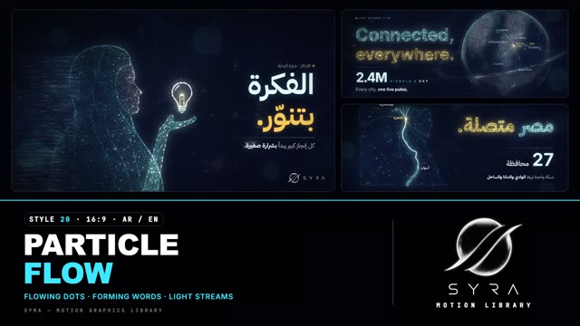

# 20 · Particle Flow

**SYRA Motion Library** · Style 20 · 16:9 · Arabic / English



<div dir="rtl">

> طريقة الاستخدام:
> انسخ البرومت ده كله وحطه لأي أداة AI أو لسكيل الـ animate، واملا الجزء الأخير ([VIDEO BRIEF]) بموضوع الفيديو.
> الستايل ده "جزيئات بتتجمّع" — آلاف النقط المنورة في فضاء غامق بتمشي مع تيار وتتجمّع لكلمات وكرة أرضية وأعمدة بيانات وأشخاص، بلون دهبي واحد — مناسب للبيانات، الذكاء الاصطناعي، التقنية، والأرقام الكبيرة.
> المرجع الأساسي للشكل والحركة هو ملف "source/index.html". بيشتغل بالعربي وبالإنجليزي. ممنوع اللون البني.

</div>

## Files in this folder

| File | What it is |
|---|---|
| [source/index.html](source/index.html) | The motion itself — opens and plays in a browser; the source of truth |
| [sample.mp4](sample.mp4) | Showcase reel of the style |
| The info card at the top of this file | Tags & hashtags: what the style expresses, what it suits, search words |

## Tags

<div dir="auto">

النوع: 2D بإحساس 3D (آلاف الجزيئات المنورة في فضاء غامق)  
في سطر: آلاف النقط المنورة سيان وأبيض في فضاء كحلي غامق بتمشي مع تيار وتتجمّع لكلمات وكرة أرضية وأعمدة بيانات وأشخاص، بلون دهبي واحد — ذكي ومنوّر ومتصل.  
In one line: Thousands of glowing cyan/white particles in deep space flow on a current and coalesce into words, a globe, data bars and people, with one bright gold accent; intelligent, luminous, connected.  
#عربي: #جزيئات #بيانات #ذكاء_اصطناعي #تقنية #أرقام #تحليل_بيانات #شبكات #اتصالات #تحول_رقمي #فضاء #مستقبل #ابتكار #فخم #هادي #إنفوجرافيك #شركات #تكنولوجيا  
#English: #particles #data #ai #artificialintelligence #tech #bigdata #analytics #network #telecom #digitaltransformation #space #future #innovation #premium #infographic #corporate #dataviz #glow  
مناسب لـ: الذكاء الاصطناعي وتحليل البيانات، تحول رقمي وشبكات واتصالات، أرقام كبيرة وإحصائيات مؤثرة، شركات تكنولوجيا وفنتك، ابتكار وأفكار جديدة، مؤتمرات وافتتاحيات تقنية فخمة، "ورا كل رقم إنسان" (بيانات بلمسة إنسانية)  
Best for: AI and data analytics, digital transformation/networks/telecom, big numbers and impactful statistics, tech and fintech companies, innovation and new ideas, premium tech conference openers, human-side-of-data stories  
مش مناسب لـ: قصص أطفال أو محتوى طفولي مبهج، محتوى أرضي يومي (أكل، زراعة بتفاصيل، حرف يدوية)، شرح خطوات عملية محتاجة رسم واضح للأدوات، أي حاجة محتاجة ألوان كتير أو نهار  
Not for: kids' or cheerful childish content, grounded everyday topics (food, detailed farming, crafts), hands-on step guides needing clear tool drawings, anything needing many colours or daylight  
المزاج: ذكي، منوّر، متصل، غامض، فخم        Mood: intelligent, luminous, connected, mysterious, premium  
الإيقاع: هادي        Pace: calm  

</div>

## Components

| # | Component |
|---|---|
| 01 | Title Data Speaks |
| 02 | Globe Network |
| 03 | Growth Bars |
| 04 | Shape Morph |
| 05 | Innovator Idea Lights Up |
| 06 | Team Stronger Together |
| 07 | Student Learn Smart |
| 08 | Portrait People Are Data |
| 09 | Three Steps |
| 10 | Big Number |
| 11 | Timeline Road Ahead |
| 12 | Quote Just Numbers |
| 13 | Noise To Insight |
| 14 | Map Egypt Connected |
| 15 | Chapter Card |
| 16 | End Logos |
---

## PARTICLE FLOW — MOTION GRAPHICS STYLE PROMPT (SYRA Motion Library · Style 20 · 16:9 · Arabic / English)

### Role

You are a senior motion designer producing motion graphics in the "Particle Flow" style of the SYRA Motion Library, on ANY topic, in Arabic OR English (or both). Match the reference exactly: the source of truth is "source/index.html" (all components, playable in a browser).

### 1. Style identity

- One line: deep space filled with thousands of tiny glowing particles riding a curl-noise flow field — silk streams drift across the frame, particles stream in and coalesce into words, logos, a globe, bar charts and human figures, hold with a living shimmer while stragglers peel off on the wind; orbit ribbons and out-of-focus bokeh give depth.
- Mood: intelligent, luminous, connected — "the future is built together".
- Never: glass/aurora panels, neon grids, large dim gold haze (it turns brown/olive).

### 2. Format & technical

- Canvas 1920×1080, 30 fps. One idea per scene, 4.2–4.8 s; scenes overlap 1.0 s for the signature transition.
- HTML + GSAP (HyperFrames): one paused timeline, only fromTo / to / set, every particle layer a pure function of scene time, deterministic (seeded randomness), no CSS keyframes, no remote assets. Keep ≲ 35k particles per frame. Hold the full state for the last ~1 s of every scene before the transition.

### 3. Colour palette (use only these)

- Void #03040A → navy #070B1E (every stage is deep space)
- Cool duotone: cyan #3EE8FF · ice #E8F7FF · electric blue #2F7BFF · white
- ONE warm accent: solar gold #FFC857 with highlight #FFE7A6 — always bright (a gold word, a hub, a heart core)

### 4. Typography (bilingual)

- Arabic display: IBM Plex Sans Arabic 700 (or El Messiri 700). English: Inter 700 (−0.03em) with Inter 400 as the thin half of a thin/bold pair. One gold accent word per headline; headlines can be FORMED by particles.
- Kickers and labels: JetBrains Mono with a gold dot; tracked caps labels in cyan; crisp HTML sub lines revealed by a sweeping edge with a seam of sparks.
- Latin digits in both languages. Min 28 px for reading text. Never split Arabic into letters.

### 5. Drawing language

- Particle words and logos, a particle globe with arcs and pulses from a gold Cairo hub, particle bar columns (hot bar gold), orbit ribbons passing behind and in front, silk streams with comets, bokeh discs, a faint nebula, stars and dust.
- People are particle busts in profile (hijab, man) with dense lit edges and features, the back dissolving into curling streams that straighten into horizontal data lanes, and a beating gold heart core.

### 6. Motion language

- Streams converge and coalesce: particles arrive in reading order (Arabic from the right, English from the left), land with a glint, then shimmer (micro drift, twinkle) while a few strays peel off; groups can disperse on the wind and re-form; the globe condenses from dust and turns slowly; bars fill from below with tops dissolving upward; slow push.
- Signature transition: particleWipe — a wind front of streaming particles sweeps right → left, blows the old scene's particles away with it and uncovers the next scene.

### 7. Branding

- SYRA logo only — plain white on dark scenes / black on light scenes, never tinted (never cyan, never gold). Every stage is deep space, so white.
- Corner logo: SYRA (mark + wordmark) bottom-right ~222 px, plain white throughout.
- End: SYRA lockup alone (mark above wordmark) — white particles condense into it, then dissolve as the crisp plain white logo takes over; tagline «المستقبل نصنعه معًا.» / "The future is built together".

### 8. Component library (in "particle html.html"; ar = arabic example, en = english)

- **01** «البيانات تتكلم.» title (AR)
- **02** Globe network (EN)
- **03** Growth bars «النمو بيتشاف.» (AR)
- **04** Shape morph: idea to impact (EN)
- **05** Innovator, the idea lights up (AR)
- **06** Team, stronger together (EN)
- **07** Student «علّم بذكاء.» (AR)
- **08** Portrait dissolve: people are the data (EN)
- **09** Three steps to a decision (AR)
- **10** Big number 98 % (AR)
- **11** Timeline: the road ahead (EN)
- **12** Quote «مجرد أرقام.» (AR)
- **13** From noise to insight (EN)
- **14** Map: Egypt connected (AR)
- **15** Chapter card + lower third (AR+EN)
- **16** End SYRA lockup from particles (AR + EN)

### 9. Sound (if the video has sfx)

- Airy whooshes on streams and the wind front, soft glittering shimmers as particles land, a deep ambient synth bed. Duck ~18–20 dB under VO.

### 10. Do / don't

- **DO** let streams converge in reading order, keep edges crisp and words legible, depth via ribbons / bokeh, one bright gold word.
- **DON'T** use brown/beige/tan/sand/wood/olive or earth tones, dim gold haze, blown-out white clumps, or glass panels / neon grids.

## [VIDEO BRIEF] — fill this in for each new video

```text
- Language: [ Arabic / English / both ]
- Topic / title: [ ... ]
- Voiceover file or script: [ path to WAV/MP3 or the text ]
- Length: [ e.g. 45 s ]
- Headlines and the accent word in each: [ ... ]
- Numbers / steps / content: [ ... ]
- Components to use (in order): [ e.g. 01, 05, 09, 16 ]
- Characters needed: [ ... ]
- Extra notes: [ ... ]
Output: 1920×1080, 30 fps MP4, same length as the voiceover, every visual timed to the word it illustrates,
SYRA corner logo, SYRA logo ending.
```
