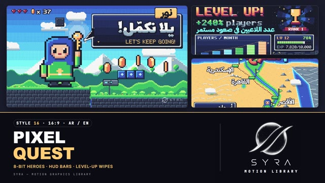

# 16 · Pixel Quest

**SYRA Motion Library** · Style 16 · 16:9 · Arabic / English



<div dir="rtl">

> طريقة الاستخدام:
> انسخ البرومت ده كله وحطه لأي أداة AI أو لسكيل الـ animate، واملا الجزء الأخير ([VIDEO BRIEF]) بموضوع الفيديو.
> الستايل ده "بكسل وألعاب" — بكسل آرت حقيقي 8/16-بت زي ألعاب زمان، HUD وعملات وقلوب وشبابيك حوار وبطلة بالحجاب — مناسب للتعليم بالألعاب، التطبيقات، الشباب، والمسابقات.
> المرجع الأساسي للشكل والحركة هو ملف "source/index.html". بيشتغل بالعربي وبالإنجليزي. ممنوع اللون البني.

</div>

## Files in this folder

| File | What it is |
|---|---|
| [source/index.html](source/index.html) | The motion itself — opens and plays in a browser; the source of truth |
| [sample.mp4](sample.mp4) | Showcase reel of the style |
| The info card at the top of this file | Tags & hashtags: what the style expresses, what it suits, search words |

## Tags

<div dir="auto">

النوع: 2D (بكسل آرت حقيقي 8/16-بت، مسطّح)  
في سطر: بكسل آرت زي ألعاب الأتاري والسيجا زمان — بطلة بحجاب "نور"، قلوب وعملات ومهمات وشبابيك حوار وبار XP وخريطة مراحل — لعّيب ومبهج ومحفّز.  
In one line: True 8/16-bit pixel art like classic console games — a hijabi hero "Noor", hearts, coins, quests, dialogue boxes, XP bars and a level map; playful, heroic and rewarding.  
#عربي: #بكسل #ألعاب #8_بت #ريترو #جيمنج #تعليم_بالألعاب #أطفال #شباب #تطبيقات #مسابقات #تحديات #مكافآت #مراحل #مهمات #لعّيب #مبهج #تحفيز #جيميفيكيشن  
#English: #pixelart #8bit #16bit #retrogaming #gaming #gamification #edtech #kids #youth #app #challenge #quest #levelup #rewards #playful #chiptune #arcade #rpg  
مناسب لـ: تعليم بالألعاب وتطبيقات تعليمية، شرح نظام نقاط ومكافآت ومستويات، مسابقات وتحديات وليدربورد، محتوى أطفال ومراهقين، إعلان تطبيق موبايل أو لعبة، رحلة متعلّم مرحلة بمرحلة، تحفيز وإنجاز يومي  
Best for: game-based learning and edu apps, explaining points/rewards/levels, competitions/challenges/leaderboards, kids and teen content, mobile app or game ads, learner journey stage by stage, daily motivation and achievement  
مش مناسب لـ: شركات رسمية وتقارير مالية جادة، طب وصحة حساسة، أخبار حزينة أو موضوعات عاطفية عميقة، براندات فخمة راقية  
Not for: formal corporate or serious financial reports, sensitive medical/health topics, sad news or deep emotional subjects, luxury premium brands  
المزاج: لعّيب، بطولي، مبهج، محفّز، نوستالجي        Mood: playful, heroic, cheerful, rewarding, nostalgic  
الإيقاع: سريع وحماسي        Pace: fast  

</div>

## Components

| # | Component |
|---|---|
| 01 | Title Adventure Begins |
| 02 | HUD Level Up |
| 03 | Quest Log Reward Chest |
| 04 | Boss Battle You Win |
| 05 | Character Noor Golden Key |
| 06 | Party Select Choose Your Team |
| 07 | Platformer Every Step Counts |
| 08 | Village Elder Quest Accepted |
| 09 | Inventory Tools Ready |
| 10 | World Map Nile Stages |
| 11 | Leaderboard Top Players |
| 12 | Three Stages Level Doors |
| 13 | Power Up Before After |
| 14 | Phone App Learn And Play |
| 15 | Chapter World 2 Dialogue |
| 16 | End Logos Pixel World |
---

## PIXEL QUEST — MOTION GRAPHICS STYLE PROMPT (SYRA Motion Library · Style 16 · 16:9 · Arabic / English)

### Role

You are a senior motion designer producing motion graphics in the "Pixel Quest" style of the SYRA Motion Library, on ANY topic, in Arabic OR English (or both). Match the reference exactly: the source of truth is "source/index.html" (all components, playable in a browser).

### 1. Style identity

- One line: real 8/16-bit pixel art — every scene drawn into ONE 320×180 canvas shown ×6 with nearest-neighbour (1 art pixel = 6×6 screen px), a fixed 16-colour palette, ordered (Bayer) dithering instead of gradients, game UI (HUD, HP/XP bars, RPG windows, item slots, coins, hearts, dialogue boxes) and parallax pixel landscapes.
- Mood: playful, heroic, rewarding — "building the future, level by level".
- Never: smooth gradients, blur or alpha fades on pixel art, off-grid / rotated / scaled pixels, brown ground.

### 2. Format & technical

- Canvas 1920×1080, 30 fps. One idea per scene, 4.2–4.8 s; scenes overlap 0.9 s for the signature transition.
- HTML + GSAP (HyperFrames): one paused timeline, draw() is a pure function of scene time, only fromTo / to / set for HTML overlays, deterministic (seeded rng), no CSS keyframes, no remote assets. Hold the full state for the last ~1 s of every scene before the transition (living loops only: blink, coin spin, idle breathing, stars, parallax).

### 3. Colour palette (use only these)

- Navy #1A1C2C · purple #5D275D · red #B13E53 · orange #EF7D57 · yellow #FFCD75 · lime #A7F070 · green #38B764 · teal #257179 · blue #29366F · sky #3B5DC9 · cyan #41A6F6 · aqua #73EFF7 · white #F4F4F4 · greys #94B0C2 / #566C86 / #333C57
- Skin #F6C9A6 with shade #E9A07E (the only off-palette pair). Outlines navy; shadows toward navy/purple/blue.
- Ground = grass (lime/green/teal) over grey-blue stone bricks; trunks teal, signs grey stone. Stages: dusk, night, HUD.

### 4. Typography (bilingual)

- Arabic display: Lalezar (≥ 26 art px), rendered into the low-res canvas — truly pixelated but joined. Arabic UI / small text: IBM Plex Sans Arabic bold (14–22 art px). English: the hand-built 5×7 pixel font (s:3 bold headlines, s:2, s:1).
- Titles: gradient fill + white top edge + bevel + navy outline + 3-step extrusion (white→aqua or yellow→orange pair). The punch word slams in with a white flash frame + whole-pixel shake.
- Latin digits in both languages. Reveal Arabic word by word, never letter by letter; English may type in. Never scale or rotate pixel text.

### 5. Drawing language

- Dithered skies, rolling ridges with sun-side rim light, faceted peaks, pines, clouds, twinkling stars, castles, lit skylines, brick and star blocks; sprites: heart, coin, trophy, gem, potion, golden key, star; RPG windows, XP bars, ▼ ▶.
- Hero: Noor, a 32×32 chibi girl in a hijab (×1 in a world, ×2 in a scene, ×3 close-up); extra characters are recoloured heroes or a boy with a cap — navy outline, 3-tone shading per material.

### 6. Motion language

- True game feel: whole-pixel positions only, sprites on 8–12 fps frame steps, coins spin on 4 frames, windows open in 4-px steps, text types in, PRESS START blinks, screen shakes by whole pixels, NES-style 4-step palette fades, item-get bursts.
- Hero poses: idle (breathing + blink), walk, jump, wave, key; parallax layers pan less the farther they are.
- Signature transition: pixelWipe — 16-px diamond tiles grow from the top-right until the frame is solid navy (scenes swap at the middle), then shrink away; clear again by 0.9 s.

### 7. Branding

- SYRA logo only — plain white on dark scenes / black on light scenes, never tinted (no palette colour, glow or dither on it).
- Corner logo: SYRA (mark + wordmark) bottom-right ~222 px, stepping in — white on dark stages, black only on a bright day sky.
- End: one SYRA reveal in an RPG window — the logo builds up from big white pixel blocks (8 → 4 → 2 → 1 px) and resolves into the crisp plain-white logo with an item-get burst; the hero walks in and waves under fireworks; tagline «نبني المستقبل، مستوى بعد مستوى» / "BUILDING THE FUTURE, LEVEL BY LEVEL".

### 8. Component library (in "pixel html.html"; ar = arabic example, en = english)

- **01** Dusk valley title + PRESS START (AR)
- **02** LEVEL UP! HUD + XP bar (EN)
- **03** Quest log + reward chest (AR)
- **04** Boss battle, YOU WIN! (EN)
- **05** Noor raises the golden key (AR)
- **06** Party select: choose your team (EN)
- **07** Platformer: every step counts (AR)
- **08** Village elder, QUEST ACCEPTED (EN)
- **09** Inventory: tools ready (AR)
- **10** World map of the Nile (AR)
- **11** Leaderboard TOP PLAYERS (EN)
- **12** Three level doors (AR)
- **13** Power up before / after (EN)
- **14** Phone app: learn + play (AR)
- **15** WORLD 2 chapter + dialogue lower third (AR+EN)
- **16** End: SYRA pixel build-up reveal (AR + EN)

### 9. Sound (if the video has sfx)

- Chiptune blips on typed text, coin pings, jump boings, block bonks, level-up jingles, a light 8-bit bed. Duck ~18–20 dB under VO.

### 10. Do / don't

- **DO** keep one pixel grid, whole-pixel steps, palette + dither only, joined Arabic, one slammed punch word.
- **DON'T** use brown/beige/tan/wood or earth tones, smooth gradients, blur, alpha fades, or rotate / scale pixel art and text.

## [VIDEO BRIEF] — fill this in for each new video

```text
- Language: [ Arabic / English / both ]
- Topic / title: [ ... ]
- Voiceover file or script: [ path to WAV/MP3 or the text ]
- Length: [ e.g. 45 s ]
- Headlines and the accent word in each: [ ... ]
- Numbers / steps / content: [ ... ]
- Components to use (in order): [ e.g. 01, 05, 09, 16 ]
- Characters needed: [ ... ]
- Extra notes: [ ... ]
Output: 1920×1080, 30 fps MP4, same length as the voiceover, every visual timed to the word it illustrates,
SYRA corner logo, SYRA logo ending.
```
