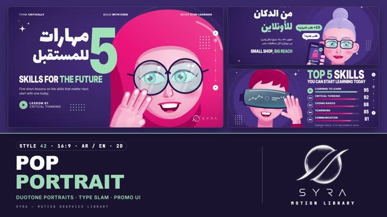

# 42 · Pop Portrait

**SYRA Motion Library** · Style 42 · 16:9 · Arabic / English



<div dir="rtl">

> طريقة الاستخدام:
> انسخ البرومت ده كله وحطه لأي أداة AI أو لسكيل الـ animate، واملا الجزء الأخير ([VIDEO BRIEF]) بموضوع الفيديو.
> الستايل ده "بوب بورتريه" — 2D فيكتور: بورتريهات كبيرة مقصوصة بلون وردي "ديوتون" على خلفية بنفسجي غامق، جنب عناوين ضخمة مكثّفة فيها كلمة واحدة بالنعناعي، وعناصر واجهة بروموشن (نجوم، نقط، أزرار، شرائح). الشخصيات ليها إيدين حقيقية: إيد على الخد، موبايل، ميكروفون، صباع لفوق — ومن كل الناس: بنت بحجاب وبنت من غير، شاب، ست كبيرة، شيف، لاعب كورة، دكتورة.
> مناسب للبروموهات، إعلانات الكورسات، اليوتيوب، والقصص القصيرة عن الناس والحياة اليومية في مصر.
> المرجع الأساسي للشكل والحركة هو ملف "source/index.html". بيشتغل بالعربي وبالإنجليزي. ممنوع اللون البني.

</div>

## Files in this folder

| File | What it is |
|---|---|
| [source/index.html](source/index.html) | The motion itself — opens and plays in a browser; the source of truth |
| [sample.mp4](sample.mp4) | Showcase reel of the style |
| The info card at the top of this file | Tags & hashtags: what the style expresses, what it suits, search words |

## Tags

<div dir="auto">

النوع: 2D — فيكتور بورتريه ديوتون (وردي على بنفسجي)  
في سطر: بورتريهات كرتون كبيرة مقصوصة بلون وردي ساخن على خلفية بنفسجي غامق، جنبها عناوين ضخمة مضغوطة وكلمة بالنعناعي وزراير ونجوم — شكل بروموشن ويوتيوب واثق ومبهج.  
In one line: A YouTube-thumbnail promo look — big cropped hot-pink duotone vector portraits on deep violet, huge condensed type with one mint word, promo UI sparkles.  
#عربي: #بروموشن #إعلان_كورس #يوتيوب #سوشيال_ميديا #تعليم_أونلاين #مهارات #شباب #بورتريه #شخصيات #مشاريع_صغيرة #صحة #رياضة #طبخ #تكنولوجيا #مودرن #حماسي #وردي_وبنفسجي  
#English: #promo #courseads #youtube #thumbnail #socialmedia #elearning #skills #youth #portrait #characters #smallbusiness #health #sport #cooking #tech #duotone #bold #modern  
مناسب لـ: بروموهات وإعلانات كورسات ومنصات تعليم، مقدمات يوتيوب وثامبنيلز، محتوى سوشيال ميديا للشباب، قصص قصيرة عن ناس عاديين بيكلموا الكاميرا (ست كبيرة، شيف، لاعب، دكتورة)، تعريف بفريق، إحصائيات بسيطة (دونات، أعمدة ترتيب، رقم كبير)، إطلاق تطبيق أو خدمة  
Best for: promos and course/learning-platform ads, YouTube intros and thumbnails, youth social content, short people-to-camera stories (grandma, chef, footballer, doctor), team intros, simple stats (donut, ranked bars, big number), app or service launches  
مش مناسب لـ: محتوى رسمي أو حكومي أو فخم هادي، تاريخ وتراث وآثار، شرح تقني أو هندسي بخرايط ومجسمات، مواضيع حزينة أو حساسة، أي حاجة محتاجة ألوان طبيعية للبشرة أو صور حقيقية  
Not for: formal, governmental or calm-luxury content, history and heritage, technical/engineering explainers, sad or sensitive topics, anything needing natural skin tones or real photos  
المزاج: واثق، مبهج، جريء، شبابي، ودود        Mood: confident, bright, bold, youthful, friendly  
الإيقاع: سريع وحماسي        Pace: fast  

</div>

## Components

| # | Component |
|---|---|
| 01 | Title 5 Skills For The Future |
| 02 | Top 5 Skills Index |
| 03 | Home Cooking Donut |
| 04 | One Tap Phone In Hand |
| 05 | Mentor And Student |
| 06 | Meet The Crew |
| 07 | Grandma Shop Goes Online |
| 08 | Doctor And Curious Girl |
| 09 | Three Health Habits |
| 10 | 90 Minutes Footballer |
| 11 | One Day In Cairo Timeline |
| 12 | Coder Quote |
| 13 | Nile Before And After |
| 14 | Egypt Map Learning |
| 15 | Chapter 02 Lower Third |
| 16 | End SYRA Lockup |
---

## POP PORTRAIT — MOTION GRAPHICS STYLE PROMPT (SYRA Motion Library · Style 42 · 16:9 · Arabic / English)

### Role

You are a senior motion designer producing motion graphics in the "Pop Portrait" style of the SYRA Motion Library, on ANY topic, in Arabic OR English (or both). Match the reference exactly: the source of truth is "source/index.html" (all components, playable in a browser).

### 1. Style identity

- One line: a YouTube-thumbnail / promo look — big, cropped, polished vector portraits in a hot-pink duotone (flat light and shade shapes, soft blush, glossy aqua eyes, aqua glass) on a deep violet field, beside huge condensed type stacks with ONE mint word, plus promo UI furniture: a thin top nav of three short phrases, sparkles, dot grids, circle arrow buttons with a 5-dot slider, speech chips.
- Mood: bright, confident, friendly, modern Egypt — real everyday people talking straight to camera.
- Never: photo realism, outlines in black, muddy colours, any brown / beige / tan in skin, hair, garments or shadows.

### 2. Format & technical

- Canvas 1920×1080, 30 fps. One idea per scene, 4.6–4.8 s; scenes overlap 0.6 s for the signature transition.
- 2D SVG + HTML + GSAP (HyperFrames): one paused timeline, fromTo / set only, deterministic (seeded randomness), every value a pure function of time (a direct seek shows the right frame). No CSS keyframes, no remote assets.
- Layout: portrait on one side (cropped hard, chin and eyes never both cut), type stack on the other; nav at y ≈ 58; Arabic headlines right-aligned, English left-aligned at x ≈ 98; keep the corner-logo area calm.

### 3. Colour palette (use only these)

- Field: deep violet radial #4A3787 → #3A2A6B → #2B1E55; backdrop discs #4B3888 / #45337E; dotted mint orbit rings.
- Duotone pinks (hijab, hair, garments): #FF6FA3 · #FF2E7E · #C2185B · #97104A (deeper set #FF5C93 #E5226F #AE1554 #86103F).
- Skin (rosy): #FFD9E3 · #FFC2D3 · #F48AAE · #DE5C8C; blush #FF6F9C; lips #E5135F → #FF4A8B.
- Mint accent #9FD9B8 (shade #6FBF98): the accent word, chips, #1 bar, one garment. Aqua glass #7FD6D6 / #4FB9C4: lenses, visor, irises, water. Line work #24164A (deep violet, never black). Type white.
- White garments (chef, doctor) #F6F2FF with lavender shade #D9CFF2 / #B7A8E2; silver hair #ECE6FA / #C9BDEB / #A495D6.

### 4. Typography (bilingual)

- English display: Inter 900 UPPERCASE squeezed to scaleX(.74) (tall promo column). Arabic display: Lalezar at scaleX(.9), whole words only (Lalezar has a dotless final ي and no "…": avoid display words ending in ي; use "،").
- Arabic body: IBM Plex Sans Arabic 500, 32 px. English body: Inter 400, 28 px. Kickers: Inter 800 tracked caps in mint / Plex 500 mint. Nav: Inter 500 with 900 keywords, 22 px.
- ONE mint accent word per headline. Latin digits in both languages. Min 28 px reading text. Never split Arabic into letters.

### 5. Drawing language

- Portraits are frontal, built from mirrored halves: soft radial skin, a duotone shade crescent on the viewer's left (light from the upper right), blush and gloss ovals, big almond eyes (aqua iris with a mint inner glow, two catchlights, a lid line with a small wing), simple nose line, glossy lips or an open smile; sparse violet line work.
- Cast: woman in hijab with round tinted glasses; young man in a VR visor; mentor in a deep-pink hijab; student with mint headphones; young man without glasses (light stubble, hoodie); older woman (silver bun, reading glasses, smile lines); chef (white toque, moustache, double-breasted jacket, mint neckerchief); footballer (close fade, mint #10 jersey); girl without hijab (long hair, mint clip); doctor (hijab, white coat, stethoscope).
- HANDS are part of the look: every hand belongs to a forearm + sleeve that leaves the frame (never floating) — hand resting on the cheek, chin on a fist, thumbs-up, raised open palm, holding a phone (screen to camera with real UI), holding a mic. Rounded capsule fingers, pink outline, nails and knuckle highlights, a soft contact shadow on the face.
- Objects and charts in the same flat duotone: donut and bar charts, phone UI, icon badges, cards, a map of Egypt with an aqua Nile, a before/after comparison panel.

### 6. Motion language (incl. camera)

- Portraits move only as rigid layers: glide in from the side and settle from 1.1–1.16 to 1 with expo.out (±4–6° tilt), then breathe (slow 3 % push). Arms rise into place from below with a small overshoot.
- Type slam: the accent word scales 1.9 → 1 with back.out(1.6); other words slide 120 px with expo.out, staggered 0.08–0.1 s.
- Discs grow from r 0 (back.out), orbits turn slowly, bars fill (power3.out), counters count, chips pop from their tail (back.out 2.2), sparkles pop with a −90° spin, dot grids bloom; nav and UI fade in last.
- Holds that breathe: blinks, glances (iris moves), a hand bob or tap, lens / visor glints, a selection halo hopping between people, pings and ripples. No exit animations — the transition is the exit.
- Signature transition: DUOTONE SLAM — two diagonal bands (deep violet trailing, hot pink leading with a light edge and riding sparkles, ~20°) slam across the frame in ~0.6 s (power4.inOut); the next scene is laid down behind the violet band's edge while the outgoing camera pushes out (x ±150, scale 1.12) and the incoming camera settles from the other side (1.1 → 1, expo.out). Direction alternates left→right / right→left.

### 7. Branding

- SYRA logo only — plain white on the violet field (black only on a light scene), never tinted.
- Corner logo: SYRA (mark + wordmark) bottom-right, ~222×60 px, 58 px from the right, 50 px from the bottom; slides in.
- End: the stacked SYRA logo alone as the hero on a violet disc with a dotted mint orbit, revealed by a miniature duotone band; tagline «اتعلّم النهارده، وانطلق» / "Learn today. Lead tomorrow."; the cast as small round badges below.

### 8. Component library (in "portrait html.html"; ar = arabic example, en = english)

- **01** Title stack «5 مهارات للمستقبل» + hijab portrait, hand on cheek (AR)
- **02** Ranked bars "Top 5 skills" + VR portrait, hand on the visor (EN)
- **03** Donut chart «طبخ البيت أولًا» + chef thumbs-up (AR)
- **04** Phone in hand + six topic badges "One tap to start" (EN)
- **05** Mentor & student with speech chips «المُرشد يصنع الفرق» (AR)
- **06** Team of four round badges "Meet the crew" (EN)
- **07** Story: grandma's shop on her phone «من الدكان للأونلاين» (AR)
- **08** Doctor & curious girl, raised hand "Every question counts" (EN)
- **09** Three habit cards with ticks «3 عادات لصحتك» (AR)
- **10** Big number 90 + footballer with mic «دقيقة من الشغف» (AR)
- **11** Avatar timeline "One day in Cairo" (EN)
- **12** Quote + coder, chin on fist «كل سطر كود كتبته كان درس جديد» (AR)
- **13** Before/after slider "The Nile: before & after" (EN)
- **14** Map of Egypt with Nile, pins and routes «مصر كلها بتتعلّم» (AR)
- **15** Chapter 02 card + lower third «صحتك أولًا» / Health first (AR + EN)
- **16** End SYRA lockup (AR + EN)

### 9. Sound (if the video has sfx)

- Punchy promo: a whoosh + bass hit on every Duotone Slam, pops and clicks for chips and sparkles, soft UI ticks for bars and counters, a bright pop-electronic bed. Duck ~18–20 dB under VO.

### 10. Do / don't

- **DO** crop portraits big, give people real hands (attached to arms), keep skin/hair/hijab in pinks, one mint word per headline, slam the type, let every hold breathe, alternate the slam direction, mix women with and without hijab, young and old.
- **DON'T** use brown/beige/tan/terracotta/wood/sepia/ochre/khaki/cream, black outlines, floating hands, squashed or warped faces, mint garments with dark pink shading, more than one accent word, or any logo other than SYRA.

## [VIDEO BRIEF] — fill this in for each new video

```text
- Language: [ Arabic / English / both ]
- Topic / title: [ ... ]
- Voiceover file or script: [ path to WAV/MP3 or the text ]
- Length: [ e.g. 45 s ]
- Headlines and the accent word in each: [ ... ]
- Numbers / steps / content: [ ... ]
- Components to use (in order): [ e.g. 01, 05, 09, 16 ]
- Characters needed (and their hand pose): [ ... ]
- Extra notes: [ ... ]
Output: 1920×1080, 30 fps MP4, same length as the voiceover, every visual timed to the word it illustrates,
SYRA corner logo, SYRA lockup ending.
```
