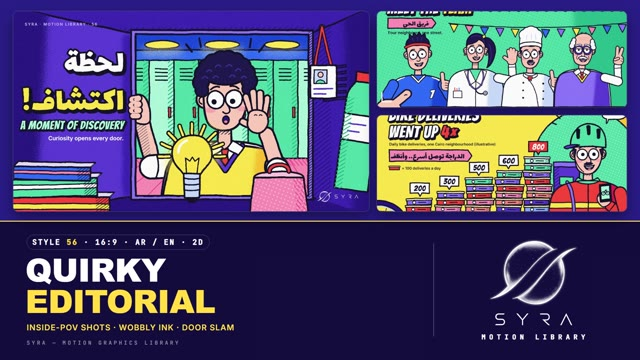

# 56 · Quirky Editorial

**SYRA Motion Library** · Style 56 · 16:9 · Arabic / English



<div dir="rtl">

> طريقة الاستخدام:
> انسخ البرومت ده كله وحطه لأي أداة AI أو لسكيل الـ animate، واملا الجزء الأخير ([VIDEO BRIEF]) بموضوع الفيديو.
> الستايل ده "الرسم التحريري المرح" — 2D (SVG): رسم تحريري معاصر بخط كحلي سميك ومهزوز شوية، ألوان مسطحة مشبعة جدًا عليها حبيبات طباعة، تظليل بالنقط والخطوط، وشخصيات مصرية مضحكة بعيون كبيرة مدورة، وكل لقطة من زاوية غريبة (من جوه اللوكر، التلاجة، الفرن، شبكة الجول، تحت المية) — مناسب للشرح المرح، المحتوى الاجتماعي، الأكل والصحة والرياضة والمدينة والأعمال الصغيرة، ومحتوى الشباب والأطفال.
> المرجع الأساسي للشكل والحركة هو ملف "source/index.html". بيشتغل بالعربي وبالإنجليزي. ممنوع اللون البني والبيج.

</div>

## Files in this folder

| File | What it is |
|---|---|
| [source/index.html](source/index.html) | The motion itself — opens and plays in a browser; the source of truth |
| [sample.mp4](sample.mp4) | Showcase reel of the style |
| The info card at the top of this file | Tags & hashtags: what the style expresses, what it suits, search words |

## Tags

<div dir="auto">

النوع: 2D (رسم SVG)  
في سطر: رسم تحريري معاصر بخط كحلي سميك مهزوز وألوان مشبعة بحبيبات طباعة، وشخصيات مصرية مضحكة بعيون كبيرة في لقطات من زوايا غريبة.  
In one line: Bold editorial illustration with thick wobbly navy ink, saturated grainy colours and funny big-eyed Egyptian characters seen from quirky inside-POV angles.  
#عربي: #رسم_تحريري #موشن_جرافيك #شرح_مرح #كرتون #شخصيات #كوميدي #أكل #صحة #رياضة #عيلة #مدينة #مشاريع_صغيرة #بيئة #أطفال #شباب #سوشيال_ميديا #إنفوجرافيك #عربي_وإنجليزي  
#English: #editorialillustration #motiongraphics #quirky #cartoon #characters #funny #explainer #food #health #sport #family #citylife #smallbusiness #environment #kids #socialmedia #infographic #bilingual  
مناسب لـ: شرح مرح للجمهور العام، محتوى سوشيال ميديا، حملات توعية صحية وغذائية، رياضة وشباب، أعمال صغيرة ومدينة، قصص عيلة ورمضان، محتوى أطفال ومدارس، بيانات بسيطة بشكل مسلي  
Best for: playful public explainers, social-media content, health & food awareness, sport & youth, small business and city life, family / Ramadan stories, kids & school content, light data told with humour  
مش مناسب لـ: محتوى رسمي جدًا أو حكومي جاد، موضوعات حزينة أو حساسة، تقارير مالية تفصيلية، فخامة وبراندات راقية  
Not for: very formal / official content, sad or sensitive topics, detailed financial reports, luxury premium branding  
المزاج: مرح، دافي، فضولي، سريع البديهة، حيوي        Mood: witty, warm, curious, snappy, lively  
الإيقاع: سريع وحماسي        Pace: fast  

</div>

## Components

| # | Component |
|---|---|
| 01 | Title Locker Discovery |
| 02 | Data Bike Deliveries |
| 03 | Data Healthy Plate |
| 04 | Product Solar Power Bank |
| 05 | Character Family Iftar |
| 06 | Team Group Selfie |
| 07 | Story Chef Oven |
| 08 | Mentor Coach Goal |
| 09 | Three Steps Business |
| 10 | Big Number Nile |
| 11 | Timeline Farmer Day |
| 12 | Quote One Hand |
| 13 | Before After Beach |
| 14 | Map Egypt Cities |
| 15 | Chapter Lower Third |
| 16 | End SYRA Lockup |
---

## QUIRKY EDITORIAL — MOTION GRAPHICS STYLE PROMPT (SYRA Motion Library · Style 56 · 16:9 · Arabic / English)

### Role

You are a senior motion designer producing motion graphics in the "Quirky Editorial" style of the SYRA Motion Library, on ANY topic, in Arabic OR English (or both). Match the reference exactly: the source of truth is "source/index.html" (all components, playable in a browser).

### 1. Style identity

- One line: bold contemporary editorial illustration — thick, slightly wobbly deep-navy ink, flat very saturated fills with risograph-like print grain, stipple and hatch shading, funny characters with huge round eyes, and an unusual camera in every shot (inside a locker / fridge / oven / goal net, under water, top-down on a table), with near objects cropped by the frame.
- Mood: witty, warm, snappy, curious — a magazine illustration that comes alive.
- Never: soft gradients, realistic rendering, thin vector lines, muddy shades, or any brown / beige / tan / wood / khaki.

### 2. Format & technical

- Canvas 1920×1080, 30 fps. One idea per scene, 4.4–4.6 s; scenes overlap 0.7 s for the signature transition.
- 2D SVG inside HTML + GSAP (HyperFrames): one paused timeline driving one proxy; every shape is a pure function of timeline time (seeded randomness, no Math.random / Date / rAF). One SVG per scene: art + display type inside ONE wobble filter (two feTurbulence/displacement passes, seeds re-rolled at 8 fps = line boil) under a full-frame grain filter; reading text sits OUTSIDE the wobble filter. Keep stipple-shade elements to ~25 per scene.
- Full state by ~2.5 s, then hold with life (blinks, talking, swinging props, steam, bubbles, fish, twinkles).

### 3. Colour palette (use only these)

- Ink (all outlines, hatching, pupils) #15142B.
- Violet #5B3FD6 / #3F27B4 / #2A1A86 / #8E78FF / #C9BDFF · Electric blue #2F6BFF / #1A48DA / #86AAFF / #C7D8FF · Lemon #FFE24A / #FFBE2E / #FFF2A0 · Tomato #FF4A3D / #E0264D / #FF8C7E · Mint #4FD6A6 / #1EAE86 / #A8F2D7 · Pink #FF8FB5 / #F25A93 / #FFC6DA · White #FFFFFF / snow #F5F3FF.
- Skin rosy peach #FFC9B8 (shade #F7A99C, blush #FF8FA6); hair navy-violet #1F1B4D / #3E3398; older hair snow.
- Shades shift toward a saturated neighbour (lemon→golden, tomato→crimson, mint→teal), never toward grey. Food stays in palette (tomato, lemon, mint, pink); boxes, crates and pencils are coloured, never cardboard or wood.

### 4. Typography (bilingual)

- Arabic: Lalezar for every headline, label and speech bubble — chunky sticker letters with a 16–18 px navy outline and an offset navy shadow, animated as whole words (never split into letters).
- English: Bangers for display words, numbers, times, labels and comic sound words (DING!, CLAP!, GOAL!).
- Reading text: Inter 600, 28–30 px (kicker 20 px tracked caps), never wobbled.
- Scale: hero 118–200 px, subs 40–64 px. Latin digits. One accent word per headline (lemon / tomato / mint).

### 5. Drawing language

- Every shape is a path with a navy stroke (9–10 px main, 5–7 px details, 30–46 px for near foreground); round joins. Union outlines (hair curls, pigtails, fingers, puffs) give one clean contour. Hatch at −38° on shadow sides, stipple print-dot shading clipped to its shape, dot and stripe patterns on cloths, awnings and walls.
- Inside-POV construction: the frame edges are the camera plane; four trapezoid walls run to an opening rectangle with a thick lip; the world outside is clipped to the opening; props near the camera are big and cropped.
- Characters: egg / bean heads, long thin necks, C ears, one-stroke hook nose, huge white eyes with small dot pupils that aim at what they react to, small arched brows, O mouth / smile / grin / talk, pink blush, sausage-finger hands, the "fingers over the edge" gag. Head kit: short hair, curly, kid, spiky footballer (+ headband), older man (bald, white tufts, white moustache, wrinkles, glasses), chef (toque, moustache), women without hijab (ponytail, bob, bun), girl with pigtails, woman in hijab (wrap, chin wrap, white under-cap), bucket hat + beard (farmer), helmet (rider). Tops: tee, polo, jersey with number, shirt + tie, sweater vest, doctor coat with stethoscope, chef jacket, rider jacket, hoodie, apron. Pose library: wave, point, palm-up surprise, hands on cheeks, thumbs up, peace, cheer, hold phone, hands on hips, present, chin-think, hold with both hands.

### 6. Motion language + signature transition

- Things pop in with a back-ease and squash & stretch from their contact point; objects drop and land with a squash; characters react with an elastic head jolt from the neck, brows jumping, pupils dilating and surprise ticks; talking mouths, blinks, waving hands. Secondary life everywhere. The camera breathes with a slow push and lands with a bounce after every door. Line boil at 8 fps all the time, everything else on 1s.
- Signature transition: DOOR SLAM — a near object of the scene you are leaving (locker door, delivery-box lid, menu or notebook cover, fridge door, phone case, oven door, crate) is hinged at a frame edge and painted in the dominant colour of the scene you are entering. f0–3 it creaks into view (real perspective wedge), f3–5 twitches back, f5–10 SLAMS shut across the whole frame, f10–12 squashes 12 % / stretches 8 % with three speed lines and white ink puffs on the slam edge while the scenes swap under full cover, f12–21 it swings open away from the camera onto the new scene. Alternate the hinge side (left, right, top, bottom).

### 7. Branding

- SYRA logo only — plain white on dark scenes / plain black on light scenes, never tinted, never wobbled or grained.
- Corner logo: SYRA (mark + wordmark) bottom-right, ~222×60 px, 58 px from the right, 50 px from the bottom; keep that corner calm (no seams, labels or props under it).
- End: the stacked SYRA logo alone in the opening of a violet locker (callback to the title), popping out of a white ink puff with confetti and stars; tagline «خليك فضولي» / "STAY CURIOUS.".

### 8. Component library (in "quirky html.html"; ar = arabic example, en = english)

- **01** Inside the school locker «لحظة اكتشاف!» (AR)
- **02** Box-stack chart + delivery rider "BIKE DELIVERIES WENT UP 4×" (EN)
- **03** Top-down healthy-plate pie «طبق صحي» (AR)
- **04** Solar power bank on a Cairo rooftop "SUN IN YOUR POCKET" (EN)
- **05** Inside the fridge at iftar, grandmother + girl «لمة العيلة» (AR)
- **06** Group selfie: footballer, doctor, chef, older shop owner "MEET THE TEAM" (EN)
- **07** Inside the oven: chef and the rising pizza «سر الطبخة» (AR)
- **08** From inside the goal: coach + young player "ONE MORE TRY!" (EN)
- **09** Three step cards + shop owner in hijab «3 خطوات لمشروعك» (AR)
- **10** Under the Nile: big number 6,650 KM + fisherman «طول نهر النيل» (AR)
- **11** Timeline: a farmer's day 5 AM → 8 PM (EN)
- **12** Proverb card + clapping hands «إيد لوحدها ما تسقفش» (AR)
- **13** Before / after slider: beach clean-up "CLEAN-UP DAY" (EN)
- **14** Map of Egypt with four city pins «مصر من فوق» (AR)
- **15** Chapter 02 card + lower third, paediatrician (AR + EN)
- **16** End: SYRA in the locker (AR + EN)

### 9. Sound (if the video has sfx)

- Snappy cartoon foley: pops and boings on every pop-in, a metallic locker-door SLAM + whoosh on each transition, dings, claps, splashes, a light ukulele / pizzicato / marimba bed. Duck ~18–20 dB under VO.

### 10. Do / don't

- **DO** use an unusual inside-POV per shot, crop near props with the frame, give every character a reaction, keep thick navy ink + grain + stipple, one accent word per headline, reading text outside the wobble and >= 28 px.
- **DON'T** use brown/beige/tan/terracotta/wood/sepia/ochre/khaki/cream, soft gradients, thin lines, split Arabic letters, generic cross-fades, or any logo other than SYRA.

## [VIDEO BRIEF] — fill this in for each new video

```text
- Language: [ Arabic / English / both ]
- Topic / title: [ ... ]
- Voiceover file or script: [ path to WAV/MP3 or the text ]
- Length: [ e.g. 45 s ]
- Headlines and the accent word in each: [ ... ]
- Numbers / steps / content: [ ... ]
- Components to use (in order): [ e.g. 01, 05, 09, 16 ]
- Characters needed: [ ... ]
- Extra notes: [ ... ]
Output: 1920×1080, 30 fps MP4, same length as the voiceover, every visual timed to the word it illustrates,
SYRA corner logo, SYRA locker ending.
```
