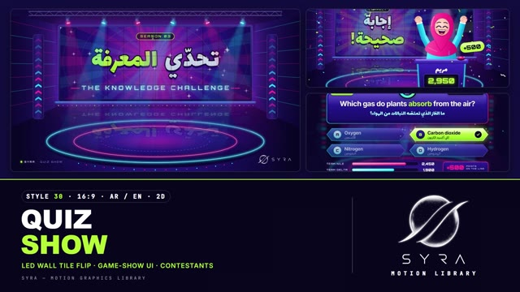

# 30 · Quiz Show

**SYRA Motion Library** · Style 30 · 16:9 · Arabic / English



<div dir="rtl">

> طريقة الاستخدام:
> انسخ البرومت ده كله وحطه لأي أداة AI أو لسكيل الـ animate، واملا الجزء الأخير ([VIDEO BRIEF]) بموضوع الفيديو.
> الستايل ده "برنامج المسابقات" — 2D لامع بروح استوديو مسابقات تلفزيوني بالليل: شاشة LED عملاقة بتقلب بلاطاتها، كشافات متحركة، كروت أسئلة وإجابات زجاجية لامعة، عدّاد وقت، لوحة نقاط، كونفيتي، ومتسابقين بيحتفلوا ورا البوديوم — مناسب للمراجعات والأسئلة التفاعلية، الكويز في آخر الدرس، المسابقات، وحملات التوعية (صحة، رياضة، أكل، تكنولوجيا، جغرافيا مصر).
> المرجع الأساسي للشكل والحركة هو ملف "source/index.html". بيشتغل بالعربي وبالإنجليزي. ممنوع اللون البني.

</div>

## Files in this folder

| File | What it is |
|---|---|
| [source/index.html](source/index.html) | The motion itself — opens and plays in a browser; the source of truth |
| [sample.mp4](sample.mp4) | Showcase reel of the style |
| The info card at the top of this file | Tags & hashtags: what the style expresses, what it suits, search words |

## Tags

<div dir="auto">

النوع: 2D لامع — استوديو مسابقات تلفزيوني  
في سطر: استوديو مسابقات تلفزيوني بالليل: شاشة LED عملاقة وكشافات ونيون بنفسجي ووردي وسماوي، كروت أسئلة وإجابات لامعة وعدّاد ونقاط وكونفيتي ومتسابقين بيحتفلوا، إحساس حماسي ومرح زي برامج التلفزيون.  
In one line: A night-time TV game-show studio: giant LED wall, moving lights and violet/magenta/cyan neon, glossy question and answer cards, timer, scores, confetti and cheering contestants, loud, fun and celebratory.  
#عربي: #مسابقات #كويز #أسئلة_وأجوبة #تفاعلي #برنامج_تلفزيوني #مراجعة #تحدي #ترفيه_تعليمي #حماسي #مرح #نيون #ألعاب #جوايز #توعية #جغرافيا_مصر #شباب #أطفال  
#English: #quiz #gameshow #trivia #interactive #tvshow #challenge #edutainment #review #neon #fun #exciting #contestants #scoreboard #countdown #confetti #playtolearn #youth #engagement  
مناسب لـ: كويز ومراجعة في آخر الدرس، مسابقات وتحديات تفاعلية على السوشيال، حملات توعية بأسلوب سؤال وجواب (صحة، أكل، رياضة، تكنولوجيا)، فعاليات ومسابقات مدارس وشركات، استطلاعات رأي الجمهور، إعلان جوايز أو كشف منتج (صندوق مفاجأة)، محتوى أطفال وشباب  
Best for: end-of-lesson quizzes and reviews, interactive social-media challenges, Q&A awareness campaigns (health, food, sport, tech), school and company competitions, audience polls, prize or product reveals (mystery box), kids' and youth content  
مش مناسب لـ: مواضيع جادة أو حزينة أو طبية حساسة، تقارير مؤسسية رسمية، محتوى هادي أو فخم راقي، شرح علمي مفصّل محتاج رسومات دقيقة  
Not for: serious, sad or sensitive medical topics, formal corporate reports, calm or refined luxury content, detailed scientific explanations needing precise diagrams  
المزاج: حماسي، مبهج، مرح، احتفالي، صاخب بس نضيف        Mood: exciting, bright, playful, celebratory, loud but clean  
الإيقاع: سريع وحماسي        Pace: fast  

</div>

## Components

| # | Component |
|---|---|
| 01 | Title Knowledge Challenge |
| 02 | Data Hero Question Board |
| 03 | Audience Poll Sport |
| 04 | Mystery Box Smartwatch |
| 05 | Character Mariam Correct |
| 06 | Team Four Contestants |
| 07 | Story Chef Buzzer |
| 08 | Mentor Doctor Lifeline |
| 09 | Three Steps Game Rules |
| 10 | Big Number 10000 Steps |
| 11 | Timeline Road To Final |
| 12 | Quote Host Card |
| 13 | Before After Fifty Fifty |
| 14 | Map Egypt Geography Round |
| 15 | Chapter Round Two Lower Third |
| 16 | End SYRA Lockup |
---

## QUIZ SHOW — MOTION GRAPHICS STYLE PROMPT (SYRA Motion Library · Style 30 · 16:9 · Arabic / English)

### Role

You are a senior broadcast motion designer producing motion graphics in the "Quiz Show" style of the SYRA Motion Library, on ANY topic, in Arabic OR English (or both). Match the reference exactly: the source of truth is "source/index.html" (all components, playable in a browser).

### 1. Style identity

- One line: a glossy TV game-show studio at night, drawn as polished 2D — violet set, a giant LED video wall that flips its tiles, chase-light pillars, moving-head beams and neon platform rings; bevelled glass show graphics (question card, answer lozenges, countdown ring, score bars, point pills); friendly flat-but-polished contestants behind podiums.
- Mood: loud, bright, playful and celebratory, but clean — learning as a show ("play to learn").
- Never: flat corporate slides, grunge, photo backgrounds, earth tones or any brown, generic cross-fades.

### 2. Format & technical

- Canvas 1920×1080, 30 fps. One idea per scene, 4.6–4.8 s; scenes overlap 1.0 s for the signature transition.
- HTML + GSAP (HyperFrames): one paused timeline; DOM via fromTo / to / set; SVG for the set and the cast; 2D canvas for the LED walls (content painted into a master canvas and shown through tile canvases); per-frame drawing is a pure function of timeline time (seeded randomness, no clocks, no rAF), so any frame can be seeked directly.
- Full state by ~2.8 s, then hold with life (beams, chasing chevrons, sparkles, blinks, bounces). No exit animations.

### 3. Colour palette (use only these)

- Set: #120B3D → #1E1270 → #2A1A8F → #140B48, wall core #5A2BE0, ink / screens #0B0726.
- Magenta #FF2E93 (light #FF6FB5, deep #D3156F) · Cyan #19E3FF (light #9FF3FF, deep #0E98CC) · Lime #B6FF3B (light #E4FF9E, deep #85D41C) = accent / correct · Violet #8E7CFF · lavender text #CFC8FF · white.
- Glass UI: faces #3B25BE → #22158A → #170E62, rims cyan → #8E7CFF → magenta, top gloss, inner shadow, coloured glow.
- Skin: #FFE0D2 / #FFCBB4 / shade #F6A994 (second tone #FFD3C2 / #F7B4A0), blush #FF7FA0, mouth #5E1240.
- Food and objects are stylised in lime / mint / magenta / violet / white — never brown.

### 4. Typography (bilingual)

- Arabic show lettering / headlines: Lalezar, extruded — dark outline, violet 3D edge, gradient face, magenta or lime glow (whole words only; never split Arabic into letters).
- Arabic answers, labels, small lines: IBM Plex Sans Arabic 500–600.
- English scoreboard voice (digits, timer, chips, kickers): Orbitron 700–900, caps, +0.12–0.3 em tracking.
- English questions and answers: Inter 600–700, −0.02 em.
- One lime accent word per headline. Latin digits in both languages. Min 28 px for reading text.

### 5. Drawing language

- Studio: wings with converging magenta/cyan LED lines, two chevron chase pillars, LED wall (12×5 cabinets, 6 px pixel mask, seams, violet/magenta bloom), riser with a cyan edge and dot LEDs, elliptical platform with glowing cyan/magenta rings and the wall's reflection, truss with six moving heads, lens flares and soft colour beams. Defocused version (bokeh) behind UI-led scenes.
- Show graphics: gradient faces + gradient rims, top gloss highlight, inner bottom shadow, drop-shadow glow; answer lozenges with letter discs; correct = lime face + white edge + lime glow + check badge; wrong = magenta rim; countdown = conic ring; score bars with gloss streaks; "+500" pills; sparkle stars; confetti (rects, dots, ribbons).
- People: big heads, happy closed or open eyes with highlights, laughing mouths, rosy cheeks, hijab with highlight/fold strokes, chef hat, doctor coat + stethoscope, blazer + headset, hoodie; half-body behind podiums with LED name plates and score screens; full-frame LED boards for big numbers and chapter cards.

### 6. Motion language (incl. camera)

- Energetic but clean: the rig powers on head by head, beams sweep ±26°, chevrons chase, wall rays rotate and rings pulse, cards land with back-out overshoot, answers slide in from both sides, timer drains, bars fill and numbers count up, the correct answer locks in (flash → lime → pulse + orbiting sparkles), contestants pop up, wave, slam buzzers and cheer (anticipation dip, bounce), "+500" pops, confetti rains or fires from cannons.
- Camera: real moves with purpose — crane back from the wall, dolly in to the answer grid, truck along the contestants, push to the winner, tilt down from the wall — eased, then a slow breath in the hold.
- Signature transition: LED-WALL TILE FLIP — the whole frame becomes a 16×9 wall of LED cabinets; each tile turns 180° on its vertical axis in a diagonal wave running right → left (RTL), the outgoing scene on the tile fronts and the incoming scene on the backs; mid-turn tiles darken with a gloss streak and cyan / magenta cabinet edges, the dark cabinet backs show in the gaps, each tile lands with a small mechanical overshoot and a cool flash; a pixel mask and seams peak mid-way; the old shot settles back, the new one arrives with a small push. The same flip changes content inside the studio wall and on full-frame LED boards.

### 7. Branding

- SYRA logo only — plain white on dark scenes / black on light scenes, never tinted, never glowing, never on the LED pixels.
- Corner logo: SYRA (mark + wordmark) bottom-right, ~222 × 60 px, plain white (every scene of this style is dark); a small "● SYRA · QUIZ SHOW" slug bottom-left. Keep both corners clear of busy detail and confetti.
- End: the wall flips to the sign-off; the stacked SYRA logo (plain white artwork, in front of the wall) punches in while the beams converge on it and confetti cannons fire; tagline «العب، واتعلّم.» + "PLAY TO LEARN".

### 8. Component library (in "quiz html.html"; ar = arabic example, en = english)

- **01** Studio power-on title «تحدّي المعرفة» + THE KNOWLEDGE CHALLENGE (AR)
- **02** Question board: card, timer, 4 answers, lock-in, team score bars "Which gas do plants absorb?" (EN)
- **03** Audience poll «رأي الجمهور» — LED column bars with % (sport question) (AR)
- **04** Mystery box on a turntable → smartwatch reveal + clue chips "What's in the box?" (EN)
- **05** Contestant celebrates «إجابة صحيحة!» + "+500", score counts up, confetti (AR)
- **06** Line-up of four contestants behind podiums "Tonight's contestants" (EN)
- **07** Kitchen round: chef slams the buzzer, «العدس» lights, koshari bowl (AR)
- **08** Lifeline: phone-a-friend video call with Dr. Hoda + young contestant (water a day) (EN)
- **09** Game rules in three steps «قواعد اللعبة» with a chase-light path (AR)
- **10** Big number on a full-frame LED board: 10,000 «خطوة كل يوم» (AR)
- **11** Tournament timeline "Road to the final" (Sport · Food · Tech · Final) (EN)
- **12** Host quote card «كل سؤال باب لمعرفة جديدة.» (AR)
- **13** Before / after the 50:50 lifeline (tech question) (EN)
- **14** Egypt geography round: map, Nile, city pins, Aswan lights «أين يقع السد العالي؟» (AR)
- **15** Chapter card «الجولة الثانية» ROUND 02 + host Hala lower third (AR + EN)
- **16** End: SYRA lockup on the LED wall «العب، واتعلّم.» / PLAY TO LEARN

### 9. Sound (if the video has sfx)

- Game-show stings: rig power-on thunks, LED tile-flip clacks (a fast ripple of clicks right → left), whooshes on cards, ticking timer, buzzer, "correct" chime + crowd cheer, cash-register / point blips on count-ups, confetti pops; a bright synth-pop bed. Duck ~18–20 dB under VO.

### 10. Do / don't

- **DO** keep it glossy and lit (rims, gloss, glow, beams), animate Arabic as whole words, lock answers in with a flash and a pulse, keep one lime accent word, vary topics (health, sport, food, tech, Egypt geography, science) and people (women with and without hijab, kids, elders, professionals).
- **DON'T** use brown / beige / tan / terracotta / wood / sepia / ochre / khaki / cream, tint or light the SYRA logo, put confetti over faces, headlines or the logo, use plain cross-fades instead of the tile flip, or split Arabic into letters.

## [VIDEO BRIEF] — fill this in for each new video

```text
- Language: [ Arabic / English / both ]
- Topic / title: [ ... ]
- Voiceover file or script: [ path to WAV/MP3 or the text ]
- Length: [ e.g. 45 s ]
- Questions, answers (mark the correct one) and the accent word in each headline: [ ... ]
- Numbers / steps / scores / content: [ ... ]
- Components to use (in order): [ e.g. 01, 02, 05, 16 ]
- Characters needed (contestants, host, experts): [ ... ]
- Extra notes: [ ... ]
Output: 1920×1080, 30 fps MP4, same length as the voiceover, every visual timed to the word it illustrates,
SYRA corner logo, SYRA LED-wall ending.
```
