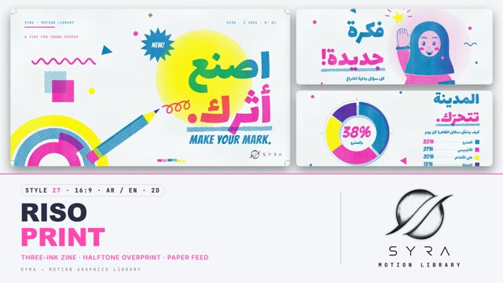

# 27 · Risograph Print

**SYRA Motion Library** · Style 27 · 16:9 · Arabic / English



<div dir="rtl">

> طريقة الاستخدام:
> انسخ البرومت ده كله وحطه لأي أداة AI أو لسكيل الـ animate، واملا الجزء الأخير ([VIDEO BRIEF]) بموضوع الفيديو.
> الستايل ده "طباعة الريزو" — 2D: كل كادر مطبوع بالحبر قدامك زي مجلات الزين: ٣ أحبار بس (وردي فسفوري، أزرق، أصفر) على ورق أبيض بارد،
> نقط هافتون، ألوان بتتطبع فوق بعض فتطلع بنفسجي وأخضر وأحمر برتقاني، وحبر مزحزح شوية عن مكانه. مناسب للمبادرات المجتمعية،
> الشباب، الصحة، المدينة، المشاريع الصغيرة، والقصص الخفيفة المبهجة.
> المرجع الأساسي للشكل والحركة هو ملف "source/index.html". بيشتغل بالعربي وبالإنجليزي. ممنوع اللون البني.

</div>

## Files in this folder

| File | What it is |
|---|---|
| [source/index.html](source/index.html) | The motion itself — opens and plays in a browser; the source of truth |
| [sample.mp4](sample.mp4) | Showcase reel of the style |
| The info card at the top of this file | Tags & hashtags: what the style expresses, what it suits, search words |

## Tags

<div dir="auto">

النوع: 2D — طباعة ورق (هافتون) بتلات أحبار  
في سطر: كل كادر شكله مطبوع بالحبر زي مجلات الزين: وردي فسفوري وأزرق وأصفر على ورق أبيض، نقط هافتون وألوان راكبة على بعض وحبر مزحزح، إحساس شبابي مبهج ومعمول باليد.  
In one line: Every frame looks freshly printed like a zine: fluorescent pink, blue and yellow on white paper, halftone dots, overprint colours and slightly off-register ink, youthful, cheerful and hand-made.  
#عربي: #ريزو #طباعة #هافتون #زين #مجلة #شباب #مبادرات_مجتمعية #مشاريع_صغيرة #صحة #مدينة #مبهج #ملون #فسفوري #بوستر #ريترو #قصص_خفيفة #إنفوجرافيك #توعية  
#English: #risograph #riso #print #halftone #zine #poster #youth #community #smallbusiness #health #city #colourful #fluorescent #pink #retro #handmade #lofi #awareness  
مناسب لـ: حملات توعية ومبادرات مجتمعية، محتوى للشباب والجامعات، مشاريع صغيرة ومحلات وإعلانات محلية، نصايح صحة ولايف ستايل، قصص خفيفة عن الناس والمدينة، إنفوجرافيك أرقام بشكل مرح، فعاليات وورش وبوسترات  
Best for: awareness campaigns and community initiatives, youth and university content, small shops and local ads, health and lifestyle tips, light stories about people and the city, playful number infographics, events, workshops and posters  
مش مناسب لـ: شركات رسمية وبنوك محتاجة رصانة، طب جاد أو أخبار حزينة، تقنية مستقبلية أو منتجات فخمة لامعة، أي حاجة محتاجة 3D أو صور حقيقية  
Not for: formal corporate or banking content, serious medical or sad news, futuristic tech or glossy luxury products, anything needing 3D or real photos  
المزاج: حيوي، مبهج، متفائل، معمول باليد، شبابي        Mood: energetic, cheerful, optimistic, hand-made, youthful  
الإيقاع: متوسط لسريع (حركة على اتنين، نطّ ودروب)        Pace: medium-fast  

</div>

## Components

| # | Component |
|---|---|
| 01 | Title Make Your Mark |
| 02 | Data Hands On |
| 03 | Data Donut Cairo |
| 04 | Product Phone Shop |
| 05 | Idea Girl Star |
| 06 | Team Portrait Cards |
| 07 | Farmer Seedling Story |
| 08 | Mentor Grandfather App |
| 09 | Three Steps Health |
| 10 | Big Number Nile |
| 11 | Timeline Cairo Day |
| 12 | Quote Flood |
| 13 | Before After Shore |
| 14 | Map Egypt Nile |
| 15 | Chapter Lower Third |
| 16 | End SYRA Lockup |
---

## RISOGRAPH PRINT — MOTION GRAPHICS STYLE PROMPT (SYRA Motion Library · Style 27 · 16:9 · Arabic / English)

### Role

You are a senior motion designer producing motion graphics in the "Risograph Print" style of the SYRA Motion Library, on ANY topic, in Arabic OR English (or both). Match the reference exactly: the source of truth is "source/index.html" (all components, playable in a browser).

### 1. Style identity

- One line: a two- and three-colour risograph zine printed live on cool white paper — flat cut-paper shapes, round-dot halftones, real overprint colours where inks cross, drums slightly out of register, grain, drum streaks and missing-ink speckles; printer's marks (crop marks, registration target, colour bar, issue numbers) are part of the layout.
- Mood: energetic, hand-made, optimistic, community zine — "printed in a hurry, full of energy".
- Never: gradients that are not halftone, glossy/3D shading, blend-mode colour, photographic textures, brown/beige paper.

### 2. Format & technical

- Canvas 1920×1080, 30 fps. One idea per scene, 4.6–4.8 s; scenes overlap 0.7 s for the signature transition.
- Rendering: ONE 2D canvas "press" for the whole film (HTML + GSAP / HyperFrames): artwork is painted into three ink separations, screened (pink 15°, blue 75°, yellow 45°, 9–10 px cells), misregistered and combined with an explicit overprint table (Neugebauer primaries) on paper. No CSS blend modes. One paused timeline, deterministic (seeded noise), every value a pure function of time; prints on twos (12 fps), on ones during transitions. Full state by ~2.8 s, then hold with life (registration jitter, bobbing, blinking, slow turns).

### 3. Colour palette (use only these)

- Paper cool white #F4F5F7 (fibres ±2 %) · Fluorescent Pink #FF48B0 · Blue #0078BF · Yellow #FFE800.
- Overprints (printed, never picked): violet #6036A8 (pink+blue) · orange-red #FF5634 (pink+yellow) · green #00965C (blue+yellow) · deep ink #342268 (all three).
- Solids = 1, tints = halftone 15–75 %. Skin = pink 30 % (rose) / + yellow 16 % (peach) / pink 50 % (deep). Hair deep ink or grey = blue 32 %. Flood sheets: pink+blue (violet) with paper-white knocked-out type, paper margin all round.

### 4. Typography (bilingual)

- Arabic display: Lalezar (fat flat-cut poster face), RTL, drawn whole — never split into letters. Avoid words ending in ي in Lalezar (it prints a dotless final yaa); ى words are fine.
- English display: Bangers, caps, +2–4 px tracking. Print furniture & labels: JetBrains Mono 500, caps, tracked.
- One accent word per headline in pink, printed as the "second pass" with a cut halftone underline. Latin digits.
- Reading text ≥ 28 px and always solid ink (never a tint); 22 px mono only for furniture (kicker, issue no., ticks).

### 5. Drawing language

- Flat cut-paper shapes with seeded, slightly rough edges; halftone discs/suns behind heroes; halftone drop shadows offset ~20 px; tape strips; starbursts with a word; squiggles, confetti dots, triangles; rainbow arc bands.
- Knock-out vs overprint chosen per shape: overprint for magic overlaps (blue type over the yellow sun prints green), knock-out for faces and reading text.
- Data: halftone bars that sweep and count, donut segments cut in clockwise, big numbers with a blue halftone shadow, dashed gridlines and mono labels, "ILLUSTRATIVE" note on invented numbers.
- People: front-facing cut-paper busts with a 5 px blue key line, halftone skin, blue eyes with paper catch-lights, overprinted pink blush, open smile with a pink tongue; hijab (with violet overprint shading), curly/long/short hair, grey tufts, white beard, hats (hard hat, straw hat, cap, chef), glasses, coat, apron, hi-vis vest, mitten hands.
- Maps: halftone land with a blue key line, the Nile knocked out in solid blue, pink teardrop pins, paper label tabs.

### 6. Motion language

- Everything on twos (12 fps). Each sheet arrives already printed with its background and first headline word; then the "second pass" builds: accent words drop ~60–90 px with a soft overshoot, underlines wipe in (right-to-left for Arabic), shapes cut in with back-out, bars sweep, numbers count, stickers pop and turn, cards drop with a tilt and print out of register before snapping in, mono labels type on.
- Characters: 4 px head bob, small gestures (wave ±0.07 rad, raise, point, hold), blinks as closed-eye arcs.
- Constant heartbeat: per-drum registration jitter of ±1 px on twos; occasional "press hiccup" (an ink slips 7 px and snaps).
- Signature transition — PAPER FEED: the current sheet is pulled off the top (drifting right, its pink/yellow drums dragging behind); the next sheet feeds in from the bottom right under it, a printed shadow ramp and feed line on its leading edge, its drums out of register (up to ±26 px per ink, blue leading, re-jittering on twos); it lands at ~0.5 s, bumps the stop, one last 3 px jitter, and snaps into register.

### 7. Branding

- SYRA logo only — plain black on paper scenes / plain white on flood (dark) scenes, never tinted, never printed in ink, never with halftone or misregistration on it (it is a clean overlay on top of the print).
- Corner logo: SYRA (mark + wordmark) bottom-right, 222×60 px, 58 px from the right, 50 px from the bottom, on clean paper; it switches colour when the next sheet passes under it.
- End: the stacked SYRA logo alone, plain black, revealed by a pink roller pass inside a crop-marked plate with registration targets; tagline «كل أثر يبدأ بفكرة.» / "EVERY MARK STARTS WITH AN IDEA."; no corner logo.

### 8. Component library (in "riso html.html"; ar = arabic example, en = english)

- **01** Poster title over a halftone sun «اصنع أثرك.» + MAKE YOUR MARK. (AR)
- **02** Big 3× + halftone bars "HANDS-ON WINS." (EN)
- **03** Halftone donut + legend «المدينة تتحرّك.» (AR)
- **04** Phone shop card + orbiting stickers "SELL IT LOCAL." (EN)
- **05** Girl in hijab reaches for a star «فكرة جديدة!» (AR)
- **06** Four taped portrait cards "MEET THE CREW." (EN)
- **07** Farmer waters a seedling → sunflower «ازرع، تحصد.» (AR)
- **08** Granddaughter shows grandfather an app "NEVER TOO LATE." (EN)
- **09** Three printed step cards «ثلاث خطوات لصحتك.» (AR)
- **10** Big number 6,650 KM + Nile ribbon «رحلة النيل.» (AR)
- **11** Five-stop day timeline "ONE DAY IN CAIRO." (EN)
- **12** Violet flood quote «قليل دائم خير من كثير منقطع» (AR)
- **13** Roller re-prints 1-ink BEFORE → 3-ink AFTER "CLEANER SHORES." (EN)
- **14** Halftone map of Egypt «على ضفاف النيل.» (AR)
- **15** Chapter card 03 «ناس البحر.» + lower third (AR+EN)
- **16** End SYRA lockup off the press (AR + EN)

### 9. Sound (if the video has sfx)

- Riso drum whirr and paper-feed swoosh on each transition with a soft "thunk" as the sheet lands, light stamp/clack on drops, paper rustle, pencil scribble; a bright lo-fi indie bed (claps, plucky synths). Duck ~18–20 dB under VO.

### 10. Do / don't

- **DO** print everything in the 3 inks (overlaps only by overprint), keep halftones visible, keep the registration jitter, arrive with the sheet already printed then build a second pass, one pink accent word, printer's marks in the margin.
- **DON'T** use brown/beige/tan/cream/sepia/ochre (not even in skin, hair, soil or hats), smooth gradients, glow or 3D shading, tinted logos, reading text as a halftone, Lalezar words ending in ي, or frozen holds.

## [VIDEO BRIEF] — fill this in for each new video

```text
- Language: [ Arabic / English / both ]
- Topic / title: [ ... ]
- Voiceover file or script: [ path to WAV/MP3 or the text ]
- Length: [ e.g. 45 s ]
- Headlines and the accent word in each: [ ... ]
- Numbers / steps / content: [ ... ]
- Components to use (in order): [ e.g. 01, 05, 09, 16 ]
- Characters needed: [ ... ]
- Extra notes: [ ... ]
Output: 1920×1080, 30 fps MP4, same length as the voiceover, every visual timed to the word it illustrates,
SYRA corner logo, SYRA lockup ending.
```
