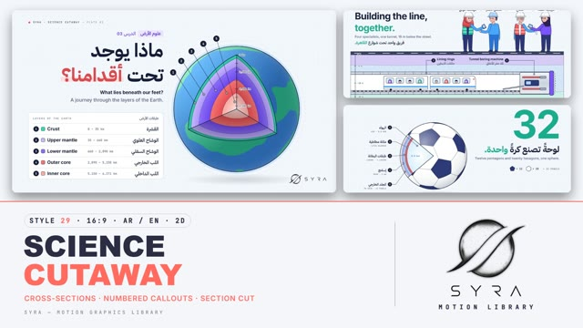

# 29 · Science Cutaway

**SYRA Motion Library** · Style 29 · 16:9 · Arabic / English



<div dir="rtl">

> طريقة الاستخدام:
> انسخ البرومت ده كله وحطه لأي أداة AI أو لسكيل الـ animate، واملا الجزء الأخير ([VIDEO BRIEF]) بموضوع الفيديو.
> الستايل ده "المقطع العلمي" (Science Cutaway) — رسم 2D بجودة الكتب العلمية: الأشياء بتتقطع ونشوف اللي جوّاها، وعليها أرقام وخطوط إشارة وأسماء بالعربي والإنجليزي، على ورقة فاتحة باردة فيها نقط خفيفة. الرسم بيترسم قدامك (الخطوط الأول وبعدين الألوان) — مناسب للعلوم، الصحة، التكنولوجيا، الهندسة، الأكل، البيئة، والمدينة: أي موضوع محتاج "نوري اللي جوّه".
> المرجع الأساسي للشكل والحركة هو ملف "source/index.html". بيشتغل بالعربي وبالإنجليزي. ممنوع اللون البني.

</div>

## Files in this folder

| File | What it is |
|---|---|
| [source/index.html](source/index.html) | The motion itself — opens and plays in a browser; the source of truth |
| [sample.mp4](sample.mp4) | Showcase reel of the style |
| The info card at the top of this file | Tags & hashtags: what the style expresses, what it suits, search words |

## Tags

<div dir="auto">

النوع: 2D فيكتور — رسم قطاعات بجودة الكتب العلمية  
في سطر: الحاجات بتتقطع نصين ونشوف اللي جوّاها، بأرقام وخطوط إشارة وأسماء بالعربي والإنجليزي على ورقة فاتحة بنقط خفيفة، إحساس كتاب علوم حديث أو لوحة متحف: واضح وفضولي ودقيق.  
In one line: Objects sliced open to show their insides, with numbered callouts and bilingual labels on a cool light dotted sheet, like a modern textbook or museum panel: clear, curious and precise.  
#عربي: #علوم #مقطع_عرضي #إزاي_بيشتغل #شرح #تعليمي #هندسة #ميكانيكا #طاقة_شمسية #جسم_الإنسان #صحة #تكنولوجيا #بيئة #مدينة #إنفوجرافيك #كتاب_علوم #متحف #أجزاء  
#English: #science #cutaway #crosssection #howitworks #explainer #education #engineering #mechanics #solarenergy #anatomy #health #technology #environment #infographic #textbook #museum #diagram #labels  
مناسب لـ: شرح "إيه اللي جوّه" وإزاي الحاجة بتشتغل (موتور، لوح شمسي، موبايل، بيت)، دروس علوم وجغرافيا للمدارس والجامعات، توعية صحية مبسطة (القلب، الخلية)، مشاريع هندسة ومدن وبنية تحتية (مترو، مياه)، شرح منتج تقني بأجزائه، محتوى بيئي وطبيعة، متاحف ومعارض علمية  
Best for: "what's inside / how it works" explainers (engine, solar panel, phone, house), school and university science and geography, simple health explainers (heart, cell), engineering, city and infrastructure projects (metro, water), product teardown explainers, nature and environment, science museums and exhibitions  
مش مناسب لـ: إعلانات حماسية أو ترفيه، محتوى عاطفي أو قصص درامية، فخامة ولمعان أو 3D، طب متخصص محتاج تشريح 3D واقعي (استخدم Medical Anatomy 3D)  
Not for: hype ads or entertainment, emotional or dramatic stories, glossy luxury or 3D looks, specialist medicine that needs realistic 3D anatomy (use Medical Anatomy 3D)  
المزاج: واضح، فضولي، دقيق، ودود، علمي        Mood: clear, curious, precise, friendly, scientific  
الإيقاع: هادي لمتوسط (رسم الخطوط ثم الألوان ثم الإشارات واحدة واحدة)        Pace: calm to medium  

</div>

## Components

| # | Component |
|---|---|
| 01 | Title Earth Layers |
| 02 | Inside a Solar Panel |
| 03 | Solar Home Energy Chart |
| 04 | Engine Four Strokes |
| 05 | Student Plant Cell |
| 06 | Metro Tunnel Team |
| 07 | Baker Oven Bread Pocket |
| 08 | Doctor Heart Lesson |
| 09 | Three Steps Water Tower |
| 10 | Big Number 32 Football |
| 11 | Sea Turtle Timeline |
| 12 | Fisherman Quote Night Plate |
| 13 | Phone Battery Before After |
| 14 | Egypt Map Nile Section |
| 15 | Chapter 03 Lower Third |
| 16 | End SYRA Lockup |
---

## SCIENCE CUTAWAY — MOTION GRAPHICS STYLE PROMPT (SYRA Motion Library · Style 29 · 16:9 · Arabic / English · 2D)

### Role

You are a senior motion designer producing motion graphics in the "Science Cutaway" style of the SYRA Motion Library, on ANY topic, in Arabic OR English (or both). Match the reference exactly: the source of truth is "source/index.html" (all components, playable in a browser; arrow keys seek).

### 1. Style identity

- One line: a modern textbook / museum-panel cross-section — objects are sliced open to show what is inside, with numbered callouts on thin leader lines, bilingual labels and small key cards, on a cool light sheet with a faint dot grid; flat vector with soft gradients and precise ink strokes; cut faces show wall thickness and hatching.
- Mood: clear, curious, precise and friendly — "see what is inside".
- Subjects: anything that has an inside — the Earth, a cell, a solar panel, a house, an engine, a phone, the heart, a water tower, a football, a sea turtle, a fish, an oven and its bread, a metro tunnel, a map with a section.
- Never: photo textures, glossy 3D, clutter without labels, cream / sepia "old paper", or any earth tone.

### 2. Format & technical

- Canvas 1920×1080, 30 fps. One idea per plate, 4.6 s; plates overlap 0.8 s for the signature transition.
- 2D SVG (+ canvas only where a ray-cast is needed) inside HTML + GSAP (HyperFrames): one paused timeline driving one pure draw(t) per scene — every frame is a function of time, seeded randomness, no timers. A direct seek must show the right frame.
- Grid: 96 px margins; header kicker at (96, 64) "● SYRA · SCIENCE CUTAWAY — PLATE NN"; callout rows on a fixed pitch; keep the bottom-right logo corner (x > 1640, y > 930) clear.

### 3. Colour palette (use only these)

- Sheet #F3F6FA with dot grid #C9D3E2 · night plate #131B31 (dots #2A3657) for one quote/rhythm plate.
- Ink #16203A · secondary ink #56627F · rules #C5CFDD.
- Four coding colours: violet #7B61FF (#B4A5FF / #5A3FE0) · coral #FF6B5E (#FFA597 / #E2483F) · sky #3FA2FF (#A9D6FF / #1E73E0) · teal #14B3A3 (#86E3D2 / #0B8C82). Tints for pills and highlighters: #ECE8FF #FFE1DD #E1EFFF #DDF6F1.
- Green #2BC48A only for living plants; yellow #FFC93C only for light and energy.
- Skin rosy peach #FFC4B0 (shade #F4A28E, blush #FF8FA3); hair ink-navy #2A2452 or cool grey #C9D2E0 for elders.
- Accent text tones (AA on the sheet): coral #E9584C · teal #0E9C8E · violet #6E52F5 · sky #1E73E0.

### 4. Typography (bilingual)

- Arabic: IBM Plex Sans Arabic — 700 headlines (80–112 px), 600 labels and sub lines.
- English: Inter — 700 headlines (80–84 px, −0.025em), 500 body (27–28 px).
- Data: JetBrains Mono 500 — numbers, units, kickers, legend headers, mono sub-labels under callout names.
- ONE accent word per headline, in a coding colour, with a soft highlighter bar under Arabic accents.
- Overline pills (subject · context): Arabic in Plex 600 on a tint, English in tracked mono caps.
- Latin digits in both languages. Min 28 px for reading text (callout names 26–30 px). Never split Arabic into letters — animate whole lines or words through masks with headroom for dots and hamzas.

### 5. Drawing language

- Ink outlines 2.6–3.2 px on objects, 1.3 px (≈55 %) on internal boundaries; flat fills with soft linear/radial gradients.
- Cut faces always read as sections: wall thickness as a band, 45° hatching on cut material, a coloured membrane or edge line, and the cross-sections of whatever the plane passes through.
- Views: iso exploded stacks, front sections, longitudinal sections, pie-wedge cut spheres, plan + "SECTION A–A" pairs, ground blocks with strata (lavender / sky / teal bands, never brown).
- Callouts: anchor = white ring + ink dot, 1.7 px leader with an elbow, 34 px ink badge with a mono number, label = name (EN bold or AR 600) + mono sub-label; sort by height so leaders never cross. Key cards: white, rounded, mono header.
- Data: bar charts, line overlays, gauges, big numbers, timelines with nodes and small icons, ECG traces, scale bars, dimension lines with arrowheads.
- People: flat vector, ink outlines, 3/4 face looking left (mirrored for right), big glossy eyes with two catch-lights, small nose, open smile, blush; double-stroke limbs; hijab with a lighter inner frame and a cheek fold. Modern Egyptian cast: students, engineer in hijab with hard hat, TBM operator, older surveyor, programmer, baker, doctor, kid, grandmother, fisherman.

### 6. Motion language + signature transition

- Build like a textbook being drawn: strokes draw on first, then fills fade in, then callouts tick in one by one (anchor clicks, leader draws, badge pops with a small overshoot, label slides). Headlines rise out of masks; accent highlighter wipes in.
- Exploded views breathe from a compact stack to their spacing; sections fan open; wedges lift out as dashed ghosts.
- Holds that breathe: processes loop (photons, electrons, blood flow chevrons, water in pipes, piston cycle, heartbeat, turning globe/ball, swimming flippers), characters blink, tilt, talk. Calm easeOut pacing; back-overshoot only on pops.
- Signature transition — SECTION CUT (0.8 s): a textbook cutting-plane line (long-dash-dot ink, thick end stubs, view arrows, "A" letters and a "SECTION A–A" tag) rules diagonally across the plate over a faint violet plane; the plate is cut along it and the two halves part ~44 px, each edge showing a hatched section face; the next plate shows through the gap, already drawing on; then the halves slide off along the plane normal and leave the frame. No fades.

### 7. Branding

- SYRA logo only — plain black on light plates, plain white on the night plate; never tinted, never cut permanently.
- Corner logo: SYRA (mark + wordmark) bottom-right, 222×60, 58 px from the right, 50 px from the bottom.
- End: the SYRA stacked logo alone on a specimen plate (crop marks, "PLATE 16 · SYRA", "1 : 1", width dimension); it arrives as two halves along a section line A–A and closes into one whole, plain mark; one callout "Made to explain / صُنع ليشرح"; tagline «نُريك ما بداخل الأشياء.» / "We show you what is inside."

### 8. Component library (in "cutaway html.html"; ar = arabic example, en = english)

- **01** Earth with one octant cut away + key card «ماذا يوجد تحت أقدامنا؟» (AR)
- **02** Exploded solar panel, photons, electrons, lamp lights "Inside a solar panel." (EN)
- **03** House in section with solar roof, battery, family + monthly bar/line chart «بيتٌ يصنع طاقته.» (AR)
- **04** Car engine section, live 4-stroke cycle, stroke pills "How an engine breathes." (EN)
- **05** Student in hijab, plant-cell model, magnifier zoom «عالمٌ كاملٌ داخل خلية.» (AR)
- **06** Team of four above a metro tunnel section (TBM, train, strata) "Building the line, together." (EN)
- **07** Baker and his oven in section, bread puffing with a steam pocket «لماذا ينتفخ الرغيف؟» (AR)
- **08** Doctor explains the heart to a boy, blood-flow chevrons, ECG card "Every beat, explained." (EN)
- **09** Three steps: Nile pump → water tower → grandmother at the tap «ثلاث خطوات إلى صنبورك.» (AR)
- **10** Big number 32 + football with a fanned section wedge «لوحةً تصنع كرةً واحدة.» (AR)
- **11** Sea turtle in section + life timeline "A turtle's long journey." (EN)
- **12** Night plate quote, fish specimen card, fisherman portrait «حين ترى ما بداخل السمكة…» (AR)
- **13** Phone battery before / after with section A–A strips "Same phone. New life." (EN)
- **14** Egypt plan + section A–A across the Nile at Luxor «وادٍ أخضر وسط الصحراء.» (AR)
- **15** Chapter card — a sectioned "03" + contents + doctor lower third «جسم الإنسان» / "The human body" (AR+EN)
- **16** End SYRA specimen plate (AR + EN)

### 9. Sound (if the video has sfx)

- Pencil / pen scratches on draw-ons, soft clicks on callout badges, a paper slice + slide whoosh on the Section Cut, light pizzicato / marimba and a calm electronic bed. Duck ~18–20 dB under VO.

### 10. Do / don't

- **DO** cut things open and label them, hatch every cut face, keep leaders straight and uncrossed, draw strokes before fills, one accent word, keep the cool sheet and the four coding colours, keep the logo corner clear.
- **DON'T** use brown/beige/tan/terracotta/wood/sepia/ochre/khaki/cream (not in bread, soil, skin, hair or shadows), photo textures, generic fades, crossing leaders, unlabeled parts, or more than one accent word per headline.

## [VIDEO BRIEF] — fill this in for each new video

```text
- Language: [ Arabic / English / both ]
- Topic / title: [ ... ]
- Voiceover file or script: [ path to WAV/MP3 or the text ]
- Length: [ e.g. 45 s ]
- Headlines and the accent word in each: [ ... ]
- What is cut open in each plate, and its labelled parts: [ ... ]
- Numbers / steps / content: [ ... ]
- Components to use (in order): [ e.g. 01, 04, 09, 16 ]
- Characters needed: [ ... ]
- Extra notes: [ ... ]
Output: 1920×1080, 30 fps MP4, same length as the voiceover, every visual timed to the word it illustrates,
SYRA corner logo, SYRA specimen-plate ending.
```
