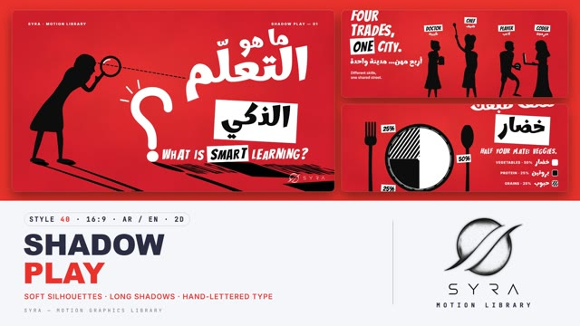

# 40 · Shadow Play

**SYRA Motion Library** · Style 40 · 16:9 · Arabic / English



<div dir="rtl">

> طريقة الاستخدام:
> انسخ البرومت ده كله وحطه لأي أداة AI أو لسكيل الـ animate، واملا الجزء الأخير ([VIDEO BRIEF]) بموضوع الفيديو.
> الستايل ده "مسرح الظل" (Shadow Play) — 2D: شخصيات سوداء ناعمة (خطوط منحنية بس، من غير زوايا حادة) واقفة على أرضية حمرا قوية، وكل حاجة واقفة على الأرض — الناس والحاجات والكلام نفسه — بترمي ظل طويل مايل. الكلام مكتوب بخط يد: العربي بخط "مرهِف" بكلمات كاملة مايلة وكلمة واحدة في بوكس أبيض، والإنجليزي حروفه بتنط.
> مناسب للحكايات والقصص القصيرة، فيديوهات التوعية (صحة، رياضة، بيئة، حياة المدينة)، الإعلانات الخفيفة، والشرح اللي محتاج إحساس درامي ومرِح في نفس الوقت. فيه أرضية زرقا (كوبالت) للبيانات والدروس.
> الانتقال المميز إن الظلال بتطول لحد ما تبلع الكادر كله، والمشهد الجديد بيبدأ وظلاله بترجع لأصحابها ("Shadow Swallow")، والبديل إن شخص عملاق يعدّي قدام الكاميرا ("Passer-by").
> المرجع الأساسي للشكل والحركة هو ملف "source/index.html". بيشتغل بالعربي وبالإنجليزي. ممنوع اللون البني.

</div>

## Files in this folder

| File | What it is |
|---|---|
| [source/index.html](source/index.html) | The motion itself — opens and plays in a browser; the source of truth |
| [sample.mp4](sample.mp4) | Showcase reel of the style |
| The info card at the top of this file | Tags & hashtags: what the style expresses, what it suits, search words |

## Tags

<div dir="auto">

النوع: 2D — سيلويت أسود على لون واحد قوي  
في سطر: شخصيات سودا ناعمة من غير ملامح على أرضية حمرا نارية، كل حاجة بترمي ظل طويل مايل، وكلام بخط يد أبيض وكلمة في بوكس — درامي ومرح زي مسرح خيال الظل.  
In one line: Smooth black silhouettes on a bold red field, every grounded thing casting a long raking shadow, with bouncy hand-lettered black-and-white type.  
#عربي: #خيال_الظل #سيلويت #حكايات #قصص_قصيرة #توعية #أمثال_شعبية #صحة #رياضة #بيئة #حياة_المدينة #إعلان_خفيف #تحفيز #درامي #مرح #أحمر #خط_يد #بيانات_بسيطة  
#English: #shadowplay #silhouette #storytelling #shortstory #awareness #proverbs #health #sport #environment #citylife #motivation #dramatic #playful #boldred #handlettering #2d #minimal  
مناسب لـ: حكايات وأمثال شعبية وحِكم، فيديوهات توعية (صحة، أكل صحي، رياضة، بيئة، حياة المدينة)، رسايل تحفيزية، إعلانات خفيفة جريئة، شرح بإحساس درامي ومرح، سوشيال ميديا لافتة للنظر، أرقام وخطوات بسيطة (على أرضية زرقا)  
Best for: folk tales, proverbs and sayings, awareness videos (health, healthy food, sport, environment, city life), motivational messages, bold light ads, dramatic-yet-playful explainers, eye-catching social posts, simple numbers and steps (cobalt variant)  
مش مناسب لـ: بيانات كتير أو تقارير شركات بجداول، محتوى محتاج وشوش وتعبيرات (السيلويت من غير ملامح)، مواضيع طبية حساسة محتاجة هدوء، أي حاجة محتاجة ألوان كتير أو صور حقيقية  
Not for: dense data or corporate reports, anything needing faces and expressions (silhouettes have no features), sensitive calm medical topics, multi-colour or real-photo content  
المزاج: درامي، مسرحي، مرح، جريء، دافي        Mood: dramatic, theatrical, playful, bold, warm  
الإيقاع: متوسط إلى سريع        Pace: medium to fast  

</div>

## Components

| # | Component |
|---|---|
| 01 | Title Smart Learning |
| 02 | Data Small Steps |
| 03 | Data Half Your Plate |
| 04 | Object Delivered |
| 05 | Character Knowledge Is Light |
| 06 | Team Four Trades |
| 07 | Story Fisherman |
| 08 | Mentor Football Coach |
| 09 | Three Steps Seed To Harvest |
| 10 | Big Number 10000 Steps |
| 11 | Timeline One Day |
| 12 | Quote Proverb |
| 13 | Before After Street |
| 14 | Map Egypt Nile |
| 15 | Chapter Lower Third |
| 16 | End SYRA Lockup |
---

## SHADOW PLAY — MOTION GRAPHICS STYLE PROMPT (SYRA Motion Library · Style 40 · 16:9 · Arabic / English)

### Role

You are a senior motion designer producing motion graphics in the "Shadow Play" style of the SYRA Motion Library, on ANY topic, in Arabic OR English (or both). Match the reference exactly: the source of truth is "source/index.html" (all
- **16** components, playable in a browser; arrow keys seek).

### 1. Style identity

- One line: soft pure-black silhouettes on a saturated warm-red field, every grounded thing throwing a long raking shadow in perspective, with bold hand-lettered black-and-white type.
- Mood: dramatic, warm, playful, theatrical — a modern shadow-puppet theatre of everyday Egyptian life.
- Composition: a ground line at y 820–950; figures, props and some words STAND on it; their shadows stream across the floor (usually down-left so the logo corner stays clean). Arabic headlines flush right, English lines flush left.
- Never: outlines on figures, faces/eyes inside silhouettes, polygon or sharp-cornered figures, gradients on figures, more than the two field colours, shadows that don't follow their owners.

### 2. Format & technical

- Canvas 1920×1080, 30 fps. One idea per scene, 4.6–4.8 s; scenes overlap 1.0 s for the signature transition.
- HTML + SVG + GSAP (HyperFrames): one paused timeline, deterministic (seeded randomness, no Math.random/Date/rAF), any frame reachable by a direct seek.
- The cast-shadow recipe: everything that stands on the ground lives in one "stage plane" built twice — the lit copy, and a black copy (brightness 0) projected onto the floor with a CSS matrix3d collineation that keeps the ground line fixed (a point at height h lands at x + kx·h, G + ky·h; tips swell toward the viewer by 1/(1 − persp·h/G)). One tween drives both copies, so every pop, step and wave animates its own shadow. Light per scene: |kx| 1.7–2.7, ky 0.6–1.2, persp 0.3; let it drift slightly during holds. Floating labels never cast.

### 3. Colour palette (use only these)

- Red field: radial #FF4632 (centre) → #E8322B (edge) — pure warm red, never orange-brown.
- Cobalt field (data / lesson scenes only, never in the same frame as red): #3560FF → #1A3BCB.
- Silhouettes and shadows #0D0D0D · type, boxes, flames, rays, water strokes #FFFFFF.
- Texture: soft black fractal mottle 22 % + fine grain 10 % over the field. Light glows: white radial 55 % → 0.

### 4. Typography (bilingual)

- Arabic: Marhey 700 (hand-lettered, bouncy). Whole words only — never split into letters. Words tilt −6°…+3°, mixed sizes (50–270 px), one accent word in a white box (padding .02em .22em .22em so the dots of ي stay inside).
- English: Bangers, letters split with seeded bounce (±10 px baseline, ±5°, 0.86–1.12× size); one word in a white box.
- Furniture: Inter 800 caps, tracked +0.24 em, 20 px kickers; Inter 600 30 px reading lines; Inter 800 26–28 px labels.
- Latin digits always (Bangers for big numbers). Min 28 px for reading text.

### 5. Drawing language — smooth silhouettes only

- Every figure is built from cubic béziers only: limbs are Catmull-Rom centrelines through hip-knee-ankle / shoulder-elbow-wrist, offset by a tapering width with a soft muscle swell and round caps (soft knees and elbows, never mitred); torsos, garments and hair are closed Catmull-Rom blobs; heads are cubic profiles (forehead, nose, lips, chin); hands are rounded mittens with a thumb; shoes are soft flats. All #0D0D0D with a 3 px round-join stroke so overlapping parts melt into one shape. NO polygons, no straight-edged limbs, no sharp corners on any figure.
- Read comes from proportion (small heads, long legs), clear profiles and props that break the outline.
- Cast: women with and without hijab (hijab with cape, bun, ponytail, long hair), men young and older (imma, galabeya, grey beard, flat cap), kids (curly hair, ponytail, backpack); doctor (lab coat + clipboard), chef (toque + apron + ladle), footballer (jersey, shorts, ball), coder (laptop with glowing screen edge), delivery rider (helmet, scooter, box), fisherman, felucca captain, coach.
- Props: soft rounded shapes — oil lamp with white flame and rays, books, plate pie chart, giant fork and spoon, phone, scooter, goal and net, plinths, plants, watering can, trees with cloud canopies, bench, lamp posts, felucca, Egypt map as a standing cut-out sign (its shadow is Egypt), quotation marks, the SYRA logo itself.
- White details only: type, boxes, flames, rays, sparks, water strokes, screen glows, seams.

### 6. Motion language (incl. camera)

- Words pop with back.out(2–2.6): drop or rise 60–90 px from 30–50 % scale with a 14–20° counter-rotation. Latin letters cascade at 12–16 ms. Boxes wipe open on scaleX before their letters land. Strokes draw on (؟, underlines, rivers, quotation marks).
- Objects stand up from the ground (scaleY from the base, back-out) so their shadows grow with them; things drop in with a bounce; a plate rolls in like a wheel; a scooter brakes (lean back, overshoot, settle).
- Characters move continuously and smoothly: walk / run cycles, anticipation before a kick, follow-through, hops of joy, page turns, waves, a fishing pull. Shadows are never animated separately — they follow their owners.
- Holds breathe: the light drifts so shadows slowly swing, flames flicker (the casts shimmer with them), slow camera push-ins and drifts, a dolly along a street where the sun crossing the sky IS the timeline (long shadows at dawn, short at noon, long the other way at dusk).
- Signature transition — SHADOW SWALLOW (1.0 s): the light drops — every cast stretches, thickens and races across the floor (kx ×3.2, ky → 5.2, persp → .62, power3.in, 0.42 s) while soft shadow streaks with swelling tips climb the frame from the floor and run together into solid #0D0D0D; cut under black; the next scene starts with its shadows maxed and retracts them to their owners (expo.out, ~0.5 s) while the streaks fall back, top first.
- Alternative — PASSER-BY (1.0 s): a giant near-black walker crosses the lens right to left, its body filling the frame for ~4 frames (the cut hides there), its arm swinging; a 2-frame-late 35 % echo sells the speed.

### 7. Branding

- SYRA logo only — plain WHITE on the red and cobalt fields (plain black only if a light field is ever used); never tinted, never an effect.
- Corner logo: SYRA (mark + wordmark) bottom-right, ~222×60 px, 58 px from the right and 50 px from the bottom; plain fade in; keep that corner (x > 1640, y > 950) free of busy shadow stripes.
- End: the stacked SYRA logo stands on the ground like every object and throws its own long shadow that slowly sweeps; tagline «لكلّ ظلٍّ حكاية» (accent «حكاية» boxed) / "EVERY SHADOW TELLS A STORY."; no corner logo.

### 8. Component library (in "shadow html.html"; ar = arabic lead, en = english lead)

- **01** Title «ما هو التعلّم [الذكي]؟» — seeker in hijab with a magnifier, giant ؟ draws on, WHAT IS SMART LEARNING? (AR)
- **02** Data hero "SMALL STEPS, [BIG] GROWTH." — book stacks 2→4→7→10 drop in, boy plants the 10H flag (EN, cobalt)
- **03** Plate pie «نصف طبقك [خضار]» — plate rolls in like a wheel, 50/25/25 portions sweep, fork & spoon pillars (AR)
- **04** Object "ORDERED. [DELIVERED.]" — giant phone monolith, route + ETA, delivery rider brakes and waves (EN)
- **05** Story «العلم [نور]» — teacher in hijab hands a lit lamp to a student, shadows fan from the flame (AR)
- **06** Team "FOUR TRADES, [ONE] CITY." — doctor, chef, footballer, coder each do their action under label pops (EN)
- **07** Story «الصبر مفتاح [الفرج]» — older fisherman on the Nile: bite, pull, the fish leaps out of a splash (AR)
- **08** Mentor "PRACTICE MAKES [PROGRESS]." — coach and girl, wind-up, kick, ball into the net, celebration (EN)
- **09** Three steps «من البذرة [للحصاد]» — plinths rise right-to-left, plants grow, can waters, sun light (AR, cobalt)
- **10** Big number 10,000 «[خطوة] في اليوم» — standing digits count up, a jogger runs past (AR)
- **11** Timeline "ONE DAY, FOUR [MOMENTS]." — camera dollies along a street, the sun crossing = the light swing (EN, cobalt)
- **12** Quote «مَن جَدَّ [وَجَد]» — boxed word stands on the street, quotation marks, older man reads on a bench (AR)
- **13** Before / after "SAME STREET, [GREENER]." — divider sweep: bare street vs trees, lit lamp, family walk (EN)
- **14** Map «من الإسكندرية إلى [أسوان]» — Egypt as a standing cut-out sign, Nile draws, felucca sails north (AR, cobalt)
- **15** Chapter «الفصل الثاني — [النيل]» / CHAPTER 02 — THE NILE + lower third "Captain Hassan" with a felucca (AR + EN)
- **16** End: SYRA stacked logo standing with its own sweeping shadow + «لكلّ ظلٍّ حكاية» / "Every shadow tells a story."

### 9. Sound (if the video has sfx)

- Warm hand-drum / oud pluck bed with playful percussion; soft paper "pop" on each word, a light tick per letter cascade, woody knocks when objects stand up; the Shadow Swallow is a low whoosh that swells into a muffled thump in the black, then a quick reverse-whoosh as the shadows retract; Passer-by = close footstep + cloth swish. Duck ~18 dB under VO.

### 10. Do / don't

- **DO** keep figures pure black and smooth, let every grounded thing cast, keep shadows on their owners, one boxed accent word per headline, whole Arabic words, keep the logo corner clean, vary people (with and without hijab, young and older, kids) and topics (health, sport, food, tech, environment, city life, the Nile).
- **DON'T** use brown/beige/tan/terracotta/wood/sepia/ochre/khaki/cream or orange-brown reds, polygon or sharp-cornered figures, outlines or facial features on silhouettes, floating objects with attached shadows, red and cobalt in one frame, split Arabic letters, generic cross-fades between scenes.

## [VIDEO BRIEF] — fill this in for each new video

```text
- Language: [ Arabic / English / both ]
- Topic / title: [ ... ]
- Voiceover file or script: [ path to WAV/MP3 or the text ]
- Length: [ e.g. 45 s ]
- Headlines and the accent word in each: [ ... ]
- Numbers / steps / content: [ ... ]
- Components to use (in order): [ e.g. 01, 03, 07, 16 ]
- Characters needed: [ ... ]
- Extra notes: [ ... ]
Output: 1920×1080, 30 fps MP4, same length as the voiceover, every visual timed to the word it illustrates,
SYRA corner logo (white), SYRA end lockup.
```
