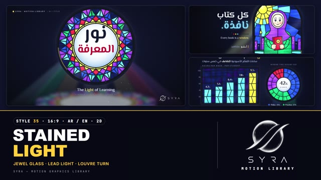

# 35 · Stained Glass Light

**SYRA Motion Library** · Style 35 · 16:9 · Arabic / English



<div dir="rtl">

> طريقة الاستخدام:
> انسخ البرومت ده كله وحطه لأي أداة AI أو لسكيل الـ animate، واملا الجزء الأخير ([VIDEO BRIEF]) بموضوع الفيديو.
> الستايل ده "ضوء الزجاج المعشّق" — 2D / 2.5D (SVG): نوافذ زجاج ملوّن عصرية بأشكال حديثة (مستطيلات، سداسيات، خلايا نحل، شاشات)، بخطوط رصاص حقيقية، الضوء بيعدّي منها على حيطة ليلية ويرسم أشعة ملوّنة وبقع نور على الأرض. الشخصيات بورتريهات زجاج بسيطة وودودة.
> مناسب للمحتوى الملهم، القصص الإنسانية، الصحة، البيئة، المدن، الشغل والمجتمع، والعناوين الكبيرة اللي محتاجة إحساس "نور".
> المرجع الأساسي للشكل والحركة هو ملف "source/index.html". بيشتغل بالعربي وبالإنجليزي. ممنوع اللون البني وكل درجاته (بيج، تان، أوكر، كاكي).

</div>

## Files in this folder

| File | What it is |
|---|---|
| [source/index.html](source/index.html) | The motion itself — opens and plays in a browser; the source of truth |
| [sample.mp4](sample.mp4) | Showcase reel of the style |
| The info card at the top of this file | Tags & hashtags: what the style expresses, what it suits, search words |

## Tags

<div dir="auto">

النوع: 2D / 2.5D — زجاج ملوّن معشّق بخطوط رصاص  
في سطر: نوافذ زجاج معشّق عصرية بألوان الجواهر وخطوط رصاص سودا، منوّرة من ورا على حيطة ليلية والنور بيرمي أشعة ملونة على الأرض، وشخصيات بورتريه زجاج بسيطة وودودة، إحساس ملهم ودافي ومليان أمل.  
In one line: Modern stained-glass windows in jewel tones with dark lead lines, backlit on a night wall and casting coloured light shafts on the floor, with simple friendly glass-portrait characters, inspiring, warm-hearted and hopeful.  
#عربي: #زجاج_معشق #زجاج_ملون #نور #ملهم #قصص_إنسانية #أمل #تعليم #صحة #بيئة #مجتمع #شغل #مدن #حكم_وأمثال #فسيفساء #ألوان_جواهر #دافي #مناسبات #تحفيز  
#English: #stainedglass #glass #light #jeweltones #inspiring #humanstories #hope #education #health #environment #community #work #quotes #proverbs #mosaic #warm #motivation #luminous  
مناسب لـ: محتوى ملهم وتحفيزي، قصص إنسانية عن ناس حقيقيين (مدرّسة، صياد، مدرب)، حكم وأمثال واقتباسات، تعليم وقراءة ومعرفة، صحة وبيئة ومجتمع، مبادرات وحملات بإحساس "نور وأمل"، مناسبات ورسائل تهنئة، أرقام وبيانات بشكل فني ملون  
Best for: inspiring and motivational content, human stories about real people (teacher, fisherman, coach), proverbs, sayings and quotes, education, reading and knowledge, health, environment and community, initiatives and campaigns with a "light and hope" feel, occasions and greeting messages, artistic colourful data  
مش مناسب لـ: تقنية وذكاء اصطناعي ومستقبل، فيديو حماسي سريع زي الرياضة والمسابقات، تقارير مؤسسية رصينة محتاجة بساطة، شرح علمي تفصيلي بأجزاء؛ ولو عايز زجاج فخم 3D لامع استخدم Crystal Prism  
Not for: tech, AI and futuristic topics, fast hype videos like sports or quizzes, sober corporate reports needing minimalism, detailed labelled science explainers; for glossy 3D luxury glass use Crystal Prism instead  
المزاج: منوّر، دافي، هادي، متفائل، فني        Mood: luminous, warm-hearted, calm, hopeful, artistic  
الإيقاع: هادي (النوافذ بتنوّر موجة ورا موجة)        Pace: calm  

</div>

## Components

| # | Component |
|---|---|
| 01 | Title Rose Of Light |
| 02 | Data Bars Donut |
| 03 | Data Honeycomb Solar |
| 04 | Product Glass Phone |
| 05 | Character Teacher Arch |
| 06 | Team Four Panes |
| 07 | Story Fisherman Sunrise |
| 08 | Mentor Coach Runner |
| 09 | Three Steps Business |
| 10 | Big Number Nile |
| 11 | Timeline Rider Day |
| 12 | Quote Proverb |
| 13 | Before After Rooftop |
| 14 | Map Egypt Nile Seas |
| 15 | Chapter Lower Third |
| 16 | End SYRA Lockup |
---

## STAINED GLASS LIGHT — MOTION GRAPHICS STYLE PROMPT (SYRA Motion Library · Style 35 · 16:9 · Arabic / English)

### Role

You are a senior motion designer producing motion graphics in the "Stained Glass Light" style of the SYRA Motion Library, on ANY topic, in Arabic OR English (or both). Match the reference exactly: the source of truth is "source/index.html" (all components, playable in a browser; click = pause, arrow keys = seek).

### 1. Style identity

- One line: contemporary stained glass lit from behind on a dark night wall — jewel-tone panes held by dark lead cames, cathedral-glass texture (ripple, density streaks, tiny seeds), soft bloom and a halo on the wall, coloured light shafts falling to the floor as pools of colour, dust motes drifting in the beams.
- Mood: luminous, warm-hearted, calm and hopeful — "every idea is a window of light".
- Modern, not church-like: windows are rectangles, hexagons, honeycombs, rounded app tiles, segment digits, chevron and Mondrian-like grids; content is modern Egyptian life (data, people, cities, the Nile and the sea).
- Never: gothic church imagery, saints, crosses, sepia/aged glass, brown or earth tones, flat vector without leads.

### 2. Format & technical

- Canvas 1920×1080, 30 fps. One idea per scene, 4.4–4.8 s; scenes overlap 1.0 s for the signature transition.
- SVG + HTML + GSAP (HyperFrames): one paused timeline, deterministic (seeded randomness, no clocks), every frame a pure function of time. Render plan: static glass (with its heavy SVG filter) is built once in its own layer and never changed; all motion lives in cheap unfiltered layers (pane covers, traces, sheen, dust) or in layer opacity/transform.
- Build order per window: lead outline traced by a light → window shows as dark unlit glass → panes light up in a wave (each flashes pale as it catches the sun) → halo, shafts and floor pools fade in → type rises. Full state by ~2.8 s, then a breathing hold.

### 3. Colour palette (use only these)

- Lead came #14161F (ridge #2C3247). Wall: radial #1A1F3E → #10132A → #07080F + fine cool grain.
- Glass: ruby #D7263D · sapphire #1F4FD8 · emerald #0FA36B · amethyst #8E44D9 · citrine #FFD23F (pure yellow, never darkened) · sky #5EC8FF · teal #0EA5B8 · rose #E8458F · coral #FF5A5F · clear #DDEFFF · night #111B4E · silver #A9B7DA. Each pane has its own radial gradient (light core → base → deep jewel edge).
- Skin glass #F6AE9C (rosy peach), blush #FF5F7A, grisaille paint #231C46 (violet-navy).
- Type: white #F4F7FF, cool grey #AFC0EE, accent citrine #FFE36E or sky #7FD6FF; on clear glass ink #151A33 + ruby #C8142F.
- Unlit glass = a cool night tone of its hue (citrine unlit = violet-night). Shades go toward deep jewel tones, never black-brown.

### 4. Typography (bilingual)

- Arabic display and lines: El Messiri 700 / 500 (rounded, calligraphic, "leaded" feel). English display and sub lines: El Messiri Latin. Labels, kickers, axes, years, name tags: Reem Kufi (English as tracked caps).
- One accent word per headline (citrine or sky glow; ruby when painted on clear glass). Latin digits in both languages.
- Min 28 px for reading text. Never split Arabic into letters: whole words rise out of masks with headroom for dots.
- Kicker top-left: citrine diamond + "SYRA · MOTION LIBRARY — NN / NAME". Leaded rule: lead bar + three glass diamonds.

### 5. Drawing language (glass, light, characters)

- Pane = SVG path + radial gradient + glass filter (turbulence ripple 3–6 px, streaky + fine density noise, bloom on bright panes). Seeds/bubbles inside panes. Leads 5–9 px dark with a slim ridge highlight, outer came 14–16 px, drawn outside the filter so they stay crisp. A dark stone surround behind each window.
- Light: blurred shafts in pane colours to a dark floor, squashed blurred copy of the window as floor pools, halo glow on the wall, a slow diagonal sheen across the glass, dust drifting up in the beams.
- Data in glass: bars that grow pane by pane, donut sectors, honeycomb waffles, segment-glass digits that count, hexagon timeline nodes, glass maps (Egypt in faceted panes, the Nile as a sky ribbon, seas in triangle facets).
- People: modern figurative glass portraits — large simple panes, lead lines follow folds, hijab halves with a white under-scarf framing the face, single skin pane; painted features (big catch-lit eyes that blink, rosy cheeks, soft smile, brows; beards, glasses, chef hat, hard hat, cap). Mix women with and without hijab, men young and older, kids, elders.

### 6. Motion language (incl. camera) + signature transition

- Slow and luminous: windows rise in with a soft settle (small overshoot only for icons and step panes), a light traces the outer came, panes light up in a wave from the light source (sun, centre, right-to-left for Arabic), values count up, light breathes (±8 %), sheen sweeps, eyes blink and look toward the light, boats bob, gulls cross.
- Camera: a gentle push-in (1.03–1.05 → 1.0) on the art while the type stays still (parallax), then a breathing hold.
- Signature transition — LEAD LIGHT-UP → LOUVRE TURN (1.0 s): a lattice of 10 vertical slats cut into modern panes (rectangles / chevron hexagons / diagonals) is drawn over the outgoing scene by a bright citrine-white trace running down the leads, right to left; each lit slat then turns like a louvre about its own axis — the old picture narrows to its edge, tinted by the slat's glass, a glint flashes edge-on, the next picture opens from the axis; the leads cool to lead colour and dissolve. Smaller echoes inside scenes: logo and lower third open like louvres, a glowing lead divider wipes before → after.

### 7. Branding

- SYRA logo only — plain white on the dark wall (black only if a scene is light), never tinted, never glowing or behind glass.
- Corner logo: SYRA (mark + wordmark) bottom-right ~222×60 px, ~58 px right / 50 px bottom, plain fade; keep the corner clear of busy glass.
- End: SYRA stacked logo alone, plain white, on a dark night pane inside a modern leaded frame (rectangles, faceted triangles, citrine corner squares); the frame lights from the centre, the logo opens like a louvre; tagline «نصنع الضوء معًا.» / "Crafting light, together.".

### 8. Component library (in "stained html.html"; ar = arabic example, en = english)

- **01** Rose-of-light title «نور المعرفة» (AR)
- **02** Bars + donut windows "Learning hours keep rising" (EN)
- **03** Honeycomb of 100 hex cells «طاقة من الشمس» (AR)
- **04** Glass phone health app + callouts "Health in your pocket" (EN)
- **05** Teacher in hijab in an arch «كل كتاب نافذة.» (AR)
- **06** Team of four portrait panes "One team, many lights" (EN)
- **07** Fisherman at sunrise, felucca, gulls «البحر يعطي من يصبر.» (AR)
- **08** Coach & young runner, medal "Every champion had a coach." (EN)
- **09** Three steps: hexagon / diamond / rounded square «ابدأ مشروعك» (AR)
- **10** Segment-glass digits 6,650 km «طول نهر النيل» (AR)
- **11** Hexagon timeline "A day on two wheels" (EN)
- **12** Proverb on a clear pane «اللي بنى مصر كان في الأصل حلواني.» (AR)
- **13** Rooftop before → after with a glowing lead divider "Same roof, new life" (EN)
- **14** Map of Egypt, the Nile and two seas «نهرٌ وبحران» (AR) 15 Chapter 02 hexagon + louvre lower third (AR+EN)
- **16** SYRA end lockup in a leaded frame (AR + EN)

### 9. Sound (if the video has sfx)

- Soft glass chimes and crystal shimmers as panes light, a gentle "tink" for each pane wave, a bright rising shimmer on the lead light-up and a soft airy flutter as the louvre slats turn, warm pads and light piano bed. Duck ~18–20 dB under VO.

### 10. Do / don't

- **DO** keep every shape leaded, light from behind (halo, shafts, floor pools), modern geometric windows, one accent word, Arabic RTL order in waves and staggers, clear panes behind any text that sits on glass.
- **DON'T** use brown/beige/tan/terracotta/wood/sepia/ochre/khaki/cream (not in unlit glass, not in shadows, not in dimmed yellow), church/gothic motifs, text over busy glass, tinted or glowing logos, generic cross-fades.

## [VIDEO BRIEF] — fill this in for each new video

```text
- Language: [ Arabic / English / both ]
- Topic / title: [ ... ]
- Voiceover file or script: [ path to WAV/MP3 or the text ]
- Length: [ e.g. 45 s ]
- Headlines and the accent word in each: [ ... ]
- Numbers / steps / content: [ ... ]
- Components to use (in order): [ e.g. 01, 05, 09, 16 ]
- Characters needed: [ ... ]
- Extra notes: [ ... ]
Output: 1920×1080, 30 fps MP4, same length as the voiceover, every visual timed to the word it illustrates,
SYRA corner logo, SYRA stained-glass ending.
```
