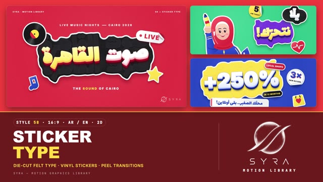

# 58 · Sticker Type

**SYRA Motion Library** · Style 58 · 16:9 · Arabic / English



<div dir="rtl">

> طريقة الاستخدام:
> انسخ البرومت ده كله وحطه لأي أداة AI أو لسكيل الـ animate، واملا الجزء الأخير ([VIDEO BRIEF]) بموضوع الفيديو.
> الستايل ده "ستيكر تايب" — 2D على كانفاس: كلام تخين أبيض بعمق مجسّم (extrusion) ملزوق على لوحة من الفيلت مقصوصة بخط أبيض زي الستيكرز، على خلفية لون واحد صريح، وكل حاجة بتتلزق بخبطة وتستقر، والانتقال بين المشاهد إن المشهد كله بيتقشّر زي الستيكر ويكشف اللي تحته — مناسب للمحتوى الشبابي، السوشيال، الإعلانات الخفيفة، الأرقام، المبادرات، والمدن والناس.
> المرجع الأساسي للشكل والحركة هو ملف "source/index.html". بيشتغل بالعربي وبالإنجليزي. ممنوع اللون البني.

</div>

## Files in this folder

| File | What it is |
|---|---|
| [source/index.html](source/index.html) | The motion itself — opens and plays in a browser; the source of truth |
| [sample.mp4](sample.mp4) | Showcase reel of the style |
| The info card at the top of this file | Tags & hashtags: what the style expresses, what it suits, search words |

## Tags

<div dir="auto">

النوع: 2D (كانفاس) — كلام مجسّم وستيكرز مقصوصة  
في سطر: كلام أبيض تخين بعمق مجسّم ملزوق على لوحة فيلت مقصوصة بخط أبيض فوق لون واحد صريح، وكل حاجة بتتلزق بخبطة وتتقشّر زي الستيكر.  
In one line: Chunky white extruded type on die-cut felt plates and vinyl stickers over one bold flat colour — everything slaps on, breathes and peels.  
#عربي: #ستيكرز #شبابي #سوشيال_ميديا #إعلانات #أرقام #إحصائيات #مشروعات_صغيرة #صحة #رياضة #طاقة_نظيفة #مدينة #مبادرات #عروض #تايبوجرافي #ملون #مرح #مصر #النيل  
#English: #sticker #stickertype #typography #bold #social #promo #youth #stats #data #smallbusiness #health #sport #cleanenergy #city #colourful #playful #egypt #kinetictype  
مناسب لـ: محتوى سوشيال وريلز، إعلانات خفيفة وعروض، أرقام وإحصائيات بشكل جذاب، مبادرات شبابية ومجتمعية، صحة ورياضة وأكل، مشروعات صغيرة وتطبيقات توصيل، فعاليات ومهرجانات، تعريف بفريق أو ناس  
Best for: social posts and reels, light promos and offers, punchy stats, youth and community campaigns, health / sport / food, small business and delivery apps, events and festivals, meet-the-team  
مش مناسب لـ: محتوى رسمي أو حكومي جاد، مواضيع حزينة أو حساسة، شرح علمي تفصيلي، تقارير فخمة هادية  
Not for: formal or official government content, sad or sensitive topics, detailed scientific explainers, calm luxury reports  
المزاج: مرح، جريء، شبابي، صاخب، ودود        Mood: playful, bold, youthful, loud, friendly  
الإيقاع: سريع وحماسي        Pace: fast  

</div>

## Components

| # | Component |
|---|---|
| 01 | Title Sound Of Cairo |
| 02 | Data Local Shops |
| 03 | Data Healthy Plate |
| 04 | Product Solar Panel |
| 05 | Character Runner Hijab |
| 06 | Team Four Crew |
| 07 | Story Delivery Rider |
| 08 | Mentor Artist Kid |
| 09 | Three Steps Start Up |
| 10 | Big Number Nile |
| 11 | Timeline Day By The Sea |
| 12 | Quote Felt Plate |
| 13 | Before After Rooftop |
| 14 | Map Egypt Cities |
| 15 | Chapter Lower Third |
| 16 | End SYRA Lockup |
---

## STICKER TYPE — MOTION GRAPHICS STYLE PROMPT (SYRA Motion Library · Style 58 · 16:9 · Arabic / English)

### Role

You are a senior motion designer producing motion graphics in the "Sticker Type" style of the SYRA Motion Library, on ANY topic, in Arabic OR English (or both). Match the reference exactly: the source of truth is "source/index.html" (all components, playable in a browser).

### 1. Style identity

- One line: chunky white display type with a deep, hard, stacked extrusion and a glossy face, sitting on a die-cut matte FELT plate (fibres, debossed ghost copies of the words, stitched seam) with a white cut line, on one flat, grainy, bold colour field; everything around it is a vinyl sticker (pills, discs, stars, icons, die-cut characters) that slaps on, breathes, and PEELS.
- Mood: loud, friendly, street-poster energy — a sticker sheet that fills up.
- Never: soft inflated balloon 3D, perspective extrusions, geometric construction grids, photo textures, brown/earth tones.

### 2. Format & technical

- Canvas 1920×1080, 30 fps. One idea per scene, 4.6–4.8 s; scenes overlap 0.9 s for the signature peel.
- 2D canvas inside HTML + GSAP (HyperFrames): ONE canvas for the whole film, one paused timeline driving a proxy time; deterministic (seeded randomness, no Math.random / Date / rAF). Every sticker (plate, extrusion slices, face, felt, die-cut, soft shadows) is drawn ONCE per scene into cached bitmaps; a frame only composites bitmaps with transforms. No ctx.filter (dilation, closing and blur are done by stamping). Arabic is drawn as whole words with fillText.
- DOM only for the SYRA corner logo (plain black / white).

### 3. Colour palette (use only these)

- Fields (one per scene, neighbours differ): coral #E8323F · cobalt #2747C9 · lemon #FFE24A · sky #36B4F2 · mint #2BC48A · violet #7B3FE4 · pink #FF5FA2 · ink #18181D. Each field has a soft light falloff, print grain and faint fibres.
- Felt plates: black #17171A · lemon #FFE24A · violet #7B3FE4 · cobalt · coral · mint · sky · pink · cool white #F6F7FB.
- Type faces: white #FFFFFF→tint, accent face lemon #FFF27A→#FFD84A (or sky / mint / cobalt on light plates). Extrusions: red #E3283A→#7E0B1C, cobalt #2E52E6→#0E1D78, violet #6A34DA→#2A0C7E, graphite #3A3A42→#101014.
- Cut line #FCFDFF. Shadows are tinted toward the field (deep red, navy, deep green, deep violet, magenta) — never grey or brown. Skin rosy peach #FFD8C4→#F7B9A0 (deeper rose variants), blush #FF7E95, mouth #B5122B; hair ink #2A1838, silver #DCE1EC for elders.

### 4. Typography (bilingual)

- Arabic display: Lalezar (stroked 5 px round-join so it reads like bubble type), whole words, RTL. Never end a Lalezar word in ي (it renders dotless) — rephrase.
- English display / digits: Inter Black 900 with a light rounding stroke (~3% of size); numbers drop glyph by glyph.
- Kickers and labels: Inter 800–900 caps, tracked 0.22–0.32 em; Arabic reading lines on white vinyl strips with a colour tab (Lalezar 54–74 px). One accent word per headline (lemon face). Latin digits. Min 28 px reading text.

### 5. Drawing language

- Type sticker = felt plate (dilated + closed word silhouette, optional debossed echo lines above/below, white cut line, felt edge light/shade, contact shade) + extrusion (20–28 stacked slices, dark contour) + face (vertical gradient, soft inner shadow, top gloss band + sheen).
- Short words get a PILL plate with a minimum width (stitched seam), so the die-cut is never a tall blob.
- Vinyl badges: pills, discs, stars, bursts, custom icon paths — flat fill, white outline, diagonal gloss.
- Characters: front-facing busts as die-cut stickers (white border by alpha dilation), flat shapes with two-stop gradients, big friendly eyes, blush, open smile; women with and without hijab, men young and older, kids, elders; outfits (coat + stethoscope, hi-vis vest + hard hat, chef jacket, apron, jacket, shirt, tee), props (bottle, box, fish, plate, brush, drawing, phone, laptop). Every shape closed — no floating limbs.
- Two shadows under every sticker: a broad soft drop shadow and a tight contact shadow (both field-tinted).

### 6. Motion language (incl. camera)

- Slap-on: a sticker appears hovering (scale 1.3–1.8, lifted: wide faint shadow), slaps down with back.out(1.6–2.4), the rotation settles to −6…+8°, the shadow tightens on contact. Type drops 30–50 px onto its plate a beat later, word by word (Arabic) or glyph by glyph (numbers). Staggers 0.1–0.2 s so the sheet "fills up".
- Idle: stickers breathe 2–5 px, tiny rotation sway, record/sun spin, characters bob and blink.
- In-scene peel: small stickers lift a corner (white backing curls back with crease and sheen); a BEFORE card peels and is pulled off to reveal the AFTER card under it.
- Camera: a slow push / drift per scene, the field moving at 45 % for parallax; furniture fixed to the frame.
- Signature transition: STICKER PEEL — the whole outgoing frame is one sticker sheet: a corner lifts (anticipation, first 20 %), then the fold sweeps across the frame (ease-in-out), the peeled part curls back as white backing paper (crease shade → sheen → cooler tip, tighter curl as it goes), casting a shadow on the remaining sheet, while the fold edge casts a soft shadow on the next scene, which is already lying underneath (its main plate in place; its type and stickers slap on as the peel finishes). Corners vary per scene (BR, TR, BL, TL, right, bottom).

### 7. Branding

- SYRA logo only — plain white on dark fields / black on light fields, never tinted, no sheen. During a peel it follows what is under it (old sheet, backing paper = black, new scene).
- Corner logo: SYRA (mark + wordmark) bottom-right, 222×60 px, 58 px right / 50 px bottom; keep that corner clear.
- End: the SYRA stack logo (plain white artwork) on a black felt sticker plate with a white die-cut line, slapped onto the coral field, with confetti stickers and two tagline strips «كل فكرة.. بداية حكاية» / "EVERY IDEA STARTS A STORY".

### 8. Component library (in "sticker html.html"; ar = arabic example, en = english)

- **01** Felt title «صوت القاهرة» + record, LIVE pill peels (AR)
- **02** +250% glyph drop on lemon felt, 3× disc peels (EN)
- **03** Die-cut donut «طبق متوازن» + legend pills (AR)
- **04** Solar panel object "SUN POWER." + battery fills (EN)
- **05** Runner in hijab «نتحرّك!» + «يلّا» on a pill plate (AR)
- **06** Team of four stickers "MEET THE CREW." (EN)
- **07** Delivery rider «وصل طلبك!» + map route + pin (AR)
- **08** Artist mentor & kid "KEEP GOING!" (EN)
- **09** Three step cards «ابدأ مشروعك» right-to-left (AR)
- **10** Big number 6,650 KM «طول النيل» (AR)
- **11** Tape timeline "A DAY BY THE SEA." (EN)
- **12** Quote on white felt «الشغل الحلو بيبان من التفاصيل» (AR)
- **13** BEFORE card peels to AFTER "GREY TO GREEN." (EN)
- **14** Egypt map on mint felt + city pins «رحلة النيل» (AR)
- **15** Chapter 03 «ناس البحر» + lower third (AR+EN)
- **16** End SYRA felt sticker (AR + EN)

### 9. Sound (if the video has sfx)

- Vinyl slap / soft thump on every landing, a paper "rrrip" + crinkle on each peel, pops and plucks on badges, a bouncy hip-hop or funk bed. Duck ~18–20 dB under VO.

### 10. Do / don't

- **DO** die-cut white line around everything, felt texture on plates, hard stacked extrusions, field-tinted double shadows, slap → settle → breathe, one lemon accent word, a peel between every scene.
- **DON'T** use brown/beige/tan/terracotta/wood/sepia/ochre/khaki/cream (not even in shadows or skin), grey neutral shadows, perspective 3D, cross-fades, split Arabic letters, or text in the bottom-right logo corner.

## [VIDEO BRIEF] — fill this in for each new video

```text
- Language: [ Arabic / English / both ]
- Topic / title: [ ... ]
- Voiceover file or script: [ path to WAV/MP3 or the text ]
- Length: [ e.g. 45 s ]
- Headlines and the accent word in each: [ ... ]
- Numbers / steps / content: [ ... ]
- Components to use (in order): [ e.g. 01, 05, 09, 16 ]
- Characters needed: [ ... ]
- Extra notes: [ ... ]
Output: 1920×1080, 30 fps MP4, same length as the voiceover, every visual timed to the word it illustrates,
SYRA corner logo, SYRA felt-sticker ending.
```
