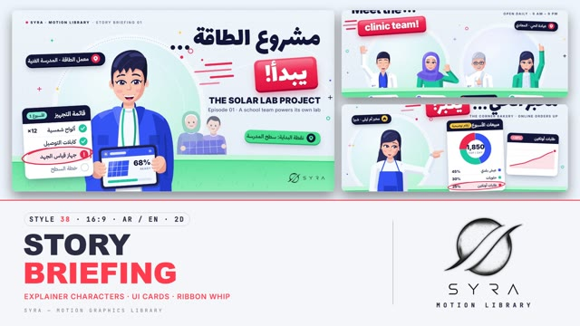

# 38 · Story Briefing

**SYRA Motion Library** · Style 38 · 16:9 · Arabic / English



<div dir="rtl">

> طريقة الاستخدام:
> انسخ البرومت ده كله وحطه لأي أداة AI أو لسكيل الـ animate، واملا الجزء الأخير ([VIDEO BRIEF]) بموضوع الفيديو.
> الستايل ده "قصة مصوّرة / بريفينج" — رسم 2D مسطح ناعم زي برامج الشرح في التلفزيون: شخصية كبيرة معبّرة قدام دايرة سما ونعناعي، كروت بيضا عايمة بضل خفيف، شريط أحمر مرجاني فيه كلمة واحدة، دايرة قلم أحمر حوالين حاجة واحدة، وأرض خضرا تحت — مناسب للقصص القصيرة، شرح المشاريع، المشاريع الصغيرة، الصحة، الرياضة، العيلة، والتطبيقات.
> المرجع الأساسي للشكل والحركة هو ملف "source/index.html". بيشتغل بالعربي وبالإنجليزي. ممنوع اللون البني (ولا بيج ولا خشبي، حتى في الأكل).

</div>

## Files in this folder

| File | What it is |
|---|---|
| [source/index.html](source/index.html) | The motion itself — opens and plays in a browser; the source of truth |
| [sample.mp4](sample.mp4) | Showcase reel of the style |
| The info card at the top of this file | Tags & hashtags: what the style expresses, what it suits, search words |

## Tags

<div dir="auto">

النوع: 2D — رسم مسطح ناعم (Flat cartoon + UI cards)  
في سطر: زي برامج الشرح في التلفزيون: شخصية كرتون كبيرة معبّرة بتشاور على كروت بيضا، شريط أحمر فيه كلمة واحدة ودايرة قلم أحمر — دافي ومتفائل وواضح.  
In one line: A bright TV-explainer storyboard — a big expressive cartoon character beside floating white UI cards, a coral ribbon word and a red-pen circle.  
#عربي: #شرح #قصة_قصيرة #كرتون #مشاريع_صغيرة #صحة #عيادة #رياضة #عيلة #تطبيقات #توصيل #بيانات #بروموشن #شخصيات #خطوات #تعليمي #متفائل #تلفزيون  
#English: #explainer #storytelling #flat2d #cartoon #characters #smallbusiness #healthcare #clinic #sport #family #app #delivery #uicards #data #promo #tvstyle #optimistic  
مناسب لـ: قصص قصيرة عن ناس عاديين (مخبز، عيادة، نادي، عيلة)، شرح مشروع أو تطبيق أو خدمة، تقرير بأرقام بسيطة على كروت، تعريف بفريق عمل، بروموشن خدمة توصيل أو أونلاين، خطوات استخدام، رسايل توعية صحية ورياضية، محتوى سوشيال ميديا  
Best for: short everyday-people stories (bakery, clinic, club, family), app/service/project explainers, light data on UI cards, team intros, delivery and online-service promos, how-to steps, health and sport awareness, social-media content  
مش مناسب لـ: محتوى فخم أو رسمي جدًا للشركات الكبيرة، تاريخ وآثار، مواضيع حزينة أو جادة وتقيلة، شرح تقني معقّد بخرايط أو مجسمات 3D  
Not for: luxury or very formal corporate films, history and heritage, sad or heavy serious topics, complex technical/3D explanations  
المزاج: دافي، متفائل، ودود، واضح، فيه حيوية        Mood: warm, optimistic, friendly, clear, lively  
الإيقاع: متوسط (بانتقالات سريعة بالشريط)        Pace: medium (snappy ribbon whips)  

</div>

## Components

| # | Component |
|---|---|
| 01 | Title Solar Lab |
| 02 | Data Rooftop Plan |
| 03 | Data Corner Bakery |
| 04 | Object Delivery App |
| 05 | Character Results Day |
| 06 | Team Clinic |
| 07 | Story Chef First Order |
| 08 | Mentor Coach And Captain |
| 09 | Three Steps Delivery |
| 10 | Big Number Youth Club |
| 11 | Timeline Family Year |
| 12 | Quote Grandpa |
| 13 | Before After Clinic |
| 14 | Map Egypt Network |
| 15 | Chapter Lower Third |
| 16 | End SYRA Lockup |
---

## STORY BRIEFING — MOTION GRAPHICS STYLE PROMPT (SYRA Motion Library · Style 38 · 16:9 · Arabic / English · 2D)

### Role

You are a senior motion designer producing motion graphics in the "Story Briefing" style of the SYRA Motion Library, on ANY topic, in Arabic OR English (or both). Match the reference exactly: the source of truth is "source/index.html" (all components, playable in a browser, seekable).

### 1. Style identity

- One line: a TV-explainer storyboard — one rich, layered editorial illustration per scene that tells a small story: a big expressive waist-up character over a sky→mint backdrop circle, floating white UI cards and pills with soft shadows, a bold two-part headline whose accent word rides a tilted coral ribbon, one hand-drawn red-pen loop, a fresh green ground band.
- Mood: warm, clear, optimistic, "here is what happened / here is the plan".
- Never: outlines on characters, gradients on skin, photo textures, dark/moody scenes, more than one ribbon or pen loop.

### 2. Format & technical

- Canvas 1920×1080, 30 fps. One idea per scene, 4.4–4.8 s; scenes overlap 1.0 s for the signature transition.
- Live SVG + HTML inside HTML + GSAP (HyperFrames): one paused timeline driving a frame(t) function; every value is a pure function of time (seeded randomness, no Math.random / Date / requestAnimationFrame / CSS keyframes); a direct seek to any time shows the right frame. No remote assets. Full state by ~2 s, then hold with life.
- Grid: 96 px outer margins, 24 px gutter; kicker line top-left at y 70; logo corner kept clear.

### 3. Colour palette (use only these)

- Background #EEF4FB → #E3ECF8 with a 32 px dot grid (#13183A at 8 %).
- Backdrop circle #D9EAFF → #CBEBF0 → #B9EDD9 (alt lilac-sky #E2DFFF → #D5E6FF → #C8EEF0), white halo + inner ring.
- Ink #13183A (type, card header bars, dark pills) · secondary text #4A5580.
- Hot accent coral #FF3B4E (ribbon #FF6372→#F0273F, extrude #BE1630, hot row #FFE8EC, pen loop, pins).
- Cobalt #2F5BFF / #1E41D2 / #6F8EFF · Teal #0FB5A3 / #0A8F82 / #7FE3D6 · Yellow #FFC83D / #F5B000 · Violet #7B74F5 / #5E56DD.
- Ground #56D19C → #8FE3BE, rim #2FBF84, far band #BDEFD8 · pill green #3CCB8E.
- Skin rosy peach #FFC9B1 (shade #F4A790, deep #E58C7C, blush #FF8C93) · hair navy #1F2346 · silver hair #B7C0D6.
- NO brown, beige, tan, cream, sepia, ochre, khaki, wood anywhere (food is green salad, coral tomato, yellow lemon).

### 4. Typography (bilingual)

- Arabic headline + Arabic ribbon word: Lalezar 150–160 px. English headline: Inter 900 100 px (ribbon word Inter 900 80–86 px). Sub lines: Inter 900 50 px / Inter 800 26 px tracked caps / IBM Plex Sans Arabic 600 36 px.
- UI (cards, rows, pills, labels): IBM Plex Sans Arabic 600–700 28–44 px · Inter 700–800 for Latin. Every Arabic font stack falls back to Inter so Latin digits never turn serif.
- Headline = two parts: line + "…" dots (three ink dots that pop), then the accent word on the tilted (−4°) coral ribbon. One accent word per headline. Latin digits in both languages. Min 28 px reading text. Never split Arabic into letters.

### 5. Drawing language

- Characters: semi-flat shapes, no outlines; soft cel shading (one shade shape per form away from a top-left light, a light patch, cast shadow under chin / fringe, rosy blush). Ink only for eye lines, brows, glasses. Big eyes with highlights, expressive mouths (grin, talk, cheer, smile). Bodies squeezed so shoulders read ~2.6 head widths.
- Cast library: young man (quiff), woman in hijab (cape hijab with white under-band), girl / woman without hijab (long hair or ponytail + headband), older man (silver hair, mustache, glasses, wrinkles), doctor (white coat, stethoscope), nurse (scrubs, hijab), chef (toque, double-breasted jacket), athlete (jersey, short sleeves), delivery rider (cap, teal vest), coach (cap, whistle), kids (simplified, soft background crowd), families.
- Hands: open palm, wave, pointing finger, fist, thumbs-up, grip on an edge, fist with marker — posable two-bone arms.
- UI: white cards 30 px radius with an ink header bar and a pill tag, rows with round check discs, one hot row; pills 72 px with an icon disc and a 7 px solid lip; plan/map panels with a light grid; phones and tablets with live screens.
- Layer stack front→back: kicker / headline + ribbon + speed lines → cards / pills → hero → ground band → background people → backdrop circle → decor (rings, plus signs, sparkles, dots) → dot grid.

### 6. Motion language (incl. camera) + signature transition

- Builds: backdrop scales 0.94→1 and fades up, people pop up from below with a back-ease overshoot, cards and pills slide in from the sides with a small rotation settle, labels pop with 50 ms stagger, bars grow, lines and routes draw on, counters count up, the red pen draws its loop (0.5 s), the "…" dots pop one by one, the ribbon whips in skewed with its speed lines and settles.
- Life in the hold: breathing bob, head sway ±1.5°, blinks, waves, pointing taps, kids hop, sparkles twinkle, confetti flutters, pins pulse, routes march; a slow camera push (≈2 %) toward the subject.
- Eases: ease-out cubic for settles, back-ease (s 1.2–2) for pops, in-out cubic for the whip; never linear except loops.
- SIGNATURE TRANSITION — RIBBON WHIP + LAYERED PARALLAX (1.0 s overlap): a giant coral ribbon band (gloss stripe, dark extrude lip, thin white trailing strip, soft shadow ahead) leans forward and whips left→right across the frame in 0.62 s, widening and leaning more at top speed with coral speed lines stretching behind it. The old scene's layers are pushed right at different speeds (front fastest) and vanish under the ribbon; the new scene is revealed behind it, its layers drift in from the left with parallax and every element assembles in the order the ribbon passes it.

### 7. Branding

- SYRA logo only — plain black on these light scenes, plain white only on a dark scene; never tinted, no colour sheen.
- Corner logo: SYRA (mark + wordmark) bottom-right ~222×60 px (58 px right, 50 px bottom) on the light green ground; people on the right stand behind the ground band so the logo never sits on busy detail. Plain fade in.
- End: the SYRA stacked logo alone on the backdrop circle (black artwork, pops in), the ribbon whips in with the Arabic tagline «حكايتك تبدأ هنا», English "Your story starts here." below, confetti and sparkles; no corner logo.

### 8. Component library (in "briefing html.html"; ar = arabic lead, en = english lead)

- **01** Title — solar lab team, checklist + red pen «مشروع الطاقة… يبدأ!» (AR)
- **02** Data hero — rooftop plan + monthly output bars, engineer with marker "One roof… full power!" (EN)
- **03** Data — bakery owner points at a sales donut + online-orders line «مخبز الحي… يكبر!» (AR)
- **04** Object — delivery app on a big phone, feature pills, rider waves "Dinner in… 12 minutes!" (EN)
- **05** Character — results day, teacher in hijab laughs, kids cheer, confetti «النتيجة… نجحنا!» (AR)
- **06** Team — clinic team of four (wave / open palm / thumbs-up / pointing) + name pills "Meet the… clinic team!" (EN)
- **07** Story — chef lifts a fresh bowl as the first online order pings, order ticket «أول طلب… أونلاين!» (AR)
- **08** Mentor & learner — coach points at a match plan, captain gives a thumbs-up "Train smart, play hard!" (EN)
- **09** Three steps — order · cook · deliver cards, scooter rides the route to the rider «3 خطوات… وبس!» (AR)
- **10** Big number — +3,200 kids in the club, kids cheer around a bouncing ball «والعدد بيزيد!» (AR)
- **11** Timeline — a family's first year, five milestones on a filling track "One family, one year!" (EN)
- **12** Quote — grandpa's saying on a quote card, accent word circled «اللي بيبدأ صغير، بيكبر بالصبر.» (AR)
- **13** Before / after — clinic paper queue 2 h vs online booking 15 min, doctor presents "From 2 hours to 15 min!" (EN)
- **14** Map — Egypt delivery network, Cairo hub, routes to 6 cities, stats card «من القاهرة… لكل مصر!» (AR)
- **15** Chapter card + lower third — «الفصل الثاني» / "From the pitch to real life" + name bar (AR + EN)
- **16** End — SYRA stacked logo + ribbon tagline (AR + EN)

### 9. Sound (if the video has sfx)

- A whoosh on every ribbon whip, soft pops on cards and labels, a marker squeak on the pen loop, light plucks on counters, a bright ukulele / marimba explainer bed. Duck ~18–20 dB under VO.

### 10. Do / don't

- **DO** tell a small human story per scene, keep one ribbon word + one pen loop, build in reveal order, keep people alive in the hold, keep text off faces and off the logo corner, use modern Egyptian everyday life (health, sport, food, small business, family, tech, the Nile and the sea), mix women with and without hijab, young and older people.
- **DON'T** use brown/beige/tan/cream/wood (not even in food or hair), outlines, more than one accent, generic fades, split Arabic letters, serif digits, or any logo but SYRA.

## [VIDEO BRIEF] — fill this in for each new video

```text
- Language: [ Arabic / English / both ]
- Topic / title: [ ... ]
- Voiceover file or script: [ path to WAV/MP3 or the text ]
- Length: [ e.g. 45 s ]
- Headlines and the accent (ribbon) word in each: [ ... ]
- Numbers / steps / content (mark invented numbers as illustrative): [ ... ]
- Components to use (in order): [ e.g. 01, 06, 09, 16 ]
- Characters needed (age, hijab or not, job, pose / hand gesture): [ ... ]
- Extra notes: [ ... ]
Output: 1920×1080, 30 fps MP4, same length as the voiceover, every visual timed to the word it illustrates, ribbon whip
between scenes, SYRA corner logo, SYRA end lockup.
```
