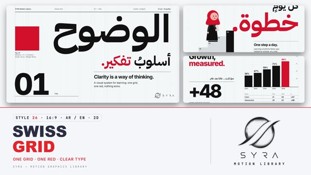

# 26 · Swiss Grid

**SYRA Motion Library** · Style 26 · 16:9 · Arabic / English



<div dir="rtl">

> طريقة الاستخدام:
> انسخ البرومت ده كله وحطه لأي أداة AI أو لسكيل الـ animate، واملا الجزء الأخير ([VIDEO BRIEF]) بموضوع الفيديو.
> الستايل ده "الشبكة السويسرية" — 2D: شبكة 12 عمود ظاهرة، خط ضخم مرصوص على الأعمدة، لون أحمر واحد بس، وكل حاجة بتطلع من "شبّاك" العمود وتقف على الشبكة بالظبط. والانتقال بين المشاهد إن أعمدة المشهد القديم تتزحزح موديول وتتبدّل بأعمدة المشهد الجديد ("Grid Shift").
> مناسب للبيانات والأرقام، الشرح الواضح، التقارير، العروض المؤسسية، وأي فيديو محتاج إحساس بالنظام والدقة والهدوء.
> المرجع الأساسي للشكل والحركة هو ملف "source/index.html". بيشتغل بالعربي وبالإنجليزي (العربي على اليمين، الإنجليزي على الشمال، ويتقابلوا على خط واحد). ممنوع اللون البني.

</div>

## Files in this folder

| File | What it is |
|---|---|
| [source/index.html](source/index.html) | The motion itself — opens and plays in a browser; the source of truth |
| [sample.mp4](sample.mp4) | Showcase reel of the style |
| The info card at the top of this file | Tags & hashtags: what the style expresses, what it suits, search words |

## Tags

<div dir="auto">

النوع: 2D فلات — تايبوجرافي وشبكة أعمدة  
في سطر: صفحات بيضا نضيفة بشبكة 12 عمود ظاهرة، خط ضخم أسود ولون أحمر واحد بس، ورسوم بيانية وشخصيات من دواير وأشكال بسيطة، إحساس منظم وهادي ودقيق.  
In one line: Clean white pages on a visible 12-column grid, huge black type with a single signal red, column-built charts and characters made of simple circles, calm, precise and orderly.  
#عربي: #تايبوجرافي #بيانات #أرقام #إنفوجرافيك #تقارير #شركات #عرض_مؤسسي #مينيمال #بسيط #شرح #تعليمي #أبيض_وأسود #أحمر #منظم #إحصائيات #جداول #خطوات  
#English: #swissdesign #typography #grid #minimal #data #infographic #corporate #report #explainer #blackandwhite #red #flatdesign #clean #statistics #charts #editorial #professional #steps  
مناسب لـ: فيديوهات أرقام وإحصائيات ورسوم بيانية، تقارير سنوية ومؤسسية، شرح واضح لخطوات أو خدمة، عروض شركات وبنوك وجهات حكومية، أخبار وملخصات بيانات، إعلان تطبيق أو خدمة بشكل رصين، محتوى تعليمي للكبار  
Best for: numbers, statistics and charts, annual and corporate reports, clear step-by-step or service explainers, company/bank/government presentations, data news and summaries, sober app or service promos, adult learning content  
مش مناسب لـ: محتوى أطفال مرح وملون، فيديو حماسي سريع زي الرياضة والألعاب، مواضيع فخمة لامعة أو 3D، قصص عاطفية دافية محتاجة رسم غني  
Not for: playful colourful kids' content, fast hype videos like sports or gaming, glossy luxury or 3D looks, warm emotional stories that need rich illustration  
المزاج: واضح، هادي، واثق، دقيق، رصين        Mood: clear, calm, confident, precise, sober  
الإيقاع: متوسط (حركة بالموديول، من غير نطّ)        Pace: medium  

</div>

## Components

| # | Component |
|---|---|
| 01 | Title Clarity |
| 02 | Data Growth Measured |
| 03 | Data Solar Waffle |
| 04 | Object Delivery App |
| 05 | Character Student Steps |
| 06 | Team Four Trades |
| 07 | Story Farm To Table |
| 08 | Mentor Track Coach |
| 09 | Three Steps Shop |
| 10 | Big Number Trees |
| 11 | Timeline Cairo Day |
| 12 | Quote Arabic Saying |
| 13 | Before After Street |
| 14 | Map Egypt Nile |
| 15 | Chapter Lower Third |
| 16 | End SYRA Lockup |
---

## SWISS GRID — MOTION GRAPHICS STYLE PROMPT (SYRA Motion Library · Style 26 · 16:9 · Arabic / English)

### Role

You are a senior motion designer producing motion graphics in the "Swiss Grid" style of the SYRA Motion Library, on ANY topic, in Arabic OR English (or both). Match the reference exactly: the source of truth is "source/index.html" (all components, playable in a browser).

### 1. Style identity

- One line: the International Typographic Style in motion — a visible 12-column grid, huge flush grotesque type in two scripts, one signal red, generous white space, and characters reduced to circles and rounded shapes.
- Mood: clear, calm, confident, precise — "clarity is a way of thinking".
- Composition: asymmetric. Arabic sits flush right on column 12, English flush left on column 7 (or 1); they meet on a shared rule. Every element snaps to a column edge, a row or the bottom margin. Big white space is deliberate.
- Never: decoration for its own sake, gradients, shadows, textures, rotation, blur, bounce, more than one accent colour.

### 2. Format & technical

- Canvas 1920×1080, 30 fps. One idea per scene, 4.4–4.8 s; scenes overlap 1.0 s for the signature transition.
- Grid: 12 columns of 122 px, 24 px gutters, 96 px side margins; 6 rows of 136 px, 72 px top/bottom margins. The grid is visible as hairlines (ink 8.5 %) with row ticks in the side margins; a meta row + 3 px rule sits on top of every page.
- HTML + SVG + GSAP (HyperFrames): one paused timeline, fromTo / to / set only, deterministic (seeded randomness), any frame reachable by a direct seek. No CSS keyframes, no remote assets.
- Paper pages (light) and ink pages (dark) alternate for rhythm (about 3 ink pages in 16).

### 3. Colour palette (use only these)

- Paper (cool white) #F5F6F7 · Ink #111111 · Signal red #E3242B — the ONE accent.
- Cool greys: text #6B6F76, on-ink text #9A9EA5, module #D9DCE0, light #B9BDC3, mid #575B62, sleeve #2B2D31.
- Skin rosy peach #F6B7A9, blush #FF7E95 (30–42 %), mouth #C2152B.
- Red discipline: per page, the accent word + at most ONE red element (a module, a bar, a marker, a hard hat, a hijab).

### 4. Typography (bilingual)

- English: Inter — 800 for headlines and numerals (−0.05 to −0.065 em, tabular figures), 700 for the 54 px sub line, 400 for 28 px reading text, 500 for 18 px captions.
- Arabic: IBM Plex Sans Arabic 700 for display (110–430 px, one or two words per page, flush right), 600/700 for the sub line, 500 for reading text. Inter + Plex read as one Swiss voice in two scripts.
- Scale: 18 caption · 28 reading · 54 sub · 96–150 headline · 290–430 display. One red accent word per headline.
- Latin digits in both languages. Min 28 px for reading text. Never split Arabic into letters — animate whole words or lines, and give every Arabic mask ~0.2 em headroom above and below so hamza, shadda, dots and the final stop are never cut.

### 5. Drawing language

- Modules, bars, rules and hairlines; charts are built from whole columns (a bar = one column wide; a waffle = two squares per column; plinths and steps = whole modules). Rules: 3 px top rule, 1.5 px section rules, 1 px table hairlines; text hangs from rules or sits on them. Icons = a few flat geometric shapes (circle bulb, Gantt bars, shop awning, metro car).
- Maps reduce a country to one flat polygon on the grid with one ink river line and square city markers.
- People: only circles, half-discs, rounded A-lines and rounded rectangles, no outlines — a face circle offset toward the direction of travel (3/4 read), dot eyes, blush discs, half-disc smile; hijab = circle + bell drape; abaya = rounded A-line; arms = rounded capsules with round hands. Variety: women with and without hijab, men young and older (grey beard), kids; doctor, engineer (red hard hat), programmer, chef, farmer (galabeya + imma), coach, urban planner.

### 6. Motion language (incl. camera)

- Expo-out on every arrival, power3.inOut for rules. Headlines rise out of their column window; accent word lands a beat later. Rules run out from their anchor side (Arabic from the right). Modules slide exactly ONE module (146 px) into place; bars and steps grow from their base; numbers count up with expo-out; waffles fill like a rising level.
- Characters move on the grid: they climb one module per beat with an anticipation dip and a small hop, rise out of their plinths, walk two modules, run a lane; holds keep blinks, breathing, a nod or a talk.
- Holds breathe without breaking the grid: a playhead or progress bar stepping module by module, a ticking counter, a slow camera push inside a map panel, and a slow pulse of the column hairlines (a metronome across the page).
- Signature transition — GRID SHIFT (1.0 s): the outgoing page splits into its 12 column strips; right to left, 50 ms apart, each strip slides one module left (odd columns up a row, even columns down a row) while its window closes; behind it the incoming page opens column by column and slides one module in from the right to lock onto the grid; the column hairlines flash as each column passes; ONE red 2×2 module travels across the grid on the beat (one module per beat), lands on the next page's red element or accent word, folds to its size and wipes off over it.

### 7. Branding

- SYRA logo only — plain black on paper pages, plain white on ink pages, never red, never tinted, no effects.
- Corner logo: SYRA (mark + wordmark) bottom-right, ~222×60 px, 58 px from the right and 50 px from the bottom; it switches black/white with the page, plain fade in; keep that corner (x > 1640, y > 950) free of busy content.
- End: the stacked SYRA logo alone on paper on the centre axis of the grid between two hairline rules, rising out of its window; tagline «وضوح في كل خطوة.» (accent «خطوة.» red) / "Clarity in every step."; no corner logo.

### 8. Component library (in "swiss html.html"; ar = arabic lead, en = english lead)

- **01** Title «الوضوح» / «أسلوبُ تفكير.» + red 2×2 module + "01" (AR)
- **02** Data hero "Growth, measured." — +48, one-column bars, region table (EN)
- **03** Waffle 62 / 100 «طاقة من الشمس.» — solar village homes (AR)
- **04** Object: delivery-app phone on an ink page "Delivered, on time." — route, rider dot, ETA (EN)
- **05** Student in a red hijab climbs a 5-step staircase «كلّ يومٍ خطوة.» (AR)
- **06** Team of four rising from plinths "Different skills. One team." — doctor, engineer, programmer, chef (EN)
- **07** Story: farmer carries tomatoes to the market stall «من الحقل إلى المائدة.» (AR)
- **08** Mentor & learner: coach times a girl on the track "Practice, coached." — 12.48 s (EN)
- **09** Three steps for a small shop «ثلاث خطوات لمشروعك.» — Idea, Plan, Launch modules (AR)
- **10** Big number on ink 4,000 «شجرة جديدة في شوارع القاهرة.» + planted trees (AR)
- **11** Timeline "24 hours in Cairo." — events hang from one rule, red playhead (EN)
- **12** Quote on ink «خيرُ الكلامِ ما قلّ ودلّ.» — "The best words are few, and clear." (AR)
- **13** Before / after "A street, redesigned." — red divider sweep, trees, bike lane, figures (EN)
- **14** Map of Egypt «من الإسكندرية إلى أسوان.» — Nile drawn south to north, cities click on (AR)
- **15** Chapter card «الفصل الثاني — المدينة.» / "Chapter 02 — The City" + lower third (AR + EN)
- **16** End: SYRA stacked logo + «وضوح في كل خطوة.» / "Clarity in every step." (AR + EN)

### 9. Sound (if the video has sfx)

- Dry paper ticks on each column of the Grid Shift and a single click when the grid locks; soft clicks for modules and markers, a light tick per counter step; minimal piano / pulse-synth bed. Duck ~18–20 dB under VO.

### 10. Do / don't

- **DO** snap everything to the 12-column grid, keep the hairlines visible, set Arabic flush right and English flush left, use one red word + at most one red element, let white space work, move in whole modules, keep holds clean.
- **DON'T** use brown/beige/tan/terracotta/wood/sepia/ochre/khaki/cream, warm greys, gradients, shadows, outlines on characters, rotation or bounce for effect, centred-everything layouts, more than one accent colour, split Arabic letters.

## [VIDEO BRIEF] — fill this in for each new video

```text
- Language: [ Arabic / English / both ]
- Topic / title: [ ... ]
- Voiceover file or script: [ path to WAV/MP3 or the text ]
- Length: [ e.g. 45 s ]
- Headlines and the accent word in each: [ ... ]
- Numbers / steps / content: [ ... ]
- Components to use (in order): [ e.g. 01, 03, 09, 16 ]
- Characters needed: [ ... ]
- Extra notes: [ ... ]
Output: 1920×1080, 30 fps MP4, same length as the voiceover, every visual timed to the word it illustrates,
SYRA corner logo, SYRA end lockup.
```
