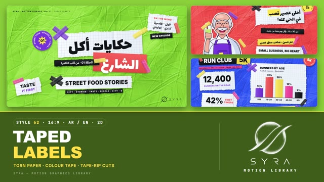

# 62 · Taped Labels

**SYRA Motion Library** · Style 62 · 16:9 · Arabic / English



<div dir="rtl">

> طريقة الاستخدام:
> انسخ البرومت ده كله وحطه لأي أداة AI أو لسكيل الـ animate، واملا الجزء الأخير ([VIDEO BRIEF]) بموضوع الفيديو.
> الستايل ده "ليبلز ملزوقة" — 2D (كانفاس): كولاج حيوي من ورق كراسة مربعات ومسطّر متقطّع، وشرايط ليبل سودا وملوّنة، ملزوقة بشريط لاصق شفاف ملوّن (شريط واحد أو علامة X) على ورقة ملوّنة متكرمشة، مع ستيكرز مدوّرة عليها كلام دايري، وكلمة مميّزة جوّه بوكس لون، وشخصيات مرسومة مقصوصة بحرف أبيض وطرف مقطوع.
> مناسب للسوشيال والريلز، الحملات الشبابية، الأكل والرياضة والصحة، المشروعات الصغيرة، التعريف بناس أو فريق، الأرقام السريعة.
> المرجع الأساسي للشكل والحركة هو ملف "source/index.html". بيشتغل بالعربي وبالإنجليزي. ممنوع اللون البني والبيج وورق الكرافت: الورق دايماً أبيض بارد والخلفية لون صريح (ليموني أخضر، كوبالت، كورال، بنفسجي، وردي).

</div>

## Files in this folder

| File | What it is |
|---|---|
| [source/index.html](source/index.html) | The motion itself — opens and plays in a browser; the source of truth |
| [sample.mp4](sample.mp4) | Showcase reel of the style |
| The info card at the top of this file | Tags & hashtags: what the style expresses, what it suits, search words |

## Tags

<div dir="auto">

النوع: 2D (كانفاس) — كولاج ورق وليبلز وشريط لاصق  
في سطر: ورق كراسة متقطّع وشرايط ليبل ملوّنة وستيكرز مدوّرة ملزوقة بشريط لاصق ملوّن على ورقة ملوّنة متكرمشة، وكل حاجة بتتلزق بخبطة وبتتشال بقطع الورقة.  
In one line: Torn notebook paper, colour label strips and round stickers taped onto one crumpled colour sheet — everything slaps on, and the sheet is ripped away to change scene.  
#عربي: #كولاج #ورق_متقطع #شريط_لاصق #ليبلز #ستيكرز #سوشيال_ميديا #ريلز #شبابي #أكل_الشارع #رياضة #صحة #مشروعات_صغيرة #أرقام #إحصائيات #مصر #ملون #حماسي #قصص_ناس  
#English: #collage #tornpaper #tape #labels #stickers #scrapbook #social #reels #youth #streetfood #sport #health #smallbusiness #stats #data #egypt #colourful #energetic  
مناسب لـ: سوشيال وريلز، حملات شبابية ومجتمعية، أكل وشارع ومطاعم، رياضة وصحة، مشروعات صغيرة وقصص ناس، تعريف بفريق، أرقام سريعة وإحصائيات، حلقات وبرامج يوتيوب  
Best for: social posts and reels, youth and community campaigns, street food and restaurants, sport and health, small business and people stories, meet-the-team, quick stats, YouTube episodes and series  
مش مناسب لـ: محتوى رسمي أو حكومي جاد، مواضيع حزينة أو حساسة، تقارير فخمة هادية، شرح علمي تفصيلي  
Not for: formal or official government content, sad or sensitive topics, calm luxury reports, detailed scientific explainers  
المزاج: حماسي، شبابي، ودود، مرح، إنساني        Mood: energetic, youthful, friendly, playful, human  
الإيقاع: سريع وحماسي        Pace: fast  

</div>

## Components

| # | Component |
|---|---|
| 01 | Title Street Food Stories |
| 02 | Data Run Club 5K |
| 03 | Data Commute Donut |
| 04 | Product Refill Bottle |
| 05 | Character Juice Shop |
| 06 | Team Meet The Team |
| 07 | Story Farm To Table |
| 08 | Mentor First Line Of Code |
| 09 | Three Steps Better Sleep |
| 10 | Big Number Nile |
| 11 | Timeline Chef Day |
| 12 | Quote Egyptian Proverb |
| 13 | Before After Rooftop |
| 14 | Map Egypt Stops |
| 15 | Chapter Lower Third |
| 16 | End SYRA Lockup |
---

## TAPED LABELS — MOTION GRAPHICS STYLE PROMPT (SYRA Motion Library · Style 62 · 16:9 · Arabic / English · 2D)

### Role

You are a senior motion designer producing motion graphics in the "Taped Labels" style of the SYRA Motion Library, on ANY topic, in Arabic OR English (or both). Match the reference exactly: the source of truth is "source/index.html" (all components, playable in a browser).

### 1. Style identity

- One line: a loud graphic-pack collage — torn notebook paper (grid / lined), black and colour label strips and round stickers, stuck onto ONE crumpled colour sheet with translucent coloured tape (single strips and X-crosses); one highlighted word sits in a colour box; friendly flat-ink characters are white-bordered paper cut-outs with a torn bottom.
- Mood: energetic, human, social-first — but easy on the eye: few pieces, big readable type, clear reading order.
- Never: kraft / brown / beige paper or tape, grey shadows, clutter, tape over words, creepy or realistic faces.

### 2. Format & technical

- Canvas 1920×1080, 30 fps. One idea per scene, 4.6–5.0 s; scenes overlap 0.9 s for the signature transition.
- 2D canvas in HTML + GSAP (HyperFrames): ONE canvas for the whole film; every piece is drawn ONCE into a cached bitmap (with its own soft shadow) and only composited per frame; one paused timeline whose master proxy calls the frame function (pure function of time, seeded randomness, seeking to any time shows the right frame). The crumpled sheets are pre-baked textures. No CSS keyframes, no remote assets. Full state by ~2.5 s, then hold with life.

### 3. Colour palette (use only these)

- Crumpled sheets (one per scene, neighbours differ), shading stays inside the sheet's own hue: lime #5A9E16 / #8BD13A / #C4F07A · cobalt #1B3BC9 / #2F5BFF / #7E9BFF · coral #D9372E / #FF5A4E / #FFA196 · violet #5422C2 / #7B3FE4 / #B391FF · pink #D8287F / #FF4FA0 / #FF9DCB
- Tapes (translucent .82–.9): violet #7B3FE4 · lemon #FFE24A · coral #FF5A4E · pink #FF4FA0 · mint #2FD99A · cobalt #2F5BFF · black #121318 — never the same colour as the sheet under it.
- Paper cool white #F6F8FB with grid / rule lines #BCD2EE and a coral margin line; ink #121318; sub text #4A5470.
- Shadows tinted to the sheet (lime #1C4600, cobalt #081460, coral #780E14, violet #22086E, pink #6E083C) — never grey.
- Characters: rosy skin #FFD8C4→#F7B9A0 / #FFC7B4→#F4A994, blush #F27D86, ink outline #1E1A33, grey hair #DCE1EC.

### 4. Typography (bilingual)

- Arabic headlines and labels: Lalezar (fat flat poster face). Smaller Arabic strips: IBM Plex Sans Arabic 700.
- English and all numbers: Inter 900 caps, slightly condensed (scaleX .92); marquee strips and sticker rings: Inter 800 tracked caps. Latin digits in both languages. Min ~28 px reading text.
- One accent word per headline: a colour box (lemon / coral / mint) drawn behind that word inside the shaped RTL line.
- Never split Arabic into letters (whole lines / whole words only); circular sticker text is Latin only.
- Don't put a colour box over the descender dots of the line above (draw the boxed line first).

### 5. Drawing language

- Crumpled sheet: broad soft folds + hundreds of sharp crease ridges, lit from top-left, paper grain.
- Scraps: torn sides (damped random walk), grid or lined paper, a soft vertical crease, fibrous white rim on torn edges.
- Strips: solid black / colour labels, slightly irregular cut, optional torn ends. Stickers: circle + circular Latin text + a centre (number, icon, starburst). Tapes: zig-zag torn ends, gloss band, crinkle lines.
- Data: torn-paper bars that rise from the base line, torn-edge donut wedges, ransom-note digits (each digit on its own scrap), time stickers on a black tape line, a map of Egypt torn from grid paper with the Nile in cobalt and pin stickers.
- People and objects: flat colour + ink outline (#1E1A33) + soft shade shapes, then a white cut border and a torn bottom, held by two tapes: Am Hassan the juice-shop owner, a doctor in hijab, an engineer, a chef, a programmer, a farmer with a blue crate of tomatoes, a coding mentor with grey hair and a kid with a laptop, a swim coach in hijab; friendly eyes, blush, open smile, gentle blinks, small breathing bob — natural, never creepy.

### 6. Motion language

- Slap-on: every label drops onto the sheet with scale 1.18 → 1, a back-out overshoot and a small spin settle (0.32 s), then a tiny idle wobble (paper settling). Tapes press down: arrive lifted and bulged, flatten in 0.22 s.
- Builds are staggered 0.1–0.4 s in reading order (right-to-left for Arabic); marquee strips unroll from their left end and scroll ~70 px/s; counters count up; bars rise; donut wedges sweep in; stickers keep turning slowly.
- Camera: slow push-in (sheet moves less than the labels = depth). Nothing floats — everything is stuck down.
- Signature transition: TAPE RIP — the tapes are pulled off (one end lifts, the strip stretches and zips out of frame), the labels they held flip away about their top edge (paper back shows) and fly off, then the whole crumpled sheet is RIPPED in two along a jagged tear (white fibrous torn edges, tinted cast shadows) and the halves are yanked apart, revealing the next colour sheet underneath where the new labels are already slapping on. Tear angle varies per scene.

### 7. Branding

- SYRA logo only — plain white on dark sheets (cobalt, violet), plain black on light sheets (lime, coral, pink), never tinted, never on a sticker colour. Corner logo bottom-right ~222×60 px, kept clear of pieces.
- Kicker top-left: "SYRA · MOTION LIBRARY — 62 · TAPED LABELS" (Inter 800 tracked).
- End: the stacked SYRA logo (black) alone on a big white grid-paper label held by two tape X's on a lime sheet, tagline strips «حكايتك.. بكل ألوانها» / "EVERY STORY, IN FULL COLOUR"; no corner logo.

### 8. Component library (in "taped html.html"; ar = arabic example, en = english)

- **01** Title «حكايات أكل الشارع» + menu scrap + marquee + sticker (AR, lime)
- **02** Run club stats: 12,400 counter, 42 %, torn-paper bars by age (EN, cobalt)
- **03** Torn-paper donut «إزاي بنروح الشغل؟» + legend labels (AR, violet)
- **04** Object moment: refill bottle cut-out + taped call-outs "REFILL, DON'T LANDFILL" (EN, lime)
- **05** Am Hassan raises his sugar-cane juice «أحلى عصير قصب في الحي كله!» (AR, coral)
- **06** Meet the team: doctor in hijab, engineer, chef, programmer + name strips (EN, cobalt)
- **07** Farmer with a crate «من الغيط.. لسفرتك» + 3 story steps with checks (AR, pink)
- **08** Mentor & kid "FIRST LINE OF CODE." + typing code label (EN, violet)
- **09** Three step cards «3 خطوات لنوم أهدأ» right-to-left with number stickers (AR, coral)
- **10** Big number 6,650 KM as ransom-note digits «طول نهر النيل» (AR, cobalt)
- **11** Timeline "A CHEF'S DAY": five time stickers on a black tape line (EN, pink)
- **12** Proverb «اللي بنى مصر كان في الأصل حلواني» on lined paper + quote stickers (AR, lime)
- **13** Before / after rooftop photos, BEFORE crossed out with tape (EN, violet)
- **14** Egypt torn from grid paper, Nile, 5 city pins «جولة في مصر · 5 محطات» (AR, coral)
- **15** Chapter 02 «ناس البحر» + lower third with a swim-coach cut-out (AR+EN, cobalt)
- **16** End: SYRA stack logo on a taped label + AR / EN tagline (lime)

### 9. Sound (if the video has sfx)

- Paper slaps and soft thumps on every landing, tape squeaks on press, a fast tape-rip + paper tear on each transition, marker clicks for counters; an upbeat percussive bed (claps, snaps, bass). Duck ~18–20 dB under VO.

### 10. Do / don't

- **DO** one sheet colour per scene, 4–8 pieces, tapes on corners/ends only, one boxed accent word, sheet-tinted shadows, leave the corner logo area clear, keep characters friendly and complete (white border all round, torn bottom).
- **DON'T** use brown/beige/tan/kraft/cream/wood/sepia/ochre (paper and tape stay cool and colourful), grey shadows, tape over text, Arabic split into letters, more than one accent per headline, or busy piles of pieces.

## [VIDEO BRIEF] — fill this in for each new video

```text
- Language: [ Arabic / English / both ]
- Topic / title: [ ... ]
- Voiceover file or script: [ path to WAV/MP3 or the text ]
- Length: [ e.g. 45 s ]
- Headlines and the accent word in each: [ ... ]
- Numbers / steps / content: [ ... ]
- Components to use (in order): [ e.g. 01, 05, 09, 16 ]
- Characters needed: [ ... ]
- Extra notes: [ ... ]
Output: 1920×1080, 30 fps MP4, same length as the voiceover, every visual timed to the word it illustrates,
SYRA corner logo, SYRA taped-label ending.
```
